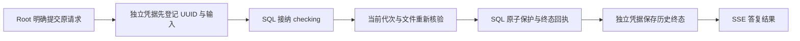

# 备份保留请求的独立恢复凭据

> 2026-11-09 续进：当前源码为维护协议 v5／凭据 v2，新增旧 SQL 回执盘点、Root 显式导入与恢复前整库覆盖检查，见[后续合同](backup-retention-history-import.md)及[操作指南](../guides/deploy/027-monitor-center/usecase-us9-backup-history.md)。下文 v4 描述保留上一切片的版本边界；原“下一工程项”已完成源码与自有隔离验收，现场旧历史是否已导入仍须实际盘点。

2026-11-09，T171 源码与自有隔离验收切片。继承[人工确认保留合同](backup-cleanup-retention.md)，只增加请求身份与历史事实的恢复保护，不改变文件删除、原清理令牌、数据库期限或插件准入权限。

## 位置、身份与容量

凭据为既有安装维护根中的 `storage-retention-ledger.json`，与独立恢复锚点共用安装身份、AnchorID、文件锁和原子写入工具。它不属于业务数据库、运维运行目录或恢复载荷，不推送到 Mac、S3 或任何新增目标，也不替代异地备份。维护根由既有安装配置决定，HTTP 不接受路径。

`powerx.storage-recovery/v4` 的绑定增加随机 `retention_ledger_id`；凭据正文必须与协议、安装、AnchorID、LedgerID 相符，并校验完整 SHA256。只接受当前用户所有、无其他用户权限、非链接的普通文件；有界读取、严格 JSON 和字段验证。写入在同一目录建立独占临时文件，完成文件 fsync、原子 rename 和目录 fsync，失败不清空旧副本。固定上限为 **4096 个手工请求、16 MiB**；临时替换也会占用空间。达到上限后拒绝新登记（HTTP 507），保留旧记录的读取和终结，不自动按天删除 UUID。它不是新的后台队列或可执行作业目录。

记录仅包含 UUID、安装 Scope、Actor、artifact/token、原核对版本、输入摘要、原因、登记时间、恢复绑定及历史结果／完成时间。没有 DSN、密钥、文件路径、SQL 或可执行命令。原因沿用既有人工操作审计字段，不把应用日志或业务表内容复制到此处。

## 执行顺序与中断

本合同不声称 SQL 与文件系统是一个原子事务。UUID 的独立登记发生在 SQL 接纳之前，历史终态在 SQL 已确认提交后保存；只有完整路径成功才答复已确认结果。原有请求／备份计划会话锁、发布与暂停、文件描述符、恢复代次和最终有界 SQL 事务继续有效。

| 中断位置 | 读取与后续处理 |
| --- | --- |
| 独立登记失败 | 不进入 SQL 接纳或保护；文件损坏、丢失、身份不符、容量满均明确失败。 |
| 独立登记后，SQL 尚未接纳 | 原 UUID 已保留；返回未知。读回显示独立 checking，禁止重新接纳同 UUID，不能判断为“从未执行”。 |
| SQL checking，当前独立代次／输入／SQL 行一致 | 原 Actor 可明确重试同一请求，在恢复锁内重新读取已有 SQL 历史，不重新接纳或补建行，仍须重新核验全部条件。 |
| SQL 历史丢失、不同或恢复代次变化 | 只读返回原身份与未知结果，`recovery_blocked=true`、`can_resume=false`；不修补 SQL、不重新保护、不将未知改写为历史未执行。 |
| SQL 终态已提交，独立结果保存失败 | 保持结果未知和独立 checking。GET 可读取匹配的 SQL 历史终态但不写文件；原 Actor 明确重试同 UUID 时仅补存已确认历史，不重新读取文件或写保护。 |
| 独立终态已保存，SQL 回放或不可用 | 直接读取独立历史；同 UUID 改内容／Actor 会冲突。原请求重放不重建 SQL 行，也不恢复 protected。 |

受控恢复的 `Begin` 在覆盖数据库前检查独立凭据完整性，并登记新恢复代次；维护报告增加 `backup_request_recovery_ledger` 检查。凭据损坏时阻止受控 SQL 覆盖。普通配置权威、能力准入、表监控等链路不依赖这份凭据；当前新功能不可用不能伪装成磁盘耗尽。

## API、页面与推送

复用现有三个 Root 人类 access 会话接口，无新增路由或授权：

- GET 原 UUID：`/admin/ops/backup/cleanup-retentions/:request_id`。
- GET 精确 artifact/token 的最近 20 条：`/admin/ops/backup/cleanup-reviews/:artifact_id/retentions?expected_token=...`，合并 SQL 与独立凭据并去重。
- POST 原请求：`/admin/ops/backup/cleanup-reviews/:artifact_id/retentions`，正文合同不变；不接受浏览器 verified、路径或任意目标。

回执新增 `record_source=database|maintenance` 与 `recovery_blocked`。`protected=true` 始终只表示该历史操作曾确认保护，不证明当前 Job、文件或数据库状态。`record_source=maintenance` 的终态不要求 SQL 回执表在线；checking 的代次／SQL 行无法匹配时只作历史核对。

SSE 的 `complete` 允许返回 `checking + recovery_blocked=true`，表示本次核对已结束但历史结果仍未知，不表示保护成功。其他 checking 不能作为 complete。客户端仍严格核对 UUID、artifact/token、原版本及原因。

备份中心原纵向“确认保留”分区标明“数据库记录／独立恢复凭据”。未知历史显示原因及原 UUID，并说明这不构成已发出任务排空的证明，不显示继续执行或新确认按钮，并允许关闭弹窗、切换分区和重新读取；不会将用户困在不能完成的请求流中。正常结果丢失仍保留原 UUID，只 GET 核对，没有自动重发或轮询。离开与身份切换释放流。

## 升级、旧历史与回退

维护启动可将完整 v1/v2/v3 锚点接续升级至 v4，保留 AnchorID 和 Epoch。先准备完整凭据文件，再登记 v4 binding，最后更新 epoch；中断重入复用原凭据和身份。v4 已登记后丢失文件不重建。原先未标记的首次安装保留既有明确初始化路径，不借损坏重建新身份。旧程序不认识 v4 时失败关闭；旧开发快照使用既有保留当前 Core 执行器的适配边界，不能降级协议或删除证明来回退。

本轮无新增数据库表、列、权限和迁移 payload；既有回执表仍由中央迁移挂载。启用源码需用户按既有维护流程重新编译／重启，Agent 本轮未替用户迁移或重启日常／线上。

**覆盖从 v4 的独立登记开始。** 升级不会将旧 SQL 历史伪装成已具备独立凭据。旧终态由原 Actor 明确重放原请求时可登记历史；旧 checking 没有独立接纳证明，只读标记 `BACKUP_RETAIN_LEGACY_HISTORY_ONLY`。恢复前应保留全部旧历史，不能以一个空的 v4 文件证明旧回执已全部迁出。

下一工程项是 T171 的**旧回执只读盘点、显式导入及覆盖证明**：先预览数量、来源和冲突，Root 明确提交绑定快照与 UUID 的导入；重复操作幂等，任何失败不提供虚假的“全部覆盖”证明，恢复前核对覆盖缺口。先在自有数据库和维护根实现／验收，不需要操作日常服务。跨代次未知意图的人工终结和解除原清理锁仍属后续 T172，不由本凭据自动处理。

## 验收与边界

[本轮证据](evidence/backup-retention-ledger-validation-20261109.json)包含文件损坏／丢失／链接／权限／容量／并发／升级中断，原生 PostgreSQL 的 SQL 接纳前与提交后故障，真实测试 schema 的 pg_dump/pg_restore，Root JWT／HTTP／SSE 和实际 Nuxt 桌面／窄屏明暗主题。Redis 传输使用 miniredis；受控备份产物不是整站业务恢复。临时进程与凭据必须收尾。

完整性摘要用于检测意外损坏，不是针对拥有维护目录写权限者的外部签名。外部工具覆盖维护根、整盘回退、主机损坏、独立备份丢失不由同机凭据解决。尚未完成旧历史全量覆盖、日常／生产部署、旧执行器现场交接、长期 S3/OSS、整站恢复及 7/14 天运行验收；T171／SG-11 不勾选完成。

代码映射：`storage_recovery/retention.go` 管理独立有界凭据；`anchor.go` 管理协议与恢复前检查；`backup_ops/cleanup_retention*.go` 实施顺序／历史解析；`backup_policy_control.go` 复用当前安装权威；`BackupRetainReview.vue` 与 `backupRetentionService.ts` 展示来源和阻止状态。
