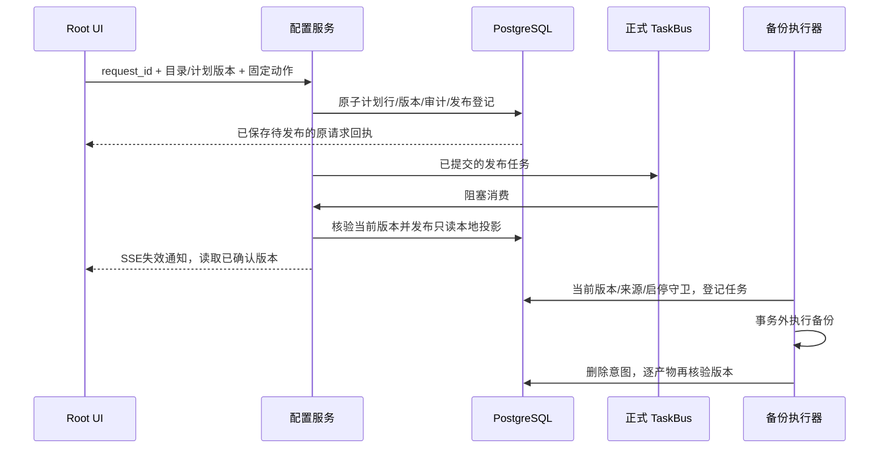

# 数据库备份计划的配置权威与执行保护

2026-11-07，SG-11 的数据库备份计划切片。系统快照、数据库期限、完整恢复时代次及商用全量门槛另行验收。未迁移日常数据库、未重启用户服务、未修改正式站。

## 权威与身份

复用现有 `ops_backup_policies` 为唯一可编辑计划表，保留既有 UUID／数字 ID 和历史产物引用。新增 `control_scope_id`、`control_revision`、`execution_fingerprint`；范围为当前 host＋filesystem＋installation。相同数据库中已有其他安装归属时拒绝接管，不把一条数据库计划当作跨部署配置。

统一控制域为 `database-backup-policies`。已有的 `ops_storage_control_revisions` 存不可变版本、操作者、请求 UUID 及目录快照；这是审计／发布依据，不是第二套独立编辑表。目录版本和单计划版本同时 CAS；同一事务提交计划行、当前计划唯一性、不可变回执及正式 TaskBus 登记。创建计划 UUID 等于创建请求 UUID，重放不新增行。

源数据库连接、备份目录和脚本目录只计算执行指纹，不将连接凭据写入正文。换库或换目录后旧计划不能执行，必须在新环境核对后重新保存并启用。指纹不代表实际恢复验证或脚本内容签名。

## 保存、发布与运行

迁移只添加列及约束，不自动改变旧启用状态。Root 显式接管时保存旧定义／标志的不可变来源快照，随后**暂停全部计划、清除当前选择、关闭自动恢复演练**；历史备份及作业不删除。此后定义保存也先暂停，启用及设为当前分别确认。只有已发布且启用的当前计划参与定时备份；启用的非当前计划可由明确执行入口调用。

正式发布产生 `backup-policy-control.json` 原子投影，绑定范围、版本、摘要、操作者和时间。它不能接受普通配置写入。读取计划行、当前配置与投影时使用同一有界事务锁，避免并发保存导致混合版本。执行时再次核验期望／确认／投影版本和原始不可变正文；未确认、来源变化、断库、丢失／篡改投影及数据库单独回滚均停止新准入和新删除，不回退旧配置。

备份只在有界守卫事务中登记作业和捕获计划版本，`pg_dump` 在事务外执行。暂停不强行抹去已经准入的备份结果；备份结束后仍按捕获版本重新核验，计划已变更就停止后续清理。当前完整作业沿用会话级作业锁，连接池需至少两条连接；配置守卫已验证单连接池，不将其等同于整个作业单连接可运行。

## 到期清理的安全边界

沿用份数／天数合同，保留最新成功及显式保护产物；不自动清理业务数据。每个删除候选先单独提交 `cleanup_state=pending`、唯一 `cleanup_token`，完整校验在配置事务外有界执行，删除前在当前计划守卫内复核路径、文件身份／大小／修改时间后删除，再软删产物登记。大产物校验不占用配置行锁；文件被替换则停止。历史作业记录保留。

删除尚未开始便失败时可清回意图；已经开始但提交／文件结果不确定时保留 `pending`／`unconfirmed`，停止自动重做并产生清理失败告警。不得手工清空标记后盲重试。需要先核对该 token、文件／校验和及数据库结果；只读核对 UI 已提供，自动完整校验／处理及解锁操作仍待后续实现，不能据文件存在／缺失直接确认清理结果。保护、恢复及清理继续复用同计划作业锁；跨 archive／snapshot 的统一引用和字节预算仍属 SG-07。

自动恢复演练在受控计划中暂不可启用，API 拒绝 `drill_enabled=true`；既有手动验证入口保留。2026-11-07 初始切片的捕获脚本只生成隔离文件；2026-11-09 另以真实 `pg_dump`／`pg_restore` 补验新版控制链，历史数据恢复与源库新值保留均通过，见[真实产物合同](storage-artifact-acceptance.md)。这仍不等于日常／生产部署、自动恢复演练或整站业务恢复。

## 固定 API 与 UI

前缀来自运行配置，以下路径相对 `/api/v1`：

| 方法／路径 | 输入／用途 |
| --- | --- |
| GET `/admin/ops/backup/policy-configuration` | 当前权威、目录／确认／快照版本、计划行版本、逐计划执行资格 |
| POST `.../adoptions` | `request_id,legacy_digest,confirm:true`，暂停式接管 |
| POST `.../changes` | `request_id,expected_revision,expected_policy_revision,policy_uuid,action,confirm:true`；动作仅 save/status/current |
| GET `.../requests/:request_id` | 原操作者的不可变请求回执，只读核对，不自动重发 |

`save` 接受完整 settings，`status` 仅接受 enabled，`current` 不接受 settings／enabled；新建时 policy_uuid 为空且单计划版本为 0。未知字段和超长正文拒绝。正式 [OpenAPI](../../specs/027-monitor-center/contracts/database-backup-policy-control.openapi.yaml) 为字段清单。

仅真实平台 Root access 用户会话管理；租户备份 RBAC、API Key、插件和 STS 不具备该权力。保持旧 `/admin/ops/backup`、`/admin/backup` 路由授权收口；旧计划写接口和 gRPC Upsert 在生产 DI 中返回 `BACKUP_POLICY_CONTROL_REQUIRED`，不隐式覆盖。此组为 `root_runtime_control`，不发布服务能力。

400 为参数／确认错误，409 为版本／请求／来源冲突，428 为未接管或旧合同，503 为权威不可用或提交结果待核对。503 不能证明没有提交。响应丢失后 UI 锁住后续写入，只用原 request_id 查询；404 也不自动新建请求。目录和单计划草稿版本不会随 SSE 自动前移，冲突须显式载入最新。

`/ops/backup` 高级设置与 `/monitor/storage` 数据库备份资源共用 `DatabaseBackupPolicies.vue`。列表只展示计划，表单按需弹层；版本／资格／错误在当前分区可见，SSE 重连同步，不使用常驻状态轮询。保持桌面纵向任务导航和窄屏选择器，关闭表单及切换分区保留草稿。

## 部署、故障与剩余门槛

集中迁移位于 `pkg/corex/db/database/migration.go`，现有 ops 模型挂载包含新增列和部分唯一索引。`MigrateBackupPolicyControlModels` 供隔离验收复用同一集中定义，不在构造器自动迁移。发布前先在备份的隔离副本完成迁移和维护演练，再通过授权维护窗口迁移日常／生产环境。

维护切换需停止旧二进制／旧执行器再启用新版；旧程序不理解新约束，仍可能写行造成漂移，新版对此失效关闭，不能承诺兼容双跑。不得删除控制行、换空运维目录或手改投影绕过保护。数据库和本地状态一起回滚的独立时代次保护、跨安装转移、旧执行器交接／回退仍属 T171，未自动完成。

[隔离验收记录](evidence/database-backup-policy-control-validation-20261107.json)区分 PostgreSQL／HTTP／SSE／浏览器证据与脚本仿真；未作为生产生效或真实恢复证据。[系统快照计划接管](snapshot-policy-control.md)已有独立切片；SG-07 预算／引用、SG-09 长期目标和 SG-11 其他门槛仍待完成。

2026-11-09 新增的[真实产物验收](evidence/storage-artifact-acceptance-validation-20261109.json)使用自有 PostgreSQL 集群、正式计划配置与 TaskBus 发布、实际备份／恢复脚本；已区分较早的脚本仿真证据。操作者启动的日常服务、策略及正式站均未改变。

代码映射：`backup_policy_control.go` 固定配置与执行守卫；`backup_control_repository.go` 计划行事务；`backup_ops/policy_admission.go` 作业准入；`policy_cleanup.go` 删除意图；`ControlBinding.Commit` 连接现有统一事务／TaskBus；bootstrap 共享 PolicyService／JobService，传输层不单独组装可写旧服务。

## 清理待核对（2026-11-09）

备份中心 → 数据库备份 → **备份清理待核对**展示现有 `pending/unconfirmed` 意图。列表包含软删／孤立记录，以免问题被过滤后误认为“没有待办”；不完整记录不可检查。顶层提醒可从其他分区进入，列表失败显示“安全状态未知”，保留已载入记录。Root 权限撤销或身份切换会清理旧数据、停止请求；不展示给租户管理员或插件身份。

[只读接口合同](backup-cleanup-review.openapi.yaml)为 `GET /admin/ops/backup/cleanup-reviews` 与 `GET /admin/ops/backup/cleanup-reviews/{artifact_id}?expected_token=...`，服从安装配置的 API 前缀。分页 1～100000、每页 1～100；未知／重复参数拒绝。Service 与 HTTP 双层检查真实平台 Root。缺表／列返回专用 503，原始 SQL、文件路径和异常不回显。没有新增模型、迁移、授权范围或能力调用准入依赖。

检查冻结产物 ID 与清理 token，读取前后复核状态、来源 URI、登记大小／校验值及记录／保护状态；变化返回 409。仅对既有登记根内的 dump、清单和校验文件执行有界 Lstat；拒绝路径逃逸、软链接、硬链接及非普通文件。不读取文件内容，不验证清单语义或 SHA256，不把元数据检查包装成后台完整校验作业。响应固定 `read_only=true, content_verified=false`；返回存在但未验证、全部／部分缺失、大小变化、不安全、不可读或元数据异常。未知标记、数据与文件均不修改。

复用备份共享 SSE 的 `backup_cleanup` 失效通知；意图登记／结果、清理完成及保护变化从原有服务发出通知。初次进入、手动刷新、事件和重连可读列表，不定时查询。事件同步后发现记录变化或状态无法确认才标记陈旧，不替换弹窗的冻结 token 或自动重新检查；同记录的正常重连同步保留正在进行的完整读取。打开原备份任务可使用已有保护／下载入口；保护仍服从原作业锁与完整校验，可能被未知意图拒绝，本分区不绕过该边界。

本轮完成源码、原生隔离 PostgreSQL／JWT／HTTP／SSE 与真实 Nuxt 浏览器验收；证据见 [20261109 核对记录](evidence/backup-cleanup-review-validation-20261109.json)。未迁移日常／生产库，未重启用户服务，未确认任何现场清理，也未完成资源接管。按需完整校验见下一节；自动哈希核对、确认清理／回滚／解锁以及跨资源统一引用仍待独立合同和任务实现。

## 按需完整性诊断（2026-11-09）

在清理核对弹窗内用“文件现状／完整性校验”纵向分区；窄屏使用选择器，一次只显示一个阶段。完成元数据检查后，Root **明确点击**“开始完整校验”，通过上述 OpenAPI 的 GET `.../cleanup-reviews/{artifact_id}/verification?expected_token=...` 接收一次 SSE。它是请求绑定的诊断读取，不是提交后脱离页面运行的后台任务：不新建业务队列、任务表、回执或持久证明，不自动重连和重读；长任务消费者仍按正式 TaskBus 合同，未被此接口替代。

计算总时限五分钟，受 JWT 到期和请求取消限制。初次数据库读取、连接／锁获取、后续元数据读取及解锁分别有三秒边界；既有策略会话锁在读取期间保留，没有长 SQL 事务。连接池上限为 1 时此诊断接口快速返回专用 503，不等待锁连接造成自锁；需要至少两条连接。这不是业务调用门禁，未给能力调用或旧配置就绪检查增加依赖。检查冲突返回 `BACKUP_REVIEW_BUSY`，旧 token／记录变化返回冲突。

从 `/` 起逐级目录描述符打开登记路径，禁止所有层级软链接及硬链接／非普通文件；固定文件描述符读取，不按传入路径读取任意文件。dump 按捕获大小完整 SHA256，限制读取字节数；两份 sidecar 各至多 64 KiB，核对文件名、Job／Policy、大小、SHA256、合同与格式。前后复核文件身份／大小／修改时间／链接数及当前路径、清理 token、Job／Policy 关联和数据库快照；不一致不能返回成功。缺少旧 sidecar 时可以看到 dump_matched，但不算完整 verified。检查不会导出文件、显示来源路径／数据库名／SQL 或关闭数据库审计。

SSE 的 progress 只表示已读取字节，不是完成证明；必须收到完整、身份与 token 匹配的 complete 才能呈现结果。`content_verified=true` 仅用于 verified，并要求 dump 与登记值及两份 sidecar 一致。中断、提前 EOF、错误帧或失效身份没有成功结果；手动停止、关闭弹窗、离开页面或切换身份会取消流，取消后策略锁可再次获取。弹窗分区切换保留读取／结果；共享清理 SSE 先同步列表；仅确认当前记录变化或无法确认其状态时标记陈旧并停止正在读取的诊断，正常重连的同记录同步不打断读取，不能替换冻结 token 自动重做。

结果只是本次文件一致性观测，不是实际 pg_restore／业务恢复通过，不写入可供删除使用的持久证明。`cleanup_state/cleanup_token`、原数据与文件保持，**成功也不能自动解除未知意图或重做删除**。人工确认保留／完成清理需后续独立的 UUID／CAS／审计／持久回执合同，不能相信前端的 verified 布尔值。

[完整性诊断验收](evidence/backup-cleanup-verification-validation-20261109.json)覆盖原生 PostgreSQL／JWT／HTTP／SSE、同大小损坏、清单错配、链接／FIFO、替换／增长／删除、取消、单连接池快速失败、锁竞争及释放和两种屏幕／主题。日常／生产未部署、迁移或接管；T155 长期在线目标、现场执行器交接、整站业务恢复及长期门槛仍未完成。

## 人工确认保留并保护（2026-11-09）

[T172 本轮合同](backup-cleanup-retention.md)已实现请求 UUID／原意图版本绑定、服务端再次完整核验、全局及计划暂停、活动任务排除、事务内源行锁／CAS、Job 保护与持久终态回执的同事务提交。不会清空原 cleanup_state/token，也不删除文件或释放容量。新表只在本功能检查结构／唯一性，不加入配置或插件能力准入；系统表清单可观测它且普通清理排除。

弹窗的第三分区“确认保留”可填写原因及明确确认，未知结果保留原 UUID／输入并锁定源和弹窗关闭；共享 SSE 或原请求 GET 可核对，不自动重发。历史回执不是当前完整性或删除许可。新增 dev/test 精确 scope `backup-cleanup-retention`；正式升级仍走完整受控计划，源码载荷校验已更新。日常／正式站未迁移或重启。[验收记录](evidence/backup-cleanup-retention-validation-20261109.json)区分隔离与实际部署。新回执的恢复／升级联合验收继续列入 T171，已删除结果确认、解除意图、外部接管和长期现场门槛未关闭。
