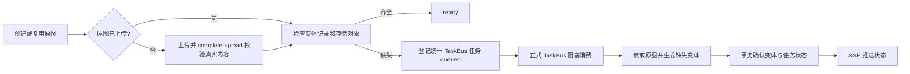

# PowerX Media 标准图片预览

PowerX Media 负责从已存储原图生成通用 `preview`、`thumbnail`、`thumbnail_64`，以及资产关联和规则检查；投递、尝试次数、租约、失败重试、恢复和历史统一归现有 TaskBus。Framework 负责正式客户端与 local/delegated 适配；插件负责业务关联、状态展示与鉴权读取，不能把 Core 的原图上传成功解释为预览已完成。

## 调用兼容与范围

自动生成是 Core 对原上传流程的后台增强：插件继续调用既有 CreateAsset → presign/upload → CompleteUpload；命中原图去重则继续调用 CreateAsset 复用。生成不要求 Framework 升级，不要求新增 ensure 调用，也不要求额外 image_derivatives read/ensure grant。原图业务状态和已有 Media 授权边界保持不变。

Host 响应的 `derivatives` 是可选字段；旧客户端可以忽略。接管 Core 预览的客户端需要映射该字段中的状态、错误与 `items[].variant_uuid`，再通过既有 GetVariant／下载接口获取实际 MIME、大小与图片。缺少该字段不能解释为预览已经成功。Framework 只需按消费需要增加 DTO 字段，无须为自动生成增加 Service 方法或新队列。

GetAsset 只返回当前状态，不会检查存储对象或启动补图。重复上传必须到达现有 CreateAsset 的复用入口；插件若在自身去重分支提前返回，Core 无法感知这次操作。

## Core 已实现的流程



- `CompleteAssetUpload()` 在真实字节、大小、MIME、SHA 校验成功后触发 ensure。校验失败的原图不进入生成任务。
- `CreateAsset()` 命中已就绪原图时仍执行 ensure；重复创建不需要再次上传原图。Core 本地 direct upload 回填也触发检查。
- ensure 同时检查变体记录和实际存储对象；文件丢失时利用原图修复，保持变体 UUID。已有可用的插件变体继续复用。
- 兼容旧插件仍自行创建预览：如果同名变体已经由 Core 生成，`CreateVariant` 返回该 `ready` 结果，调用方应使用返回的 MIME／大小而非假定自己的编码结果；插件自行上传的既有变体仍严格检查 checksum／大小／MIME 冲突。插件创建变体和 worker 结果接纳使用同一父资产行锁；有效的插件上传进行中只延后生成，不消耗失败重试次数。
- `GetAsset()`、Host 创建／上传确认响应新增 `derivatives`；原有 `status`／`UploadState` 仍表示原图上传状态。列表可使用独立状态接口按需读取。
- 原图、归属、原上传约束、失败上传的票据版本与重传语义保持不变。预览生成失败不会将原图改为上传失败。

## 集中预览规则

当前规则版本 `standard-image-v2`，规则仅在 Core `imageProfiles` 定义：

| 变体 | 最长边 | 编码 |
| --- | --- | --- |
| preview | 1600 px | JPEG 原图输出 JPEG，质量 85；PNG／GIF／静态 WebP 输出 PNG |
| thumbnail | 320 px | 同上 |
| thumbnail_64 | 64 px | 同上，文件不超过 32,768 bytes |

保持比例，不放大小图；PNG／WebP 保留透明度；JPEG 按 EXIF Orientation 旋转显示；GIF 取第一帧。原图及原始元数据保持不变，派生图不复制 EXIF。

支持 JPEG、PNG、GIF 和静态 WebP（VP8／VP8L／含 alpha 的 VP8X）；WebP 派生图输出 PNG，原图保持 WebP。动画 WebP 不取首帧伪装成功，解码失败返回 `MEDIA_IMAGE_DECODE_FAILED`。SVG、HEIC 等明确返回 `unsupported`，不伪装为生成成功。外链不后台抓取，返回 `unsupported`。算法为面积平均缩小，生成规则变更须提升 recipe 版本并验收已有图的兼容行为。2026-11-10 的大图输入修复保留原有算法与 `standard-image-v2`，已有有效变体继续复用。

### 高清原稿与处理预算

原稿上传、保存及下载与预览派生独立。以下配置只限制派生任务，不压缩、覆盖或删除原稿，也不替代上传接口的文件大小及校验和检查：

```yaml
storage:
  image_derivatives:
    max_source_bytes: 67108864   # 64 MiB 的派生源文件上限
    max_pixels: 80000000        # 像素上限；还须满足下面的内存预算
    max_working_bytes: 536870912 # 每任务 512 MiB 保守估算预算
    max_parallel_jobs: 1        # 同一 MediaService 的最大同时处理数
```

未配置该区块时采用上述默认值；已有配置文件无需为缺省字段增加环境变量。启动配置校验拒绝非法数值。Core 主服务、显式派生维护工具及媒体栈均接收同一配置；本地／S3 使用相同处理限制。`max_parallel_jobs` 是处理并发上限，不自动创建额外 worker。

完整解码前检查真实图片头、像素数和估算预算：`宽×高×8 + 宽×24 + 压缩字节×2 + 两份1600×1600 RGBA缓冲 + 16 MiB余量`，覆盖 16-bit PNG、扫描行及输入缓冲。像素、源文件或预算分别超限时返回 `MEDIA_IMAGE_PIXEL_LIMIT`、`MEDIA_IMAGE_BYTE_LIMIT`、`MEDIA_IMAGE_MEMORY_LIMIT`；配置非法返回 `MEDIA_IMAGE_CONFIGURATION_INVALID`。因此像素上限不是全部图片都能处理的承诺，实际须同时满足预算。预算是内存估算，不是操作系统 RSS 硬上限；总资源须考虑处理并发及 Core 其他业务。

处理槽位等待及存储／解码读取遵守任务取消，保留既有 90 秒处理上下文、TaskBus 租约、重试及事务接纳机制。超限任务明确失败，原稿仍为 `ready` 并可按原权限下载。历史失败任务不会因 GET、启动或升级自动重试；部署后须使用既有 ensure 的 `retry_failed=true` 显式重试，或走后文的已审阅回填流程。不需要数据库迁移、调整授权或修改 Framework 合同。

本机真实图片受控验收使用 `POWERX_MEDIA_LARGE_IMAGE_FIXTURES=/path/to/images go test ./internal/service/media -run '^TestLargeImageOriginalFixturesThroughTaskBus$' -count=1`（在 backend 目录执行，且不设置 `POWERX_MEDIA_TEST_DSN`）。仅只读原文件；上传、TaskBus 与结果读取使用临时 SQLite、miniredis 和临时对象目录。覆盖原稿哈希、三种变体真实像素／大小／哈希、完成状态及复用。受控验收不等同于已经部署或实际租户浏览器验收。

## 经 Core 管理前端访问事件流

浏览器经 `/_p/<plugin-id>/api/**`、`/__up/_p/<plugin-id>/api/**` 或 Core 的 `/api/v1/**` 代理访问时，管理前端必须原样转发调用方的 `Accept` 请求头。插件可以在同一个元数据读取入口用 `Accept: text/event-stream` 显式协商状态事件流；普通 JSON 和图片读取保留各自的内容协商。不能把响应类型改成 JSON，也不能将 JSON 响应标记为 SSE。

当前 h3 的 `proxyRequest` 默认过滤 `Accept`，因此 `00-proxy-plugins.ts` 与 `01-proxy-api.ts` 显式补回此头；其余代理头仍按原有安全规则处理。备份与插件安装事件保留既有的下游关闭 → 取消上游机制。此修复不改用户身份、RBAC、插件 Service grant 或媒体生成任务。

排障时，HTTP 200 不等于状态订阅成功：同时检查响应 `Content-Type: text/event-stream` 和实际事件帧。若客户端报告 `ASSET_PREVIEW_STREAM_INVALID`，且 `stage=content_type`、`content_type=application/json`，先检查代理是否丢失内容协商。已有原稿和变体的完成状态须分别核实，不能据此重传原稿、重试生成或修改数据库。

真实 h3 中间件回归见 `web-admin/tests/unit/proxy/content-negotiation.spec.ts`：覆盖插件／直通／Core API 的事件流、JSON、图片 Accept、授权头、上传字节、首帧及时转发，以及备份／安装事件断开后的上游释放。测试使用临时本地监听并在结束时关闭，不替代安装实例中的真实图片页面验收。源码、生产构建与隔离 HTTP 验收结果见 [2026-11-12 验证记录](evidence/media-preview-proxy-validation-20261112.json)。

## 状态与重试

响应形如：

```json
{
  "asset_uuid": "已上传的资产 UUID",
  "upload_state": "ready",
  "status": "queued",
  "recipe": "standard-image-v2",
  "attempts": 0,
  "retryable": false,
  "items": [
    {"variant": "preview", "status": "queued"},
    {"variant": "thumbnail", "status": "queued"},
    {"variant": "thumbnail_64", "status": "queued"}
  ]
}
```

| status | 含义 |
| --- | --- |
| not_requested | 存量原图尚未请求标准预览 |
| waiting_upload | 原图尚未确认上传 |
| waiting_source | 原图记录已就绪，但源对象不可用；检查存储后重新 ensure |
| queued / processing | 已持久登记／正在执行；不等于生成完成 |
| ready | 本配方三个标准变体均有效并有 variant_uuid |
| failed | 解码／限额等永久失败，或瞬时故障达到重试上限 |
| scheduling_failed | TaskBus 不可用或投递耗尽；原图仍保留，恢复后重新 ensure |
| unsupported | 本版不支持该格式或外链 |
| unavailable | 状态持久层等依赖不可用；不能解释为预览成功 |

瞬时生成失败最多尝试 3 次，重试由 TaskBus 延迟投递。解码失败、校验和不符、超限直接失败。普通重复上传不会无限重启失败任务；显式 `retry_failed: true` 可启动一次新的有限重试周期。队列提交失败可以通过后续 ensure 或启动恢复重投。

同一租户同一资产通过父资产行锁复用当前未完成任务。状态、尝试次数、错误、时间统一保存在已有 `event_task_histories`，投递与租约仍由正式 TaskBus Stream 驱动管理。共享历史装饰器校验现有 TaskBus 租约，拒绝旧投递结果，并把业务变体更新与任务完成放在同一个事务中。启动补投也由统一驱动扫描共享历史完成，Media 没有私有任务恢复扫描、重试计数器、RunToken 或租约期限。

原资产 `meta.image_derivatives` 仅关联 `task_id`、`recipe`、`source_checksum` 和缺失变体名称；不保存任务状态、尝试次数、错误或租约。显式重试或补图创建新的统一任务记录，历史保留，资产指向当前任务。生成先写独立对象，再由共享任务完成事务接纳变体；未接纳对象进行清理，原图始终保留。

2026-10-18 架构修正：已移除上一版提出的 Media 专用任务表及迁移登记，不能按旧说明为 Media 创建独立任务表。

## HTTP 与类型化服务合同

路由均在现有 `server.api_prefix` 下挂载。以下使用 `<APIPrefix>`，默认 `/api/v1`；前缀迁移规则见 [共享规范](../standards/_shared/api-prefix-and-versioning.md)。

| 方法与路径 | 权限 |
| --- | --- |
| GET `<APIPrefix>/admin/media/assets/{uuid}/derivatives` | 用户 JWT + tenant + RBAC，读取状态 |
| POST `<APIPrefix>/admin/media/assets/{uuid}/derivatives/ensure`，body `{}` 或 `{"retry_failed":true}` | 用户 JWT + tenant + RBAC，检查／补齐 |
| GET `<APIPrefix>/admin/media/assets/{uuid}/derivatives/events` | 用户 JWT + tenant + RBAC，SSE |
| GET `<APIPrefix>/tenant/media/assets/{asset_uuid}/derivatives/events` | STS／API Key + tenant + 已发布／登记／授予的 image_derivatives.read，SSE |

两种身份的 SSE 复用同一 Redis 变更通知与流传输实现。先订阅再读取当前状态，后续仅在通知到达时读取；心跳只保活，不查询状态或数据库。连接最长一分钟且不超过 JWT 期限，发送 `reconnect` 后关闭；重连需要重新鉴权并同步快照。客户端离开或取消请求时释放 Redis 订阅。

服务入口在初次订阅和每次状态发送前实时检查 capability published、当前租户 registration、STS／API Key 的 live grant。撤权后不再发送状态，收到变更通知时发送无状态数据的 `invalidate` 并关闭；无变更时最迟在连接期限结束时关闭。事件凭证只放 Authorization，不接收 query token／tenant override；Admin SSE 继续仅用于用户 JWT／RBAC。

订阅是状态展示的可选接入，不是后台自动生成的前置条件。通知仅用于同步当前快照，不保证回放每个中间状态。首次载入、手动刷新、事件到达与重连允许调用 GetAsset，页面不得常驻轮询。Framework／插件若要页面自动从 queued 更新为 ready／failed，仍需接入此订阅或经鉴权的现有事件桥接。

服务态使用两个独立能力：

- `com.corex.media.image_derivatives.read`：类型化 `status` 及可选服务态事件读取。
- `com.corex.media.image_derivatives.ensure`：仅 `ensure`，允许显式重试。

这两个显式扩展能力均有固定 `core://media/image-derivatives`、`INVOKE`、`service_actor`。API Key 必须具有显式 service grant；运行时检查 published capability、当前租户 registration 和 live STS/API-key grant，撤销即时生效。Admin REST 权限不充当服务 grant。

通过现有 `<APIPrefix>/tenant/invocations` 调用：

```json
{
  "capability_id": "com.corex.media.image_derivatives.ensure",
  "preferred_protocol": "core_internal",
  "payload": {
    "body": {
      "operation": "ensure",
      "asset_uuid": "原图资产 UUID",
      "retry_failed": false
    }
  }
}
```

读取时使用 read capability，body 为 `{"operation":"status","asset_uuid":"..."}`。租户只从已认证上下文获取。拒绝任意 endpoint、HTTP method、headers、query、tenant override 或 raw proxy payload。变体读取继续使用现有 UUID 型 Media Host variant/download 合同，不公开存储凭证。

正式定义：[OpenAPI](../../specs/001-media-storage/contracts/image-derivatives.openapi.yaml)、[Capability](../../backend/config/platform_capabilities/media-image-derivatives.yaml)。

## 安装、验证与接入边界

本次不新增数据库表或列，复用现有 `media_assets.meta`、`media_asset_variants` 和统一 `event_task_histories`。统一任务表原本就在 Core 迁移清单中；已具备队列底座的环境不需要执行 Media 专项建表迁移。没有删除、清空原数据或批量改写原图操作，本轮没有改动现有业务库或替换日常服务。

正式能力仍需按现有升级方式更新目录（不会自动授予调用方权限）：

```sh
make capability-seed
```

随后启动新 Core，检查配置的 Redis TaskBus 与原图存储均可用。原上传／复用继续依赖已有 Media capability 和授权，不因自动生成而要求新增 derivative grant。

只有调用显式状态／事件或人工重试扩展时，才需要在相应租户发布／登记并按最小权限授予新能力：订阅只需 read；显式补齐／失败重试才需 ensure。seed 不会替调用方补 grant。验收扩展入口时必须检查实际服务凭证的 `grant-status`，不能用隔离测试 Key 替代实际 Host 凭证。

验收用一张真实 PNG：创建并上传原图、确认上传，观察 `upload_state=ready`、`derivatives.status=queued/processing`，随后通过 SSE 或一次手动查询确认 `ready`；通过受鉴权资源接口读取 preview／thumbnail。重复创建应复用同一资产；删除测试预览对象后再次调用原 CreateAsset 复用，应从原图补齐且不重传；不需要额外 ensure grant。验证跨租户读取被拒、撤销 service grant 后调用被拒、无效图片失败不影响原图上传状态。

外部仓库后续接入：Framework 按需给 HostAsset 增加可选 derivatives DTO；不强制新增 ensure/status 方法，不把升级 SDK 当作 Core 自动生成的上线条件。AI Craft local 保留本地生成；delegated 停止自行编码，复用原创建／上传／查询接口消费 Core 变体，提前去重分支改走 Core 创建／复用。已有 Variant DTO 含 MIME／大小，插件须保存返回的实际值，而不是本地编码的假定值。

这些插件流程调整与状态推送消费尚未实施；Core 无法替一个未到达创建／复用入口的插件分支发起请求，也不会让浏览器到插件的已发生文件传输消失。

源码与隔离验证证据见 [验收记录](evidence/media-image-derivatives-validation-20261018.json)。尚未执行安装实例与 AI Craft 实际商家上传验收。

## 代码映射

- `backend/internal/service/media/image_derivatives.go`：统一 ensure 与状态。
- `backend/internal/service/media/image_derivative_worker.go`：业务消费与图片生成。
- `backend/internal/service/event_fabric/task_queue/stream_history.go`：正式 TaskBus 的共享历史、重试、恢复与结果接纳。
- `backend/internal/service/media/image_renderer.go`：尺寸、字节限制、缩放与编码。
- `backend/pkg/corex/db/persistence/repository/media/derivative_repo.go`：资产与变体行锁，不持有任务生命周期。
- `backend/pkg/corex/db/persistence/model/event_fabric/task_history.go`：复用既有统一任务历史模型。
- `backend/internal/service/media/image_derivative_invoker.go`：固定服务能力入口。
- `backend/internal/transport/http/admin/media/derivative*`：管理 HTTP 与用户态 SSE。
- `backend/internal/transport/http/openapi/media/derivative_events.go`：可选插件服务态 SSE。
- `backend/internal/transport/http/mediaevents/stream.go`：两种身份共用的通知传输与有界连接。
- `backend/internal/transport/http/openapi/media/image_derivatives_test.go`：既有 Host 上传 → 自动任务 → 变体读取／重复补图及服务通知授权回归。


## v2 升级与历史复用（2026-10-22）

配方要求的规格与每张变体的生成配方分别记录。v1 的 preview/thumbnail 编码规则与 v2 相同；来源校验和匹配、记录有效且存储对象存在时原位复用，不改 UUID、文件、生成元数据或票据版本。只补缺失规格，原图每个执行批次只解码一次。早于校验和约束的历史记录，由显式 ensure 读取有界原图字节计算并锁内补记 expected_checksum；已有 metadata 校验和必须匹配。dry-run 只在计划副本计算，不写库，不重传或修改原文件。无法证明来源的旧变体重新生成，不把空校验和当成有效来源证明。thumbnail_64 上限 32,768 字节，超限为 MEDIA_THUMBNAIL_64_BYTE_LIMIT，不降级到大图。显式上传该规格也必须有 checksum，并校验实际 JPEG/PNG 字节、大小和解码尺寸；不能靠文件名或客户端 metadata 声明尺寸。

响应 recipe 表示目标配方 v2；items 由规格清单计算，数组顺序不属于协议。completed 任务本身不能使一个缺少 variant_uuid 的项目变为 ready。缺少历史新规格时为 not_requested；v2 已完成却缺失结果记录时为 unavailable / MEDIA_DERIVATIVE_RESULT_INCOMPLETE，GET 不创建任务；其他 ready 项可以独立读取。项目失败可附 error_code/retryable；原图顶层上传状态独立。

新任务使用 image-derivatives-v2 subscriber；旧任务继续使用 image-derivatives-v1，旧 worker 不会领取 v2。新 worker 在 v1 完成事务内同时登记 v2 后继，只补 64px；完成后尚未投递就重启时，统一历史恢复仍能找回该后继。显式 ensure 可在父资产锁下替换关联，旧投递因 task_id/recipe/source_checksum/统一租约检查无法覆盖后继。每批缺失结果通过一次统一 TaskBus 完成事务接纳；本批失败不接纳暂存输出，但此前 ready 图继续可读，重试仅生成仍缺失项目。

### 显式维护命令

从 backend 目录运行，使用可信运维身份持有的目标 Core 配置与数据库凭据；这是离线维护入口，不是普通插件权限升级。默认覆盖当前 Core 环境全部租户的历史资产；`--tenant` 仅作为可选缩小范围的筛选，不要求维护人员逐租户执行。每张资产和任务仍保留自己的 tenant_uuid，禁止通过 Web 请求传入任意数据库配置。普通上传仍不需要 ensure grant；插件人工补图继续使用现有 ensure 能力。

```sh
go run ./cmd/media_tool derivatives-backfill --config /path/to/core.yaml --report /path/to/scan.jsonl --batch-size 50 --concurrency 2
```

默认 dry-run，仅读取数据库和存储，不连接 Redis、不登记任务、不运行完整应用启动、插件、seed 或 worker。历史记录缺少来源校验和时，会有界读取原图计算 SHA-256，仅用于内存中的计划，不落库；因此只读扫描仍可能产生原图下载流量。维护命令要求本地存储目录已存在，不创建缺失目录。全量执行须使用已审阅的 --plan 并增加 --dry-run=false --confirm，不能无清单直接全局写入。支持 --assets <uuid1,uuid2>、--after-id <最后完整输出ID>、--through-id <固定上界>、--retry-failed；--limit 0 是默认值，表示完整处理当前环境的固定快照范围。按递增 ID 扫描并固定高水位，避免并发上传令范围不断扩张。并发限制 1..8，批大小 1..200，默认分批扫描直至固定快照范围全部处理完，不会在100条或某个租户后停止。LIMIT 非零只用于显式抽样或受限执行。

输出 JSONL asset 和 summary：would_enqueue、submitted、active、skipped、failed、source_missing。submitted 表示任务已登记，不能当生成成功；通过原状态/SSE 观察最终结果。临时存储故障归 failed，不当成 source_missing。每条 asset 输出也包含 through_id。中断可从最后完整记录 ID 及其 through_id 继续；进程突然退出尚未输出的已登记任务，重跑仍通过 ensure 去重。失败记录可按 assets 重试，不能仅推进游标后丢弃失败清单。不要求重传原图。

### 扫描清单 → 确认执行

Core 托管的资产统一使用此维护流程，包括 Core 本机磁盘和对象存储。AI Craft 自己管理的本地资产由插件自己的工具处理。本流程只补派生资源，不迁移业务关联或存储位置；不挂到 make migrate、应用启动或页面读取。

在仓库根目录运行以下两个入口。REPORT 的父目录须已存在，报告以 0600 独占创建，不覆盖旧文件；相对路径均相对于仓库根目录。CONFIG 必须指向目标环境已有的可信配置，命令读取相同 installation.json 环境 ID。

```sh
make media-derivatives-scan CONFIG=/path/to/core.yaml REPORT=/path/to/scan.jsonl BATCH_SIZE=50 CONCURRENCY=2
make media-derivatives-apply CONFIG=/path/to/core.yaml PLAN=/path/to/scan.jsonl CONFIRM=1 BATCH_SIZE=50 CONCURRENCY=2
```

扫描只写指定的本地报告文件，不修改数据库、原图、变体或队列。JSONL 包含：

- `kind=plan`：`media_derivatives_backfill_plan.v2`、environment_id、scope=all_tenants（默认）或 tenant（显式筛选）、可选 tenant_uuid、目标 recipe、创建时间及资产/ID/limit 范围。
- `kind=asset`：资产 UUID、实际所属 tenant_uuid、工具内部扫描 ID、through_id、缺失规格、来源 source_checksum、outcome/error_code。
- `kind=summary`：全局统计、tenant_count、固定上界、最后扫描游标、`complete=true`。默认 LIMIT=0 会扫描完整快照；只有显式 LIMIT=100 等限制时，complete 才只表示受限的这次扫描正常结束。

执行只提交报告中 `would_enqueue` 的候选 UUID；扫描失败、源文件缺失和已跳过项不自动加入执行范围。扫描有 failed 时命令返回非零，完整报告中的其余候选仍可审阅后执行；源文件缺失不能靠重复提交恢复。汇总保留 `scan_failed` 和 `scan_source_missing`，异常明细继续查看原扫描文件。损坏、未完成、重复、统计/范围不一致、配方不匹配的清单一律拒绝。执行可选 TENANT_UUID 仅用于核对单租户清单，不能把全量清单改成单租户执行；拒绝 ASSETS、AFTER_ID、THROUGH_ID 等范围覆盖。

执行默认保存 `<plan>.progress.jsonl`，也可以用 `PROGRESS=/path/to/progress.jsonl` 指定。进度合同为 `media_derivatives_backfill_progress.v2`，绑定清单完整字节 SHA-256、环境、全量/筛选范围和配方，每条结果 fsync 后才推进。**扫描游标与执行进度完全独立，执行从候选 UUID 开始，不使用扫描结束的 after_id。** 重复相同执行命令会跳过已经 submitted/active/skipped 的项；LIMIT 限制本次尝试的候选数，未处理完时重复同一命令继续。不要编辑清单、换用其他清单的进度文件或删除执行进度来表示任务重试。

执行进度使用 Linux/macOS OS 文件锁，同一文件的并行执行明确失败，进程退出时自动释放。中断后原命令可继续；验证文件头后可丢弃未写完整的最后一行，其对应任务由现有 ensure 去重。文件头损坏或完整行损坏不会被自动修复。`failed_assets`、`source_missing_assets` 和剩余候选在 execution_summary 中单独列出，失败返回非零，scan_by_tenant 汇总所有扫描租户（包含源文件缺失等异常），by_tenant 汇总各租户候选、提交、失败和剩余数量；单个租户的资源异常不会中断其他租户的处理。人工允许重新开启失败任务周期时显式增加 `RETRY_FAILED=1`；已经成功提交后才异步失败的任务，需重新扫描并用新清单确认重试。

任务提交前在父资产锁内复核来源校验和，以及当前缺失规格是否仍属于审阅范围。其他预览图在扫描后丢失、来源改变等情况返回 `MEDIA_BACKFILL_PLAN_CHANGED`，须重新扫描审阅；已被其他任务补齐的规格直接复用。`submission_complete=true` 只表示当前清单候选已完成提交/复用，**不代表图片生成完成**；最终仍通过状态/SSE 和实际 variant_uuid 读取验证。运维中止提交不会取消已经入队的任务，原图和已有可用派生图保留。

扫描更多分片时使用新 REPORT，并传入上次扫描输出的 AFTER_ID 与 THROUGH_ID，固定同一上界。扫描中断产生的报告没有 complete=true，不能作为执行清单；可以重扫原范围，或按最后完整 asset 的游标和 through_id 创建下一份报告，再将中断片段涉及的候选单独重扫。不要把失败清单遗落在已推进的游标之前。CONCURRENCY 限制维护扫描/提交并发，实际图片生成并发继续由 Core worker 配置控制。

发布包已包含 media_tool。无需 Go 工具链时，可给 Make 指定 `MEDIA_TOOL=/path/to/media_tool`。无源码 Makefile 的部署环境，在 backend 工作目录直接执行等价命令（路径建议全部使用绝对路径）：

```sh
/path/to/media_tool derivatives-backfill --config /path/to/core.yaml --report /path/to/scan.jsonl --dry-run=true
/path/to/media_tool derivatives-backfill --config /path/to/core.yaml --plan /path/to/scan.jsonl --dry-run=false --confirm
```

全量入口的受控回归记录见 [media-derivatives-maintenance-all-tenants-validation-20261022.json](evidence/media-derivatives-maintenance-all-tenants-validation-20261022.json)。单租户诊断可额外加 TENANT_UUID，但全量修复不需要列出租户。维护合同本轮为 v2，旧 v1 清单/进度不能推断为全量范围，须重新扫描生成 v2 清单。目标环境补图须由维护人员按实际配置扫描、审阅后执行。

### 环境隔离与发布顺序

TaskBus Stream、delay、dead-letter、dedupe、lease、fence 和 retirement 均按稳定命名空间隔离；共享历史结果接纳也包含 namespace，跨环境租约不被接纳。派生 SSE 的 Redis Pub/Sub 频道使用相同命名空间。心跳不读取状态。

安装态作用域直接使用环境管理已有的环境 ID（`installation.json.id` / `active_environment_id`），物理前缀统一为 `powerx:<环境 ID>:`。不再配置 `queue.namespace`，不从数据库连接或 dev/prod 标签派生另一套身份。Core 与 `media_tool` 读取相同环境记录，数据库凭据和 Redis DB 变化不改变作用域；缺少合法环境记录时维护命令报错，不创建另一套 ID，也不降级为共享队列。

部署时先停止旧版本 worker，固定并核对正式/开发身份，再启动新版本；共享 SQL 历史恢复各自未完成任务到新命名空间。新 worker 同时恢复 v1/v2 的任务记录，不扫描所有资产。旧 Redis 键不自动删除或 FLUSHDB；确认归属与历史恢复后由运维单独处理。v1 已完成但还没有 64px 的历史资产通过上述显式命令补齐。修改 namespace 后，历史中有效任务会按原 task_id 恢复；不要在旧 worker 仍运行时同时切换命名空间。

共享消费样例：[media-image-derivatives.v2.json](fixtures/media-image-derivatives.v2.json)。真实安装态跨租户、API Key/STS grant-status、实际正式/开发配置仍须分别验收，不用隔离测试结果替代。

本次 v2 的 [受控验收记录](evidence/media-thumbnail64-core-validation-20261022.json)、[历史补图 dry-run / apply 演练](evidence/media-thumbnail64-20261022/backfill-controlled.json)及 [Framework / AI Craft 详细任务](media-thumbnail64-framework-handoff.md)已单独归档。演练使用隔离 PostgreSQL 与合成图片，不代表目标租户已执行补图或安装态已验收。
