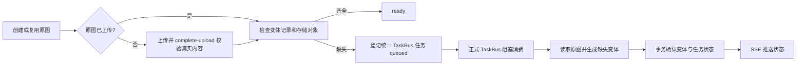

# PowerX Media 标准图片预览

PowerX Media 负责从已存储原图生成通用 `preview`、`thumbnail`，以及资产关联和规则检查；投递、尝试次数、租约、失败重试、恢复和历史统一归现有 TaskBus。Framework 负责正式客户端与 local/delegated 适配；插件负责业务关联、状态展示与鉴权读取，不能把 Core 的原图上传成功解释为预览已完成。

## 调用兼容与范围

自动生成是 Core 对原上传流程的后台增强：插件继续调用既有 CreateAsset → presign/upload → CompleteUpload；命中原图去重则继续调用 CreateAsset 复用。生成不要求 Framework 升级，不要求新增 ensure 调用，也不要求额外 image_derivatives read/ensure grant。原图业务状态和已有 Media 授权边界保持不变。

Host 响应的 `derivatives` 是可选字段；旧客户端可以忽略。接管 Core 预览的客户端需要映射该字段中的状态、错误与 `items[].variant_uuid`，再通过既有 GetVariant／下载接口获取实际 MIME、大小与图片。缺少该字段不能解释为预览已经成功。Framework 只需按消费需要增加 DTO 字段，无须为自动生成增加 Service 方法或新队列。

GetAsset 只返回当前状态，不会检查存储对象或启动补图。重复上传必须到达现有 CreateAsset 的复用入口；插件若在自身去重分支提前返回，Core 无法感知这次操作。

## Core 已实现的流程



- `CompleteAssetUpload()` 在真实字节、大小、MIME、SHA 校验成功后触发 ensure。校验失败的原图不进入生成任务。
- `CreateAsset()` 命中已就绪原图时仍执行 ensure；重复创建不需要再次上传原图。Core 本地 direct upload 回填也触发检查。
- ensure 同时检查变体记录和实际存储对象；文件丢失时利用原图修复，保持变体 UUID。已有可用的插件变体继续复用。
- 兼容旧插件仍自行创建预览：如果同名变体已经由 Core 生成，`CreateVariant` 返回该 `ready` 结果，调用方应使用返回的 MIME／大小而非假定自己的编码结果；插件自行上传的既有变体仍严格检查 checksum／大小／MIME 冲突。插件创建变体和 worker 结果接纳使用同一父资产行锁；有效的插件上传进行中只延后生成，不消耗失败重试次数。
- `GetAsset()`、Host 创建／上传确认响应新增 `derivatives`；原有 `status`／`UploadState` 仍表示原图上传状态。列表可使用独立状态接口按需读取。
- 原图、归属、原上传约束、失败上传的票据版本与重传语义保持不变。预览生成失败不会将原图改为上传失败。

## 集中预览规则

当前规则版本 `standard-image-v1`，规则仅在 Core `imageProfiles` 定义：

| 变体 | 最长边 | 编码 |
| --- | --- | --- |
| preview | 1600 px | JPEG 原图输出 JPEG，质量 85；PNG／GIF 输出 PNG |
| thumbnail | 320 px | 同上 |

保持比例，不放大小图；PNG 保留透明度；JPEG 按 EXIF Orientation 旋转显示；GIF 取第一帧。原图及原始元数据保持不变，派生图不复制 EXIF。

本次支持 JPEG、PNG、GIF。WebP、SVG、HEIC 等明确返回 `unsupported`，不伪装为生成成功。外链不后台抓取，返回 `unsupported`。单张原图上限 32 MiB、2400 万像素；先检查尺寸再完整解码，单次处理上下文期限 90 秒。算法为面积平均缩小，生成规则变更须提升 recipe 版本并验收已有图的兼容行为。

## 状态与重试

响应形如：

```json
{
  "asset_uuid": "已上传的资产 UUID",
  "upload_state": "ready",
  "status": "queued",
  "recipe": "standard-image-v1",
  "attempts": 0,
  "retryable": false,
  "items": [
    {"variant": "preview", "status": "queued"},
    {"variant": "thumbnail", "status": "queued"}
  ]
}
```

| status | 含义 |
| --- | --- |
| not_requested | 存量原图尚未请求标准预览 |
| waiting_upload | 原图尚未确认上传 |
| waiting_source | 原图记录已就绪，但源对象不可用；检查存储后重新 ensure |
| queued / processing | 已持久登记／正在执行；不等于生成完成 |
| ready | 两个标准变体均可复用或已生成 |
| failed | 解码／限额等永久失败，或瞬时故障达到重试上限 |
| scheduling_failed | TaskBus 不可用或投递耗尽；原图仍保留，恢复后重新 ensure |
| unsupported | 本版不支持该格式或外链 |
| unavailable | 状态持久层等依赖不可用；不能解释为预览成功 |

瞬时生成失败最多尝试 3 次，重试由 TaskBus 延迟投递。解码失败、校验和不符、超限直接失败。普通重复上传不会无限重启失败任务；显式 `retry_failed: true` 可启动一次新的有限重试周期。队列提交失败可以通过后续 ensure 或启动恢复重投。

同一租户同一资产通过父资产行锁复用当前未完成任务。状态、尝试次数、错误、时间统一保存在已有 `event_task_histories`，投递与租约仍由正式 TaskBus Stream 驱动管理。共享历史装饰器校验现有 TaskBus 租约，拒绝旧投递结果，并把业务变体更新与任务完成放在同一个事务中。启动补投也由统一驱动扫描共享历史完成，Media 没有私有任务恢复扫描、重试计数器、RunToken 或租约期限。

原资产 `meta.image_derivatives` 仅关联 `task_id`、`recipe`、`source_checksum` 和缺失变体名称；不保存任务状态、尝试次数、错误或租约。显式重试或补图创建新的统一任务记录，历史保留，资产指向当前任务。生成先写独立对象，再由共享任务完成事务接纳变体；未接纳对象进行清理，原图始终保留。

2026-10-18 架构修正：已移除上一版提出的 Media 专用任务表及迁移登记，不能按旧说明为 Media 创建独立任务表。

## HTTP 与类型化服务合同

路由均在现有 `server.api_prefix` 下挂载。以下使用 `<APIPrefix>`，默认 `/api/v1`；前缀迁移规则见 [共享规范](../standards/_shared/api-prefix-and-versioning.md)。

| 方法与路径 | 权限 |
| --- | --- |
| GET `<APIPrefix>/admin/media/assets/{uuid}/derivatives` | 用户 JWT + tenant + RBAC，读取状态 |
| POST `<APIPrefix>/admin/media/assets/{uuid}/derivatives/ensure`，body `{}` 或 `{"retry_failed":true}` | 用户 JWT + tenant + RBAC，检查／补齐 |
| GET `<APIPrefix>/admin/media/assets/{uuid}/derivatives/events` | 用户 JWT + tenant + RBAC，SSE |
| GET `<APIPrefix>/tenant/media/assets/{asset_uuid}/derivatives/events` | STS／API Key + tenant + 已发布／登记／授予的 image_derivatives.read，SSE |

两种身份的 SSE 复用同一 Redis 变更通知与流传输实现。先订阅再读取当前状态，后续仅在通知到达时读取；心跳只保活，不查询状态或数据库。连接最长一分钟且不超过 JWT 期限，发送 `reconnect` 后关闭；重连需要重新鉴权并同步快照。客户端离开或取消请求时释放 Redis 订阅。

服务入口在初次订阅和每次状态发送前实时检查 capability published、当前租户 registration、STS／API Key 的 live grant。撤权后不再发送状态，收到变更通知时发送无状态数据的 `invalidate` 并关闭；无变更时最迟在连接期限结束时关闭。事件凭证只放 Authorization，不接收 query token／tenant override；Admin SSE 继续仅用于用户 JWT／RBAC。

订阅是状态展示的可选接入，不是后台自动生成的前置条件。通知仅用于同步当前快照，不保证回放每个中间状态。首次载入、手动刷新、事件到达与重连允许调用 GetAsset，页面不得常驻轮询。Framework／插件若要页面自动从 queued 更新为 ready／failed，仍需接入此订阅或经鉴权的现有事件桥接。

服务态使用两个独立能力：

- `com.corex.media.image_derivatives.read`：类型化 `status` 及可选服务态事件读取。
- `com.corex.media.image_derivatives.ensure`：仅 `ensure`，允许显式重试。

这两个显式扩展能力均有固定 `core://media/image-derivatives`、`INVOKE`、`service_actor`。API Key 必须具有显式 service grant；运行时检查 published capability、当前租户 registration 和 live STS/API-key grant，撤销即时生效。Admin REST 权限不充当服务 grant。

通过现有 `<APIPrefix>/tenant/invocations` 调用：

```json
{
  "capability_id": "com.corex.media.image_derivatives.ensure",
  "preferred_protocol": "core_internal",
  "payload": {
    "body": {
      "operation": "ensure",
      "asset_uuid": "原图资产 UUID",
      "retry_failed": false
    }
  }
}
```

读取时使用 read capability，body 为 `{"operation":"status","asset_uuid":"..."}`。租户只从已认证上下文获取。拒绝任意 endpoint、HTTP method、headers、query、tenant override 或 raw proxy payload。变体读取继续使用现有 UUID 型 Media Host variant/download 合同，不公开存储凭证。

正式定义：[OpenAPI](../../specs/001-media-storage/contracts/image-derivatives.openapi.yaml)、[Capability](../../backend/config/platform_capabilities/media-image-derivatives.yaml)。

## 安装、验证与接入边界

本次不新增数据库表或列，复用现有 `media_assets.meta`、`media_asset_variants` 和统一 `event_task_histories`。统一任务表原本就在 Core 迁移清单中；已具备队列底座的环境不需要执行 Media 专项建表迁移。没有删除、清空原数据或批量改写原图操作，本轮没有改动现有业务库或替换日常服务。

正式能力仍需按现有升级方式更新目录（不会自动授予调用方权限）：

```sh
make capability-seed
```

随后启动新 Core，检查配置的 Redis TaskBus 与原图存储均可用。原上传／复用继续依赖已有 Media capability 和授权，不因自动生成而要求新增 derivative grant。

只有调用显式状态／事件或人工重试扩展时，才需要在相应租户发布／登记并按最小权限授予新能力：订阅只需 read；显式补齐／失败重试才需 ensure。seed 不会替调用方补 grant。验收扩展入口时必须检查实际服务凭证的 `grant-status`，不能用隔离测试 Key 替代实际 Host 凭证。

验收用一张真实 PNG：创建并上传原图、确认上传，观察 `upload_state=ready`、`derivatives.status=queued/processing`，随后通过 SSE 或一次手动查询确认 `ready`；通过受鉴权资源接口读取 preview／thumbnail。重复创建应复用同一资产；删除测试预览对象后再次调用原 CreateAsset 复用，应从原图补齐且不重传；不需要额外 ensure grant。验证跨租户读取被拒、撤销 service grant 后调用被拒、无效图片失败不影响原图上传状态。

外部仓库后续接入：Framework 按需给 HostAsset 增加可选 derivatives DTO；不强制新增 ensure/status 方法，不把升级 SDK 当作 Core 自动生成的上线条件。AI Craft local 保留本地生成；delegated 停止自行编码，复用原创建／上传／查询接口消费 Core 变体，提前去重分支改走 Core 创建／复用。已有 Variant DTO 含 MIME／大小，插件须保存返回的实际值，而不是本地编码的假定值。

这些插件流程调整与状态推送消费尚未实施；Core 无法替一个未到达创建／复用入口的插件分支发起请求，也不会让浏览器到插件的已发生文件传输消失。

源码与隔离验证证据见 [验收记录](evidence/media-image-derivatives-validation-20261018.json)。尚未执行安装实例与 AI Craft 实际商家上传验收。

## 代码映射

- `backend/internal/service/media/image_derivatives.go`：统一 ensure 与状态。
- `backend/internal/service/media/image_derivative_worker.go`：业务消费与图片生成。
- `backend/internal/service/event_fabric/task_queue/stream_history.go`：正式 TaskBus 的共享历史、重试、恢复与结果接纳。
- `backend/internal/service/media/image_renderer.go`：尺寸、字节限制、缩放与编码。
- `backend/pkg/corex/db/persistence/repository/media/derivative_repo.go`：资产与变体行锁，不持有任务生命周期。
- `backend/pkg/corex/db/persistence/model/event_fabric/task_history.go`：复用既有统一任务历史模型。
- `backend/internal/service/media/image_derivative_invoker.go`：固定服务能力入口。
- `backend/internal/transport/http/admin/media/derivative*`：管理 HTTP 与用户态 SSE。
- `backend/internal/transport/http/openapi/media/derivative_events.go`：可选插件服务态 SSE。
- `backend/internal/transport/http/mediaevents/stream.go`：两种身份共用的通知传输与有界连接。
- `backend/internal/transport/http/openapi/media/image_derivatives_test.go`：既有 Host 上传 → 自动任务 → 变体读取／重复补图及服务通知授权回归。
