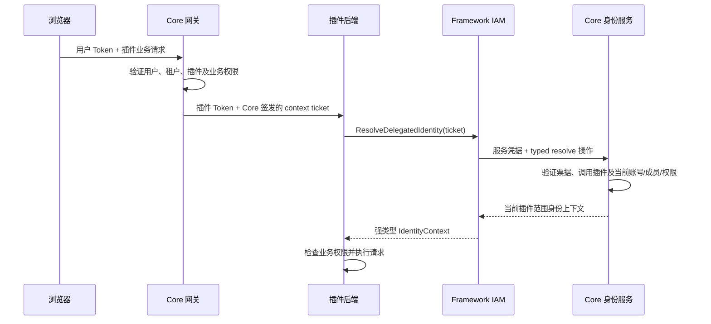

# 插件身份上下文 401：Core / Framework / AI Craft 协作修复

日期：2026-10-10。

**状态更新：Core 已实现票据签发、解析、授权与 Root/WS 合同。正式字段、路径、错误及接入要求以 [Core 正式合同](plugin-request-identity.md) 和 [OpenAPI](../../specs/018-plugin-request-identity/contracts/identity-context.openapi.yaml) 为准。下文保留原问题证据和设计过程，原草案 DTO 已由正式合同取代。**

## 1. 问题与远程证据

目标：`https://agent-dev.starrtoylumi.com/` 的 AI Craft 支付单页面。通过现有远程连接只读检查 systemd、插件进程及 Loki，未修改远程配置、数据或重启服务。

2026-10-10 14:22:45–14:22:46（北京时间）观察到：

| 请求 | Core 网关 | 插件响应 | Trace |
|---|---|---|---|
| GET `/_p/com.powerx.plugins.ai-craft/api/v1/admin/operations/ai-craft/payment-orders` | `GATE-ALLOW`，权限 `operations.order:read` | 401，`IAM_UNAUTHORIZED` | `13906b53-3935-4aee-87ac-e447e5ecfb47` |
| GET `/_p/com.powerx.plugins.ai-craft/api/v1/admin/integration/bot-configs` | `GATE-ALLOW`，权限 `settings.ai_craft:read` | 401，`IAM_UNAUTHORIZED` | `95d52231-4eff-4dfe-bb26-16fc580665a8` |

在支付单请求转发后、插件返回 401 前，Core 收到新的身份查询：

```text
GET /api/v1/admin/user/auth/me/context
HTTP 401
reason="token has invalid claims: token has invalid audience"
issuer=powerx-auth audiences=[user]
trace_id=9e20c4ea-aee8-482b-a4f4-af9aa61428c6
```

同时核对：Core 与插件进程的有效 JWT 签名密钥一致；浏览器自己的用户 context 请求能返回 200。会话、跟踪单和 WS 授权也出现同类插件 401。

**影响：请求在业务查询之前被身份刷新中间件拒绝。支付单页面拿不到数据；Bot 配置查询失败后显示“通知配置自检失败”。现有证据不证明 Bot 配置本身缺失。**

## 2. 根因：两种 Token 用途混用

当前调用链：

```text
浏览器用户 Token（aud=user）
  → Core 验证用户与插件业务权限
  → Core 网关签发插件短期 Token（aud=plugin:<plugin_id>）
  → 插件 RefreshFrameworkIAMContext 读取收到的 Bearer
  → Framework ResolveIdentity 把该 Bearer 发给 Core 用户 /me/context
  → 用户接口拒绝 plugin audience
  → 插件统一返回 IAM_UNAUTHORIZED
```

当前工作区最新源码（包含未提交改动）仍有此调用链：

- [Core 网关](../../backend/internal/infra/plugin/manager/router/router.go)：转发业务请求时覆盖 Authorization 为插件短期 Token。
- Framework `framework/backend/go/iam/delegated/core_client.go`：`ResolveIdentity` 调 `/admin/user/auth/me/context`，使用传入的 Bearer。
- AI Craft `backend/internal/transport/http/middleware/local_iam_context.go`：`RefreshFrameworkIAMContext` 将插件收到的 Bearer 交给 `ResolveIdentity`。
- Framework 最新前端 `framework/frontend/nuxt/framework-client/host-session.ts`：处理宿主会话消费、context 验证和异步代际；没有改变上述后端调用。

本文以当前源码和实际调用链为依据，发布版本号只用于远程制品定位。重新编译当前源码仍需完成后端修复。

## 3. 目标合同

用户身份接口继续严格要求用户 Token。插件业务入口继续接收插件专用凭据。

新增 **Core 权威的插件请求身份上下文解析**：Core 网关根据已验证的用户请求生成短期票据；Framework 用插件服务凭据读取；插件根据 Core 返回的当前身份和权限执行业务检查。



### 3.1 Core 签发短期票据

推荐实现为 **不透明随机票据 + Redis TTL**，不是持久业务记录，也不存数据库：

- Core 网关完成用户认证及目标插件授权后签发，例如 `pxctx_v1_<随机值>`；随机强度至少 256 bit。
- 服务端仅存票据摘要索引及可信上下文；TTL 建议 60 秒，不能超过原用户 Token 的到期时间。
- 绑定部署/环境、目标插件、租户、用户 UUID、成员 UUID（普通成员必需）、已验证的原登录会话关联、原请求 method/path、request ID 与 Trace。
- 关联信息必须来自 Core 已验证的用户上下文，不能来自浏览器传入的 UUID、roles、is_root、tenant 或会话字段。
- 转发头草案：`X-PowerX-Identity-Context`。Core 删除客户端提供的同名头及相关身份覆盖头，再写入自己生成的票据；前端不持有、不生成票据。
- 票据只用于身份解析，不授予额外业务权限。同一插件可在 TTL 内重复读取，读取时仍复核当前状态；过期明确失败，不从旧缓存恢复。
- 禁止在日志、URL、错误详情及交付证据中记录票据、用户/插件/服务 Token 或签名密钥。

采用服务端票据的原因：现有插件可能持有业务 JWT 的 HMAC 验证密钥，不能仅凭“Token 能用该共享密钥验签”认定某个用户身份一定由 Core 签发。票据的发行事实必须由 Core 权威维护。若以后采用独立非对称签名票据，私钥仍只保留在 Core，另行发布版本与密钥轮换合同。

### 3.2 Core 解析和授权

只有同时满足以下条件才返回上下文：

1. 外层服务凭据有效，目标能力 published、租户 registration 有效、实时 grant 存在。
2. STS 的插件身份与票据目标插件一致；API Key 模式必须校验该 Key 对票据目标插件的精确 owner 授权。Key 名称、Profile 名称和浏览器 plugin_id 不构成授权。
3. 票据有效、未过期，来源部署、原用户会话、租户与目标插件匹配。
4. 目标插件在该租户中当前可用；用户、租户、成员及角色状态实时有效。
5. 普通用户的 user/member/tenant 关系一致。Root 身份从 Core 当前权威状态确认；已选租户按 Core 当前规则处理，缺少有效租户不得读取其他租户。
6. roles、permissions、policy_version 与 perms_hash 来自当前 Core 权威数据；不信任业务 Token 的权限快照或插件请求里的声明。

只返回当前目标插件的有效业务权限及必要身份字段。身份读取成功不等于任意业务操作获准；Core 网关和插件业务 Handler 的权限检查均保留。

## 4. 服务接口与 DTO 草案

### 4.1 授权平面

服务能力建议：`com.corex.iam.identity_context.service_read`。

| 项目 | 草案 |
|---|---|
| typed binding | `INVOKE core://iam/identity-context` |
| actor | `service_actor` |
| 权限范围 | 当前凭据租户 + 票据目标插件 + 票据确认的用户请求 |
| API Key scope | `_scope.iam.identity_context.service_read` |
| API Key action / resource | `read` / `capability` / `iam_identity_context_read` |
| 可选正式 Tenant HTTP | `POST /api/v1/tenant/iam/identity-contexts:resolve` |
| 用户接口 | 现有 `/api/v1/admin/user/auth/me/context` 保留用户身份语义 |

Core 正式交付时须提供 capability YAML、OpenAPI、DTO、错误及授权映射；service permission 必须有 `allow_api_key=true` 和 `api_key_explicit=true`。不得使用 Admin REST 权限或宽泛 manage grant 代替服务读取权限。如新增此能力的管理界面/管理入口，同一新 capability 合同必须同时声明 `admin_user + user JWT + RBAC` 平面。

### 4.2 请求

Framework 调用 `POST /api/v1/tenant/invocations`，外层使用已授权 STS/API Key：

```json
{
  "capability_id": "com.corex.iam.identity_context.service_read",
  "preferred_protocol": "core_internal",
  "payload": {
    "body": {
      "operation": "resolve_request_identity",
      "request": {
        "schema": "powerx.iam.plugin-request-identity-query/v1",
        "context_ticket": "<redacted>"
      }
    }
  }
}
```

仅接受上述 typed 字段。禁止任意 HTTP method/endpoint/headers/raw proxy，禁止调用者覆盖 tenant/user/member/plugin、roles、permissions 或 Root 标志。Trace 从可信请求上下文传播；不要把敏感票据放入 query。

### 4.3 响应

typed 操作结果草案（外层沿用 Core invocation envelope）：

```json
{
  "result": {
    "schema": "powerx.iam.plugin-request-identity/v1",
    "mode": "delegated",
    "plugin_id": "com.powerx.plugins.ai-craft",
    "tenant_uuid": "1edd4132-1644-412d-abb4-d5f1e9487052",
    "user_uuid": "11111111-1111-4111-8111-111111111111",
    "member_uuid": "22222222-2222-4222-8222-222222222222",
    "is_root": false,
    "roles": ["role_user"],
    "permissions": ["operations.order:read", "settings.ai_craft:read"],
    "policy_version": "<current-policy-version>",
    "perms_hash": "<current-permission-hash>",
    "source_request_id": "13906b53-3935-4aee-87ac-e447e5ecfb47",
    "trace_id": "13906b53-3935-4aee-87ac-e447e5ecfb47",
    "expires_at": "2026-10-10T06:23:00Z"
  }
}
```

UUID、角色和时间仅为结构示例，不能硬编码为业务身份或权限。普通成员 member_uuid 必填；Root 的 null/有效成员规则须在正式 OpenAPI 中明确。时间统一 UTC RFC3339。`expires_at` 是本次证明的有效上限，不保证期间角色或账号不会撤销。

### 4.4 错误草案

| HTTP | 稳定机器码与条件 |
|---|---|
| 400 | `IAM_CONTEXT_INVALID_ARGUMENT`：不支持字段、操作或格式 |
| 401 | `IAM_CONTEXT_PROOF_REQUIRED` / `IAM_CONTEXT_PROOF_INVALID` / `IAM_CONTEXT_PROOF_EXPIRED`：缺少、伪造或过期票据 |
| 401 | `IAM_UNAUTHORIZED`：外层凭据或原用户会话失效 |
| 403 | `IAM_CONTEXT_FORBIDDEN`：capability/grant/owner 不符、跨租户、跨插件、停用账号/成员/插件或失去访问资格 |
| 503 | `IAM_CONTEXT_UNAVAILABLE`：票据存储、IAM 或其他依赖不可用 |

Framework 必须保留实际 HTTP、Core error/reason code、原 Trace 和上游 request ID。依赖失败不能当作“用户无权限”；错误不能变成空成功、匿名身份或 Root。人类可读提示按各仓库 locale 机制处理。

## 5. 各方修改清单

### Core

- 网关签发及注入票据；清除伪造入站头；使用部署独立的票据命名空间，避免多环境/多数据库共用缓存上下文。
- 复用当前用户/成员/权限服务，增加票据解析及实时授权；固定 typed invoker 与正式 Tenant route（如交付）。
- 正式 capability + 最小 service grant + API Key 目标插件 owner 校验；如有管理面，补齐同合同双平面。
- 统一传播 source request/Trace，审计票据发行和解析结果，所有敏感字段脱敏。
- 发布支持范围、TTL、Root/普通用户规则、DTO/OpenAPI 和真实凭据验收证据。

### Framework：当前最新源码

- `framework/backend/go/iam/contracts`：新增 typed `ResolveDelegatedIdentity` 输入/结果，或按新合同严格更新 delegated context 接口；显式字段、UUID、Root、权限版本及错误不得丢失。
- `framework/backend/go/iam/delegated/core_client.go`：服务凭据调用固定 typed identity binding；delegated 路径停止用插件 Bearer 查询用户 `/me/context`。
- `framework/backend/go/iam/delegated/adapter.go`：将新的身份解析能力纳入启动绑定，缺合同或缺票据明确失败。
- .NET 对应 IAM contracts/client/adapter 做同合同映射；Go/.NET 不各自推导身份或拼接自由代理请求。
- skeleton、scaffold 和 CLI 内嵌模板同步接入新输入及启动校验；业务 middleware 统一读取 Core 票据并调用 Framework，不能继续沿用 `ResolveIdentity(ctx, pluginBearer)`。
- Local 身份处理保持启动选定的 Local provider。新 delegated 方法不静默落到 Local、不解析未经权威确认的 claims 作兜底；旧 delegated 调用必须明确失败并迁移。
- 前端桥接维持宿主管理会话，用户 context 校验走宿主用户入口；业务请求走插件入口。前端不生成票据、不持有服务凭据。
- 开发期使用当前源码完成联调；交付确认后再发布。外部插件升级依赖后须更新已复制的 middleware/adapter，再重新构建制品。

### AI Craft / 其他消费插件

- `backend/internal/bootstrap/framework_iam.go`：绑定新的 delegated identity client/adapter。
- `backend/internal/transport/http/middleware/local_iam_context.go`：从可信 Core 转发头读取票据，用新 typed 方法刷新身份，保留租户一致性与业务权限检查；Root 也必须按明确的新身份合同处理。
- 同步 auth、RBAC 和 WS 授权调用处；所有 protected API 使用同一身份解析路径。
- 普通成员及 Root 分别验收支付单、Bot 配置、会话、跟踪单和 WS grant。身份成功后，真实缺 Bot 配置才显示配置缺失提示。
- 记录错误及 Trace，前端区分身份失效、权限不足和上游不可用。此修复不改支付状态、不创建 Bot 配置、不迁移业务数据。

## 6. 实施顺序与验收门槛

1. Core / Framework 确认本文草案，冻结正式合同及安全边界。
2. Core 实现票据与 typed 解析，完成能力声明、授权及证据交付。修改正式能力后运行 `make capability-check`、`make capability-seed`、相关 grant 测试，并查开发 Host key 的 `grant-status`。
3. Framework Go/.NET + skeleton/scaffold/CLI 对齐，在当前源码联调；更新受影响的实现及 mock。
4. AI Craft 接入，重新构建安装包；部署时确认 Core 已具备新合同，按用户安排重启服务。
5. 完成真实普通成员和 Root 的浏览器请求验收后，记录实际制品和调用证据；组件/编译通过不能代替此步骤。

必须覆盖：

- 已授权普通成员支付单与 Bot 配置读取 200，Core 用户 `/me/context` 的 `aud=user` 检查继续严格有效。
- 无业务权限返回 403；失效登录、缺票据、伪造/过期票据返回明确 401。
- 跨租户、跨插件、API Key 无目标 owner、STS 未获新能力、停用账号/成员/插件明确失败。
- 角色/权限/成员关系在票据签发后撤销，后续解析及业务操作拒绝；不能使用旧快照继续访问。
- 使用旧 delegated 输入显式失败，不回退 `/me/context`、Local 或未验签 claims。
- Redis/IAM 上游失败 503；Root/普通成员都不绕过身份真实性；同名开发 key 的环境缓存互不影响。
- 支付单、Bot 配置、会话、跟踪单、WS grant 的 source request/Trace 可关联；日志及证据没有 Token、票据或签名密钥。
- Core 发布检查、Framework typed tests、插件 middleware 集成测试、真实 API Key/STS 与浏览器验收分别记录。

**最初交接仅提供方案；现已补齐 Core 实现与正式合同。Framework/插件须据正式合同接入。未修改外部仓库、执行迁移或远程发布/重启。**
