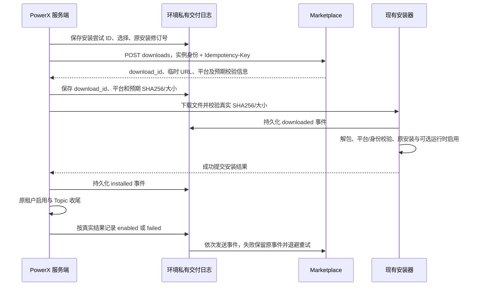
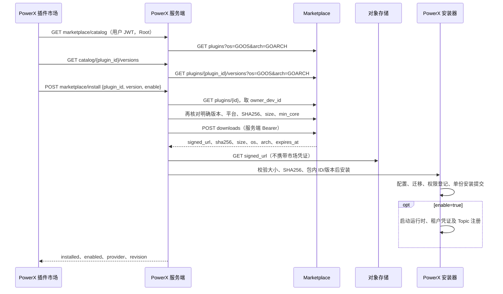

# PowerX 接入 Marketplace：目录、平台版本与安装

本合同对应 `/plugins/market` 的第一阶段接入。Root 浏览远端已发布插件、选择当前宿主平台版本，PowerX 服务端获取下载授权并验证 SHA256，再交给现有插件安装器。手动安装独立放在 `/plugins/local`；两种来源共用同一安装器，并可勾选安装后启用，后续在 `/plugins/installed` 管理。租户管理员的订阅列表仍使用已启用的本地插件。

当前源码还实现了服务端实例登记、基于环境身份的指纹、心跳和下载／安装结果回报，详见下文“实例分发跟踪”。公钥验许可证、离线宽限、账单归集及完整宿主控制器仍属于后续范围。本实现不代表 Marketplace `specs/013-marketplace-control-and-host-controller` 全部完成。替换已有安装需要用户明确确认；安装后是否启用由请求中的 `enable` 决定。

**阅读状态**：本文对齐当前源码的首次安装、单安装替换和共享启用链路。真实 Core 安装验收仍受下文 `min_core` 限制，受控测试不等同于用户登录后的真实安装。

部署识别的共同协议见[版本化协议包](../../contracts/deployment-fingerprint/v1/README.md)。PowerX 已接入发行清单、匿名产品信息、内存证明、原登记/心跳 worker 的能力协商及 Nitro 固定证明代理；旧市场保持原格式。配置、构建和市场后台步骤见[部署识别手册](../guides/deploy/powerx-deployment-fingerprint/guide.md)。源码及受控验证与真实双部署验收分开记录，不能据此关闭 A01–A24。

## 当前调试范围：本地上传保持原流程

当前先测试本地上传，页面入口调整为 **本地插件 → 本地安装 → 本地上传 → 选择本地来源 → 安装**。上传继续使用原 `InstallDialog` 和 `POST /admin/plugins/install/local`，不请求 Marketplace，不需要市场下载凭证，也不会用线上目录的 `min_core` 阻断本地包。宿主原有的平台、数据库、STS 等本地校验仍按原安装器执行。

- 默认保留“安装后立即启用”和覆盖安装选项；选择目录或目录中的 `.tar.gz/.tgz` 包后，点击一次安装即可提交。多文件目录仍用 `files + file_paths_json`，大目录仍由原前端逻辑打包为 `file` 上传；`enable`、`force`、`metadata` 保持原参数语义。
- 原本地及来源未知的历史安装，不要求给旧包补 `provider`，也不增加 `expected_revision` 或发布者绑定确认步骤。取消覆盖时，同版本保留原产物并同步权限；勾选覆盖时按原用户操作重装。安装器在内部读取当前修订号，仍保证单份安装登记和失败恢复。
- 已有发布者而上传的旧包没有该字段时，保留原安装记录中的发布者信息；双方都没有时仍保持未知，不声称完成签名或身份验证。已有明确的不同发布者仍禁止相互覆盖；从市场安装切回本地依旧走跨来源确认。
- 上传后的链路仍为解包／定位 Manifest → 平台检查 → 配置与凭证 → 迁移 → 权限登记 → 可选运行时启用 → 当前租户实例、凭证下发及 Topic 注册。单安装规则仍保留，原版不会作为第二份可运行安装出现；不新增卸载或重新初始化业务数据的步骤。

兼容标记仅由服务端识别真正的 multipart 本地上传后设置，客户端 JSON 不能开启，市场和自备 URL 也不能开启。市场安装的下载鉴权、校验和、发布者及替换确认要求仍按下文执行。

## 连接配置

PowerX 的内置默认市场为 `https://marketplace.artisan-cloud.com/api/v1`。源码启动、分发二进制、Docker 以及全新 Setup 共用此默认值；无需在 Setup 中额外填写地址，也不需要为了浏览公开目录提供实例接入码。

需要改为私有市场或本机联调时，在实际加载的配置文件（源码默认 `backend/etc/config.yaml`）中覆盖：

```yaml
plugin:
  marketplace:
    api_root: http://127.0.0.1:8088/api/v1
    heartbeat_seconds: 300
```

地址优先级为 **非空的 `POWERX_MARKETPLACE_API_ROOT` → 配置文件中的 `plugin.marketplace.api_root` → 内置官网默认值**。省略该配置项使用官网；显式填写 `api_root: ""` 可关闭市场连接。已有配置中的本机或私有地址会继续生效，不会被默认值、Setup 或容器重复初始化覆盖。配置文件修改后重启后端加载，不要求修改源码或重建镜像。

Docker 容器使用 `POWERX_CONFIG` 指定的配置（默认 `/etc/powerx/config.yaml`）；标准容器部署对应宿主机部署目录的 `config/config.yaml`，旧版 Compose 默认映射宿主机 `/etc/powerx/config.yaml`。新初始化配置写入官网地址；标准 Compose 同时透传 `POWERX_MARKETPLACE_API_ROOT`，未设置时不压过配置文件。未来更换官网域名时，运维可直接修改上述配置或环境变量覆盖，无需等待新版本。

`POWERX_MARKETPLACE_HEARTBEAT_SECONDS` 可覆盖心跳秒数。正常接入无需 `POWERX_MARKETPLACE_ENROLLMENT_TOKEN` 或共享下载令牌。PowerX 启动后在后台检查市场服务并自动登记，不要求用户到 Marketplace 创建实例。

### 自动身份登记与持久化

沿用环境私有快照目录下按市场来源摘要隔离的 `marketplace/<source-hash>/distribution.json`，不写入插件源码或浏览器存储；实例文件锁阻止两进程共用同一身份目录。

1. 调用公开 `GET /host/instances/discovery`，确认市场自动登记协议。
2. 依据私有持久化 `EnvironmentID` 计算稳定环境指纹，为每个市场生成独立的 32 字节随机实例凭证。先以 `pending_instance_token` 保存到现有私有交付日志，文件权限 0600，再发送请求。
3. `POST /host/instances/register` 使用本机凭证，不使用管理员或用户 JWT；包含环境指纹、PowerX 版本和真实服务端平台。市场返回稳定实例 ID，不回传秘密。登记只提供实例归属，不授予管理员、商业许可或付费权益。
4. 成功保存实例 ID 后，立即报到；后续默认每 300 秒心跳。正常重启复用已有凭证并报到，不重复创建记录。
5. 断网、市场未启动或响应丢失时，后台使用同一持久化凭证退避重试（5 秒至 5 分钟）。先保存凭证可保证市场已收件、响应丢失后仍找回同一实例。自动接入不阻塞 Core 启动、本地上传或已安装插件。
6. 独立部署必须使用各自的环境 ID 和私有身份目录。复制同一身份文件相当于复制实例，不能用于部署两个独立实例。
7. 401/403 保留原身份并停止市场下载和回报，不静默生成新凭证绕过撤销。私有身份文件损坏也不丢弃旧记录重新登记。

旧 `POWERX_MARKETPLACE_ENROLLMENT_TOKEN` 仅保留显式旧版部署兼容；不要为新部署设置。旧共享下载令牌也不再作为尚未完成实例登记时的静默回退。PowerX 用户 JWT 不能替代市场实例凭证。

下载、心跳、结果回报统一携带 `Authorization: Bearer <instance_token>` 与 `X-PowerX-Fingerprint: <fingerprint_sha256>`。带凭证的市场请求拒绝跟随 HTTP 重定向。对象存储下载使用安装器原有的独立 HTTP 客户端，不携带这些凭证或指纹。

### 下载与真实结果



- 每次新的安装尝试先持久化 UUID，并用作 `Idempotency-Key`；选定的插件、版本、平台和业务租户不能随重试改变。响应中的签名 URL 仅供当前下载使用，不保存到交付日志、结果事件或浏览器。
- 安装器真实文件 SHA256 和大小均通过后，先持久化 `downloaded` 事件，再进入原有解包和安装流程。文件校验或该日志写入失败时，不执行安装。
- 共用安装器成功返回后才记录 `installed`；自动启用失败导致安装事务回滚时，回报安装阶段失败，不伪造已提交安装。
- `enable=false` 停在 `installed`。`enable=true` 还需完成原租户启用、Drain 收尾及 Topic 注册，成功后记录 `enabled`；已安装但收尾失败时记录 `failed(stage=enable)`。后续手动启用只关联当前安装修订号、市场实例和**非空且一致的业务租户**对应的 `installed` 下载；Root 无租户上下文的运行时启用，不替其他租户回报启用成功或失败。已进入 `failed/enabled` 的尝试不改写终态。
- 失败回报使用受控错误类别，例如校验不匹配、Manifest 无效、迁移失败或安装状态冲突；不发送底层错误里的 URL、文件路径或凭证。

事件的 UUID、完整 payload 及 `reported_at` 在入待发日志时固定，同一下载按 `downloaded → installed → enabled/failed` 顺序发送。网络失败、429 和 5xx 使用原事件退避重试，从 5 秒增长到最多 5 分钟；其他 4xx 保留原事件并标为待处理。401/403 同时停止使用实例凭证并关闭市场下载，不回退旧令牌。重试发送器不调用安装器或启用接口。

实际安装或启用已经执行、但交付日志暂时不可写时，PowerX 在内存保留该安装尝试的已知结果及原事件 UUID、完整 payload 和时间，立即计入 `unconfirmed_installs`。运行中的发送器按同样的 5 秒至 5 分钟退避重试本地写入，无需重启；同一次尝试的 `installed` 和后续 `enabled/failed` 按原顺序补记，落盘成功后才发送。该重试只处理对应安装尝试，不触发全局启动恢复，不将其他正在进行的安装判为中断，也不重新执行安装或启用。实例凭证失效时仍可补记本地结果，向市场发送则保持停止。

文件不可写期间，最新结果尚未持久化；若此时进程退出，内存结果不能保证保留。重启仅核对中断结果：使用插件 ID、版本、市场来源、实际校验和及新安装修订号确认是否已经提交。能确认安装、无法确认启用收尾时，保留 `installed` 并提供待核对计数，不猜测启用成功或失败，也不自动重装。下载申请响应丢失时，可用原幂等键取回下载 ID 后回报中断；不会据此继续执行安装。

### 心跳、观察和验收

心跳由 PowerX 后台生命周期管理，默认每 300 秒发送，退出时取消请求并停止发送器。发送器由新事件和重试到期时间唤醒，不增加页面轮询，也不新增私有 Redis 任务队列。

Root 已有的 `GET /api/v1/admin/plugins/marketplace/catalog` 响应增加 `connection.instance`：`state`、市场实例 `id`、`last_heartbeat`、`pending_reports`、`blocked_reports`、`unconfirmed_installs` 和安全的 `error_code`。不返回令牌、接入码、指纹或日志路径。`registered` 表示已持有实例凭证；最近心跳时间不等价于实时在线探测。

`pending_reports` 统计已落盘但未发送的事件；`unconfirmed_installs` 统计需核对或仍待补记本地结果的安装尝试，同一尝试不重复计数。插件市场页以中英文“安装结果未确认”提示展示后者，提醒无需重复安装，可用“刷新目录”核对恢复状态；启用结果仍不明确时到“已安装”检查。页面不增加周期查询。

现场验收：

1. 两套独立 PowerX 配置相同市场地址并启动，无需后台创建实例或配置接入码；刷新分发跟踪，确认自动出现两个实例且平台、版本正确。
2. 重启其中一个 PowerX，确认其市场实例 ID 不变、没有新增登记，心跳仍归属原实例。
3. 由各自市场入口安装兼容的插件版本，确认下载、真实校验、安装、启用的事件归属正确，单纯签发链接不会显示安装成功。
4. 阻断市场结果回报后完成安装，再恢复网络或重启 PowerX，确认原事件补发且插件没有重复安装；重复接收同一事件不增加市场时间线。
5. 分别验证校验失败、安装失败、安装成功但启用收尾失败；未勾选启用不得出现 `enabled`。
6. 撤销测试实例，确认后续心跳／下载／回报被拒绝，宿主不回退旧令牌，历史交付日志保留。
7. 回归本地目录和压缩包上传：不需要市场凭证、不请求登记／下载／回报接口，覆盖和立即启用参数维持原语义。

本轮源码验收采用临时私有目录、受控 Marketplace HTTP 服务和真实安装器，覆盖双环境身份、重启、断网补报、重定向与凭证拒绝、安装和启用失败分支，记录见[分发接入验收证据](evidence/marketplace-distribution-integration-20261022.json)。真实两个部署及真实插件安装仍须按以上步骤现场验收；本轮没有修改用户凭证或重启现有服务。

Marketplace review 后补充了运行中日志写失败恢复、连续结果补记、空租户／跨租户启用防误报，以及桌面／窄屏中英文提示的回归，见[反馈修复验收证据](evidence/marketplace-distribution-feedback-fixes-20261022.json)。受控 HTTP 用例确认补记不重复申请下载或执行安装，Root 无租户上下文的运行时启用不推进原租户记录；不代表真实双部署联调已经完成。

## 请求链路



平台始终来自 PowerX 后端进程的 `runtime.GOOS/GOARCH`。浏览器所在系统、请求体中的平台或对象存储路径都不决定制品选择。Docker 中的 PowerX 会选择容器平台。目录按市场分页；本阶段没有伪装成全局查询的本页搜索或排序。

| PowerX 管理接口（API 前缀默认 `/api/v1`） | 用途 |
| --- | --- |
| `GET /admin/plugins/marketplace/catalog?page=1&size=12&installation=all` | 远端目录和连接状态；未配置时明确返回 `configured=false`，不冒充本地市场 |
| `GET /admin/plugins/marketplace/catalog/{plugin_id}/versions?page=1&size=20` | 当前平台的已发布版本 |
| `POST /admin/plugins/marketplace/install` | 接收 `plugin_id`、明确版本、`enable` 及替换确认字段，不接收 URL、SHA256、客户端 provider 或平台选择 |

上述接口均限 Root 用户 JWT；它们在 `capability_audit_ignore.yaml` 中按 `root_runtime_control` 明确登记，不作为插件／Agent 的服务能力发布。

## 插件身份与单安装替换规则

插件业务身份由 **provider 身份 + plugin ID** 确定。同一身份在一个宿主内只有一份已登记安装；版本和安装来源是当前安装的属性，不能据此创建第二份安装。本地、URL 与市场只是取得安装包的入口。同一 provider、同一 plugin ID 从本地转到市场或反向操作，都走替换流程。

该约束必须由后端安装器和注册表共同保证，覆盖本地、URL、市场等所有安装入口。不能只在页面隐藏旧版本，也不能仅限制“同时启用”：已安装列表及可运行版本登记中均只能有一个当前安装。来源变化不改变插件身份，版本升级或降级也不产生另一份安装。

| 当前状态与目标包 | 操作规则 |
| --- | --- |
| 尚未安装该身份的插件 | 首次安装 |
| 已安装，市场或跨来源目标是其他版本／来源 | 明确显示“替换当前安装”；用户确认后替换，成功后仅保留目标安装记录；纯本地上传沿用原覆盖开关 |
| 同版本、同制品，能够核对身份及校验和 | 返回已安装，无需重复安装，不重写原安装来源 |
| 同版本、不同制品或无法比较制品 | 明确说明会覆盖当前代码，走替换流程，不能并列登记 |
| provider 不同、plugin ID 相同 | 属于不同插件，禁止当作原插件替换 |
| 市场／URL 替换中，旧安装缺少 provider、目标身份明确 | Root 核对显示的目标发布者后，分别确认身份绑定和替换；后台同时要求当前 `revision` |
| 市场／URL 目标包缺少 provider，或双方已知 provider 不同 | 拒绝替换；本地旧包兼容规则见上节，明确身份冲突始终拒绝 |

例如，本地 AICraft `0.1.76` 被同一 provider 的市场版 `0.1.77` 替换后，“已安装”仍只有一个 AICraft，当前版本为 `0.1.77`、来源为市场；本地旧版本不再作为另一份已安装插件出现。市场目录应显示该身份的全局安装状态，并注明当前来源，而非仅因本地已安装就报告来源冲突。

替换须先验证目标身份、平台、Core 兼容性、下载授权、大小与 SHA256，然后处理正在使用的租户实例和旧运行进程，再完成安装替换及状态回读。替换沿用原插件配置、凭证及数据库内的租户关系和业务数据；数据库变化遵守迁移兼容规则。`enable=true` 仅为当前租户开通，Drain 后其他租户不会被自动批量重新启用。安装器失败会恢复原文件、配置和注册表，并尝试重启原先启用的运行时；恢复失败会明确报错并保留恢复日志。数据库迁移及权限同步等外部副作用不承诺自动回退，必须使用兼容迁移并按插件自己的恢复方案处理。允许单独保留恢复备份，但备份放在安装扫描范围外，不登记为第二个已安装版本，也不提供双版本并行启用。历史多版本记录不能在首次加载新规则时自动删除，需单独核对与迁移。

替换确认界面应同时展示 provider、plugin ID、当前版本／来源、目标版本／来源及覆盖本地代码的影响。后台下载和暂存目标包不等于第二份安装；提交替换前，原安装仍是唯一有效安装。并发安装／替换必须以同一插件身份互斥，并在提交时再次核对当前安装，避免旧页面或重复点击覆盖刚完成的替换。

### 单安装替换的验收条件

以下条件由安装器、HTTP 合同与受控浏览器回归验证；真实进程启停和租户数据库副作用仍须使用兼容制品完成现场验收。

| 用例 | 必须满足的结果 |
| --- | --- |
| 同 provider、同 ID，本地 `0.1.76` 替换为市场 `0.1.77` | 替换成功后只有一个已安装记录，版本和来源更新为目标值 |
| 同 provider、同 ID，从市场版换成本地包，或选择其他版本 | 经过替换确认，仍只有一份安装，旧版本不能继续作为已安装版本列出或启用 |
| 同 provider、同 ID、同版本、同制品重复安装 | 幂等返回已安装，不新增记录，不伪造新的安装来源 |
| 同 provider、同 ID、同版本，但制品不同 | 明确确认覆盖，不能静默覆盖或并列安装 |
| 下载、校验、安装或迁移失败 | 原安装与配置仍可恢复；不留下第二份安装或误报替换成功，迁移回退边界必须明确 |
| 两个入口并发替换同一身份 | 后端互斥或返回明确的状态冲突，不产生双份安装 |
| 相同 ID、不同已知 provider | 拒绝替换；市场／URL 的未知旧身份必须经 Root 单独确认绑定；本地上传不增加该步骤 |
| 重启扫描、刷新页面及查看恢复备份 | 不重新登记旧版本或备份；“已安装”仍只有一份，市场页正确标注当前来源 |

### provider 合同与信任边界

新本地包可在 `plugin.yaml` 声明：

```yaml
provider:
  id: afc0d6b6-9e3f-4f64-9281-f94676289a6d
  authority: http://127.0.0.1:8088/api/v1
```

`id` 是签发域内的发布者 ID，`authority` 是规范的身份签发域。当前适配使用配置的 Marketplace API 根地址作为域，使用该市场服务端返回的 `owner_dev_id` 作为 ID；地址本身不能确认发布者。本地包声明由执行导入的 Root 信任，**不是已完成签名验真**。市场安装时重新读取服务端目录身份，包内声明存在时必须一致；浏览器不能自行指定 provider。更换市场地址不会自动映射旧身份。

首次安装及本地上传重装兼容没有 provider 的旧本地包，上传规则见“当前调试范围”。市场及 URL 的后续替换中，目标身份必须明确；旧安装身份为空时，Root 需要勾选“当前安装属于上述发布者，同意建立身份绑定”。已有明确的不同发布者不能用该选项绕过。市场请求会记录替换及身份绑定确认的审计信息。

Core 的目录、路由和运行实例仍以全局 plugin ID 索引，所以**不同 provider 的同 ID 并行安装尚不支持**，当前明确拒绝覆盖。注册表保留旧结构以读取历史数据，但新安装入口只提交一份当前安装；遇到历史多版本会阻止替换，等待人工核对，不擅自删除。

### 替换请求与恢复

目录返回目标 `provider`、当前 `installed_provider`、`revision`、`can_replace` 和身份异常 `reason`。同发布者的本地安装在市场目录显示“已安装”，其来源仍是本地。确认替换时发送：

```json
{"plugin_id":"com.example.demo","version":"1.2.0","enable":true,"replace":true,"expected_revision":"<目录中的当前 revision>","confirm_legacy_provider":false}
```

`confirm_legacy_provider=true` 仅用于用户已核对并确认的旧身份绑定；已知不同身份始终拒绝。`expected_revision` 是安装修订号，不是语义版本。同一个 Core 进程串行化安装／启停／卸载，并再次校对修订号；旧页面不能覆盖已变化的安装。


首次安装示例（PowerX API，用户 JWT；制品必须满足当前 Core 版本）：

```sh
curl --noproxy '*' -X POST 'http://127.0.0.1:8077/api/v1/admin/plugins/marketplace/install' -H "Authorization: Bearer ${POWERX_USER_TOKEN}" -H 'Content-Type: application/json' --data '{"plugin_id":"com.example.demo","version":"1.2.0","enable":false}'
```

以下为新增安装响应合同示例，**非真实 Core 安装回包**：

```json
{"code":200,"message":"success","data":{"installed":{"id":"com.example.demo","version":"1.2.0","state":"installed","provider":{"id":"developer-id","authority":"http://127.0.0.1:8088/api/v1"},"revision":"new-installation-revision","install_origin":{"type":"marketplace","source_id":"http://127.0.0.1:8088/api/v1","channel":"catalog","os":"darwin","arch":"arm64","sha256":"<已验证的 SHA256>"}},"enabled":false,"tenant_instance":null,"event_fabric_seeded_tenants":0}}
```

自备 URL 或从市场切回本地时，先按普通请求提交。需要确认已有安装时返回 HTTP 409，`details.code=PLUGIN_REPLACEMENT_REQUIRED`，同时返回 `current`、`target` 和 `requires_provider_confirmation`。页面展示前后身份和版本，确认后用原接口重提 `force=true`、`expected_revision`，必要时附带 `confirm_legacy_provider=true`。自备 URL 默认不强制覆盖；纯本地上传沿用原默认覆盖开关。

替换前验证身份与宿主平台，读取并保留原配置、凭证，要求活跃租户实例已完成 Drain。暂存和原包备份放在 `InstalledRoot` 的父目录 `.powerx-install-backups/replace-*/`，权限 0700，恢复日志 0600；它们不参与安装扫描，也不会登记成另一安装版本。提交后原子写入单份安装记录；中断恢复在 Bootstrap 扫描前进行，已提交的修订不会被误回滚。备份可能包含配置和凭证，不应提交仓库或公开下载；本次不自动清理用户原始数据及历史备份。

远程替换遇到活跃租户实例会显示 Drain 提示并链接插件详情，不会自动强制停止租户任务。完成 Drain 后重新确认替换。

安装后的租户启用／Topic 收尾可能独立失败，此时明确返回“插件已安装，但…失败”，包已经提交，应到已安装页处理，不能声称数据库和外部副作用已全部回滚。

## 本地与 Marketplace 分开处理（当前实现）

来源导航控制目录与管理入口，身份核对控制是否首次安装或替换；二者独立。

Root 顶部入口分为 **插件市场 → 本地插件 → 已安装**，名称跟随界面语言。三页共用页头、来源导航和 208px 桌面分区栏，窄屏分区栏横向滚动。Marketplace 只读取线上已发布目录；本地页只读取宿主安装记录和手动安装入口，不请求 Marketplace，也不在市场故障时把本地插件冒充线上目录。本地默认“全部”包含本地安装与来源未知的历史记录，另设“本地安装”“来源未知”分区；已安装页按“全部／插件市场／本地安装／来源未知”查看。来源未知仍保持独立标记，不等于认定为本地来源。本地安装仍为选包、目录或自备 URL 后直接安装，本阶段没有“先导入未安装候选包”的包仓库。

安装来源和安装状态是两个独立维度：

| 维度 | 取值及语义 |
| --- | --- |
| `install_origin.type` | `local`（手动安装）、`marketplace`（市场入口安装）、`unknown`（历史记录缺失来源） |
| `install_origin.source_id` | 本地为 `local`；市场为配置的规范 API 根地址，移除凭证、查询串和尾部斜线 |
| `installation.status` | 同发布者已安装 `installed`（无论来源）、未安装 `not_installed`、身份待处理 `source_conflict`、宿主记录读取失败 `unknown` |

`GET /admin/plugins` 返回每个插件当前选中版本的 `install_origin`。来源按版本写入安装注册表，包含安装入口、市场地址，以及已验证的 SHA256／平台等可用信息；来源由服务端入口设置，不采用包内声明或客户端 `metadata`。重启扫描保留已有来源，缺失记录保持 `unknown`，不根据 ID 或“磁盘上存在”猜成本地或 Marketplace。

Marketplace 目录响应增加 `connection.source_id`、`inventory_ready` 和每项 `installation`。这是新增 PowerX 合同示例，**非真实登录会话回包**：

```json
{
  "connection": {"configured":true,"download_ready":true,"source_id":"http://127.0.0.1:8088/api/v1","os":"darwin","arch":"arm64","core_version":"v1.0.0"},
  "inventory_ready":true,
  "items":[{"id":"com.example.demo","name":"Demo","installation":{"status":"installed","version":"1.0.0","revision":"installation-revision","can_replace":true,"provider":{"id":"developer-id","authority":"http://127.0.0.1:8088/api/v1"},"installed_provider":{"id":"developer-id","authority":"http://127.0.0.1:8088/api/v1"},"origin":{"type":"local","source_id":"local","channel":"url"}}}],
  "total":1,"page":1,"size":12
}
```

目录按 **provider 身份 + plugin ID** 核对已安装记录，来源单独展示。`source_conflict` 为兼容现有字段名保留，页面显示“身份待处理”：`provider_mismatch` 禁止替换，`provider_unconfirmed` 在目标身份明确时允许 Root 人工核对旧安装并确认绑定。

目录支持 `installation=all|not_installed|installed|source_conflict`。筛选先汇总远端目录再分页，避免只筛当前页；超过 10,000 项时明确报错，不返回不完整筛选结果。宿主记录不可读时仍可看线上目录，但状态为未知并禁止安装，筛选状态返回 503。旧服务尚未加载来源字段时，前端同样按未知处理，须重启 PowerX 加载契约。

## Marketplace 当前合同及请求示例

以下 URL 与字段直接对应 Marketplace 当前路由和 Handler，不使用旧 `/latest` 或“登记即上架”流程。只有公开发布且存在当前平台制品的插件会出现在带平台条件的目录中。

```sh
curl --noproxy '*' 'http://127.0.0.1:8088/api/v1/plugins?os=darwin&arch=arm64&page=1&size=12'
```

2026-10-19 本机实测的目录响应节选（省略时间字段）：

```json
{"code":0,"message":"success","data":{"items":[{"id":"com.powerx.plugins.ai-craft","name":"AICraft","summary":"","categories":[],"owner_dev_id":"afc0d6b6-9e3f-4f64-9281-f94676289a6d"}],"total":1,"page":1,"size":12}}
```

```sh
curl --noproxy '*' 'http://127.0.0.1:8088/api/v1/plugins/com.powerx.plugins.ai-craft/versions?os=darwin&arch=arm64&page=1&size=20'
```

版本成功响应的 `data` 为 `{items,total,page,size}`；每条版本使用 `semver`，包含 `plugin_id`、`channel`、`min_core`、匹配平台的 `os/arch/sha256/size`。按平台查询时必须使用匹配制品的校验和，而非其他平台或版本主记录的校验和。PowerX 只转出选版所需字段，不转出 `storage_key` 等存储内部字段。

服务刷新后的真实版本响应节选（省略内部存储路径与更新日志）：

```json
{"code":0,"message":"success","data":{"items":[{"plugin_id":"com.powerx.plugins.ai-craft","semver":"0.1.76","channel":"stable","min_core":"1.0.2","os":"darwin","arch":"arm64","sha256":"9bee64a7742c5e29f39c39d1b953e4e2a2bbb9083eecc5bbbdc3bc0382629648","size":67110444}],"total":1,"page":1,"size":20}}
```

初次探测曾返回 HTTP 500（历史 `dependency_matrix` 空对象），Marketplace 当前源码已有 `decodeMatrix` 修复，运行服务刷新后已恢复 HTTP 200。首次失败和后续成功记录均保留在 [本机检查记录](evidence/marketplace-basic-integration-20261019.json)。该问题不需要直接删除或重写历史版本数据。

**当前真实安装边界**：PowerX `/admin/setup/status` 返回 `v1.0.0`，而该插件要求 `min_core=1.0.2`。本机已验证真实下载与 SHA256，未在当前 Core 上安装或启用插件。需要提供兼容当前 Core 的发布版本，或先按 Core 的正常升级流程升级；不要绕过版本检查。用户已重启 PowerX 8077，新目录路由已从旧进程的 404 变为匿名请求 401，确认路由和鉴权边界已加载；需要在已有 Root 登录会话中刷新页面做最终目录回读。

版本查询恢复后，从返回的 `semver` 选择明确版本，服务端再请求：

```sh
curl --noproxy '*' -X POST 'http://127.0.0.1:8088/api/v1/downloads' -H "Authorization: Bearer ${POWERX_MARKETPLACE_DOWNLOAD_TOKEN}" -H 'Content-Type: application/json' --data '{"plugin_id":"com.powerx.plugins.ai-craft","version":"0.1.76","os":"darwin","arch":"arm64","tenant_id":"<PowerX 当前租户 UUID>"}'
```

下载成功响应的字段结构如下，**这是合同示例，不是真实下载成功记录**：

```json
{"code":0,"message":"success","data":{"signed_url":"http://storage.example/package.pxp?<限时签名>","sha256":"<64 位十六进制>","size":123456,"os":"darwin","arch":"arm64","expires_at":"<RFC3339 时间>"}}
```

以上历史示例使用旧服务令牌。实例接入后的 `/downloads` 响应还包含 `download_id`、`tracking_mode=registered_instance` 和 `status=url_issued`，并由上文流程回报真实结果。仅有旧令牌的调用仍显示“未绑定实例”，不能证明实例级安装成功，也不代表完整控制器已完成。

本次 `TestLiveMarketplaceCatalogDownload` 已对真实 `AICraft 0.1.76` 完成授权、对象存储 GET、67,110,444 字节大小核对和 SHA256 核对，校验和与上述真实版本一致。该独立合同探测没有携带 PowerX 租户上下文，没有安装或启用插件，会留下市场普通下载审计。此测试默认跳过；只有显式设置 `POWERX_MARKETPLACE_LIVE_TEST=1`、API 地址、服务端凭证及测试插件 ID 才执行。

## 安装约束与验收

PowerX 会拒绝不存在／已撤下的明确版本、不匹配的平台、缺失或无效 SHA256、大小与目录不符、过期链接以及 `min_core` 不满足的版本。随后验证实际下载大小和 SHA256，按内容识别 ZIP 或 gzip TAR（包括 `.pxp`），校对 `plugin.yaml` 的 ID 与版本后才进入 `InstallFromFile`。解压拒绝路径穿越、链接及特殊文件，下载上限 2 GiB、解压上限 4 GiB。

安装接口同步等待安装器完成；页面只显示进行中的请求，不虚构任务进度，也不周期查询目录或状态。首次安装和替换共用 `InstallFromURL → InstallFromFile → installDirectory`，安装器沿用配置生成、迁移和权限登记。`enable=true` 时继续共用运行时启用、当前租户实例／凭证下发及 Event Fabric Topic 注册；`enable=false` 仅安装，后续从已安装页启用。同步请求不展示虚构百分比。

安装链路的现场验收顺序：

1. Root 打开 `http://127.0.0.1:3030/plugins/market`，确认显示在线目录和宿主平台；本地插件从顶部“本地插件”进入，线上目录不混入本地列表。
2. 打开“查看版本”，确认系统、架构、明确版本、包大小、最低 Core 版本与 SHA256；切换版本后确认安装请求发送对应 ID、版本与启用选择，替换另带修订号和确认字段。
3. 缺少下载凭证、版本加载失败或本地已安装状态读取失败时，应有可见反馈并阻止安装。同发布者的本地安装应显示“已安装”，允许确认替换；不同发布者必须阻止覆盖；旧身份需单独确认绑定。
4. 安装成功后检查“已安装”，应只有一份目标版本；勾选启用应完成运行时和租户启用，取消勾选则保持未启用；后置失败不能误报全流程成功。
5. 在桌面、390px 窄屏与明暗主题检查主要操作、版本弹层、长校验和换行和关闭弹层后的目录上下文。三页默认均为“全部”，桌面分区栏宽度、起点与内容列应对齐；来源标签不得竖排或重复显示原始英文状态。窄屏可先用现有侧栏“收起”操作收起导航。
6. 打开本地页，确认本地安装和来源未知分别展示，切换分区保留搜索；“已安装”可按来源筛选。本地页面不能请求 Marketplace。
7. 实际网络请求中，空闲时不应周期刷新目录／版本。浏览器不得收到下载凭证或 `signed_url`。

此前单安装接入完成的源码和受控验证：4 个相关 Go 包测试、显式 `go vet`、9 项页面组件测试、11 项浏览器测试（9 项市场／来源管理 + 2 项本地 URL 替换，分两批完成）、隔离目录的 Nuxt 生产构建，以及 `git diff --check`。安装器覆盖来源／版本替换、配置及凭证保留、失败恢复、并发首次安装、旧身份确认和重启恢复；HTTP 用例覆盖服务端发布者身份、替换修订号、下载前拦截及启用选项。浏览器安装响应受控，包含桌面／390px、明暗主题和中英文；已检查替换确认和窄屏截图。日志与首次失败记录见 [验收证据](evidence/marketplace-basic-integration-20261019.json) 的 `single_install_replacement`。

真实目录、版本、下载鉴权、对象存储下载和制品校验在先前探测中通过；本轮只读复查仍为 Core `v1.0.0`、AICraft `min_core=1.0.2`。真实 Core 安装、运行进程及租户启用未执行。需要用户重启 PowerX 后，用已有 Root 会话及兼容制品现场验收；本轮没有重启用户服务或留下临时服务。

Lint 边界：新增远程市场组件和客户端通过 Nuxt ESLint。触及的既有 `InstallDialog.vue` 与 `adminPluginsService.ts` 全文件检查仍有 38 处存量 `any` 错误及 3 处样式警告；与 HEAD 对照后数量一致，没有新增诊断，未扩大范围清理存量问题。项目默认 ESLint 配置当前没有生成有效规则，因此使用独立 Nuxt 基础规则检查。


2026-10-20 本地上传兼容性复核：恢复本地模式的默认覆盖和原 multipart 参数，不增加发布者／修订号确认请求。新增安装器回归验证无 provider 旧包首次上传、同版本重装、换版本、保留凭证／备注、取消覆盖、历史未知来源及明确身份冲突；新增 HTTP 测试验证目录／压缩包上传与原启用选项传递，且不依赖 Marketplace。浏览器覆盖桌面与 390px 的目录和压缩包上传，并重验 URL 确认行为。完整结果见证据中的 `local_upload_compatibility_20261020`。这些仍是临时目录安装器、Handler 及受控浏览器验证，没有替用户真实上传并启动插件。

## 代码位置

| 责任 | 代码 |
| --- | --- |
| 配置和环境变量 | `backend/config/plugin.go`、`backend/config/config.go` |
| Marketplace HTTP 合同 | `backend/internal/infra/plugin/marketplace/client.go` |
| 实例登记、心跳及结果合同 | `backend/internal/infra/plugin/marketplace/distribution.go` |
| 环境私有凭证与交付日志 | `backend/internal/infra/plugin/marketplace/distribution_store.go` |
| 实例生命周期、恢复核对与事件补报 | `backend/internal/service/plugin_marketplace/distribution.go` |
| 平台选版与下载核对 | `backend/internal/service/plugin_marketplace/service.go` |
| Root 管理入口与安装审计 | `backend/internal/transport/http/admin/plugin/marketplace_remote_handler.go` |
| 下载、校验、解压与包身份校对 | `backend/internal/infra/plugin/manager/install_url.go` |
| 发布者匹配与状态筛选 | `backend/internal/service/plugin_marketplace/catalog.go` |
| 来源持久化与启动保留 | `backend/pkg/plugin_mgr/types.go`、`backend/internal/infra/plugin/manager/registry.go`、`manager.go` |
| 单安装事务与中断恢复 | `backend/internal/infra/plugin/manager/install_transaction.go` |
| 共享启用收尾 | `backend/internal/transport/http/admin/plugin/install_handler.go` 的 `finishPluginInstallation` |
| 独立本地入口 | `web-admin/app/pages/plugins/local.vue`、`web-admin/app/components/plugins/PluginSourceNav.vue` |
| 在线目录与选版弹层 | `web-admin/app/components/plugins/RemoteMarketplace.vue` |

连接异常先检查配置、Marketplace 进程和上述真实请求。需要回退接入时清空 API 地址并重启 PowerX，页面会显示尚未连接，已安装插件仍从原入口管理。清理本地下载凭证时只移除 `backend/.env` 中本次增加的变量。首次安装是否启用由 `enable` 决定，失败校验不写入安装目录；安装成功后的卸载沿用既有人工管理流程。
