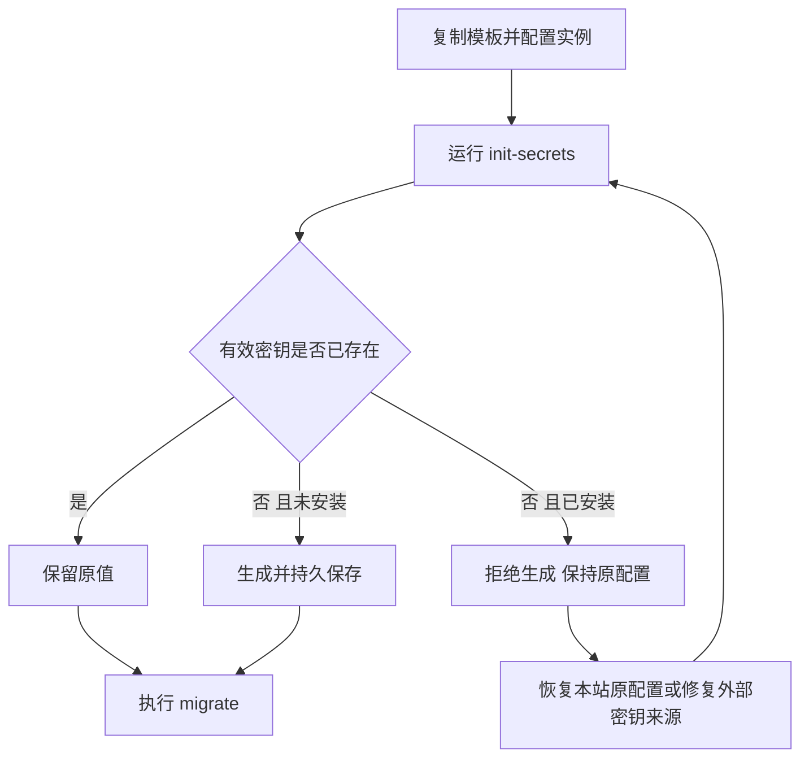
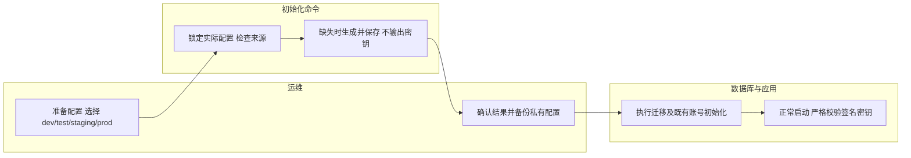

# 手动部署：首次密钥初始化与数据库迁移

## 1. 功能背景与目标

手动部署时，复制 example 文件只会复制模板，不会生成实例身份。首次运行 `database init-secrets` 自动生成并保存独立的 JWT 签名密钥和服务数据加密密钥，无需手工执行随机数命令或粘贴密钥。后续重启、迁移、Setup 和升级沿用原值。

## 2. 角色与适用范围

供本地开发者及 Linux 原生部署运维使用。Docker 初始化及首次 Web Setup 继续使用原有流程。命令只准备密钥，不连接数据库、不创建管理员、不修改 `install.status`，也不启动服务。完全跳过 Setup 的部署仍需按现有受控流程初始化管理员和确认安装状态。

## 3. 整体架构与模块关系

```mermaid
flowchart LR
  CLI[make init-secrets / database init-secrets] --> Shared[共享安装密钥初始化]
  Setup[Web Setup] --> Shared
  Shared --> Config[私有 config.yaml]
  Env[实例 powerx.env / 进程环境] --> Shared
  Config --> Runtime[Core 完整配置校验]
  Config --> Migration[迁移专用配置校验]
  Migration --> DB[数据库迁移]
```

## 4. 核心流程



## 5. 跨角色协作流程



## 6. 前置条件与依赖

- 已更新并构建包含 `init-secrets` 的 `database` 程序；仓库开发可直接使用 Make。
- 实际 `config.yaml` 已存在，明确选择 `deployment.env`，核对数据库连接。新实例保留 `install.status: uninstalled`，不要为跳过 Setup 提前伪装成已安装。
- 使用配置所有者执行。生成密钥时配置权限设为 `0600`；该所有者应是实际服务账户，或由运维配置明确的受控 ACL。命令保留文件所有者，不替运维切换账户或重启服务。
- JWT 来源优先级：进程 `POWERX_AUTH_JWT_SECRET` → 同配置目录的 `powerx.env` → YAML。仅本地开发、且无实例环境文件时才读取开发 `.env`；明确设置 `POWERX_ENV=test/staging/prod` 时不搜索开发 `.env`。
- 外部管理的有效 JWT 不写回 YAML；后续服务、种子和升级必须继续提供同一来源。旧 JWT 变量名必须迁移名称并保留原值。

## 7. 操作步骤

### 7.1 仓库本地开发

已有实际配置不要覆盖。尚无配置时，从模板复制：

```bash
test -e backend/etc/config.yaml || cp backend/etc/config_example.yaml backend/etc/config.yaml
```

编辑 `backend/etc/config.yaml` 的环境和数据库等基础信息后，在仓库根目录依次运行：

```bash
make init-secrets
make migrate
```

使用其他配置时，两条命令明确选择同一文件，`CONFIG` 相对路径按仓库根目录解析：

```bash
make init-secrets CONFIG=/absolute/path/to/config.yaml
make migrate CONFIG=/absolute/path/to/config.yaml
```

预期：初始化输出 `JWT=generated/existing/environment` 及 `server.secret_key=generated/existing`，不打印实际值。迁移成功退出；既有业务表和迁移逻辑仍走集中入口。

### 7.2 原生发行包

由实际配置所有者运行，与服务使用同一配置及外部环境来源：

```bash
/opt/powerx/backend/database init-secrets -config /etc/powerx/config.yaml
/opt/powerx/backend/database migrate -config /etc/powerx/config.yaml
```

重复执行初始化应显示 `existing` 或 `environment`，不会换钥。数据库、媒体和配置备份需包含此实际配置及受保护的外部密钥来源。

### 7.3 Setup、接口与升级

- Web Setup：按[安装向导](setup.md)操作；已由 CLI 初始化的 JWT 会原样沿用，不要求用户再次填写。Setup 的现有 JWT 自动生成路径保持可用。
- HTTP：没有新增匿名密钥生成或轮换接口；离线命令由操作系统文件权限控制。
- 升级：保留实际配置及环境文件，直接走既有升级流程；不要用新模板覆盖。`POWERX_UPGRADE_MODE=1` 时 `init-secrets` 明确拒绝，升级迁移仍采用原有严格预检。
- 普通 `migrate/status` 不依赖 JWT 或 `server.secret_key`，不生成任何密钥；Core、seed、refresh、备份及凭证修复等运行命令继续采用完整配置校验。

### 7.4 本地联调及与 Setup 的衔接检查

密钥初始化及迁移后，由开发者按日常流程启动服务；已有服务则复用，不重复占用端口：

```bash
make dev
```

另一个终端启动管理端：

```bash
npm --prefix web-admin run dev
```

页面例子：未安装实例访问 `http://127.0.0.1:3030/setup`，按向导操作并点击“完成设置”；出现“安装已完成，请重启后端”后，按页面提示重启。事先通过 CLI 保存的 JWT 应被沿用。

只读接口例子（前缀和端口按实际配置调整）：

```bash
curl -fsS http://127.0.0.1:8077/api/v1/admin/setup/status
```

完成安装后的响应关键字段如下，`restart_required` 随当前启动状态变化：

```json
{"data":{"install_status":"installed","configured":true}}
```

CLI 的初始化成功提示不应包含密钥，迁移日志应有 `migrate ok`（控制台或实际配置的日志文件）。Setup 状态接口不生成密钥，也不能代替业务登录验收。

## 8. 预期结果与验收标准

1. 空模板可离线生成两个独立随机密钥；初始化前后其他字段、注释及安装状态保留。
2. 重复执行及多个进程并发执行保持同一实例身份；输出中没有密钥内容。
3. 未配置 JWT 的普通迁移仍可执行；数据库连接和部署身份错误仍会阻断。
4. Core 普通加载仍拒绝空、示例和过短 JWT，升级模式的完整预检不放宽。
5. 已安装实例的缺失/无效密钥不会被自动替换；Setup 重试继续保留原签名身份。

开发验证：

```bash
go -C backend test ./config ./cmd/database ./internal/transport/http/admin/system
```

本轮真实离线 CLI、并发初始化及无运行密钥 PostgreSQL 迁移结果见[本地验证记录](../../../contracts/evidence/manual-secret-initialization-validation-20261016.json)。

## 9. 代码实现映射

| 位置 | 职责 |
|---|---|
| `backend/config/init_secrets.go` | 共享初始化、文件锁、密钥来源、持久保存 |
| `backend/config/setup_auth_secret.go` | Setup 复用 JWT 初始化 |
| `backend/config/migration.go` | 迁移专用配置加载与验证 |
| `backend/cmd/database/init_secrets.go` | 离线 CLI、帮助与安全输出 |
| `backend/cmd/database/config.go` | 按命令选择校验范围 |
| `make_files/database.mk` | 本地命令与显式 CONFIG |

## 10. 常见问题与排障

| 现象 | 操作 |
|---|---|
| 复制 example 后密钥为空 | 执行一次 `init-secrets`，或首次进入 Setup |
| 已安装实例缺少有效密钥 | 恢复该实例原配置/环境文件；不要改为 uninstalled 诱导生成 |
| 外部 JWT 无效、出现旧变量名 | 修复同实例环境文件中的值或名称；命令不会用新密钥覆盖外部配置 |
| 配置不可写或不为普通文件 | 检查实际路径、文件所有者和读写权限；不接受符号链接配置文件 |
| 迁移提示数据库连接或身份错误 | 核对目标配置及数据库权限；无需为迁移生成临时 JWT |
| 迁移通过但服务仍拒绝启动 | 迁移仅验证自身依赖；先初始化或恢复有效运行密钥，再完成其他运行配置 |

## 11. 回滚与风险控制

初始化不修改数据库；失败时不要修改安装状态或删除既有配置来强制重建身份。已生成并投入使用的配置必须持久保留和备份。需要回滚部署版本时沿用该实例原密钥；更换 JWT 会使旧签名凭证失效，更换服务加密密钥还可能使已有加密数据不可读，不能用重复初始化代替密钥轮换流程。

## 12. 变更记录

- 2026-10-16：补齐手动首装密钥初始化命令、Make 入口及迁移校验分离；保留 Setup、Docker 和升级的既有密钥生命周期。
