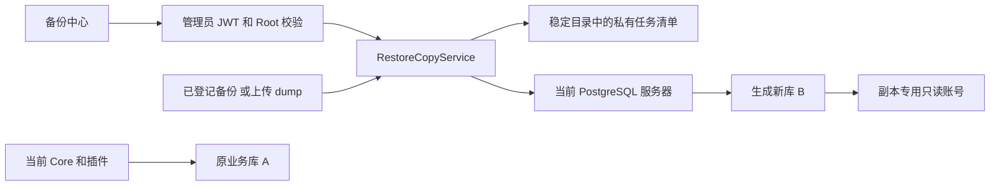
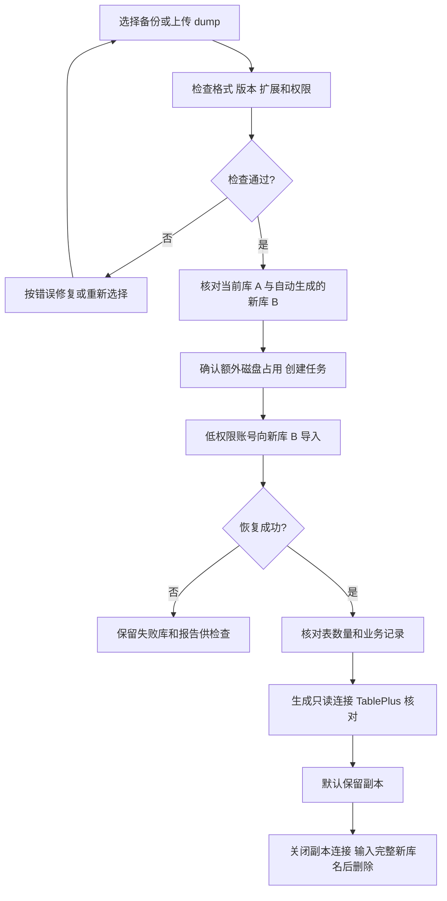
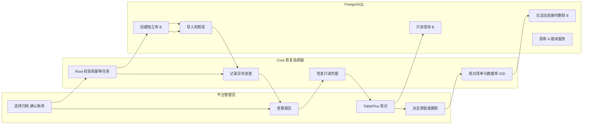

# US5：在界面恢复到独立新库并保留

## 1. 功能背景与目标

从已登记备份或本地 `.dump` 创建一个能用 TablePlus 核对的数据库副本。页面展示恢复进度、业务数量和只读连接，不再要求手写创建数据库和导入命令。

假设当前 Core 使用库 **A**，选择备份 **F**，本次创建库 **B**。操作是 **F → B**。当前 Core 继续连接 A；页面提供连接 B 的独立只读账号。B 保留到管理员手动删除，不受备份策略的 7 天或 168 份规则影响。

本功能不提供 PowerX 应用副本预览和正式库连接切换。看到“恢复完成”表示归档结构和数据导入完成；仍需核对业务记录。

## 2. 角色与适用范围

仅平台 Root 管理员的用户 JWT 可以访问。租户管理员、插件 STS、API Key 均不能访问完整数据库副本或凭据。

目标 PostgreSQL 是当前 Core 已连接的服务器，不能在界面填写别的 DSN、已有库名或 SQL。恢复到本地时，打开本地 PowerX；恢复到远程时，打开对应远程 PowerX。

## 3. 整体架构与模块关系

## 4. 核心流程

## 5. 跨角色协作流程

## 6. 前置条件与依赖

- Core 和 Web Admin 都更新到包含本功能的版本；更新后由服务使用者重启日常服务。
- 当前 PostgreSQL 管理账号具备 `CREATEDB` 和 `CREATEROLE`；准备 `vector` 等需要超级用户的扩展时仍需相应权限。预检查会明确列出缺失项。
- Core 可执行 `pg_restore`、`psql`，客户端能读取所选归档；目标安装了归档所需的允许扩展。
- 恢复协调器使用已加载的密钥加密临时恢复账号密码。不会返回源库密码。
- 目标磁盘有空间。单次上传最多 512 MiB，同一源库一次执行一个恢复任务。
- 当前服务用户能写稳定运维目录。上传归档和任务清单为私有文件，不能放到公开 Web 目录。

| 数据/文件 | 保存方式与保留规则 |
|---|---|
| 新库 B | 存储在目标 PostgreSQL 管理的数据目录中，是数据库，不是一个新的 `.dump` 文件。一直保留到手动删除 |
| 已登记备份 F | 沿用 `storage/backups` 和原备份策略；恢复期间与备份清理共用策略锁 |
| 恢复任务目录 | `POWERX_LINKS_ROOT/storage/restore-copies/<source-key>/`；无 links root 时为当前服务用户 `~/.powerx/storage/restore-copies/<source-key>/` |
| `<source-key>` | 当前连接 host、port、database 的 SHA256，隔离开发/正式实例清单 |
| 任务清单 | `<copy-id>.json`，0600；目录 0700。已删除任务记录保留，用于追溯 |
| 上传归档 | `imports/<import-id>.dump` 和同 ID `.json`；没有创建任务的上传归档，在 Core 运行时 24 小时后清理 |
| 被任务引用的上传归档 | 随副本保留；最后一个引用副本删除后清理。不会删除已登记的原备份 F |
| 只读密码 | 每次生成替换上次密码；24 小时后过期。Core 运行时一分钟内进一步撤销新登录；已有连接需自行关闭 |

清单目录与 release 无关。本机多个 Core 若使用同一源库和目录，仅允许一个恢复协调器持锁。应用重启后，未完成任务标记为中断，不自动继续导入或删除库。

## 7. 操作步骤

### 页面恢复

1. 用 Root 登录，打开 **监控中心 → 备份中心 → 备份操作**。
2. 在备份作业行点 **恢复到新库**，或在 **恢复副本** 区域点同名按钮。选择已登记备份，或上传本机 `.dump`。历史作业的服务器路径已不存在时，上传实际 dump。
3. 点 **检查备份与目标**。核对目标服务器、当前业务库 A、自动生成的新库名格式、归档与 PostgreSQL 版本。缺扩展/权限等错误会显示，不能开始。
4. 如果目标 PostgreSQL 较旧，需要勾选兼容尝试；仍可能失败。只移除 PG17 的 `transaction_timeout` 会话设置，不做表结构或数据转换。跨主版本恢复仍需业务核验。
5. 勾选创建并保留独立新库、额外占用磁盘空间的确认，点 **创建新库并恢复**。
6. 任务显示等待、校验、创建、导入、核验阶段。可以离开页面，后台仍执行；重新进入能查看结果。
7. 看到 **恢复完成** 后展开 **查看核验报告**：核对表数、schema、关键业务数量、警告、SHA256 和 Trace。缺字典等历史问题仅报告，不自动写种子。
8. 点 **只读连接信息**。TablePlus 新建 PostgreSQL 连接，填写页面主机、端口、新库名、专用用户名、密码和 SSL。可复制含密码的完整 DSN。
9. 若页面的主机是远程服务器的 `localhost`/`127.0.0.1`，在 TablePlus 配置 SSH 隧道；不能直接用笔记本的 localhost 代替服务器地址。

### 删除恢复副本

关闭 TablePlus 等连接，点 **删除副本**，输入完整 B 库名后提交。仍有连接、库 OID/所有者改变时返回冲突并保留数据库，不强制结束连接。删除不会修改 A 或原备份 F。

### 接口调用

根地址 `/api/v1/admin/ops/backup/restore-copies`，仅 Root 用户 JWT：

| 方法与路径 | 输入与结果 |
|---|---|
| `POST /imports` | multipart 唯一 `file` 字段，返回上传 ID |
| `POST /plan` | `{ "source_job_id": "1" }` 或 `{ "import_id": "<UUID>" }`，返回目标与依赖检查 |
| `POST /` | 上述来源加 `allow_older_server`，请求头 `Idempotency-Key: <UUID>`；202 返回副本任务 |
| `GET /`、`GET /:copy_id` | 列表或单条报告；不包含密码 |
| `POST /:copy_id/connection` | `{}`；返回只读凭据，`Cache-Control: no-store` |
| `DELETE /:copy_id` | 无 body/query，请求头 `X-Restore-Confirmation: <完整新库名>` |

重试创建时复用相同 Idempotency-Key，不会重复创建数据库。不得使用 query/body 注入 DSN、库名、服务器路径或 SQL。详细 DTO 见 [接口合同](../../../contracts/restore-copies.openapi.yaml)。

### 本地联调

在 `backend` 模块运行 `go test ./internal/service/backup_ops ./internal/transport/http/admin/backup`。真实原生数据库测试为显式开启；环境变量 `POWERX_RESTORE_TEST_ADMIN_DSN` 指向可创建测试库的本机管理员连接。`POWERX_RESTORE_HTTP_TEST_DSN` 与 `POWERX_RESTORE_HTTP_TEST_ARCHIVE` 启用实际 dump 的 HTTP 验收测试，仅用于已知的 AI Craft 19 条验收数据集。测试会清理自己创建的库和角色，不使用 Docker。

## 8. 预期结果与验收标准

- 未授权、租户管理员、STS/API Key 不可执行。
- 新库名由服务端生成；原库 A 与 PowerX 的 DSN 不变化。
- 真实归档导入到 B，报告的表与记录数量符合备份数据。
- TablePlus 能 SELECT，INSERT/DELETE/CREATE 与写入型 SECURITY DEFINER 函数被拒绝。
- 创建重试幂等，删除需完整 B 库名，活动连接与 OID 改变均阻止删除。
- 服务重启后清单保留，中断任务不会偷偷重跑。
- UI 关闭或离开时释放轮询及内存凭据；数据库副本独立保留。

## 9. 代码实现映射

| 位置 | 职责 |
|---|---|
| `web-admin/app/components/ops/backup/RestoreCopiesPanel.vue` | 向导、报告、连接和删除 |
| `web-admin/app/composables/api/services/restoreCopyService.ts` | typed 请求，异步任务与局部加载 |
| `backend/internal/transport/http/admin/backup/restore_copy_handler.go` | Root、严格 DTO、私密凭据响应 |
| `backend/internal/service/backup_ops/restore_copy_service.go` | 幂等、独立角色、新库身份、防误删、凭据到期 |
| `restore_copy_worker.go` | 低权限导入、结果核验、受限 SQL 流 |
| `restore_copy_store.go`、`restore_copy_archive.go` | 稳定清单、私有上传、归档和依赖检查 |
| `backend/internal/bootstrap/app.go` | 单一协调器生命周期与 DI |
| `restore_copy_postgres_test.go`、`restore_copy_handler_test.go` | 原生 PostgreSQL、安全边界、HTTP 验收 |
| `web-admin/tests/unit/backup/restore-copies.spec.ts` | 确认、失败、重试、凭据清理和轮询 |

## 10. 常见问题与排障

| 问题 | 处理 |
|---|---|
| 503 服务未加载 | 更新并重启 Core；检查稳定目录权限、同目录重复实例和加密密钥 |
| 归档已不可用 | 从保存位置取回实际 dump 再上传；导入数据库不会带回原服务器文件 |
| vector 等扩展缺失 | 运维在目标 PostgreSQL 安装对应扩展；重新预检查 |
| 恢复失败/SQLSTATE | 查看阶段、错误码和 Trace。目标库保留，修复后可创建新的恢复任务 |
| 数量为 0 | 核对所选备份的日期及源库；恢复不能找回备份前已缺失的数据 |
| 无法删除副本 | 关闭副本连接；身份变化时人工核对。系统不会自动删同名外来库 |
| 密码不能写数据 | 此账号用于核对，只授予副本 SELECT。完整 PowerX 预览需要后续隔离运行流程 |

## 11. 回滚与风险控制

取消向导不会创建数据库；创建开始后数据库副本会保留到完成、失败或人工删除。一次导入使用单事务，归档读取中断或禁止的 psql 命令会终止导入，避免正常 EOF 提交半份数据。

恢复 SQL 由本次新库专用账号执行，没有超级用户、CREATEDB、CREATEROLE 权限；不会以主库管理员执行归档 SQL。删除绑定实际数据库和角色 OID，不复用同名外来对象。

归档含敏感数据，私有目录和连接信息应按生产数据管理。副本占用额外磁盘，保留规则与备份文件规则分别管理。完整应用预览和正式连接切换应另行评审、停写、核验和制定回滚步骤。

## 12. 变更记录

- 2026-10-11：加入界面恢复到独立保留库、只读连接、严格 Root 边界和原生 PostgreSQL 验收。
