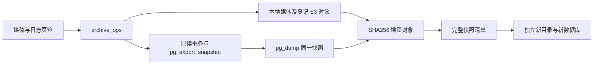
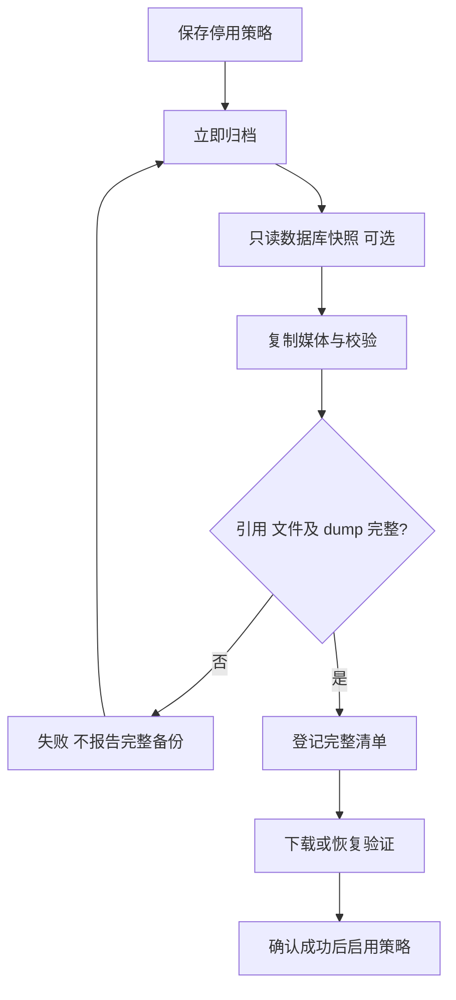
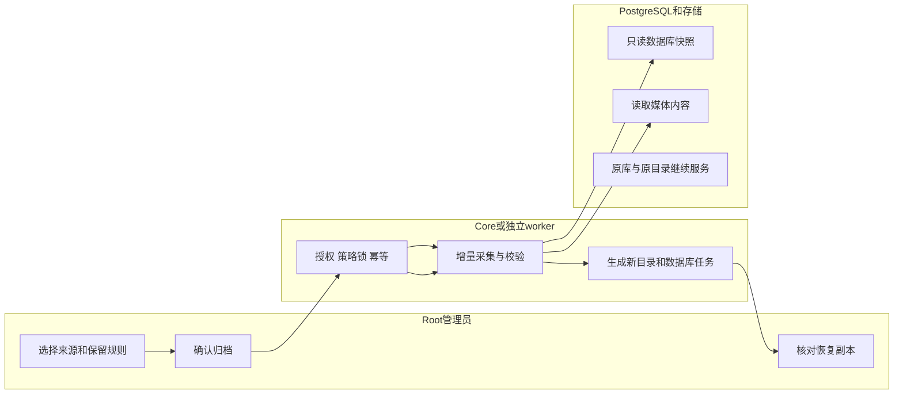

# US6：媒体快照、配套数据库与独立恢复

## 1. 功能背景与目标

数据库 dump 保存媒体记录，但不保存图片、视频、附件和缩略图的实际内容。媒体策略将本地整个媒体目录和已登记 S3 对象备份为完整文件清单；相同内容的文件只保存一个 SHA256 对象。

选择“同时保存数据库事务快照”时，数据库 dump 和媒体引用查询共享 PostgreSQL MVCC 快照。归档会检查所引用文件存在、大小及已登记 SHA256；读取中变化或校验不符时失败。数据库事务快照不等于文件系统／S3 的原子快照：对象应使用不可变 key，原 key 并发覆盖且未登记校验值时仍需要运维协调停写或存储版本控制。

## 2. 角色与适用范围

仅平台 Root 用户会话；普通租户管理员、STS 和 API Key 不可操作整站媒体归档。配置保存在稳定目录，原业务数据库无需新增表。本轮支持本地目录和媒体表登记的 S3 对象；不会列举／备份整个 S3 Bucket 中未登记的对象。

## 3. 整体架构与模块关系



## 4. 核心流程



## 5. 跨角色协作流程



## 6. 前置条件与依赖

- 更新 Core 和 Web Admin；管理员自行重启日常服务。
- 配套数据库需要 `pg_dump`，账号可读取完整库；媒体目录需可读。S3 需要对应读凭据。
- 有足够磁盘空间。媒体对象按内容去重；每份数据库 dump 仍是完整逻辑备份。
- 文件清单、策略、SSH 目标和状态独立于业务库。`POWERX_OPS_ARCHIVE_CONFIG` 指定私有运维 YAML 时优先使用它；无该变量时，Core 从实际配置发布 `runtime-config.yaml`，供独立 worker 使用。

| 产物 | 路径／格式 |
|---|---|
| 保存根目录 | `POWERX_LINKS_ROOT/storage/archives`；无 links root 时为服务用户 `~/.powerx/storage/archives` |
| 策略／目标 | `policies/<UUID>.json`、`targets/<UUID>.json` |
| 完整清单 | `jobs/<UUID>.json`，包含文件路径、大小、SHA256、原数据库、事务快照标识与状态 |
| 增量对象 | `objects/<SHA256前两位>/<SHA256>`；相同内容复用，不按文件名覆写 |
| 下载格式 | 动态生成 `.tar.gz`，包含 `media/`、登记对象的 `s3/`、可选 `database/database.dump` 和 `archive-manifest.json` |
| 恢复目录 | `restores/<恢复UUID>/`，独立创建，原目录不变化 |
| 权限 | 新目录 0700，新文件 0600；配置可能包含数据库／S3 凭据，禁止提交部署配置或公开目录 |

本地默认保留 7 天、最多 168 份。超出任一条件时清理，始终保留最新一份、保护项及未成功异地传输的快照；清理后再删除所有快照均未引用的对象。清单历史保留。恢复目录一直保留到 Root 手动删除，不受备份保留天数影响。

## 7. 操作步骤

### 页面

1. Root 登录，打开 **监控中心 → 备份中心 → 媒体与日志**。
2. 查看下方“服务器来源与保存位置”，确认媒体源目录和保存根目录正确。来源不可用时修复部署配置及权限。
3. “归档策略 → 新建策略”，选媒体来源，设置间隔、本地天数和份数。可选择异地目标；远端保留规则单独填写。默认停用。
4. 勾选“同时保存数据库事务快照”可得到配套 dump；保存后点“立即归档”，确认策略。
5. 作业显示本地完成后，核对文件数、快照逻辑大小、本次新增存储。重复归档相同媒体文件时，新对象存储应减少；配套 dump 仍会增加。
6. 点“下载 .tar.gz”，解压后查看媒体、SHA256 清单及配套 dump。
7. 点“恢复到新目录／新库”，确认后查看独立恢复目录。配套数据库另生成异步恢复任务，进度在 **备份操作 → 恢复副本**；媒体目录完成不代表数据库任务也已完成。
8. 核对文件及数据库业务数量后，编辑或启用策略。Core 自带每分钟策略检查；生产可安装独立 timer，Core 停止时继续执行。

S3 对象恢复为新目录中的文件，不自动写回原 Bucket。完整 PowerX 应用副本预览、原库或原媒体连接切换不自动执行。

### 接口

根地址 `/api/v1/admin/ops/backup/archives`：`GET /` 查询来源和状态；`POST /policies` 保存策略；`POST /policies/:policy_id/run` 创建异步归档，需要 UUID `Idempotency-Key`；`GET /jobs/:job_id/download` 下载；`POST /jobs/:job_id/restore` 恢复。

```bash
curl -H "Authorization: Bearer $TOKEN" -H 'Content-Type: application/json' -H "Idempotency-Key: $ARCHIVE_REQUEST_ID" -d '{}' "http://127.0.0.1:8077/api/v1/admin/ops/backup/archives/policies/$ARCHIVE_POLICY_ID/run"
```

202 的 `data.job` 是任务，轮询查询作业状态；不能把 202 当成已经备份成功。

### 本地验收

从 `backend` 执行 `go test ./internal/service/archive_ops ./internal/transport/http/admin/backup`。原生 PostgreSQL 配套验收需显式设置 `POWERX_ARCHIVE_TEST_DSN` 为可创建测试库的管理员连接。测试创建独立测试库、验证 dump，再清理自建库，不使用 Docker、不改开发业务库。

## 8. 验收标准

相同媒体内容去重；源文件改变后恢复仍能得到旧快照；缺文件／坏校验拒绝成功；dump 可恢复；原业务库和原媒体目录保留；恢复目录被替换时拒绝删除；所有 Agent 测试进程按归属退出。

## 9. 代码映射

| 位置 | 职责 |
|---|---|
| `ResourceArchivesPanel.vue` / `archiveOpsService.ts` | 页面和 typed API |
| `archive_handler.go` | Root 管理路由、严格 DTO、下载 |
| `archive_ops/capture.go` | 媒体 CAS、引用校验、同一事务 dump |
| `archive_ops/service.go` / `store.go` | 独立清单、幂等、策略锁和调度 |
| `archive_ops/restore.go` | 下载、独立目录恢复、保护和本地 GC |
| `internal/bootstrap/app.go` | 实际连接配置与恢复数据库 DI |
| `cmd/archive_worker` | 不依赖 Core HTTP 的独立执行入口 |

## 10. 排障

来源不可用检查实际目录和权限；配套 dump 失败检查客户端与数据库版本、读取权限；媒体 SHA256／大小不符时先核对源记录及文件，不通过删除校验绕过。软链接来源被拒绝。数据库异步恢复失败按 US5 查看 SQLSTATE 和版本依赖。

## 11. 回滚与风险控制

停用策略停止后续自动采集；已有备份保留。删除恢复目录需输入完整恢复 UUID，只删本次目录；对应新数据库由“恢复副本”另行管理。归档目录不得放入媒体来源内部，以免备份自身。业务库不执行 seed、refresh 或迁移。

## 12. 变更记录

- 2026-10-11：加入媒体增量快照、配套逻辑 dump、独立恢复、Root 页面及原生数据库验收。
