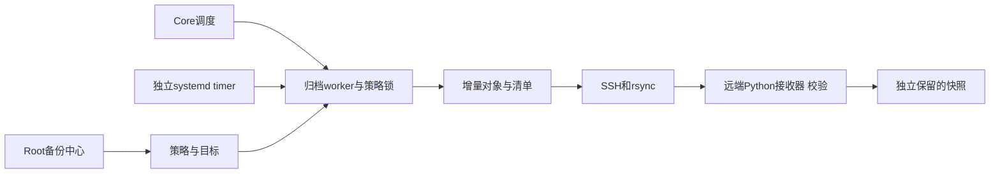
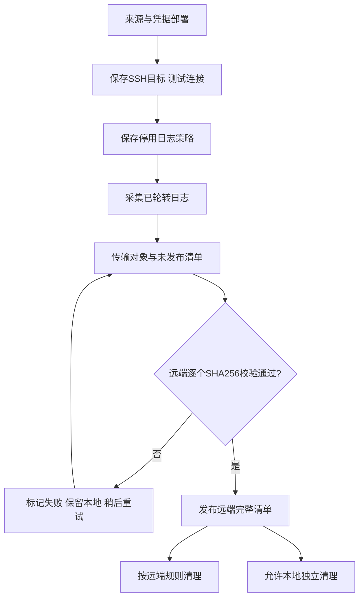
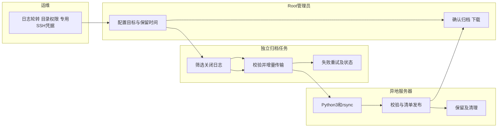

# US7：日志、媒体及数据库文件的异地归档

## 1. 功能背景与目标

源服务器轮转或删除日志后，异地服务器独立保存已确认归档。媒体和数据库文件也可选择同一个 SSH 目标。传输成功后仍需远端逐个 SHA256 校验，最后发布完整清单。

普通 PostgreSQL 操作日志用于追查行为；时间点恢复仍需基础备份和 WAL/PITR，本功能不把 SQL 日志当作 WAL。

## 2. 角色与适用范围

Root 用户配置、执行和下载；部署运维负责可读日志来源、专用 SSH 密钥与主机信任。插件无需修改。当前包含回环 SSH 验收，不代表真实异地服务器已经部署或连通。

## 3. 整体架构与模块关系



## 4. 核心流程



## 5. 跨角色协作流程



## 6. 前置条件与依赖

### 来源与凭据

复制 dist 的 `config/archives.example.yaml` 为 `/etc/powerx/archives.yaml`，编辑实际路径并设为 0600。在实例 env 文件设置 `POWERX_OPS_ARCHIVE_CONFIG=/etc/powerx/archives.yaml`。开发环境使用 `/etc/powerx-dev`、`/opt/powerx-dev` 和独立 instance 标识。

配置声明 `media`、`postgresql_logs`、`database_files` 来源。来源路径在运维文件登记，页面仅选择这些来源，不接受任意服务器路径。PG 日志配置必须给出实际 `current_logfiles` 文件；任务跳过其中活动日志，只收 `.log/.csv/.json/.gz` 的关闭文件。

日志应配置唯一时间文件名及适当轮转频率，归档延迟取决于轮转。建议轮转间隔不大于策略间隔。任务用户仅需读取日志和活动文件指针；不要通过开放整个 PostgreSQL 数据目录来解决权限。可使用精确 ACL 或让 PostgreSQL 运维复制活动文件指针到任务可读目录。PG 停止或目录不可读时任务明确失败。

专用私钥文件 0600；known_hosts 必须提前通过可信渠道核实指纹。不要把私钥粘贴到页面或聊天。配置的 `credentials.<ref>.key_file` 和 `known_hosts_file` 指向服务器文件；页面只保存引用。

接收端需 SSH、Python3、rsync 和目标目录写权限，不需要安装 PowerX 或数据库。接收器是固定脚本，通过 SSH stdin 执行；目标字段不能带 shell 命令。SSH 开启 StrictHostKeyChecking，不自动信任未知主机。

### 独立定时任务

完整 `make dist DIST_VERSION=...` 会编译 `archive-worker` 并复制归档单元。它的 `--version` 与 DIST_VERSION 对齐；查询版本不读配置和数据库。

部署后执行一行命令：

```bash
sudo /opt/powerx/backend/scripts/ops/install-archive-timer.sh prod
```

开发站改用 `/opt/powerx-dev` 和 `dev`。该脚本只安装归档 timer，不重启 Core 或 PostgreSQL。查看 `systemctl status powerx-archive.timer`、`journalctl -u powerx-archive.service`。timer 每分钟检查启用策略；与 Core 使用同一策略文件锁。

无显式配置时，worker 默认读 `POWERX_LINKS_ROOT/storage/archives/runtime-config.yaml`，由 Core 在初始化时生成；它含实际来源／连接，必须保护。worker 不加载 JWT 初始化，不以数据库可连接为前置条件。媒体配套 dump 需要数据库可读，但日志、已有 dump 文件异地保存可独立运行。

## 7. 操作步骤

1. Root 进入 **备份中心 → 媒体与日志 → 异地目标**，点“新增 SSH 目标”。填写主机、端口、用户名、绝对保存根目录和已部署凭据引用。
2. 保存后点“测试连接”。成功表示 SSH 信任、Python 接收器和 namespace 可写；实际文件传输还需首次归档成功证明。
3. 新建策略，选 PostgreSQL 日志来源及该目标。日志策略必须有异地目标。
4. 默认本地保留 7 天／168 份，远端 90 天／2160 份；可按容量修改。超过天数或份数任一上限时清理，最新一份和保护项始终保留。
5. “立即归档”后同时查看本地状态与异地状态。只有“异地已校验”表示接收器确认完整。
6. 失败后保留本地对象，自动指数退避重试，最多 5 次自动尝试；可手动“重试传输”。重试使用原快照，不重新采集变化后的文件。
7. 核验成功后启用策略并安装 timer。Core 停止时日志归档仍由独立 worker 执行。
8. 点击“下载 .tar.gz”获取日志文件和清单。本地已清理但远端仍保留时，系统从远端取回、与本地保存的清单比对后校验，再下载。远端也过期时明确失败。

### 实际远端路径

```text
<目标根目录>/<instance>/<策略UUID>/
  .powerx-archive.json             namespace身份标记
  objects/<SHA256前两位>/<SHA256>   增量对象
  incoming/<归档UUID>.json         尚未发布的清单
  manifests/<归档UUID>.json        已校验发布的完整清单
```

配置根目录后，页面每个作业显示实际远端清单路径。磁盘中的对象按 SHA256 保存，下载时重建原文件名及目录；不会误把远端对象目录当作可直接浏览的日志文本目录。

清理不使用 rsync `--delete`，源文件轮转删除不删除远端归档。远端保留在后续成功发布时执行，故闲置／离线目标会比配置天数保留更久；“保留90天”是成功作业推动的清理规则，不是独立云桶生命周期。

### 接口与本地联调

根地址 `/api/v1/admin/ops/backup/archives`：`POST /targets`、`POST /targets/:target_id/test`、`POST /jobs/:job_id/retry`、`PATCH /jobs/:job_id/protection`、`POST /cleanup`。均需 Root 用户 JWT；更新保护需显式传 `{ "protected": false }` 或 true。

```bash
curl -H "Authorization: Bearer $TOKEN" -H 'Content-Type: application/json' -d '{}' "http://127.0.0.1:8077/api/v1/admin/ops/backup/archives/jobs/$ARCHIVE_JOB_ID/retry"
```

在 `backend` 执行 `go test ./internal/service/archive_ops -run TestSSH -v`。测试启动只在 127.0.0.1 监听的独立 SSH 接收器，使用临时密钥运行真实 ssh/rsync/Python3，结束后关闭端口和子进程；不使用 Docker，不使用个人 SSH 凭据。

## 8. 验收标准

未知主机／错误凭据拒绝；活动日志排除；传输后逐个文件校验；本地清理不删除远端；远端清理只触碰自身标记 namespace；保护项保留；可从远端恢复本地已清理对象；Source 文件和其他目录保持一致。

## 9. 代码映射

| 位置 | 职责 |
|---|---|
| `archive_ops/remote.go` | 严格 SSH、rsync、校验、重试和取回 |
| `archive_ops/receiver.py` | 固定远端协议、namespace、防越界、SHA256、保留 |
| `archive_ops/capture.go` | 排除 current_logfiles 活动日志 |
| `cmd/archive_worker/main.go` | 独立于业务库的定时入口 |
| `deploy/powerx/systemd/powerx*-archive.*` | 正式和开发单元 |
| `install-archive-timer.sh` | 明确实例的单元安装 |
| `make_files/dist.mk` | worker 与版本注入、配置模板、单元打包 |

## 10. 排障

| 问题 | 处理 |
|---|---|
| 没有已轮转日志 | 确认轮转及唯一文件名，等待封存文件；不把活跃文件强行报为完整归档 |
| SSH／接收器失败 | 核实主机指纹、密钥权限、Python3、目录权限；不关闭主机校验 |
| rsync 失败 | 核对两端工具、磁盘和网络，原快照保留，可重试 |
| 文件校验失败 | 核对对象与本地 SHA256，重新传输；不删校验或复用同名外来目录 |
| timer 失败 | 查看 journal；清单保留错误，页面显示未完成异地传输告警 |
| 配置来源与 Core 不一致 | 对齐实际连接与媒体路径，再创建策略；禁止靠字段默认值猜测 |

## 11. 回滚与风险控制

停用策略停止新的归档；停用 timer 只停止独立任务，Core 调度仍需停用策略。SSH 凭据撤销可阻止后续传输，既有远端文件保留。原文件不移动、不删除。日志可能包含 SQL／业务信息，下载权限仅 Root。远端身份标记与清单损坏时拒绝自动清理。

## 12. 变更记录

- 2026-10-11：加入日志与文件 SSH 异地归档、独立 worker/timer、远端保留和回环真实传输验收。
