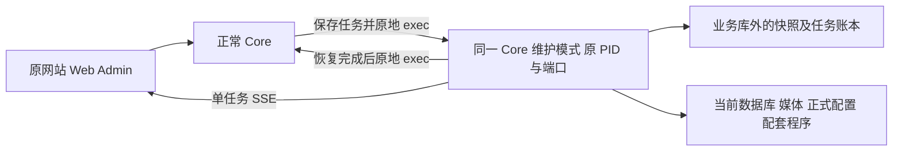
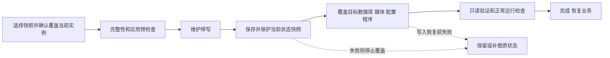
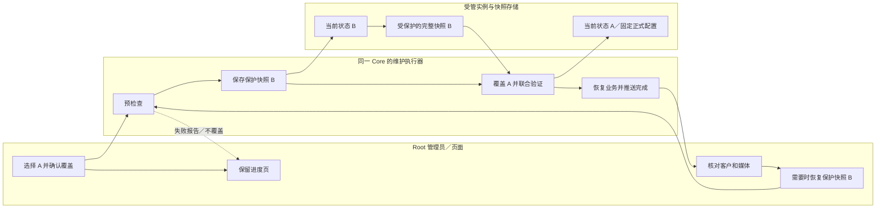

# 系统快照：恢复当前实例与异机验证

> 2026-10-19 调整：普通 Core 启动自动加载维护恢复，沿用原网站、后端端口和启动入口；不再要求另启协调器或访问 33330。当前自动接入的覆盖恢复已验证 dev + PostgreSQL + 本地媒体 + 独占的 Redis 任务逻辑库；共享缓存按实例隔离重建。生产与外部依赖完整合同尚待验收。

> 2026-10-18 调整。恢复表示覆盖目标实例；不再提供长期候选环境、正式切换或切回原环境的页面操作。旧环境切换测试是历史证据，不能作为本流程验收结果。

## 1. 功能背景与目标

快照是备份包，不是运行环境。保存七份快照，仍然只有一个当前 PowerX 实例。恢复期间允许内部临时展开和只读校验，完成后清理，不要求管理员管理多套配置和数据库。

- **恢复当前站点**：快照覆盖当前受管实例的数据库、媒体、应用配置和配套程序。
- **验证备份**：在另一台干净服务器导入完整恢复包，恢复到那台服务器；生产站不变。
- **需要回到恢复前状态**：选择自动生成的保护快照，再执行一次恢复。系统不会合并两份快照之间的数据。

## 2. 角色与适用范围

| 使用者／场景 | 入口与范围 |
|---|---|
| Root 管理员，本地页面测试 | 在当前开发站创建 A、修改为 B、恢复 A，再恢复保护快照 B |
| 运维，恢复当前服务器 | 核对生产恢复合同；当前同进程恢复不得作为生产验收结论 |
| 运维，验证生产备份 | 在另一台干净服务器导入完整包，恢复并核对那台服务器 |

本手册默认操作当前日常开发站 `3030`。A、B 两组操作在同一个站点完成；恢复覆盖同一个数据库和媒体目录。旧 `33330` 及 profile 演练入口保留兼容，不作为本流程前置条件。

## 3. 整体架构与模块关系



## 4. 核心流程



## 5. 跨角色协作流程



## 6. 前置条件与依赖

- 已完成下文[本地启动](#local-startup)，页面能以 Root 正常登录。当前开发入口是 <http://127.0.0.1:3030/ops/backup>。
- 顶部选择“系统快照”，左侧选择“快照备份”。页面应显示快照保存目录、策略表和快照记录表，而不是一直加载。
- “整站恢复”应显示当前实例状态，并提供同站点维护页面。升级后需要按原方式重启 Core，新的启动代码才能生效。
- 当前流程无需 profile、独立服务或新端口。普通启动会登记当前配置路径和唯一数据库；“恢复当前实例”需满足快照可用、当前环境可恢复、无冲突任务。外部数据库连接或共享的 Redis 持久任务库会在维护预检查阶段阻止覆盖，不会强行终止其他程序；其他项目共用缓存库本身不会阻止恢复。
- 本地演练允许显式登记的在线包进行数据演练。缺少同一恢复点 Redis 合同的在线包仍不能作为生产整站恢复凭据。
- 准备两个可辨认的本地文件，例如 `snapshot-A.png` 和 `snapshot-B.png`。使用当前开发实例的本地媒体，外部对象存储另行验收。

## 7. 操作步骤

### 页面测试：A → B → 恢复 A → 再恢复 B

**已经有快照 A，并且之后已经新增 test5、修改 test4 的读者，直接从步骤 5 恢复 A 开始，不要重复步骤 1～4。** 本机已保留的 `2026-10-18 16:17:45`、编号前缀 `65ee8b07` 就是此前的快照 A；已有快照记录可继续使用，无需重新创建 A。恢复前核对时间与编号，新的业务改动应晚于该恢复点。不要把现在的 B 重新备份后当作 A 来恢复。

以下 test4、test5 是测试记录代称；如果已有同名数据，改用带本次日期后缀的新名字。关键是：test5 必须在快照 A 创建完成后才新建。

| 步骤 | 在页面上怎么操作 | 预期结果／失败时看哪里 |
|---|---|---|
| 1. 准备 A | 在当前开发站打开[客户管理](http://127.0.0.1:3030/customers)，点“新建客户”，建立 test4，昵称填 `test4-A`。打开[媒体库](http://127.0.0.1:3030/content/media)，点“上传”，上传 `snapshot-A.png` | 客户保存成功、媒体可打开。保存失败先处理当前表单错误，不继续建快照 |
| 2. 确定策略 | 打开[备份中心](http://127.0.0.1:3030/ops/backup) → 顶部“系统快照” → 左侧“快照备份”。已有“系统默认”策略时直接使用；否则点“新建策略”，设置每天一次（1440 分钟）、保留 7 天／7 份并保存。若该行还没有“系统默认”标记，再点“设为系统默认” | 策略行出现“系统默认”。定时任务可以保持“未开启”；保存策略不产生快照记录 |
| 3. 创建快照 A | 在系统默认策略那一行点“创建快照”，核对使用策略，点“确认执行”。提交后如自动进入进度区，可等待完成再回左侧“快照备份” | “快照记录”新增一行并最终显示“快照包可用”。记下时间和编号，称为 A；这不是名称输入框。不要拿“策略已保存”或“等待执行”当备份完成。失败点该行“查看详情” |
| 4. 制造 B | 回到同一开发站的客户管理，新建 test5；对 test4 点“编辑客户资料”，把昵称改为 `test4-B` 并保存。媒体库再上传 `snapshot-B.png` | 能查到 test5、看到 `test4-B`，且 B 文件可打开。此时无需再手工创建 B 快照，恢复操作会自动保护当前状态 |
| 5. 恢复 A | 回“系统快照 → 快照备份”，在 A 的记录行点“恢复当前实例”；也可进入左侧“整站恢复”点同名按钮，再选择 A。在弹窗核对“恢复点”，勾选“我确认覆盖当前实例，并了解快照之后的改动将由保护快照保留。”，点“确认执行” | 自动进入同站点维护页面，依次显示预检查、保护、覆盖和正常启动验证。只确认一次；保持此页，等恢复状态“完成”。出错点“查看报告”，不要重复提交 |
| 6. 核对恢复 A | 看到完成提示后，点“在新窗口检查当前站点”，再到客户管理和媒体库读取最新结果。会话失效时重新登录 | test5 查不到，test4 昵称是 `test4-A`，A 文件可打开，B 文件不在当前媒体记录里。B 的改动保存在恢复前保护快照中 |
| 7. 恢复 B | 回备份中心 → 顶部“系统快照” → 左侧“整站恢复”。找到刚才恢复 A 的那条记录，在“恢复前保护快照”列点“恢复这份保护快照”，核对恢复点后勾选确认，再点“确认执行” | 再次等待“完成”，重新读取客户和媒体：test5 回来、test4 昵称为 `test4-B`、B 文件可打开。此操作同样先保护恢复前状态，不是切换环境 |

恢复会覆盖当前 `3030` 站点的数据，不会把 A、B 合并。页面上不需要选择 DSN、配置文件或切换环境，也没有第二次“确认正式切换”。如果仍看到“恢复到隔离副本”及“不切换当前正式站”的旧弹窗，请先核对本轮 Web 构建，不要继续按旧页面测试。

页面测试通过后，还应完成下文的完整停启验收。只看到任务“完成”不能替代客户和文件差异检查。

### 业务维护或关闭浏览器后，页面怎么操作

恢复控制台固定为**同一站点下的 `/__powerx_recovery/`**，由同一个 Core 的维护模式提供，不装配业务数据库、插件和业务任务。原 Web 入口／反向代理需要保持运行；本地不要同时停止 Nuxt 开发服务器。恢复中可刷新同一维护网址。

1. **首次准备**：以 Root 登录正常站点，在“系统快照 → 整站恢复”点击“恢复进度与维护页面”。正常 Root 会话会建立最长两小时的独立管理会话。控制台点“保存恢复密钥”，妥善保存下载的 `powerx-recovery-administrator.key`。此步骤不创建新快照、不更改业务数据。
2. **正常恢复**：在控制台“恢复快照”选择已有 A，点“恢复当前实例”，核对编号、勾选确认并执行。自动进入“恢复记录”，显示预检查、保护、维护、覆盖及验证进度。
3. **维护中刷新**：刷新当前网址即可接续任务。无须等待业务登录接口恢复；快照、任务和管理员会话保存在业务库外，由同一个 Core 的维护模式读取。
4. **业务已停止或关闭了浏览器**：Core 进入维护模式期间，重新打开同一站点的 `/__powerx_recovery/`。独立会话有效时直接进入；会话过期或已退出时，在“恢复密钥”中输入先前保存的密钥，再点“验证并进入”。若整个 Core 进程被手工停止或主机断电，必须先按原方式启动 Core；存在未完成恢复时会自动进入维护模式，进程彻底停止期间不会有 HTTP 页面。
5. **恢复完成**：默认三秒后返回当前站点的 `/ops/backup`；如需保留报告，取消“完成后返回站点”。应用会话失效时，在正常站点重新登录。需要恢复 B 时，在恢复记录点“恢复这份保护快照”。
6. **失败或需核对现场**：查看“恢复记录 → 查看报告”。预检查或保护失败不会继续覆盖。写入可能已恢复而失败时保留维护现场；“继续当前实例”只重新验证并启动现有数据，不再次覆盖。验证不通过会继续保持维护。

恢复密钥是当前安装的管理凭证，与业务数据库、JWT 和应用配置分别保存，不随业务快照回退。新服务器会生成自己的恢复密钥；业务仍只有一个当前实例。独立会话使用 HttpOnly／SameSite Cookie，密钥、CSRF 和进度票据不写入 URL 或浏览器存储。退出正常站点或恢复控制台会撤销相应独立会话，并通知其他恢复页面释放旧连接。

<a id="local-startup"></a>

### 本地启动与停启验收（命令行）

更新代码后，使用者在原终端停止自己启动的后端，再按原方式启动。仓库根目录的普通入口保持不变：

```bash
make dev
```

Web Admin 继续使用原来的启动方式和 `3030` 端口。开发服务器会加载新的恢复代理；发布部署需要同步更新 Web 构建。快照包含程序产物，首次尚未构建 Web 时，在 `web-admin` 执行：

```bash
npm run build
```

随后回原来的 <http://127.0.0.1:3030/ops/backup>，不访问 `33330`，不启动 snapshot-tool 协调器。已有 A 可直接进入页面步骤 5。

停启验收安排在页面步骤 6 之后、步骤 7 之前：在原后端终端按 `Ctrl+C`，再执行同一条普通启动命令，确认仍是 A；随后从页面恢复保护快照 B。禁止临时修改 DSN、选择另一环境或重新复制数据库来替代重启验收。

### 正常启动、维护与部署边界

普通 Core 自动登记当前配置文件、DSN、程序和媒体路径。恢复请求先写入业务库外的账本，正常 Core 退出业务生命周期后，以同一 PID `exec` 进入维护模式。维护模式复用原后端端口，不启动业务数据库连接、插件和业务 worker；页面通过原 Web 代理持续接收 SSE。覆盖完成后，原地重新运行正常 Core，业务启动检查通过才显示“完成”。

配置文件旁的私有 `.recovery.json` 仅指向恢复账本；中断发生在配置文件替换窗口时，下一次启动也先处理恢复现场，不会先连接半恢复的业务库。维护密钥和任务账本不随业务快照回退。它们不是另一套运行配置或可切换环境。

macOS 的 `/var`、`/tmp`、`/etc` 系统别名会在验证指向标准 `/private/...` 位置后归一化。启动终端的 `PWD=/var/...` 与配置中的 `/private/var/...` 可混用；不必搬迁仓库或修改终端目录。恢复目标先统一为物理路径，再检查目标间及快照／维护目录的重叠，替换前再次核对路径。业务目录自行建立的软链接仍会被拒绝，错误会列出具体目标。

当前普通启动覆盖恢复限定在 `deployment.env=dev`、PostgreSQL 主库和本地媒体。可重建缓存按当前安装和缓存代次加前缀；恢复后使用新代次，普通重启保持代次，不读取恢复前的旧缓存，也不清空共享缓存库。队列、事件等持久任务库仍按配置登记并去重；这些库存在外部客户端时拒绝覆盖。旧在线 A 没有历史 Redis 队列时，只清理当前实例已登记且独占的任务逻辑库；恢复前保护快照包含这些库的数据，可恢复 B。不会停止 Redis／PostgreSQL 服务，也不会终止其他应用的连接。

早期开发快照的 Core 不支持当前维护／缓存协议时，恢复报告会明确列出 `local_core_adapter`，保留当前 Core 执行器来演练数据恢复。如果这份旧包也没有 `programs/core/platform_capabilities`，则配套保留当前正式能力目录，并增加 `local_capability_adapter` 报告项；当前目录不可用时仍阻止恢复。支持当前协议的新包缺少该目录必须失败，不能按旧包跳过。此兼容仅适用于本地开发演练，不证明旧 Core 或能力目录逐字节恢复，也不放开生产恢复。

Docker／systemd 的正常启动命令保持为原 PowerX 后端，不需要安装额外恢复单元。本轮尚未完成 Linux、生产插件、共享外部依赖和生产队列合同验收；不得把本地测试结果作为正式站可升级覆盖的证明。旧私有 profile、`make dev-recovery` 和 systemd 协调器示例只供既有隔离演练兼容或下文异机验证使用。

恢复密钥首次自动生成。Root 从“整站恢复”打开维护页面后可“保存恢复密钥”；会话过期时使用这份密钥进入同一地址，不要求访问另一端口。正常业务恢复后会话失效可重新登录；不会要求用户切换配置或数据库。

### 另一台干净服务器验证（运维）

先部署匹配平台的 snapshot-tool、PostgreSQL（含所需扩展）、Redis、Node，以及 macOS sandbox-exec / Linux bubblewrap。导入目标使用独立目录和凭据；不要指向源服务器的数据库、队列或媒体。

1. 从生产导出完整包和独立解密口令材料。包必须具有所需组件和受支持的恢复合同；`ready` 不代表生产业务已验收。
2. 在目标按[私有 profile 示例](../../../../deploy/powerx/systemd/recovery-profile.example.json)登记唯一实例，`restore_in_place=true`，只有一个 `allow_overwrite=true` 目标。替换 UUID、工具路径、端口、域名；配置权限 0600。验证服务器把唯一目标的 `mode` 改为 `isolated`、`environment` 改为 `dev`：正常启动也保持 OS 出站隔离并禁用后台业务写入。`initial.root` 必须是不存在的新目录，所有运行组件都属于目标实例。
3. 导入完整包，记录返回的快照 UUID：

```bash
snapshot-tool -action import -directory /var/lib/powerx-recovery/snapshots -file /private/path/snapshot.px -password-file /private/path/passphrase
```

4. 使用**刚导入的真实 UUID**初始化空目标（不能照抄占位符）：

```bash
snapshot-tool -action initialize-instance -profile /etc/powerx/recovery-profile.json -id SNAPSHOT_UUID -confirmation SNAPSHOT_UUID
```

初始化先验证并恢复，随后停止自己创建的进程，保留数据；已经存在的目录或实例记录会被拒绝，不会当成空服务器覆盖。

5. 只读验证阶段有 OS 隔离。正常启动前，必须核对目标环境的外部依赖、业务探针和副作用配置。验证服务器应阻止真实消息、支付、Webhook 和后台业务写入；缺少适配的生产依赖会明确阻断。开发演练 profile 使用 `local=true`、目标 `dev` 并明确列出范围，不能用它冒充生产恢复证明。
6. 用同一个标准协调器服务启动目标，正常登录，核对客户、插件业务、附件、配置和重启结果。恢复后所有后续快照仍从目标实例采集。

跨服务器恢复会映射目标 DSN、Redis、路径、端口及域名；业务配置、插件版本及解密历史数据所需材料随快照恢复。跨平台程序需要私有 profile 中按版本和 SHA 登记的本机产物，不自动把 Linux 二进制当作 macOS 程序执行。

### 接口核对（研发，可选）

页面已经完成以上调用，普通测试无需再发接口。仅在诊断时，Root 会话可读取概览，记录当前 `generation` 后提交快照 UUID；不要沿用过期代次或旧的 `target_id`／`restore_mode`。

```bash
# TOKEN 为当前 Root 会话凭据，只在本机设置，不写入文档或提交日志。
curl --fail-with-body -H "Authorization: Bearer $TOKEN" \
  http://127.0.0.1:3030/api/v1/admin/ops/backup/system-snapshots/recovery
```

概览的 `data` 包含 `configured`、`online`、`generation`、`targets` 与 `jobs`。恢复接口为 `POST /api/v1/admin/ops/backup/system-snapshots/{snapshot_id}/recovery`，请求体为 `{"confirmation":"所选快照的真实 UUID","generation":当前概览代次}`，并带独立 `Idempotency-Key`。成功回执包含 `data.recovery` 与 `data.progress_token`。票据只用于本次独立进度连接，不写入 URL、文档或浏览器持久存储。

## 8. 预期结果与验收标准

| 检查项 | A 创建完成时 | 修改为 B 后 | 恢复 A 后／正常重启后 | 恢复保护快照 B 后 |
|---|---|---|---|---|
| test4 昵称 | `test4-A` | `test4-B` | `test4-A` | `test4-B` |
| test5 | 不存在 | 存在 | 不存在 | 存在 |
| A 媒体 | 可打开 | 可打开 | 可打开 | 可打开 |
| B 媒体 | 不存在 | 可打开 | 不在当前媒体记录中 | 可打开 |
| 页面入口 | `3030` | `3030` | `3030` | `3030` |

配置与程序的完整恢复还需核对联合验证报告，以及自动化验收中的正式配置路径、DSN、媒体内容和程序合同。不能仅凭客户列表变化声称所有外部依赖都已还原。

备份中心的受控界面测试使用模拟后端，证明按钮、确认、布局和推送。另有普通 Core 与真实 PostgreSQL／Redis 的维护页面测试，验证原网站地址发起恢复、自动重连、完成状态及刷新接续；数据差异由原生 A/B 验收单独断言。它们不能替代真实客户、生产插件、Linux 和生产定时包的实机验收。

## 9. 代码实现映射

| 内容 | 位置 |
|---|---|
| 页面入口 | `web-admin/app/pages/ops/backup.vue` |
| 页面按钮、SSE 与纵向分区 | `web-admin/app/components/ops/backup/SystemRecoveryPanel.vue`、`SystemSnapshotsPanel.vue` |
| 维护页面、独立认证、受控恢复 API | `backend/internal/service/system_recovery/portal.go`、`portal_auth.go`、`portal/`；[恢复合同](../../../contracts/recovery-console.openapi.yaml) |
| Root 概览、恢复接口与旧切换接口 410 | `backend/internal/transport/http/admin/backup/routes.go`、`system_recovery_handler.go`；`backend/internal/service/system_recovery/control.go` |
| 单实例队列、幂等、代次与并发 | `backend/internal/service/snapshot_ops/managed.go` |
| 普通 Core 的登记、维护启动与原地 exec | `backend/internal/bootstrap/system_snapshots.go`、`backend/cmd/app/main.go`、`backend/internal/service/system_recovery/current_runtime.go`、`current_startup.go` |
| 当前实例的预检查、保护、覆盖、验证与补偿 | `backend/internal/service/system_recovery/current_restore.go`、`current_files.go`、`current_redis.go` |
| macOS 系统别名与恢复路径边界 | `backend/internal/service/system_recovery/current_paths.go`、`current_files.go` |
| 可重建缓存的实例与代次隔离 | `backend/internal/service/system_recovery/current_cache.go`、`backend/pkg/cache/` |
| 正式配置原子落盘 | `backend/internal/service/system_recovery/installation_config.go` |
| 原 Web 地址代理与重启期间断线传播 | `web-admin/server/middleware/00-recovery-progress.ts`、`server/utils/backup-stream-proxy.ts` |
| 干净目标初始化 | `backend/internal/service/system_recovery/initialize_instance.go`、`backend/cmd/snapshot_tool` |
| 本地普通启动命令 | `make_files/dev.mk` 的 `dev`；`dev-recovery` 仅为旧演练兼容 |

## 10. 常见问题与排障

| 状态 | 含义与处理 |
|---|---|
| 预检查失败 | 不覆盖当前实例；查看包完整性、平台、依赖、密钥及业务报告 |
| 保护快照失败 | 停止覆盖，验证并恢复原实例 |
| 恢复写入前中断 | 下次启动从独立账本和暂存日志补偿，不启动混合状态 |
| 可能已恢复写入后失败 | 保持维护现场，避免自动回退丢弃新数据；运维核对后继续现有数据或选择保护快照恢复 |
| 任务完成但临时清理失败 | 恢复结果仍保留，报告待清理项；不要手动删除活动实例目录 |
| 旧版提示“恢复目标或父目录包含软链接” | 本轮修复了 macOS 标准 `/var` 等系统别名误判。更新后按原方式重启 Core，从已有 A 新建恢复任务；无需重建快照或迁移仓库。若新提示明确指出“非系统软链接”，按列出的路径核对实际业务链接，不能强制覆盖 |
| 旧 A 提示“程序产物不存在，请先完成发布构建” | 先查看报告中的具体组件。早期 A 没有采集正式能力目录，旧实现误当成新包必需文件。更新本轮 Core 并按原方式重启后，可从已有 A 新建恢复任务；本地兼容会明确保留当前 Core 及其能力目录，无须重建 A。新包缺失目录、当前适配目录缺失或其他复制来源读取失败仍阻止恢复，并显示实际来源／目标路径 |
| 共享 Redis 缓存导致旧版恢复失败 | 更新本轮 Core 后按原方式重启，再从已有快照新建恢复任务。缓存自动隔离重建，不必关闭其他项目或修改缓存库号；旧失败记录保留。若新错误明确指向 queue／events 的 DB 号，则是持久任务库冲突，不能绕过检查清库 |
| 恢复入口离线 | 检查原 Core 进程、原 Web 代理及端口；整个进程停止时按原方式启动 Core，未完成任务会进入维护模式。不另起常驻协调器，也不能周期查询代替进度推送 |
| 维护时刷新出现连接错误或纯文本 503 | 核对原 Web／反向代理是否仍运行、恢复路径是否代理至原 Core 地址，以及 Core 是否已更新到维护模式；不要同时关闭原网站入口 |
| 业务维护，普通 Root 登录不可用 | 打开同一站点的 `/__powerx_recovery/`，使用预先保存的恢复密钥；整个 Core 进程停止时先按原方式启动。凭证遗失时由有服务器权限的运维从私有密钥文件取回 |
| 重启后进度不更新 | 检查 Web 构建含本轮 SSE 断线修复。上游重启中断必须同步关闭浏览器连接，随后有上限退避重连并读取一次当前状态；不得加入周期性列表查询 |
| 在 `3030` 点恢复后提示尚未配置托管恢复 | 本次没有提交恢复，也未覆盖业务数据。更新并按原启动方式重启 Core，再在同一 `3030` 页面刷新；检查后端日志中的维护恢复加载错误，无需新建 A 或启动另一实例 |
| 页面仍是“恢复到隔离副本” | 当前是旧页面或其他入口；核对当前网站、本轮构建和原启动终端，不用取消勾选来尝试覆盖 |
| 策略保存了却没有快照 | 策略是执行规则；在系统默认策略行点“创建快照”，等记录显示“快照包可用” |
| 任务完成但客户没变化 | 核对是否在同一开发站、同一租户查看，A 是否早于 B，客户列表是否已重新读取 |
| 看不到“恢复这份保护快照” | 进入“整站恢复”，查看恢复任务表中的“恢复前保护快照”列；需要对应保护包仍可用。尚未完成保护阶段的任务不会有可恢复保护包 |

异步进度通过 `GET /__powerx_recovery/jobs/<UUID>/events` SSE，单任务限时票据只放在 Authorization 头，不能写进 URL 或浏览器持久存储。初次进入、手动刷新、变更事件、断线重连可同步概览；没有页面状态轮询。

## 11. 回滚与风险控制

恢复前保护快照保存失败时停止覆盖。需要回到 B 时，使用页面步骤 7 恢复保护快照；不会合并 A 恢复完成后新增的业务数据。再次恢复前也会保护当时的当前状态。

保护快照自动标记保留。管理员验收并确定不需要后，可以解除快照保护，让整份快照保留策略清理；系统不会把它当作可切回的第二环境。维护期间保留独立进度页；出现“需要核对现场”时不要自行删除目录、切换 DSN 或启动旧进程。

## 12. 变更与本轮验收记录

- 2026-10-19，macOS 路径别名修复：本机启动目录使用 `/var/...`，配置使用 `/private/var/...`，旧校验把标准系统别名当成业务链接。现先验证并归一全部目标，再检查同路径、嵌套及快照边界；替换前再次检查，非系统链接仍拒绝并显示具体路径。当前登记的全部目标只读审计通过；`/var` 混合路径的准备／替换／回退、跨别名嵌套拒绝通过；真实 `/tmp` 别名 PWD + `/private/tmp` 配置下的 A/B、重启、保护快照回退、共享缓存及 3 项浏览器回归通过。辅助恢复目标均限制在自建夹具内，未对日常库执行恢复，自建服务已退出。见[路径验证报告](../../../contracts/evidence/system-recovery-darwin-path-validation-20261019.json)。旧 A 继续使用，更新并按原方式重启 Core 后新建恢复任务，无需修改目录或重建快照。
- 2026-10-19，共享缓存回归补齐：此前将 Redis 缓存 DB 0 也视为整库恢复对象，导致本机多个开发服务共用缓存时被预检查阻止。现按安装和缓存代次重建缓存，整库保护／清理仅处理专用队列、事件库。真实验收持续保留外部缓存连接和数据，A/B、保护快照与完整停启通过；专用 DB 5 被外部客户端占用时仍正确阻止覆盖。桌面、窄屏及网关错误清除共 3 项浏览器测试通过，5 个 Go 包、缓存隔离单元和 vet 通过。旧失败任务未覆盖客户及媒体；更新并按原方式重启 Core 后，从原 A 新建恢复任务，无需重做快照或关闭共享缓存的其他项目。见[共享缓存验证报告](../../../contracts/evidence/system-recovery-shared-cache-validation-20261019.json)。
- 2026-10-19，普通 Core 原端口恢复：无需另外运行协调器、第二实例或维护端口。同一 PID 的正常 → 维护 → 正常恢复、真实 PostgreSQL／媒体／配置 A/B、保护快照 B、Redis 保护、完整停启及外部连接阻断通过；桌面和窄屏真实维护页面 2 项、前端单元 171 项、5 个 Go 包及 vet 通过。已修复重启期间 SSE 上游断开而浏览器连接悬挂的问题。自建进程和端口已释放，日常 3030／8077 未重启。见[本轮验证报告](../../../contracts/evidence/system-recovery-current-process-validation-20261019.json)。当前自动覆盖限定 dev；生产、Linux 和真实生产插件尚未验收。
- 2026-10-18，独立停机恢复入口：常驻恢复控制台、独立管理员会话与恢复密钥、停机后重新打开／刷新／认证、单任务推送和正常托管启动已完成。真实 PG/Core/Web/Redis/媒体/配置的恢复、重启及保护快照回退通过；164 项前端单元、2 项独立控制台和 13 项备份中心浏览器测试通过，见[停机恢复验证报告](../../../contracts/evidence/system-recovery-offline-console-validation-20261018.json)。临时进程与端口已释放；日常 3030/8077 未重启，这是旧独立协调器阶段的记录；当前启动已由本文 2026-10-19 流程替代，远程与 Linux 生产验收尚未执行。
- 2026-10-18，PowerX 开发维护：恢复收敛为覆盖当前实例；自动保护、固定正式配置和重启、异机干净验证。指导更新为页面 A/B 点击流程，启动／停启命令集中放在本地联调小节。
- 2026-10-18，恢复入口可用性修正：未配置、离线、加载失败、实例未登记、包不受支持或任务冲突时禁用恢复并展示原因；刷新同步重读恢复状态。77 项备份单元、发布构建及 13 项桌面／窄屏浏览器夹具通过，见[验证记录](../../../contracts/evidence/system-restore-ui-availability-validation-20261018.json)。此轮未执行真实业务恢复，也未重启日常服务。

[2026-10-18 原地恢复验证报告](../../../contracts/evidence/system-restore-inplace-validation-20261018.json)：真实 PostgreSQL/Core/Web/Redis/媒体的 A/B 覆盖、固定配置与 DSN、完整停启、保护快照恢复、强制中断补偿和独立验证目标通过。真实本地客户、Base、AI Craft 只读接口通过；71 项前端单元、12 项桌面／窄屏浏览器夹具及发布构建通过。临时服务已停止，日常 3030/8077 健康。生产接入、Linux 实机、真实生产定时包及外部 S3 报告验收仍未完成。
