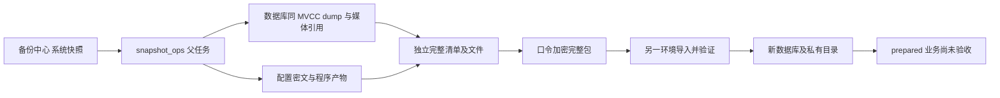
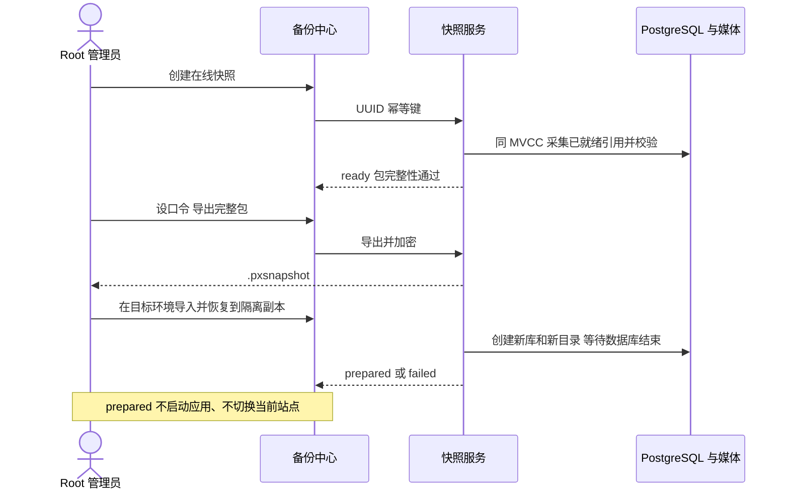

# US8：完整包与历史数据副本操作

> 本页保留完整包和历史数据副本的兼容操作。已配置独立协调器的整站采集、隔离验证和正式切换，按[托管恢复手册](usecase-us8-managed-recovery.md)执行；正式站部署与真实 scheduled 包验收尚需运维完成。

## 1. 业务背景与目标

管理员选择一份恢复包，数据库和媒体不再按日期人工配对。一次采集保存数据库、本地媒体、加密配置及程序产物，离开源服务器后仍能导入和准备独立数据副本。

`ready` 表示包完整性通过；`prepared` 表示数据库和文件副本准备好。两者均不代表应用业务已验收，也不会改变当前站点的数据库、媒体或配置。

## 2. 角色与范围

页面和 API 仅平台 Root 用户 JWT 可用，拒绝普通租户、STS 和插件 API Key。离线工具由操作系统账户的私有目录权限保护，不是网络鉴权入口。

本兼容数据路径基线是单一 PostgreSQL 库（含 Core／插件 schema）及本地媒体，采集整实例的全部租户数据，不随页面当前租户切换。有效媒体引用必须登记 SHA256。在线采集不提供同一恢复点的 Redis 队列状态恢复；只有受控停写包具备独占 Redis 合同。对象存储和独立插件库等未适配项仍阻断整站恢复。

手动和自动快照均在线采集，不暂停客户提交、不停止 Core／插件、不取得阻塞 DML 的表锁。`pg_dump` 与媒体引用共享 PostgreSQL Repeatable Read 导出快照。恢复点之后新建的跟踪单继续保存在运行库，进入下一份快照，本份恢复包不会混入该记录。

媒体仅采集该事务中登记为 `ready`、未删除的本地文件和变体；未完成上传及未登记的文件不属于在线恢复点。逐级目录描述符拒绝软链接，已打开文件固定 inode；若文件在打开前删除、原位覆盖、摘要不符或配置／插件来源改变，本次不会封存为成功。可识别的来源冲突在同一个任务中按 5／15／45 秒退避，最多采集 4 次，每次重建完整临时目录和 MVCC；仍冲突则失败并保留记录，业务继续。磁盘／权限／非法媒体元数据错误不盲目重试。

在线包 `recovery_supported=false`，页面明确显示“在线恢复包”，只可准备隔离数据副本；不复制运行中的 Redis 为假一致性队列。完整在线 Redis／数据库恢复尚无跨组件一致性协议，不能宣称已完成整站灾备。既有受控停写包以及正式切换时保存当前状态的回退点继续走[托管维护路径](usecase-us8-managed-recovery.md)。

## 3. 模块关系



## 4. 页面信息层次

`/ops/backup` 中 Root 默认进入“系统快照”。在同一个“快照备份”分区展示快照策略表和快照实体记录表，导入入口保持可见，手动创建入口放在系统默认策略行，与定时开关无关。单份快照行提供详情、导出和恢复；组件数量、保护状态及 Trace 放在详情弹层，目标数据库和目录在恢复任务中展开查看。

原数据库／媒体功能保留，旧策略不自动迁移或停用。全量采集仍占用磁盘和数据库读取资源，建议低峰执行；页面直接创建在线任务，无暂停写入确认。

状态通过一条共享的 Root SSE 连接更新：`GET /admin/ops/backup/events` 在账本文件实际变更时推送资源失效通知，快照、归档及数据库恢复副本各分区按需读取当前状态。页面无状态定时轮询；初次连接、收到变更、手动刷新和断线重连后才同步。断线会显示提示并按上限退避重连，表单和任务保留；离开页面或切换登录身份后释放浏览器、Node 代理和后端订阅。

SSE 15 秒心跳只保活，不查任务。连接最长一分钟后重新鉴权，JWT 到期也会关闭连接。文件通知不可用时明确报错，不静默退回状态轮询。生产代理须透传 `X-Accel-Buffering: no`，避免把事件攒成整段响应。

## 5. 操作流程与职责



## 6. 环境准备

1. 用户自行启动本地 Core、Web Admin 和所需 PostgreSQL；使用当前分支，不切换分支。
2. 先完成 Web Admin 发布构建 `cd web-admin && npm run build`。采集读取 Core 当前可执行文件、`web-admin/.output`、已安装插件的声明／程序／配置；缺产物时界面阻止创建。
3. Core 实际配置必须使用本地媒体驱动；数据库具备导出快照及 dump 读取权限。媒体来源 `storage.local.base_path` 可沿用 `./storage/media`，相对于 Core 工作目录解析；宿主预检查和实际采集器使用相同的绝对路径，不需要为备份改动业务媒体配置。它与下述快照包保存目录是两个独立配置。隔离恢复需要现有恢复副本服务的专用角色、创建新库与 `pg_restore` 环境，见 [US5](usecase-us5-retained-copy.md)。
4. 快照可配置独立保存目录，备份工作区直接显示实际规范目录和配置来源，并提供“配置说明”弹层。优先级为协调器 `snapshot_directory` > `POWERX_SNAPSHOT_DIRECTORY` > `config.yaml` 的 `system_snapshots.directory` > `$POWERX_LINKS_ROOT/storage/system-snapshots`（安装根为绝对路径时）> `~/.powerx/storage/system-snapshots`。目录、账本、审计、配置密文和 `master.key` 均需私有权限；离线包不依赖源目录中的主密钥。

   ```yaml
   system_snapshots:
     directory: "/var/lib/powerx/system-snapshots"
   ```

   留空保持原默认值。也可在实例的 `powerx.env`／进程环境中设置 `POWERX_SNAPSHOT_DIRECTORY=/absolute/path`；不要只为改变备份位置而修改整个安装根目录。目录必须是绝对路径，可包含空格；不展开 `~`。托管部署以协调器 JSON 为准，Core 与协调器必须使用同一份 profile。

   配置在启动时生效，不接受页面提交服务器路径。修改后由运维重启 Core，托管部署还需更新协调器。不会自动迁移旧数据；要保留历史，停服务后将整个旧目录（包含 `master.key`、`contents`、账本、策略等）迁移到目标，再修改配置并重启。直接指向空目录会使用一个新存储，旧目录不会被删除。不要在任务运行中人工移动存储。

   在线数据包采集明确排除快照存储，避免备份自身；隔离候选将该目录改写到候选根内，不能沿用生产路径。导出的 `.pxsnapshot` 临时文件位于 `staging`，请求完成后清理，浏览器下载位置由用户选择。离线 `snapshot-tool` 的 `-directory` 高于独立环境变量；离线工具不自行读取 Core YAML，使用 YAML 自定义目录时需显式传 `-directory`。
5. 源程序或快照目录不能包含越界软链接。Nitro 产物根内的软链接会物化为普通文件；根软链接、循环或越界均拒绝。

新统一策略默认关闭，每天一次（间隔 1440 分钟），保留 7 天／最多 7 份。已保存策略保持原配置。启用后以保存策略时间为初始锚点，按间隔执行，调度精度约一分钟；修改保留量不重置锚点。失败启动原因在概览展示，执行失败保留父任务记录。

“系统快照 → 快照备份”在同一个工作区直接显示两张表：上方“快照策略”维护配置，下方“快照记录”展示实际创建或导入的快照实体。策略表显示各套配置的周期、保留量、启停状态、默认标记和下次执行时间；实体表显示时间、编号、关联策略／来源、状态、大小及详情、导出和恢复操作。策略较多时在表内滚动，不再把策略列表放进弹层，也不拆成独立分区。

“新建策略”和“编辑策略”打开表单弹层，保存后关闭弹层并更新当前工作区的策略表；已有快照实体记录继续保留。第一套自动成为系统默认，定时默认关闭；可以将所有策略停用。表单错误留在表单，启停错误显示在策略表旁。即使尚无快照实体，已保存的策略也持续显示。

“设为系统默认”在一次原子提交中选择所需策略并关闭原策略的定时任务，新策略保持定时关闭；其他配置继续保留。当前系统策略行独立提供“开启定时／关闭定时”和“创建快照”：手动创建无需开启定时，确认框显示策略名称、执行周期和保留规则。保存、选择系统默认以及开启定时均不会立即备份；已有进行中的快照不会因切换而中断。编辑表单显式勾选“启用自动快照”仍会将该策略设为默认并开启定时。

手动创建使用系统默认策略，允许所有定时任务关闭；自动创建仅在该策略启用定时后执行。“设为系统默认”独立于定时开关，切换默认会关闭旧定时，并保持新策略定时关闭。管理端必须发送 `{ "policy_id": "当前系统策略 UUID" }`，服务端在策略锁内核对；弹窗打开后切换系统默认会拒绝旧选择；仅关闭定时不影响手动创建，不会静默改用新策略。相同幂等键重复请求同一策略返回原任务，即使默认已切换；同键换策略返回冲突。内部协调器为正式切换保留回退点属于独立维护路径，不受自动调度启停约束。任务记录策略身份和当时名称；切换后按各自所属策略执行保留清理，不用新默认的份数清理其他策略的历史包。历史未关联任务归入旧单策略保留范围（不存在旧策略时使用安全默认值），最新包和显式保护包继续保留。

已有 `policy.json` 保持原值，只读兼容为“默认快照策略”。第一次维护策略时将完整集合及默认选择写入私有 `policies.json`，旧文件保留；后续以集合账本为准。策略账本独立于业务库，避免业务数据库恢复覆盖运维调度配置，不用重新迁移业务数据库。旧单策略 PUT 只维护当前默认配置，新客户端必须使用集合接口。

## 7. 页面、接口与离线命令

### 页面步骤

1. 进入“备份中心 → 系统快照”，确认来源就绪。
2. 点“创建快照”，阅读影响并勾选确认；等状态成为“快照包可用”。失败时查看错误与任务 ID，不改用时间接近的历史组件拼包。
3. 点“导出完整包”，设置独立口令，保存 `.pxsnapshot` 与口令到受控位置。口令为 12–1024 个 UTF-8 字节，不写 URL、日志或浏览器存储；遗失不能重置解密。
4. 在另一已启动且 Core 版本匹配的本地／开发实例点“导入恢复包”，选择文件并输入同一口令。导入后默认保护，避免刚导入的旧恢复点立即被保留策略清理。
5. 点“恢复到隔离副本”并确认。统一任务等待数据库恢复完成，再显示“数据副本已准备”；任一阶段失败均为整体失败。展开查看新库和私有目录。
6. 此阶段没有“应用验证通过”或“正式切换”按钮；不要把源配置解密后直接交给应用启动。目标部署身份、插件绑定、凭据和后台隔离需要下一阶段完成。

### API

真实前缀由 Core 配置注入，默认基址 `/api/v1/admin/ops/backup/system-snapshots`。完整合同见 [OpenAPI](../../../contracts/system-snapshots.openapi.yaml)。

| 操作 | 相对基址的请求 | 结果 |
|---|---|---|
| 概览 | `GET` 空路径 | `data.overview`，含来源、策略、下一次执行和父任务 |
| 策略列表 | `GET /policies` | `policies/default_policy_id`，至多 100 套配置 |
| 新建／编辑策略 | `POST /policies`、`PUT /policies/{id}` | `name/enabled/interval_minutes/retention_days/retention_count` |
| 启停／默认切换 | `PATCH /policies/{id}/status` | `enabled`；启用即原子停用其他策略并设为默认 |
| 兼容旧单策略 | `PUT /policy` | 只维护当前默认配置；新页面不再调用 |
| 创建 | `POST` 空路径，body `{ "policy_id": "系统默认策略 UUID" }`，UUID `Idempotency-Key` | 202、`data.snapshot`；缺失策略 400，已切换／同键换策略 409 |
| 导出 | `POST /{snapshot_id}/export`，JSON `password` | 校验完成后的加密二进制包 |
| 导入 | `POST /imports`，multipart `file/password` | `data.snapshot` |
| 准备副本 | `POST /{snapshot_id}/restores`，JSON `confirmation=snapshot_id`，UUID 幂等键 | 202、`data.restore` |
| 查恢复 | `GET /restores/{restore_id}` | `prepared/failed/interrupted` 等父状态 |
| 保护 | `PATCH /{snapshot_id}/protection`，JSON `protected` | 更新后的快照 |

不接受自由命令、SQL、DSN、源／目标服务器路径或 query 覆盖。创建及恢复遇到响应不确定时保留同一幂等键重试。不同执行任务互斥，409 可稍后重试。

### 离线包工具

不启动 Core、不连接数据库也能列出、导出及导入包。当前工具没有采集、数据库恢复或正式切换命令。发布构建会生成 `backend/snapshot-tool`；本地可在 `backend` 下运行：

```bash
# 列出已有私有快照目录
# 示例路径替换为本次源／目标的绝对路径
go run ./cmd/snapshot_tool -action list -directory /absolute/source/snapshots

# password-file 必须为预先安全准备的 0600 普通文件；不在参数中传明文口令
go run ./cmd/snapshot_tool -action export -directory /absolute/source/snapshots \
   -id '<实际快照UUID>' -file /absolute/output/restore.pxsnapshot \
   -password-file /absolute/private/package-password

# 新目标目录可以为空，导入后按目标主密钥重新封装配置解密材料
go run ./cmd/snapshot_tool -action import -directory /absolute/target/snapshots \
   -file /absolute/output/restore.pxsnapshot -password-file /absolute/private/package-password
```

通过离线工具导入后，如需由目标 Core 页面继续准备副本，`-directory` 必须与目标 Core 的默认保存目录解析到同一路径；离线工具不修改 Core 配置。

导出文件不覆盖既有路径。包最大 8 GiB，配置明文总量最多 16 MiB。导出／数据副本准备前核对空间，解包逐文件检查空间并预留 128 MiB；数据库新库的额外容量仍由 PostgreSQL 环境提供，失败不会切换站点。

## 8. 本地回归与预期结果

在仓库根目录运行服务／HTTP 合同测试：

```bash
GOMAXPROCS=2 go -C backend test -p 2 ./internal/service/snapshot_ops ./internal/transport/http/admin/backup
```

原生 PostgreSQL A/B 用例需要显式指定专用本地连接，角色可创建数据库且本机具备 `pg_dump/pg_restore`。测试仅创建并清理本次随机命名的 `px_snapshot_test_*` 库；不复用已有业务库：

```bash
POWERX_SNAPSHOT_TEST_DSN='postgresql:///postgres?host=/tmp&sslmode=disable' \
  GOMAXPROCS=2 go -C backend test -p 2 ./internal/service/snapshot_ops \
  -run '^TestNativePostgresPortableRestoreAWithSourceAtB$' -count=1 -v
```

Web Admin 中运行 `npx vitest run tests/unit/backup`，构建后运行 `npx playwright test --config playwright.snapshots.config.ts`。浏览器回归使用模拟 API，证明页面操作、确认、状态和下载；真实 JWT、加密和 PostgreSQL 分别由 Go 测试证明，不能把浏览器模拟结果写成整站验收。

原生结果必须是：A 的订单／媒体恢复到新目标，B 的源库记录保留；移除源快照、主密钥和媒体仍可从导出包恢复。错误口令、坏摘要、缺文件、引用清单不一致及路径逃逸不得导入为可用快照。

脱敏验证结果见[第一阶段验收记录](../../../contracts/evidence/system-snapshot-package-validation-20261015.json)。浏览器为 macOS Chromium 加模拟 API；原生数据库用例使用本地 PostgreSQL 的独立新库，未启动恢复应用。

## 9. 代码映射

| 位置 | 实际职责 |
|---|---|
| `backend/internal/service/snapshot_ops/` | 父任务、独立账本、锁、加密、完整包、数据副本及重启识别 |
| `archive_ops/system_component.go` | 同 MVCC 数据库／媒体采集；使用独立对象目录避开旧 GC |
| `internal/bootstrap/system_snapshots.go` | 生效配置／产物来源、原生适配和数据库副本装配 |
| `internal/http/snapshot_guard.go` | 采集期间 HTTP 写请求门禁 |
| `internal/transport/http/admin/backup/snapshot_handler.go` | Root typed API，默认前缀之外的挂载也有测试 |
| `cmd/snapshot_tool/`、`make_files/dist.mk` | 离线包工具及发布产物 |
| `web-admin/app/components/ops/backup/SystemSnapshotsPanel.vue` | 主流程及分层详情 |

## 10. 排障

- **来源未就绪**：刷新概览、创建快照和启用策略时，服务都会重新枚举当前来源。插件卸载／升级／重装后，不再检查启动时保存的旧版本目录；补齐同一路径下的 Web Admin 构建后，点击刷新即可重新检查。真正缺失的程序会标明 `core/powerx`、`core/web-admin` 或具体插件／版本／文件，不应将插件文件问题按 Core／Web 构建处理。修改配置文件本身仍需由用户重启 Core 使配置生效。
- **macOS 程序产物软链接越界**：相对插件路径须先转绝对路径，再解析规范路径，避免 shell 的逻辑 `PWD`（如 `/var/...`）与实际 `/private/var/...` 被误判为两个目录；当前已修正。真正越出产物根的链接仍拒绝，错误会标明产物组件与相对路径。升级并重启自己运行的 Core 后重新创建快照；已有失败记录不自动变为成功。
- **页面显示等待执行**：只表示任务已登记，以之后的采集／验证／失败状态为准。失败会显示原因，详情也随 SSE 更新；旧的 queued 创建回执不能覆盖已推进的状态。断线时使用页面手动刷新，不加周期查询。
- **仍有业务写入请求／SNAPSHOT_WRITE_PAUSED**：这是旧停写实现的错误；新在线采集不返回该错误。升级后重启用户自己运行的 Core 和协调器，确认实际执行版本；已有失败记录不会自动变为成功。
- **媒体校验失败**：核对仍标记为 `ready` 的资产／变体是否都有真实原文件及正确 SHA256。缺校验值和原文件缺失是两类问题：现存文件可在核验后补齐校验值；缺失文件应先找回原件，确认无法找回后再决定是否纠正附件状态。不得伪造空文件、跳过完整性校验或自动删除业务记录。
- **等待自动重试**：查看记录中的尝试次数和下一次重试时间，通过 SSE 更新；连续 4 次来源冲突后明确失败。不要让客户重复登录或重提业务。
- **409**：其他采集／导出／导入／恢复正在执行，或相同快照已存在。响应丢失的创建／恢复使用同一幂等键。
- **507**：清理经过确认的无关临时文件或提供更大目标卷，保留快照与候选数据；不自动删除已有数据库腾空间。
- **本机主密钥丢失**：已有内容时拒绝生成替代密钥；恢复原 `master.key`，或在新目录导入外部完整包。删除主密钥不能当作重置。
- **恢复失败**：展开父任务错误及关联数据库副本报告。媒体复制完也不能视为成功。
- **进程中断**：重启识别为 `interrupted`；保留候选新库与目录，重新发起新任务，不猜测已切换。

## 11. 风险、清理与回退

此阶段恢复始终写新库和私有目录，当前业务环境无需切换回退。恢复副本不会被快照保留策略自动删除；清理仅限确认属于该任务的资源。快照清理按整份内容执行，保留最新可用份及保护项，活动任务持锁。

采集、导出和恢复会占用数据库、磁盘与维护时间。在线数据包没有跨 PostgreSQL／Redis 的完整一致性协议，不启动副本应用或正式切换；受控维护恢复另见托管手册。保留既有可验证备份，生产 scheduled 包的异机恢复验收通过前，不宣称完成生产整站灾备验收。

## 12. 变更记录

- 2026-10-18：修正本地相对媒体目录已通过预检查、实际采集器却仍收到相对路径的问题；原生 PostgreSQL 回归通过 Core 装配入口验证手动／定时采集及导出包的隔离 A/B 恢复。加载修复后需重新编译启动 Core，旧失败任务保留原状态。
- 2026-10-17：快照、归档、恢复副本和独立恢复进度改为 SSE 事件推送；移除页面状态定时器，补齐断线恢复、身份切换和代理取消；将禁止常驻状态轮询写入 `AGENTS.md`。
- 2026-10-17：修复重叠写请求导致采集锁长期无法获得的问题；增加排空与取消后恢复写入的回归，原生 PostgreSQL A/B 演练覆盖重叠轮询请求。授权修复本地旧媒体后，真实站点仍须加载新锁实现再验证快照包创建。
- 2026-10-17：修复来源预检查沿用启动时插件清单，导致卸载旧版、重装新版后误报 Core／Web 构建缺失的问题；预检查动态刷新，协调器派发前更新加密来源清单，保留真实缺失与部署合同错误的阻断。
- 2026-10-15：实现统一包、Root API、离线导出导入、统一策略、页面及隔离数据副本；原生数据库 A/B 通过。此记录属于原包／数据链路；后续整站验证、切换与中断回退见[托管恢复手册](usecase-us8-managed-recovery.md)，线上环境未调整。
