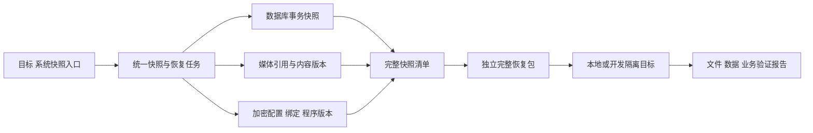
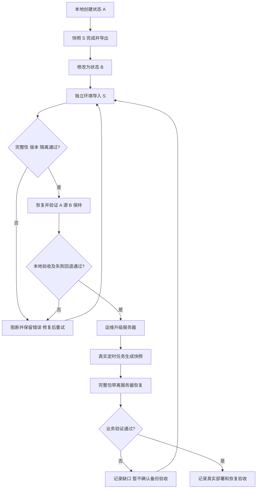
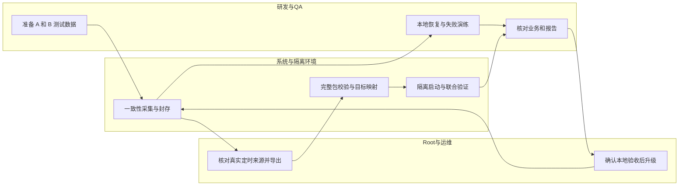

# US8：系统快照、本地回退与生产备份跨环境恢复验收

> 状态：2026-10-15 本地实现与原生整站 A/B、切换、协调器 SIGKILL 回退已通过，见[托管恢复手册](usecase-us8-managed-recovery.md)和[本地证据](../../../contracts/evidence/system-snapshot-managed-validation-20261015.json)。本文继续作为实际业务和部署后真实定时包的验收门槛；Linux 运行、实际已启用插件与生产第二轮未验收。设计依据：[系统快照计划](../../../plan/deploy/system-snapshot-and-restore.md)。

## 1. 功能背景与目标

管理员选择一个完整系统快照，系统统一恢复数据库、媒体、必要配置和匹配的程序版本。验收分两轮：先在本地用几分钟的受控业务操作证明状态回退正确，再把部署后真实定时生成的快照带离服务器，在本地或独立开发环境恢复验证。

## 2. 角色与适用范围

研发实现恢复包与隔离模式；QA 核对业务和失败链路；平台 Root 发起快照和恢复；运维负责升级、目标资源和正式维护窗口。首版基线为 PostgreSQL + 本地媒体。正式恢复与隔离演练是不同模式，跨环境演练不得切换正式实例。

## 3. 整体架构与模块关系



## 4. 核心流程



## 5. 跨角色协作流程



## 6. 前置条件与依赖

- 统一快照、完整导入／导出、隔离恢复及聚合报告已经实现；当前只有 US3／US5／US6 的组件级能力，不满足这一前提。
- 目标使用独立数据库、媒体目录、配置、端口和进程；确认磁盘可容纳恢复包、解包对象、候选库及回退数据。
- 备份包、解密材料、匹配版本及目标平台安装产物均可在源实例不可访问时取得。macOS 使用相应平台程序，不能直接运行 Linux 服务二进制。
- 目标 PostgreSQL／扩展兼容；配置和插件数据库绑定按目标 `deployment.env` 映射。不能复用生产库、生产媒体路径或生产服务凭据作为默认目标。
- 恢复模式在启动前禁用业务定时任务、事件／队列消费及外部业务发送。测试账号由恢复流程明确提供；不携带生产登录会话。
- Agent 临时启动服务时按 AGENTS.md 记录 PID、命令、工作目录、端口；验收结束关闭自建进程及子进程，确认端口释放。用户自行启动的服务由用户管理。

## 7. 操作步骤（按场景拆分）

### A. 本地第一轮：几分钟操作后恢复

| 步骤 | 动作与入口 | 预期结果 | 失败处理 |
|---|---|---|---|
| 1 | 在自建本地测试实例创建业务状态 A：记录测试工单／订单标识、字段值，上传原图及附件并生成缩略图 | 可从业务页面查看，记录逻辑标识、数量和内容校验结果 | 业务或上传失败先修复，不开始采集 |
| 2 | 目标页面“备份中心 → 系统快照 → 创建快照”，核对包含数据库、媒体、配置和版本 | 记录快照 S；全部必需组件通过，显示完整可恢复 | 父任务失败时查看组件错误和 Trace，不使用半成品 |
| 3 | 导出 S 的完整恢复包；解密材料按独立受控方式保存 | 导出完成且清单与全部引用内容齐全 | 缺对象或密钥时导出失败，不能显示完成 |
| 4 | 在源测试实例形成状态 B：新增记录，修改 A 中字段，删除一条测试记录或媒体；配置变更仅使用无外部业务影响的测试项 | B 与 A 明确不同，截图／检查记录可比较 | 误操作用户已有数据时停止；测试只使用自建数据 |
| 5 | 在另一自建目标中，目标页面“导入快照 → 恢复测试”，核对新库、媒体根目录、域名、绑定和隔离规则 | 预检查通过，目标与源完全分离 | 目标指向生产、配置不完整或版本不兼容时必须阻断 |
| 6 | 发起恢复，查看统一任务的数据库、媒体、配置及应用验证进度 | 全部完成；任一子任务未完成时不显示整体成功 | 保留候选环境和错误报告，不改源 B |
| 7 | 用目标地址打开业务页面，核对 A 的数据、媒体、权限和插件；确认 B 后新增数据未出现 | 恢复的是 A；源实例仍为 B，未发生外部业务发送 | 任一业务检查失败，结论为未通过，不以表数或健康接口代替 |
| 8 | 仅在自建测试实例演练正式切换及一次切换失败 | 维护、回退点、统一切换和恢复服务可验证；失败可回退整套环境 | 不能只回退数据库而留下不同时间的媒体／配置；保持停写直至一致 |

不能用“缺少的文件还在原服务器，因此恢复成功”作为通过依据。可以复用目标已有且 SHA256 完全一致的内容，但完整包必须能在一个空目标独立恢复。

### B. 部署后第二轮：真实定时快照带离服务器

1. **运维升级**：第一轮通过后按现有部署流程升级 Core、Web Admin 及必要执行器；核对版本，配置统一快照策略。失败按发布流程处理，不自动改旧策略或删除旧产物。
2. **观察调度**：至少观察一个真实计划周期，可按一天验收；目标“系统快照”列表应显示 `scheduled` 来源、真实间隔、时间和完整组件。未触发先检查调度、服务、锁和告警，手动快照不能代替这一证据。
3. **完整导出**：选择自动生成的快照，在目标详情中核对数据库、媒体、配置、程序版本及验证结果，下载完整包。导出失败先修复，不转而手动拼接独立 dump 和媒体。
4. **独立导入**：把完整包传到本地或独立开发目标，禁止目标访问源实例及生产业务写入口，完成目标配置／身份映射后恢复。缺解密材料或产物应在预检查阶段明确失败。
5. **业务检查**：按快照时间核对关键记录、原图／附件／缩略图、文件 SHA256、租户权限、插件绑定和登录；确认恢复过程中正式站继续保持原状态。
6. **留存报告**：记录真实任务 ID、包完整性、目标版本、隔离与业务检查、耗时和结论。任何一项未通过都不宣称整站备份已验收。

等待一天用于覆盖实际调度与部署链路；手动快照的本地恢复测试可立即进行，不必等待一天。

### C. 当前可执行的组件基线

当前页面 `/ops/backup` 的“备份操作 → 恢复到新库”只创建数据库副本；“媒体与日志 → 恢复到新目录／新库”只恢复所选归档及其可选配套数据库，不切换正式站。详见 [US5](usecase-us5-retained-copy.md) 与 [US6](usecase-us6-media-archives.md)。

已有接口示例（只读核对来源，**不是统一快照接口**；地址改为实际本地 Core 地址，使用自己的 Root 用户 JWT）：

```bash
curl -fsS -H "Authorization: Bearer $TOKEN" \
  http://127.0.0.1:8077/api/v1/admin/ops/backup/archives
```

响应结构片段如下（省略其余字段，空数组仅作结构示例，不表示当前实例状态）：

```json
{"data":{"overview":{"sources":[],"policies":[],"jobs":[]}}}
```

预期返回 `data.overview` 的来源、策略和作业。403 检查 Root 用户会话；503 检查运维配置与来源。系统快照 API／CLI 见[冻结合同](../../../contracts/system-snapshots.openapi.yaml)和[托管恢复命令](usecase-us8-managed-recovery.md#7-独立命令)。

从 `backend` 执行的现有组件回归命令：

```bash
go test ./internal/service/backup_ops ./internal/service/archive_ops ./internal/transport/http/admin/backup
```

这条命令不能替代本节两轮业务验收；原生 PostgreSQL 集成测试需各组件文档规定的显式测试连接。日常服务由用户启动；不要因文档示例擅自重启正式站。

## 8. 预期结果与验收标准

| 检查项 | 必须成立 |
|---|---|
| 恢复点 | 数据库、媒体、配置与版本属于同一快照，不能用文件时间接近替代 |
| 可移植性 | 源实例不可访问、目标原先为空时，仍可从完整包恢复 |
| 媒体 | 所有有效引用能解析，大小和内容摘要匹配，业务页面能打开 |
| 状态 A／B | 目标为 A，源 B 不变，B 后新增记录不出现在 A 中 |
| 目标隔离 | 没有连接生产数据库／媒体／队列，没有发起外部业务写入 |
| 聚合进度 | 数据库或配置失败时，即使媒体复制成功，也显示整体失败 |
| 正式切换 | 自建测试实例验证统一切换、中断处理与整套回退 |
| 真实调度 | 部署后至少一份真实 scheduled 快照在另一环境通过恢复 |

失败用例必须覆盖：缺媒体对象、坏校验、缺配置、错误解密材料、不兼容版本／扩展、目标指向生产、磁盘不足、并发修改、重复请求、进程中断及切换阶段失败。

报告记录快照／恢复 ID、源／目标模式与版本、各组件状态、业务断言、文件校验、隔离结果、RTO 和失败／回退阶段。生产业务正文、密码、密钥与完整连接串不进入公开报告。

## 9. 代码实现映射

| 现有位置 | 可复用能力与缺口 |
|---|---|
| `backup_ops` | 数据库 dump、副本与验证；缺统一父任务及正式切换 |
| `archive_ops/capture.go`、`restore.go` | 媒体 CAS、配套 dump、独立目录；缺配置／版本组件和统一状态 |
| `internal/bootstrap/app.go`、`config/recovery.go` | 启动前校验、后台停用及 HTTP／gRPC 只读守卫 |
| `internal/transport/http/admin/backup/` | 现有组件接口；已增加包／数据副本合同；Root 恢复和正式切换合同已实现 |
| `app/pages/ops/backup.vue`、`ResourceArchivesPanel.vue`、`RestoreCopiesPanel.vue` | 现有页面；系统快照入口已实现；独立目标、联合验证及二次确认已实现 |
| `cmd/archive_worker`、systemd 部署文件 | 独立采集基础；新增 `system_recovery` 协调器、active 指针、检查点及补偿 |

## 10. 常见问题与排障

- **只有 `.dump`**：仅有数据库，不是完整系统包；回到快照来源补齐组件，不手工拼接时间相近的媒体。
- **能复制文件却打不开业务**：核对驱动、路径映射、引用、权限、插件绑定及程序版本；文件复制成功不代表应用可用。
- **源站在线才能恢复成功**：说明包或目标仍依赖源内容／密钥／服务；判定可移植性失败。
- **Mac 无法运行包内程序**：核对目标平台产物；数据恢复和程序平台兼容分别检查。
- **媒体成功、数据库失败**：父任务保持失败，保留候选环境，按数据库阶段错误处理，不切换。
- **隔天未生成快照**：检查真实策略间隔、启停、锁、服务与失败记录，不按策略名称猜测每天执行。

## 11. 回滚与风险控制

跨环境演练只写自建目标，不改源实例。失败保留记录和候选对象；清理须按本次任务身份删除，不覆盖既有数据库或目录。

正式切换只在明确维护窗口和当前环境回退点已保存后执行；协调器停止全部写入并按账本处理失败。数据库、媒体、配置和程序版本一起回退。恢复业务写入后的回退涉及新数据，必须另行判断，不能自动丢弃。

## 12. 变更记录

- 2026-10-15：按用户对齐的统一系统快照概念新增两轮验收方案；第一阶段已另行实现并回归包／隔离数据链路；已追加原生整站验证、切换及真实协调器中断回退；Linux／实际插件与生产定时第二轮仍待验收，线上策略和部署未调整。
