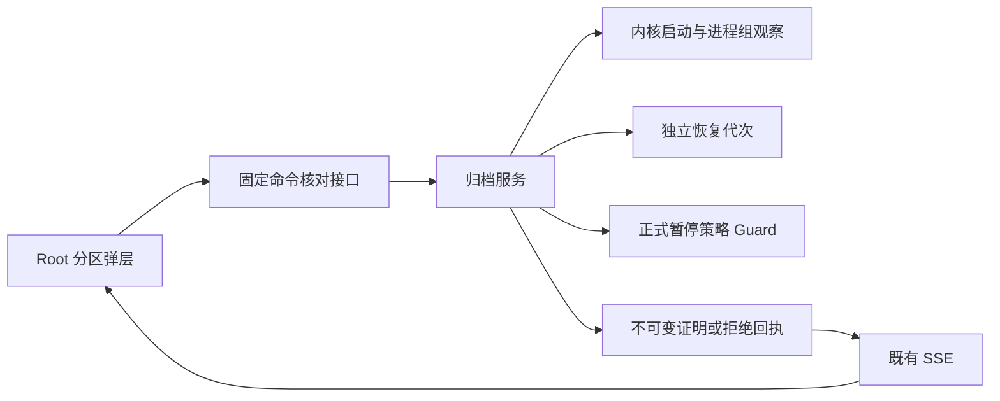
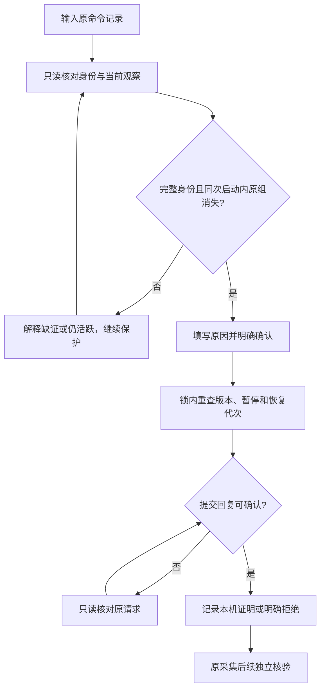
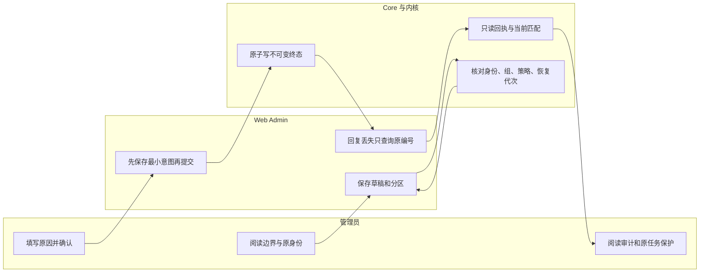

# US9：核对本机命令并记录人工证明

## 1. 功能背景与目标

组件被强杀后，原命令可能仍在运行。此流程用启动身份和进程组观察核对，再由管理员明确记录本机证明，避免仅凭“PID 不见了”解除保护。

## 2. 角色与适用范围

平台 Root／运维处理有原任务身份的命令。只确认本机前台组退出，不结束采集、不删除内容、不启用策略，也不代表远端提交成功。目标探测和旧记录缺证继续保护。

## 3. 整体架构与模块关系



## 4. 核心流程



## 5. 跨角色协作流程



## 6. 前置条件与依赖

- 新 Core overview 的 command_confirmation_version=1，真实 Root 用户会话。
- 有原任务的未知命令记录，完整新协议启动身份；原任务、命令和执行对应。
- 原策略明确暂停归档和远端清理，正式控制链及独立恢复锚可用；原执行锁可取得。
- 进程仍在时先由运维核对真实归属并在外部完成结束。产品不提供裸 PID 杀进程入口。
- 无需配置 OSS 或重启日常服务来运行隔离验证。

## 7. 操作步骤（按场景拆分）

### 页面操作

1. 进入 `/monitor/storage` → “日志归档与追溯”，在本机命令保护提示中点击“核对本机命令”。预期打开独立分区弹层；读取失败时保留原任务，不删台账。
2. 切到“核对启动身份”，点击“只读核对命令”。预期显示同次启动、原进程／组消失或具体阻止原因。需要详细核对时展开内核身份；这一步不会结束进程或写证明。
3. 若身份缺失、不符、系统启动已变化或进程仍在，停止提交并保留保护。不能因为当前查不到 PID 就绕过。
4. eligible 时进入“人工审核确认”，填写原因、勾选确认并提交。预期展示本机证明审计，原任务和原命令不变，原采集仍待独立内容核验。
5. 回复丢失后点击“核对原请求”，也可刷新后返回此分区。预期匹配当前回执后结束待确认；404／失败／历史不匹配继续锁定，不再次提交。
6. 确切 rejected 表示尚未进入正向写入，保护仍在。处理依赖后重新核对，用新请求确认；旧 UUID 不得更换输入。

### 接口操作

Root 通过部署 API 前缀访问：

- `GET /api/v1/admin/ops/backup/archives/commands/<原记录UUID>/review`：预期 read_only=true，阅读 eligible／problem 和 review_version。
- `POST .../commands/<原记录UUID>/confirmations`：提交新 request_id、expected_version、原 execution_id／command_id、固定 action=confirm_local_command_drain、原因、confirm=true。字段以[合同](../../../contracts/storage-archive-command-confirmation.md)为准；不接受命令或 PID。
- `GET .../command-confirmation-requests/<原请求UUID>`：confirmed 必须 current_record_matches=true 才代表当前本机资格；rejected 不解除任何运行保护。历史、缺失或错误停止推进。

### 本地隔离验证

仓库根运行：

```sh
go -C backend test -race -vet=all ./internal/service/archive_ops -run '^TestCommandConfirmation' -count=1 -v
```

预期覆盖并发、真实孤儿进程、身份比较、恢复及不可变回执。原生控制链和 HTTP 使用自有 PostgreSQL，分别运行 TestArchiveCommandConfirmationNativePublishedPauseAndDatabaseFailure、TestArchiveCommandConfirmationRootHTTPAndOwnedBrowser。POWERX_ARCHIVE_TEST_DSN／POWERX_STORAGE_CONTROL_TEST_DSN 必须指向自有库，不得用日常／正式库。

浏览器脚本 `scripts/ops/test-storage-archive-command-confirmation-ui.mjs` 仅接受自有私有 fixture 元数据；使用真实 Nuxt 页面，归档 API 代理到自有后端并截断成功回复。真实 pg_dump 的 final ack 丢失夹具与真实父组件 SIGKILL 分开验收；登录产生正常认证审计。脚本关闭自有浏览器／代理／后端并清除私有 JWT 文件。

## 8. 预期结果与验收标准

- 活跃、身份不符、缺证、旧版本和恢复变化不放行；核对不发终止信号。
- 确认只新增不可变证明或确切拒绝回执，不改原任务／命令／内容／策略。
- 同请求重放只读，改输入或同命令重复确认拒绝；新执行和恢复不继承旧资格。
- 控制库断连未写正向证明，原请求可核对明确拒绝；写入后的不确定错误不冒充拒绝。
- 截断回复、404／503／错回执／历史回执、刷新和 SSE 不触发重复 POST，无空闲周期查询。
- 桌面／窄屏、明暗主题、草稿和当前任务实际检查；全部自有资源退出并释放端口。

## 9. 代码实现映射

| 环节 | 文件 |
| --- | --- |
| 启动身份 | backend/internal/service/archive_ops/command_identity.go、command_identity_linux.go、command_identity_darwin.go |
| 核对、确认、回执 | backend/internal/service/archive_ops/command_confirmation.go |
| 原运行记录与派生保护 | command_drain.go、execution.go、service.go |
| Root HTTP | backend/internal/transport/http/admin/backup/archive_command_confirmation_handler.go、routes.go |
| 分区与意图 | web-admin/app/components/ops/backup/ArchiveCommandConfirmationDialog.vue、app/utils/archive-command-confirmation.ts |
| 原生与进程验证 | command_confirmation_test.go、archive_command_confirmation_postgres_test.go |
| 浏览器验收 | scripts/ops/test-storage-archive-command-confirmation-ui.mjs |

## 10. 常见问题与排障

- **PID 不存在，为什么仍不允许？** 必须同时具备完整原启动身份、同次 boot／namespace 和组不存在证据，缺一项继续保护。
- **identity_mismatch：** PID 可能已复用。不要发信号、改身份或清标记。
- **confirmed 但 current_record_matches=false：** 当前执行、命令、恢复或主机已变化。保留历史审计，不把它重新授予当前资格。
- **rejected：** 已明确未进入正向证明写入；处理提示后重新核对，旧编号不重做。
- **ARCHIVE_COMMAND_SUBJECT_UNSUPPORTED：** 目标探测尚无原任务绑定，下一阶段实现对应目标范围，当前不绕过。
- **回执损坏或达到目录上限：** 停止推进、保留文件，按正式生命周期和恢复证据处理，不删除未知台账。

## 11. 回滚与风险控制

暂停所有旧执行后再评审版本回退；保留原任务、命令、正向及拒绝回执和恢复锚。旧执行器不识别人工证明，不可混跑。不要通过删意图／删台账／复制新协议标记来“恢复”。Linux 当前仅交叉编译；实际运行、远端接收器、整站恢复和完整文件系统回退后的墓碑仍待独立验收。

## 12. 变更记录

2026-11-10：T158 原任务命令的内核身份、Root 人工本机证明及 UI；[本轮证据](../../../contracts/evidence/storage-archive-command-confirmation-validation-20261110.json)。源码和隔离验收完成，不等于正式部署或 SG-09／SG-11 总门槛完成。
