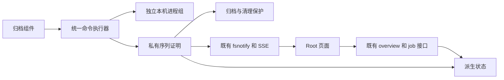
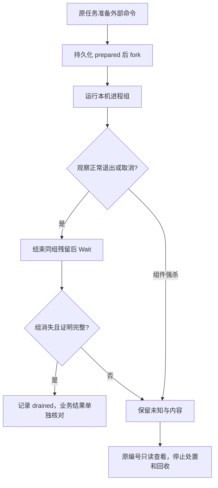
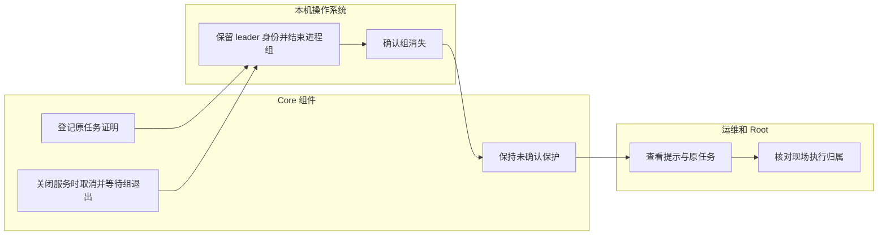

# US9：归档外部命令的退出与保护

## 1. 功能背景与目标

归档组件退出后，pg_dump 或 rsync 的 SSH 子进程仍可能存活。此功能先结束本机命令组，再保存排空证明；无法确认时保留原任务和内容，避免仅凭策略锁已释放就进行安全处置。

## 2. 角色与适用范围

Root／运维查看存储治理的归档状态。实现覆盖固定 pg_dump、ssh、rsync 本机前台进程组。远端接收器、旧临时脚本及完整主机交接需要另行证明；普通业务和插件权限不变。

## 3. 整体架构与模块关系



## 4. 核心流程



## 5. 跨角色协作流程



## 6. 前置条件与依赖

本机 Linux／Darwin、固定客户端工具可用，私有归档根可读写，组件使用新协议。真实数据库验收必须使用 Agent 自有 PostgreSQL；不对日常库加锁。现场旧执行器须暂停交接，不能与新旧版本混跑。

## 7. 操作步骤（按场景拆分）

### 查看页面

1. 进入 `/monitor/storage` → “日志归档与追溯”。预期未知状态显示“本机外部命令尚未确认退出”和原任务入口；切换其他分区后仍能返回处理。读取失败保留原编号。
2. 打开任务，预期弹层解释保护原因并禁用内容核验。不要删文件、删台账或换编号绕过。
3. 正常关闭组件时，由执行器等待本机组退出；这不是页面的固定 loading 时长。状态由既有 SSE 更新。断线时保留任务并显示连接异常，重连只同步状态。
4. 本机排空变为 drained 后，原采集仍可能 interrupted。预期不会自动启动核验、重传或第二任务；后续必须单独明确核验和确认。

### 只读接口

Root 使用部署 API 前缀读取：

- `GET /api/v1/admin/ops/backup/archives`：查看 command_execution 的 active、unconfirmed、jobs。
- `GET /api/v1/admin/ops/backup/archives/jobs/<原UUID>`：查看 command_drain_state。drained 仅代表本机组结束，远端 ACK 与完整清单必须另外核对。

没有公开“杀进程”或“清除未知”接口。错误 ARCHIVE_COMMAND_DRAIN_UNCONFIRMED 应停止处置；ARCHIVE_COMMANDS_ACTIVE 应等待原执行，不强清锁。

### 本地隔离验收

仓库根执行：

```sh
go -C backend test -race -vet=all ./internal/service/archive_ops -run '^TestCommandDrain' -count=1 -v
```

预期进程组、强杀重启和 SSH 用例通过；未配置自有数据库时明确跳过 pg_dump 用例。自有集群单独设置 POWERX_ARCHIVE_TEST_DSN 再运行 TestCommandDrainRealPostgresDumpBlockedThenServiceClose，预期 pg_stat_activity 证明 pg_dump 确实等待 Lock，Close 后进程和会话退出。禁止将环境变量指向日常或正式数据库。

UI 脚本 `scripts/ops/test-storage-archive-command-drain-ui.mjs` 仅接收自有 fixture 私有元数据；真实 Nuxt 归档接口代理到自有后端。controlled prepared 状态没有实际 fork，夹具的只测试 drain 操作不能当作产品解锁路径。结束脚本关闭浏览器／代理／后端并移除私有 JWT 文件；登录仍会产生正常认证审计。

## 8. 预期结果与验收标准

- 取消／Close 后忽略 TERM 的同组子进程、监听端口和打开文件随进程退出释放；leader 最后信号前未被回收。
- 真实 pg_dump 的锁等待、客户端退出、服务端会话消失、暂存 dump 删除、源／已有 CAS 保留。
- rsync 的真实 SSH 子进程退出；远端接收器没有因此被认证为已退出。
- 强杀父组件后原 UUID 和未知证明保留，重启不按旧 PID 补杀、不自动放行回收。
- 缺失／损坏／其他主机／旧协议阻止处置；UI 明暗、桌面／窄屏与 SSE 保留任务，空闲无周期查询。
- 全部自有服务和子进程退出、端口释放；日常服务保持原 PID。

## 9. 代码实现映射

| 环节 | 文件 |
| --- | --- |
| 台账、组退出、保护 | backend/internal/service/archive_ops/command_drain.go |
| 非回收退出观察 | command_exit_linux.go、command_exit_darwin.go |
| 工具接入 | capture.go、remote.go |
| 原任务协议和 Close | execution.go、service.go |
| 回收与处置 | restore.go、interruption_disposition.go、remote_gc.go、control.go |
| 页面和 SSE | ArchiveGovernanceBody.vue、ArchiveInterruptionDialog.vue、changes.go |
| 真实进程／原生 PG／SSH | command_drain_test.go、command_drain_postgres_test.go、command_drain_ssh_test.go |
| 页面验收 | scripts/ops/test-storage-archive-command-drain-ui.mjs |

## 10. 常见问题与排障

- **锁已释放，为什么仍不能核验？** 组件退出不保证子命令退出；需要匹配当前执行的证明。
- **进程已经不存在，能否直接改 drained？** 不能。裸 PID 可能重用，缺少回执也不证明此前没执行。人工证明与受控补充是下一项开发。
- **drained 为什么远端仍未知？** 本机 SSH 退出不代表接收器结束或异地提交成功，须保留原任务并核对原结果。
- **旧任务为什么缺协议？** 旧版本没有命令生命周期证据，不能自动迁移为已证明；先暂停旧执行并核对现场归属。
- **目录已满？** 达到 10000 条停止登记；不得删除未知文件腾出门槛。原任务和归档资源期限另行治理。

## 11. 回滚与风险控制

先暂停执行器，保留任务、命令证明、源和对象，再评审回退。禁止旧版本混跑、强清锁、按 PID 随意杀进程或删除未知记录。Linux 当前只有交叉编译证据，本机原生测试为 Darwin；正式 Linux、旧执行器和整站恢复仍需现场验收。

## 12. 变更记录

2026-11-10：T158 本机命令组退出、私有证明、围栏和页面提示；[合同](../../../contracts/storage-archive-command-drain.md)、[证据](../../../contracts/evidence/storage-archive-command-drain-validation-20261110.json)。源码和隔离验证不代表正式部署或整个 SG-09／SG-11 完成。
