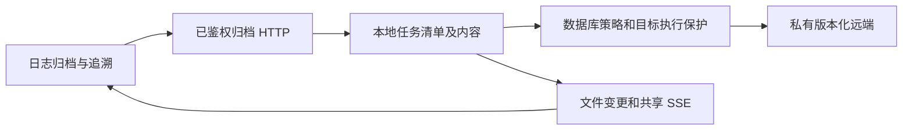
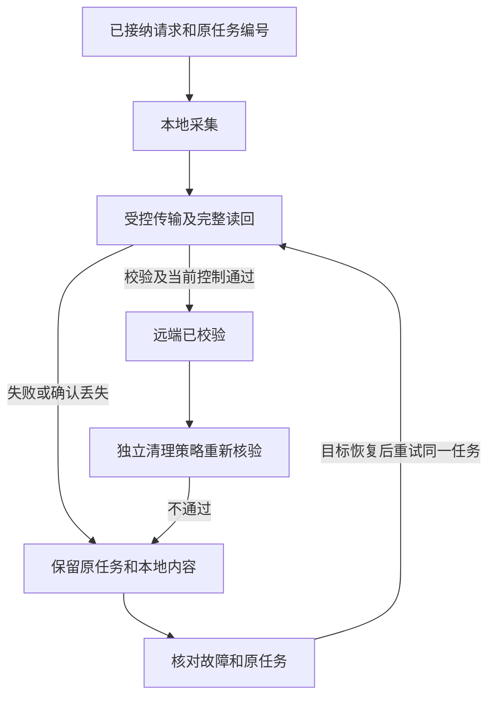
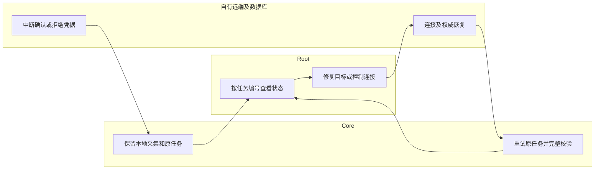

# 已接纳归档故障检查

## 1. 功能背景与目标

远端收到文件不等于 Core 已确认归档完成。连接或权限故障时，要保留原任务、本地内容与源日志，让管理员能分清本地采集和远端校验结果。本指南对应 T158 已接纳任务的传输故障回归。

## 2. 角色与适用范围

Root 查看任务；QA 在自有源、协议服务和数据库内注入故障。日常实例、正式站、真实 OSS 与长期运行分别验收。本轮没有改变日常策略、迁移或重启日常 Core。

## 3. 整体架构与模块关系



## 4. 核心流程



## 5. 跨角色协作流程



## 6. 前置条件与依赖

- 页面需要 Root 会话；归档与清理是否启用仍取决于正式配置，打开页面不会接管或开启。
- 原生测试仅接受 `/tmp/powerx-control-owned-*` Unix socket、自有 `storage_control_test` 角色、`postgres` 库，在随机 schema 内运行正式迁移并收尾。不得填日常 DSN。
- 浏览器检查需要已由用户启动的 Nuxt `127.0.0.1:3030` 和登录服务；测试代理将归档请求转到自有 HTTP 服务，禁止无关写入。Playwright 依赖来自 `web-admin`。
- [故障合同](../../../contracts/storage-archive-accepted-faults.md)列出协议、数据库、调度和未完成边界。

## 7. 操作步骤（按场景拆分）

### 页面检查

1. 打开 `/monitor/storage`，选择“日志归档与追溯 → 检索与取回”。预期每条记录分别显示本地结果、远端结果与归档任务编号；失败时保留编号，查看该任务错误。
2. 若看到“本地采集已完成／远端传输未完成”，预期未显示远端已校验，可能已有部分远端内容。先检查连接、凭据或控制链；不要把它当作源清理许可，也不要用新归档任务替代未知的原任务。
3. 切换“存储目标”再返回，预期搜索草稿保留。推送断线有明确提示；可用“刷新观测”同步，失败时已有记录应保留。

### 只读接口核对

API 前缀以部署配置为准；以下为默认前缀。`ROOT_TOKEN` 只在当前 shell 使用，不保存到文档或输出。

```bash
curl --fail-with-body -H "Authorization: Bearer $ROOT_TOKEN" "http://127.0.0.1:8077/api/v1/admin/ops/backup/archives/jobs/$JOB_ID"
```

预期失败传输的片段：`{"data":{"job":{"id":"原任务 UUID","status":"success","remote_state":"failed","attempts":1}}}`。本地采集和远端结果分别解释；接口失败时保留编号，不自动创建任务。

### 原生回归

在自有 PostgreSQL 已启动并登记 PID、目录、命令、Unix socket 端口后，从 `backend` 执行：

```bash
POWERX_STORAGE_CONTROL_TEST_DSN="$OWNED_STORAGE_TEST_DSN" go test -race ./internal/service/storage_governance -run '^TestArchiveAcceptedNativeFaultsPreserveIdentityAndContent$' -count=1 -v
```

预期四个子场景全部 PASS：对象确认丢失、清单确认丢失、凭据被远端拒绝、控制连接中断。没有 DSN 时测试会 SKIP，不能报告已验收；失败看 phase／remote_error 及原测试日志。

### 实际 Nuxt 浏览器回归

使用新的自有产物目录，不复用旧私有文件。从仓库根目录在终端 A 启动有时限的自有夹具，记录 go test 与测试子进程 PID：

```bash
POWERX_ARCHIVE_FAULT_UI_FIXTURE="$OWNED_UI_ARTIFACTS/http-private.json" go -C backend test ./internal/transport/http/admin/backup -run '^TestArchiveAcceptedFaultBrowserFixture$' -count=1 -v
```

私有文件生成后，在终端 B 使用当前允许的本地登录凭据，运行：

```bash
POWERX_ARCHIVE_FAULT_UI_ARTIFACTS="$OWNED_UI_ARTIFACTS" POWERX_CHECK_USER="$LOCAL_ROOT_USER" POWERX_CHECK_PASSWORD="$LOCAL_ROOT_PASSWORD" node scripts/ops/test-storage-archive-fault-ui.mjs
```

预期 `ui-result.json` 为 passed，包含四组主题／尺寸截图和请求记录；测试会结束夹具、关闭浏览器／代理并移除私有 JWT 文件。失败时查看 `error` 与 `failure.png`，核实已启动进程退出和监听释放；不要重启用户服务排除夹具故障。最后另停自有 PostgreSQL 并删除自有临时目录。

## 8. 预期结果与验收标准

- 原请求重放得到原任务，重试仍为同一 Job ID；本地非空内容逐份 SHA256 相符。
- 远端未完成验证时不是 success，清理握手为 false，源文件和远端已有版本不被故障恢复删除。
- 修复故障后原任务第 2 次传输完整读回，才有远端成功与新的清理握手；清单允许产生新的精确版本。
- 元数据 503／SSE 断线保留状态和草稿；实际推送可更新，空闲无周期状态读取，浏览器无自动写入，离开页面释放连接。
- 1440／390 与浅色／深色下主要入口、完整任务编号、搜索输入及错误可见，无横向溢出。

## 9. 代码实现映射

| 入口 | 代码 |
| --- | --- |
| 任务／传输／清理握手 | `backend/internal/service/archive_ops/{service.go,s3_transfer.go,lifecycle_proof.go}` |
| 数据库事务执行保护 | `backend/internal/service/storage_governance/archive_policy_control.go` |
| 原生联合故障 | `backend/internal/service/storage_governance/fault_injection_test.go` |
| 自有协议与 HTTP／SSE | `backend/internal/testutil/archivefault/s3.go`、`backend/internal/transport/http/admin/backup/archive_fault_browser_test.go` |
| 状态与响应式检索 | `web-admin/app/components/ops/backup/ArchiveGovernanceBody.vue` |
| 组件回归／实际浏览器 | `web-admin/tests/unit/storage/archive-governance.spec.ts`、`scripts/ops/test-storage-archive-fault-ui.mjs` |

## 10. 常见问题与排障

- **本地成功为什么远端失败？** 两个阶段独立；查看原任务 remote_error。失败不证明远端没有写入。
- **远端已校验能马上删源文件吗？** 仍须独立策略和当前完整读取握手；页面徽标不是删除许可。
- **为什么提示未接管或调度未启动？** 自有页面夹具没有接管数据库配置或启动调度器。它验证故障展示与推送，原生控制事务另测，不在日常实例自动开启来消除提示。
- **测试没有到故障点？** 检查测试启用确认绑定的目标版本／指纹和归档预算。清单需要预留空间；不能降低正式保护迁就测试。

## 11. 回滚与风险控制

本轮没有新增迁移、改变策略默认值、运行生产清理或开启云目标。页面改动可按文件回退，既有任务与清单格式不变。回归只中断自有连接，不能推广为终止日常数据库的操作许可。

[手动归档原请求核对](usecase-us9-archive-request.md)已补齐源码与隔离验收，日常 Core 生效仍由用户启动新版。下一项为自有 Core／worker 写入中断与真实进程重启联合回归，无需中断日常服务。T155 真实 OSS、Core／worker 重启、完整停库及其余联合故障、现场接管和长期运行门槛仍未全部通过。

## 12. 变更记录

2026-11-09：补充已接纳归档传输故障回归、原任务与本地／远端独立状态、响应式检索、实际 SSE 浏览器验收。责任：PowerX Core 开发协作；现场部署状态按正式任务清单另记。
