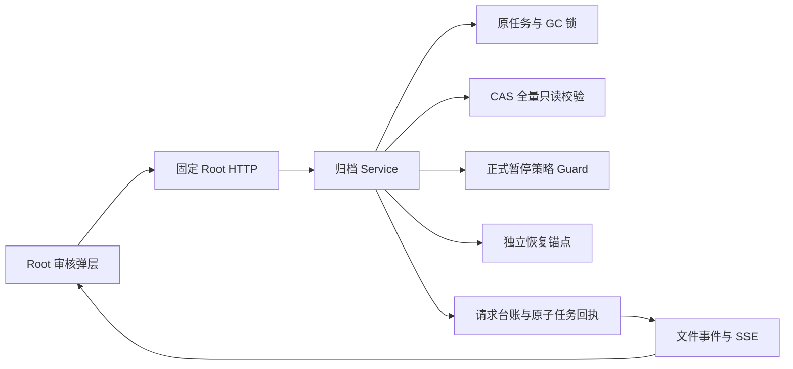
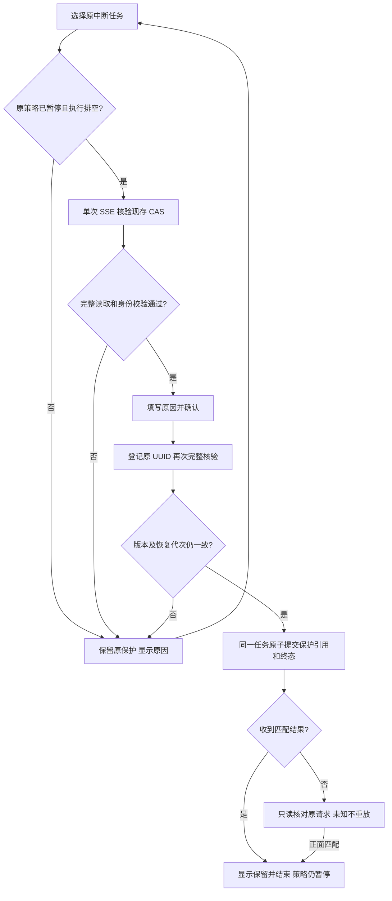
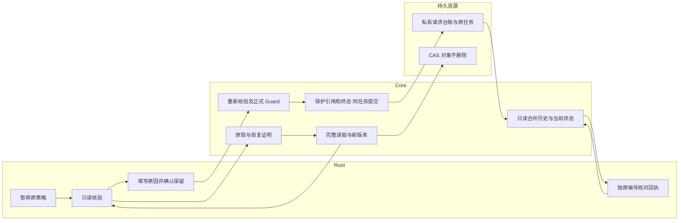

# US9：保留中断采集并结束原任务

## 1. 功能背景与目标

进程在采集中退出后，部分内容已进入本地归档根，但还没有完整快照。不能把它当作成功归档，也不能删掉“没有引用”的局部对象。本功能允许 Root 核对现存内容、保留证据并明确结束这次采集，解除该任务的执行阻塞。

## 2. 角色与适用范围

Root 审核原采集；QA 用自有数据做故障验证；运维负责实际部署、恢复锚点与正式接管。本轮完成源码和隔离验收，未代替用户启动日常服务、迁移日常库或部署线上。

适用未完成的原采集，包括一次性媒体采集。完整快照使用“重传原任务”；导入、恢复及迁移任务不在此动作范围。

## 3. 整体架构与模块关系

## 4. 核心流程

## 5. 跨角色协作流程

## 6. 前置条件与依赖

- Root 管理员用户会话，不能使用插件身份或 API Key。
- overview 的 `interruption_resolution_version=1`；旧 Core 不显示入口。日常生效由用户按原 VS Code 流程编译启动新版 Core，本轮未代操作。
- 独立恢复锚点可读取；私有任务／回执目录可同步写入。
- 日志策略在本页“归档策略”、媒体策略在备份中心明确暂停归档及远端清理。正式控制面已启用时须暂停版本已发布，不接受本地 JSON 回退。一次性采集没有周期启用状态，但仍须执行排空。
- 当前 CAS 核验上限：10000 个、64 GiB、五分钟。超限或未知文件不会自动删减集合。

## 7. 操作步骤（按场景拆分）

### 页面：审核原任务

1. 打开 `/monitor/storage` → “日志归档与追溯”，点击顶部中断提示中的原编号，或日志行的“处置中断采集”。预期弹层显示原编号和状态；完整快照不进入此处置，返回检索与取回重传。失败时保留原编号，不新建采集绕过。
2. 在“任务概览”确认已暂停原策略；在“内容核验”点击“核验保留内容”。预期通过单次 SSE 显示对象／字节，完成后得到本次核验结果。软链、硬链、损坏、忙锁、控制或恢复证明不可用时原任务保持保护，按显示原因处理后明确重新核验。
3. 切换“审核确认”，填写至少五个字符的原因，并确认“保留现存内容并结束原采集，不自动重启或创建替代任务”。桌面纵向导航、窄屏选择器切换保留原因；推送导致证明失效时，重新核验并再次确认。
4. 点击“确认保留并结束”。预期原任务成为“不完整采集已结束，内容受保护”，原编号不变，没有第二任务，也不会自动开启策略。源文件、CAS、staging 与远端对象都不由此动作删除。
5. 若今后需要新采集，另外审核并明确启用策略或发起新的按需采集；保留记录不能下载、重传、恢复或普通取消保护。保留集合可能包含共享对象，不等于已经释放空间。

### 页面：回复丢失或断连

1. 看到“处置结果尚未核对”时保留原 UUID，点击只读核对按钮。刷新或返回页面仍恢复同一登录的原请求，不自动再发 POST。
2. 缺失／503／错误身份／历史回执不匹配时保持锁定。匹配且当前原任务一致的保留回执，或明确 rejected 回执，才结束这次 UI 意图。断线提示在弹层内部显示，重连只同步元数据。
3. 只有 registered 而没有终态时，当前版本不能人工结案或自动重试。记录编号等待下一项受控核对功能；不要删缓存或台账冒充此前未执行。

### 接口调用

| 方法与默认入口 | 输入／输出 | 预期与失败处理 |
| --- | --- | --- |
| GET `/api/v1/admin/ops/backup/archives/jobs/:job_id/interruption-review` | 无 query；单次 progress／complete／error SSE | complete 的 review_version 才可用于确认；EOF 不自动续读 |
| POST `/api/v1/admin/ops/backup/archives/jobs/:job_id/interruption-retentions` | `{request_id,expected_version,action:"retain_and_close",reason,confirm:true}` | 200 返回原回执；503／连接异常先只读核对 |
| GET `/api/v1/admin/ops/backup/archives/interruption-requests/:request_id` | 状态、证据来源、result、current_record_matches | 不写入、不重放；404 不等于未执行 |

请求使用部署的实际 API 前缀和 Authorization header；不把 JWT、密钥或恢复票据放到 URL／报告。业务客户和插件不用调用这些 Root 运维接口。

### 本地联调

- 常规回归：`go -C backend test -race ./internal/service/archive_ops ./internal/service/storage_governance ./internal/transport/http/admin/backup`，预期普通测试通过，原生／进程 opt-in 测试明确跳过。
- 自有原生 PostgreSQL：`POWERX_STORAGE_CONTROL_TEST_DSN="$OWNED_TEST_DSN" go -C backend test -race ./internal/service/storage_governance -run '^TestArchiveDispositionNativePublishedPauseAndDatabaseFailure$' -v -count=1`。只能指向自有临时 Unix socket／测试身份。预期已发布暂停允许、旧版本和控制连接失效拒绝，原保护仍在。
- 自有进程：`POWERX_STORAGE_CONTROL_TEST_DSN="$OWNED_TEST_DSN" POWERX_ARCHIVE_RESTART_ACCEPTANCE=1 go -C backend test -race ./internal/service/archive_ops -run '^TestArchiveOwnedProcessRestart$' -v -count=1 -timeout=180s`。预期真实 SIGKILL 后新进程可核验并保留原局部内容。不是整套 Core、电源故障或外部 pg_dump／SSH／rsync 排空测试；正式接管／重新启用前，外部执行仍须独立验收。
- 页面夹具：`TestArchiveInterruptionRootHTTPAndOwnedBrowser` 接受私有输出路径 `POWERX_ARCHIVE_DISPOSITION_UI_FIXTURE`；配合 `scripts/ops/test-storage-archive-disposition-ui.mjs`。日常 Nuxt 只提供页面外壳，归档请求代理至自有服务。脚本模拟成功回复截断并验证原请求，结束须清除 JWT 文件、浏览器／代理／HTTP 服务及自有 DB。

## 8. 预期结果与验收标准

- 原编号和所有既有 CAS SHA 不变；终态、审核和保护引用原子保存，策略保持暂停，无新任务、删除或远传。
- 普通回收保护保留集合，但仍能处理此集合以外的无用对象；损坏／缺失证明停止回收。
- 旧预览、恢复代次变化、错误内容、软硬链、忙锁、取消、并发、输入冲突、台账缺失／回放及控制连接失效保持正确边界。
- 正面终态可以在回复丢失后只读找回；未知和历史事实不能当当前执行许可。
- 明暗 1440／390 下导航、原因／确认、错误、断连提示、刷新保留、SSE 及无空闲轮询通过实际页面验收。
- 全仓能力检查另有客户模块五条未登记路由；归档范围通过不等于全仓发布门禁通过。实际结果见[证据](../../../contracts/evidence/storage-archive-disposition-validation-20261110.json)。

## 9. 代码实现映射

| 范围 | 仓库路径 |
| --- | --- |
| 核验、固定动作、请求台账、保留引用 | `backend/internal/service/archive_ops/interruption_disposition.go` |
| 普通回收与保护限制 | `backend/internal/service/archive_ops/restore.go`、`store.go` |
| 正式暂停 Guard | `backend/internal/service/storage_governance/archive_policy_control.go` |
| Root HTTP／SSE 与路由 | `backend/internal/transport/http/admin/backup/archive_interruption_handler.go`、`routes.go` |
| 弹层／审核详情／最小会话意图／流解码 | `web-admin/app/components/ops/backup/ArchiveInterruptionDialog.vue`、`web-admin/app/utils/archive-disposition.ts` |
| 工作区入口／备份中心状态 | `ArchiveGovernanceBody.vue`、`ResourceArchivesPanel.vue`、`StorageGovernanceWorkspace.vue` |
| 原生／进程／实际页面 | `archive_disposition_postgres_test.go`、`process_restart_test.go`、`archive_interruption_test.go`、`test-storage-archive-disposition-ui.mjs` |

## 10. 常见问题与排障

- **为什么保留对象比原采集进度多？** 未完成采集没有完整归属清单，因此保守保留当前共享 CAS 集合，不宣称这些对象全由本任务采集。
- **结束后空间为什么没下降？** 结束的是执行阻塞，内容仍受保护；没有删除动作。本轮不提供这些保留内容的到期删除。
- **为什么必须暂停？** 防止旧任务处置与新执行相互覆盖；仍有工作或回收占锁时不会按时间强行接管。
- **GET 返回历史 retained，为什么仍锁住？** 当前记录可能已经回放，历史结果不等于当前保护。查看 current_record_matches，不能重放旧请求解除新中断。
- **新入口不出现／恢复证明不可用？** 检查 overview 协议标记与维护锚点装配。不要自动重建锚点、扩大插件权限或关闭容量门禁。

## 11. 回滚与风险控制

本轮没有迁移、修改日常策略或重启用户进程。尚未部署时保持当前服务即可。

加载本实现并产生 retained 引用后，不能降级到不认识这些引用的旧回收器。需要回退时先在正式 UI 暂停有关执行和回收，确认工作排空，保留完整归档根、原任务、台账及独立恢复锚点，走独立维护审查；不要手改状态、删保留数组或普通取消保护。关闭页面不能回滚已落盘的审核。

## 12. 变更记录

| 日期 | 内容 | 责任 |
| --- | --- | --- |
| 2026-11-10 | T158 中断采集保留并结束、Root UI／回执／引用保护与隔离验收 | Core 存储治理实现与 QA |

下一项是 registered 无终态请求的人工只读核对与受控结案：绑定原 UUID／输入／当前任务／恢复代次，保留原保护与审计，不假定未执行、不重放或删除。无需此时重启日常服务即可先开发。T155 真实 OSS、完整 Core／DB 故障、现场交接、逐资源接管、整站恢复、外部密钥及双环境／长期运行门槛继续待办。
