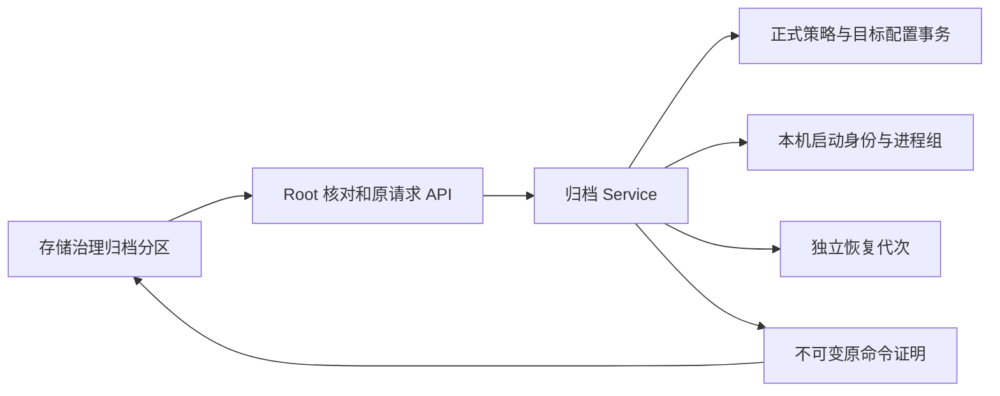
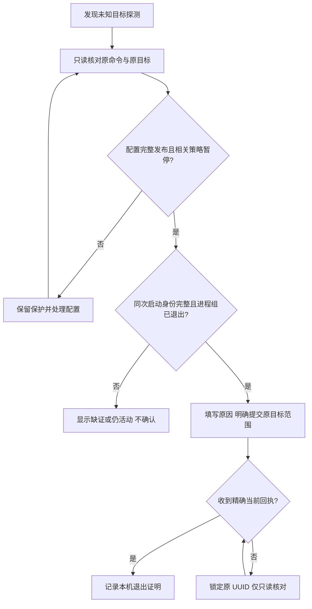
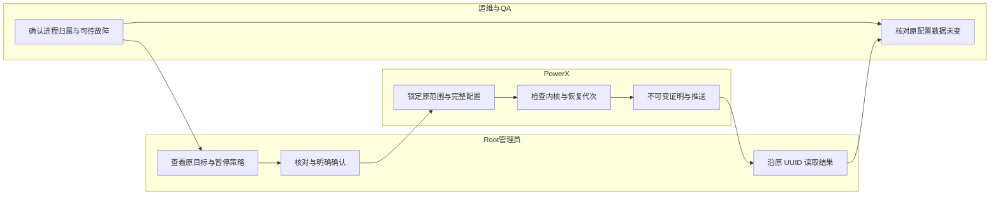

# 目标探测中断后的本机命令核对

## 1. 功能背景与目标

测试归档目标时，SSH 命令不一定属于某一张归档任务单。服务中断后遗留的未知命令会继续保护数据。管理员现在可以核对**原探测目标和本机退出证据**，显式记录结论；不会顺便验证或启用当前目标。

## 2. 角色与适用范围

平台 Root 用户负责核对与确认，QA 使用自有目标验收，运维负责现场身份和维护边界。适用于协议 3 的 SSH 目标探测；旧记录没有原范围时只读说明、继续保护。插件、API Key、租户管理员不能调用确认接口。本轮仅源码与自有隔离验收。

## 3. 整体架构与模块关系



## 4. 核心流程



## 5. 跨角色协作流程



## 6. 前置条件与依赖

后端 overview 同时支持 command_confirmation_version=1 和 probe_command_confirmation_version=1。正式配置控制链可用且两份配置均已发布，原目标的所有引用策略均暂停；原目标命令必须具备同主机启动身份。持有原探测／命令锁表示仍在执行，不能代替系统退出证据。无需为本轮源码开发重启日常服务；日后运行当前源码需由用户重新编译并启动日常 Core，Nuxt 使用当前前端代码。

## 7. 操作步骤（按场景拆分）

### 页面

1. 在 `/monitor/storage` →“日志归档与追溯”打开未知命令告警中的“核对目标探测 · 名称”。预期无 job 也能发现。没有入口时核对后端版本；不要新建任务绕过未知命令。
2. 在弹层“只读核对”点击核对，查看原目标 ID／原版本、当前目标一致／变更／删除、引用策略和内核详情。预期明确 eligible 或保护原因；配置失败先处理正式控制链，不能把失败理解为已删除。
3. eligible 后到“人工审核确认”，核对再次显示的原目标，填写原因并勾选确认。只有显式点击才 POST；切换分区／桌面窄屏保留草稿，推送变更会作废预览。
4. 回复未知时只点“核对原请求”。预期同 UUID 返回当前精确证明或明确 rejected；404／暂不可用／历史或范围不符继续锁定，不清浏览器意图、不生成新 UUID 重发。
5. 确认完成后目标仍未因此验证，策略仍保持暂停。需要使用目标时，另行按正常目标配置／测试流程操作，预期新的探测拥有新执行编号；失败保留原证据继续排障。

### 接口

Root JWT 使用受保护的会话注入，不能放 URL、文档或日志。默认先 GET `/api/v1/admin/ops/backup/archives/commands/{record_id}/review`，再以返回版本、原 execution_id／command_id 和 target_id 提交同路径 `/confirmations`；沿 `/archives/command-confirmation-requests/{request_id}` 只读核对。字段与错误合同见[固定合同](../../../contracts/storage-archive-probe-confirmation.md)。预期 job_id 为空且目标回显一致；400／409 处理原范围或版本，503 保留保护，不能修改 PID 或提交任意命令。

### 本地联调

使用自有测试 PostgreSQL，分别设置 `POWERX_STORAGE_CONTROL_TEST_DSN` 和 URL 格式 `POWERX_ARCHIVE_TEST_DSN`，执行：

```sh
go -C backend test -race ./internal/service/archive_ops ./internal/service/storage_governance ./internal/transport/http/admin/backup -count=1
```

预期三包通过；native 专项为 `TestArchiveProbeNative*`，未提供 DSN 会跳过原生测试，不能视为完成。前端执行：

```sh
cd web-admin && npx vitest run tests/unit/storage/archive-command-confirmation.spec.ts
```

真实 UI 脚本 `scripts/ops/test-storage-archive-probe-confirmation-ui.mjs` 只接受自有 Root HTTP 夹具的 0600 私有文件；指定 `POWERX_ARCHIVE_PROBE_CONFIRMATION_UI_ARTIFACTS` 和本地登录环境变量。夹具由 `TestArchiveProbeCommandConfirmationRootHTTPAndOwnedBrowser` 创建，`POWERX_ARCHIVE_PROBE_CONFIRMATION_UI_FIXTURE` 指向私有文件。脚本代理归档接口到隔离服务，阻止其他业务写入，结束关闭代理／浏览器／夹具并删除令牌。失败先查产物日志，核实自有进程归属后清理，绝不能停止日常服务。

## 8. 预期结果与验收标准

目标变更／删除、策略新增引用／活动／未发布、原探测与策略锁、legacy 缺证、活动身份／boot／恢复代次、并发原 UUID、断库均不能使用旧预览放行。新核对可只确认 changed／deleted 原范围；不会更新目标验证。正向重复读取一致，下一次显式探测使旧回执变成历史。真实桌面 1440 与窄屏 390、明暗主题、草稿保留、单次 POST、回复截断、重载、SSE 断流重连、空闲无详情轮询和离开释放连接均须留证。

## 9. 代码实现映射

| 责任 | 路径 |
| --- | --- |
| 范围、原目标与引用锁 | `backend/internal/service/archive_ops/probe_command_scope.go` |
| 真实命令与原请求回执 | 同目录 `command_drain.go`、`command_confirmation.go`、`remote.go` |
| DB 发布与事务 | `backend/internal/service/storage_governance/archive_probe_command_control.go` |
| Root HTTP | `backend/internal/transport/http/admin/backup/archive_command_confirmation_handler.go` |
| UI 与最小意图 | `web-admin/app/components/ops/backup/ArchiveCommandConfirmationDialog.vue`、`web-admin/app/utils/archive-command-confirmation.ts` |
| 发现入口 | 同组件目录 `ArchiveGovernanceBody.vue` |
| 隔离验证 | `probe_command_scope_test.go`、`archive_probe_command_control_postgres_test.go`、`archive_probe_command_confirmation_test.go` 与上述 UI 脚本 |

## 10. 常见问题与排障

- `probe_scope_missing`：旧记录没有原绑定，不能自动修复；先只读现场调查，保持保护。
- 当前目标变更或删除：旧预览失效；重新核对原范围，退出证明不能用于验证新目标。
- `ARCHIVE_PROBE_PUBLICATION_PENDING`／控制链不可用：检查配置发布、TaskBus、数据库与投影，不关闭门禁。
- `group_not_drained`／identity_mismatch：仍活动或身份不符，不能按记录 PID 杀进程，不补造证明。
- 已有回执但不是 current：这是历史事实，不能让新执行继承；只读核对原 UUID 和恢复代次。

## 11. 回滚与风险控制

本轮不迁移 schema，不修改业务数据、用户策略或权限。回退源码前保留原命令、回执、维护代次与凭据；旧二进制不识别协议 3 时应继续保护，不能删除未知文件让它继续。现场回退或接管需独立维护验收。Linux 原生运行、远端接收器排空、阿里云 OSS 真实传输／源消失后取回、完整 Core／DB 故障、独立墓碑、旧执行器交接与长期运行仍未验收。

## 12. 变更记录

2026-11-10：补齐 T158 无任务目标探测的范围绑定、Root 受控确认、原请求恢复、UI 与隔离证据；未部署日常或生产环境。
