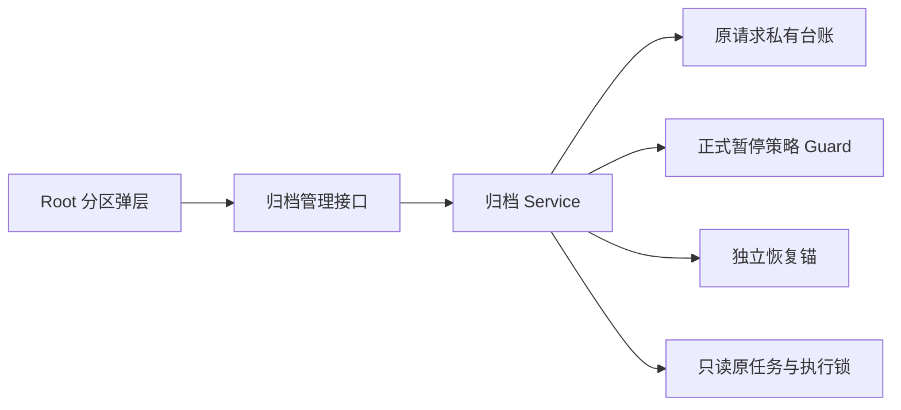
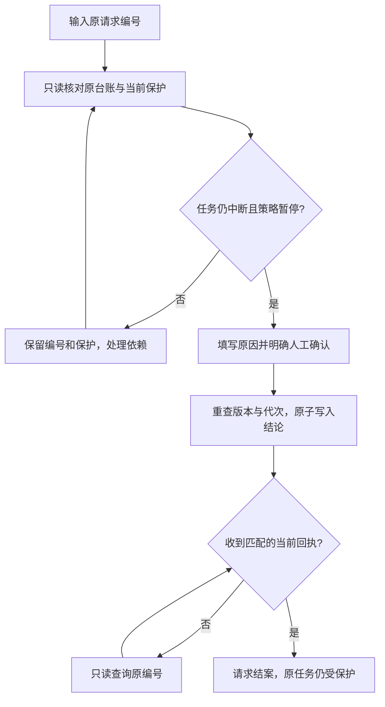
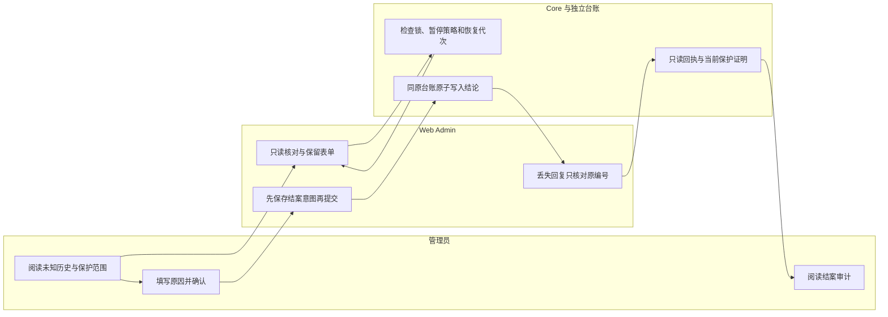

# US9：人工结束归档未知处置请求

## 1. 功能背景与目标

“保留并结束中断采集”的请求已经登记，却没有可确认的结果时，管理员需要有审计的人工结案入口。结案只结束这次待核对请求，历史动作结果仍未知，原任务保护继续生效。

## 2. 角色与适用范围

平台 Root 用户在存储治理的“日志归档与追溯”中操作。仅适用 registered 无终态请求及仍受中断保护的原采集。普通租户、插件或 API Key 不适用。此指南不负责结束外部命令，也不把文件判定为可清理。

## 3. 整体架构与模块关系



## 4. 核心流程



## 5. 跨角色协作流程



## 6. 前置条件与依赖

- 当前 Core 支持 overview 的 `interruption_request_closure_version=1`，真实 Root 用户登录。
- 原请求台账完整，原任务仍 interrupted / interruption_pending，策略已明确暂停归档和远端清理。
- 独立恢复锚、正式发布控制及数据库可用，原执行锁可取得。
- 这一步无需 OSS、业务数据清理、扩权或重启日常服务。

## 7. 操作步骤（按场景拆分）

### 页面操作

1. 进入 `/monitor/storage` → “日志归档与追溯”，打开原请求的待核对提示。预期仍显示原编号；读取失败时保留页面，不清空缓存。
2. 选择“核对未知请求”，点击“只读核对原请求”。预期展示当前中断保护、锁范围和代次是否变化；失败时先处理暂停／控制库／执行锁，再手动核对。
3. 切到“确认人工结案”，填写原因并勾选人工确认。预期原因在切换分区后保留；核对过期时重新读取，不能沿用旧确认。
4. 点击“保留保护并结案请求”。预期展示“未知请求已人工结案”、人员、时间、原因及结案编号；原采集仍待处理，没有释放空间。
5. 若回复丢失，保留原页面或刷新后点击“核对原请求”。预期只读恢复同一结论；404、坏回执、恢复后历史不匹配时继续保留待确认，不再提交。
6. 若需结束原采集，另行进入原任务的内容核验流程，明确保留并结束。此次结案本身不提供删除、下载或重传资格。

### 接口操作

Root 会话以部署配置前缀访问：

- `GET /api/v1/admin/ops/backup/archives/interruption-requests/<原UUID>/review`，记录 review_version；失败停止。
- `POST .../interruption-requests/<原UUID>/closures`，输入新 request_id、expected_version、固定 action=`close_unknown_keep_protection`、reason、confirm=true。未明确确认时不得提交。
- `GET .../interruption-requests/<原UUID>`，预期 state=closed_unknown、closure 审计、current_protection_matches=true。false 表示只有历史结论，不能重新授予保护。

不要把令牌放入 URL 或示例文档。输入和回执字段以[合同](../../../contracts/storage-archive-request-closure.md)为准。

### 本地联调

在仓库根运行：

```sh
go -C backend test -race ./internal/service/archive_ops ./internal/transport/http/admin/backup -run 'Test(Interruption|ArchiveInterruption)' -count=1
```

预期 Service／HTTP 通过，不要求日常 Core 重启。正式 PostgreSQL 测试仅向自有测试库设置 `POWERX_STORAGE_CONTROL_TEST_DSN`，运行 `TestArchiveDispositionNativePublishedPauseAndDatabaseFailure`；禁止使用日常数据库 DSN。浏览器脚本 `scripts/ops/test-storage-archive-request-closure-ui.mjs` 仅接受自有私有 fixture 元数据；通过真实 Nuxt 页面把归档接口代理到自有后端，结束自动关闭。登录会产生正常认证／审计读取与写入，不能称为完全零写入。

## 8. 预期结果与验收标准

- 只读核对不修改台账／任务；确认只变更原请求台账。
- 原任务、源文件及 CAS 内容保持，原中断保护仍阻止不安全回收和新执行。
- 并发、旧预览、活动锁、非 Root、控制库不可用均不能写出错误结论。
- 结案回放只读；代次／任务变化后不把历史回执当成当前保护。
- 回复丢失、刷新、坏回执、SSE 断线保持原编号；无周期状态轮询，无自动 POST。
- 桌面／窄屏、明暗主题及表单上下文实际验证；Agent 测试服务退出且端口释放。

## 9. 代码实现映射

| 环节 | 文件 |
| --- | --- |
| 服务核对与原子结案 | backend/internal/service/archive_ops/interruption_request_closure.go |
| 原回执与 UUID 校验 | backend/internal/service/archive_ops/interruption_disposition.go |
| HTTP／Root | backend/internal/transport/http/admin/backup/archive_interruption_handler.go、routes.go |
| 弹层与上下文 | web-admin/app/components/ops/backup/ArchiveInterruptionDialog.vue、app/utils/archive-disposition.ts |
| API | web-admin/app/composables/api/services/archiveDispositionService.ts |
| 并发与回放 | backend/internal/service/archive_ops/interruption_request_closure_test.go |
| 原生数据库 | backend/internal/service/storage_governance/archive_disposition_postgres_test.go |
| 页面故障验收 | scripts/ops/test-storage-archive-request-closure-ui.mjs |

## 10. 常见问题与排障

- **结案后为何仍不能回收？** 只结束未知请求；原采集尚未完整核验，保护继续生效。
- **恢复代次不同能否核对？** 可以重新核对当前状态并作人工未知结论；不能声称旧动作没有执行。
- **ARCHIVE_BUSY／ARCHIVE_PAUSE_REQUIRED：** 核实原任务／GC／策略执行与暂停状态；不要强删锁文件。
- **ARCHIVE_CLOSURE_UNCONFIRMED：** 只 GET 原请求，不换编号重复提交。
- **历史 closed_unknown 但 current_protection_matches=false：** 原任务或锚已变化／缺失／不可读；保留历史审计，停止从这条旧回执推进。
- **ARCHIVE_DISPOSITION_CORRUPT：** 保留台账及对象，由运维核对恢复证据；不能删除损坏文件绕过保护。

## 11. 回滚与风险控制

保持原任务、源文件、CAS、原请求和人工审计。暂停执行后再评审版本回退，新台账格式不能交给不识别它的旧执行器混跑。不能通过清空台账或浏览器意图“修复”未知状态。完整文件系统与锚共同回放后的 UUID 墓碑、外部命令排空和正式现场接管仍需独立验收。

## 12. 变更记录

2026-11-10：Core 存储治理实现 T158 未终态请求人工结案；[本轮证据](../../../contracts/evidence/storage-archive-request-closure-validation-20261110.json)。源码及隔离验收完成不代表正式站部署、OSS 或整个 SG-09／SG-11 完成。
