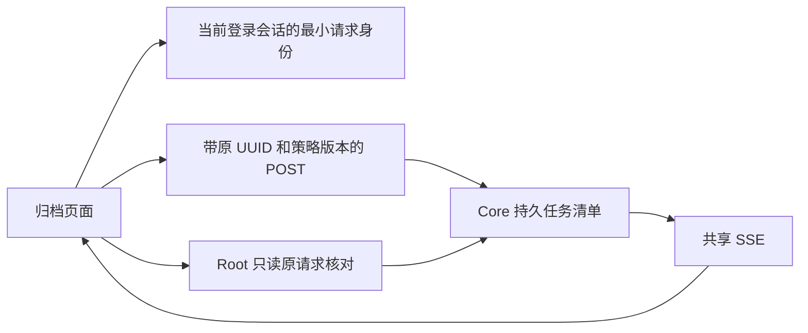
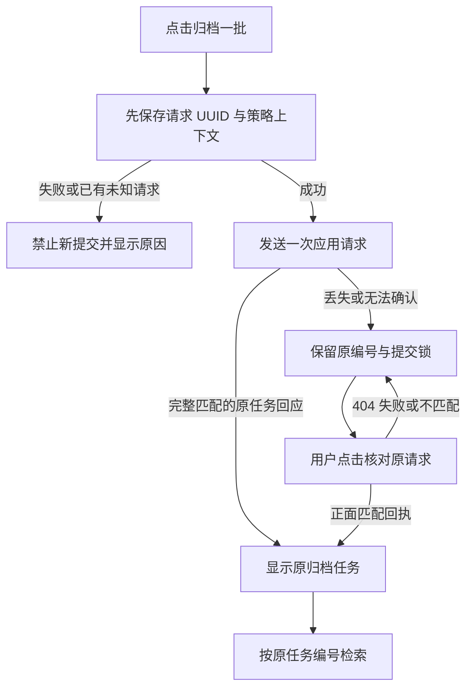
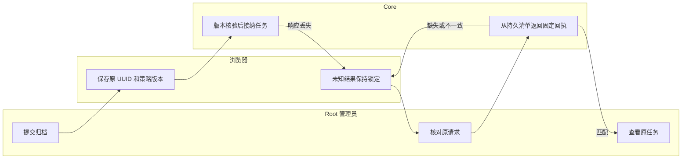

# 手动归档响应丢失后找回原任务

## 1. 功能背景与目标

手动点击“归档一批”后，Core 可能已经接纳请求，浏览器却未收到完整回复。重新生成编号再提交会带来重复任务。本功能先保留原请求，再只读找回对应任务。

## 2. 角色与适用范围

Root 操作整机归档；QA／运维验证故障与原编号。这里只处理已启用策略的手动归档接纳，不提供云资源创建、源日志删除、正式恢复或未知请求人工解除。日常部署与真实 OSS 单独验收。

## 3. 整体架构与模块关系



## 4. 核心流程



## 5. 跨角色协作流程



## 6. 前置条件与依赖

- 使用 Root 用户会话；策略已显式开启，来源、目标及执行保护满足既有条件。
- 新 Core 在归档 overview 返回 `run_request_version=1`。旧 Core 未加载新接口时页面会禁用提交；由用户通过现有 VS Code 启动流程重新编译／重启 Core，Agent 不重启日常进程。
- 浏览器允许当前页面使用 `sessionStorage`。其中只保存原请求身份，不保存令牌、云凭据或恢复票据。当前登录会话和来源信息必须匹配。
- 隔离验收需要自有 PostgreSQL，Unix socket 路径以 `/tmp/powerx-control-owned-` 开头，用户 `storage_control_test`、库 `postgres`；不要使用日常 DSN。正式 TaskBus 发布使用自有 miniredis 协议夹具，版本化 S3 也为自有协议夹具。

## 7. 操作步骤（按场景拆分）

### 正常提交与原任务入口

1. 进入 `/monitor/storage`，选择“日志归档与追溯 → 归档策略”，确认策略名称与版本后点击“归档一批”。预期只生成一次原请求，完整回复后出现“已找到原归档任务”。失败时保留原请求提示，先核对而不重新提交。
2. 点击“查看原任务”。预期进入“检索与取回”，按返回的 `job_id` 检索；“已找到”只证明任务存在，仍需分别查看本地与远端状态。

### 回复丢失、刷新或断线

1. 若出现“归档提交结果待核对”，记录显示的原请求 UUID。预期“归档一批”锁定，其他分区仍可查看；离开归档分区时外层保留提醒入口。
2. 点击“核对原请求”。预期只发送 GET；正面回执必须匹配原请求、策略、版本及来源。404／503／错误回执后仍保留编号和锁，不自动 POST。
3. 刷新页面或同一登录会话返回页面。预期原编号恢复；SSE 断线有提示，连接恢复只同步状态。不同账号／登录会话隔离旧上下文，不把旧会话请求当成新身份操作。
4. 没有回执时，运维核对原编号、清单、服务及恢复历史。不要清缓存、补造任务文件或换 UUID 绕过未知状态。本轮没有人工解除入口。

### 只读 API

默认前缀如下；自定义部署使用对应前缀。不要把 Root token 放进 URL、文件或验收输出。

```bash
curl --fail-with-body -H "Authorization: Bearer $ROOT_TOKEN" "http://127.0.0.1:8077/api/v1/admin/ops/backup/archives/policies/$POLICY_ID/requests/$REQUEST_ID"
```

预期 HTTP200：`data` 含 `request_id, policy_id, job_id, policy_revision, source_id, status, phase, remote_state, created_at, updated_at`。HTTP404 的 `ARCHIVE_REQUEST_UNCONFIRMED` 不证明此前没有执行。不要给 GET 添加 query、请求体、任意目录或重试开关。

### 本地服务回归

从 `backend` 执行：

```bash
go test -race ./internal/service/archive_ops ./internal/transport/http/admin/backup -run 'TestRunRequest|TestArchiveRunRequestHTTP|TestAllRegisteredHostBackupRoutes' -count=1 -v
```

预期包括接纳后实际断开 HTTP socket、只读找回、重复同键不新增任务、版本冲突、损坏和身份边界。失败看测试日志中的固定错误码及原 UUID；不改日常策略绕过保护。

### 自有 PostgreSQL + 实际 Nuxt 验收

先创建新的自有产物目录、启动并登记自有数据库 PID／命令／工作目录／Unix socket。由用户保持日常 Nuxt `127.0.0.1:3030` 和允许的本地登录服务运行。终端 A 从仓库根启动有时限的真实注册路由夹具：

```bash
POWERX_STORAGE_CONTROL_TEST_DSN="$OWNED_STORAGE_TEST_DSN" POWERX_POLICY_BROWSER_DIR="$OWNED_UI_ARTIFACTS" go -C backend test ./internal/transport/http/admin/backup -run '^TestArchivePolicyNativeHTTPAndSSE$' -count=1 -v
```

等待 `http-owner.json` 与私有 `owned-token` 生成。终端 B 执行：

```bash
POWERX_ARCHIVE_REQUEST_UI_ARTIFACTS="$OWNED_UI_ARTIFACTS" POWERX_CHECK_USER="$LOCAL_ROOT_USER" POWERX_CHECK_PASSWORD="$LOCAL_ROOT_PASSWORD" node scripts/ops/test-storage-archive-request-ui.mjs
```

预期 `ui-result.json` 为 passed，产生四种尺寸／主题截图。脚本只在自有目标完成接管／校验／显式启用，代理把归档请求转到自有路由；日常服务仅用于页面壳与允许的登录。实际截断 202 响应体，验证新页面未知锁定与正面核对。

另以全新夹具和产物目录设置 `POWERX_ARCHIVE_REQUEST_LOSS_MODE=pre-headers` 可检查响应头返回前的断连，分别记录应用 fetch 次数和 HTTP 请求次数。浏览器透明重传必须保持原 UUID，服务端任务仍只有一个；不能只看 HTTP 数量推断应用发了两次。

失败时看 `error`／`failure.png`；不要靠强制点击遮罩下的按钮代替验收。脚本结束关闭浏览器／代理并通知夹具结束；确认测试进程退出、私有 token 被夹具移除、自有目录和监听释放后，再关闭自有 PostgreSQL。

## 8. 预期结果与验收标准

- 原请求 UUID 在提交前保存，应用不在回复丢失、分区／刷新／事件／重连时重放 POST。
- 同一 UUID 同一版本只对应原任务；不匹配的策略版本拒绝，404／503／损坏／重复匹配不解除锁。
- 正面回执校验所有固定身份字段，找到任务不表示任务已完成或可删除源文件。
- 桌面 1440 与窄屏 390、浅色与深色检查原编号、锁定按钮、导航、全局提醒和返回入口；无横向溢出。
- 元数据通过 SSE 更新，空闲无周期状态查询；离开页面关闭旧 SSE，不串用其他身份的结果。

## 9. 代码实现映射

| 位置 | 职责 |
| --- | --- |
| `archive_ops/run_request.go` | 固定回执、只读扫描、版本前置 |
| `archive_ops/service.go` | 原请求幂等与策略版本绑定、协议版本声明 |
| `admin/backup/{archive_handler.go,routes.go}` | 严格输入、统一响应与 Root 路由 |
| `web-admin/app/utils/archive-run-request.ts` | 会话内最小身份、严格回执匹配、持久化失败关闭 |
| `ArchiveGovernanceBody.vue`／`StorageGovernanceWorkspace.vue` | 原请求提示、锁定、核对、原任务与外层提醒 |
| `archiveOpsService.ts` | 固定 GET、版本绑定 POST、retry=0 |
| `scripts/ops/test-storage-archive-request-ui.mjs` | 自有原生控制链与实际浏览器故障回归 |

## 10. 常见问题与排障

- **请求编号为什么和任务编号不同？** 前者在提交前生成，后者由 Core 接纳时分配；只读接口将两者对应起来。
- **404 为什么不能重新归档？** 清单可能暂不可用或恢复到较早状态；缺少记录不能证明没有执行。
- **旧版本提示怎么处理？** 用户用原来的方式重新编译／重启 Core，再刷新归档页面。未重启不提交探测请求。
- **HTTP 有两条 POST 就是应用重放吗？** 先看脚本的 `application_submits`，再核对每条 HTTP 的原 UUID 和服务端任务数；响应头前断连可能由浏览器透明重传。
- **换账号后为什么看不到旧提示？** 当前实现按登录会话隔离。Root 可使用已保留的原请求／策略编号通过只读端点查历史；没有跨账号自动继承操作资格。

## 11. 回滚与风险控制

本轮不新增数据库迁移，不修改普通业务／插件准入、权限授予、清理默认值或远端目标。旧 `{}` 提交继续兼容；不要回退新页面并清除未知请求来绕过锁定。回退或升级后仍需保留原编号与持久任务证据。

下一项为 T158 Core／worker 写入中断与重启联合验收，先用自有进程和目录确认原任务不丢、不误报活跃／完成、不新建替代任务及不放行删除。真实 OSS 待用户未来配置，现场接管与长期运行分别验收。

## 12. 变更记录

2026-11-09：新增原请求只读核对、浏览器会话内未知请求保护、策略版本绑定与旧 Core 版本提示；本轮由 PowerX Core 开发协作完成源码及自有隔离验收，日常实例和正式站未重启／部署。
