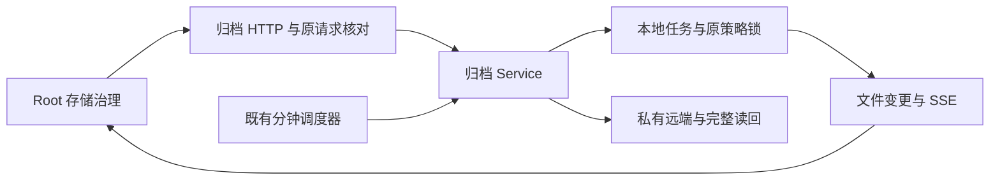
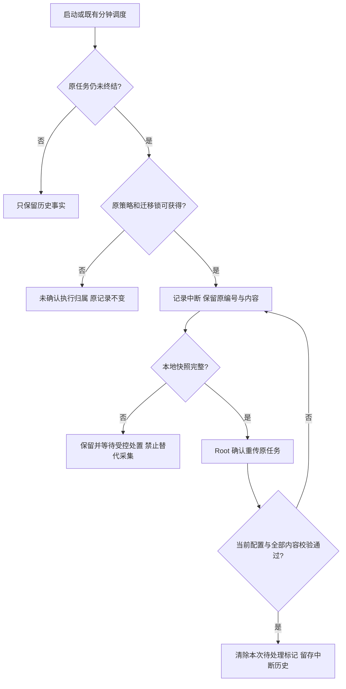
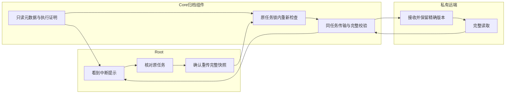

# US9：识别中断归档并处理原任务

## 1. 功能背景与目标

归档进程退出后，磁盘中的 running 记录仍可能存在。需要把“历史记录”和“当前有人在执行”分开，保留已产生的内容，避免定时器不断创建另一任务或错误放行源日志删除。

## 2. 角色与适用范围

Root 在存储治理中查看原任务、确认完整快照重传；研发／QA 使用自有资源做进程中断验收；运维负责部署和现场接管。本轮覆盖生产归档组件，未验收整套 Core 进程或真实 OSS。

## 3. 整体架构与模块关系

## 4. 核心流程

## 5. 跨角色协作流程

## 6. 前置条件与依赖

- 日常 Core 由用户按原 VS Code 流程编译启动，overview 的 `run_request_version` 和 `execution_version` 都应为 1。旧 Core 不支持时，新页面禁用手动采集并说明需要升级。
- Root 用户 JWT；既有归档根、策略与凭据引用。策略／目标未接管或验证失效时必须先按原配置流程核对，不能扩大权限或关闭容量保护替代。
- 测试只能指向自有 PostgreSQL Unix socket、`storage_control_test` 用户和空的自有资源。脚本不读取日常配置，不要求停日常 Core／Nuxt。
- 对未来阿里云 OSS 的实际传输和取回仍待目标就绪。

## 7. 操作步骤（按场景拆分）

### 页面：查看原任务

1. 打开 `/monitor/storage`，选择“日志归档与追溯”，预期顶部能发现待处理提示；切换内部策略／目标分区，提示仍可见。失败时保留原结果，按刷新观测核对接口状态。
2. 点击提示中的原任务编号，进入“检索与取回”的精确检索。预期同时看到执行归属、本地采集和远端结果，不能只看远端徽章判断任务正在运行。
3. “未确认有执行器正在处理”表示本进程没有当前执行证明，不等于已停止。不要手动改记录；确认原执行器与策略锁状态。

### 页面：完整快照重传

1. 完整本地快照的中断任务显示“重传原任务”；点击后查看确认弹层，核对原编号及目标上下文。打开弹层不会发起重传。
2. 确认后预期发送一次原 Job ID 的 Retry。异步结果由 SSE 同步；不需要等固定 15 分钟，也不会周期拉详情。断线时保留原任务与检索条件。
3. 完整远端读回成功后，当前待处理提示消失，中断时间仍作为历史保留。失败／响应未知时保留编号，使用刷新观测核对原任务，不自动创建新采集。
4. 采集未完成时不会显示重传入口，预览／下载不可用；原内容仍保留，等待下一项受控处置功能。不能通过删除任务文件解除阻塞。

### 接口：固定操作

| 操作 | 默认路由 | 预期与失败处理 |
| --- | --- | --- |
| 只读概览 | GET `/api/v1/admin/ops/backup/archives` | 协议标记、近期任务及不受近期截断影响的 execution_attention；503 保留原结果 |
| 只读任务 | GET `/api/v1/admin/ops/backup/archives/jobs/:job_id` | execution_state 与 interruption_pending；404 不证明未执行 |
| 原请求核对 | GET `/api/v1/admin/ops/backup/archives/policies/:policy_id/requests/:request_id` | 原 UUID 对应原 Job ID；不会重试、重建或解锁 |
| 显式同任务重传 | POST `/api/v1/admin/ops/backup/archives/jobs/:job_id/retry`，body `{}` | 202 只是接纳；完整校验后才是远端成功；409 时保持原任务 |

以上均为 Root 运维接口。使用部署实际 API 前缀；JWT 只放 Authorization header，不放 URL 或报告。

### 本地联调

从仓库根执行 `go -C backend test -race ./internal/service/archive_ops ./internal/service/storage_governance ./internal/transport/http/admin/backup`，预期普通回归通过，opt-in 原生／进程测试明确跳过。

准备自有临时数据库后执行 `POWERX_ARCHIVE_RESTART_ACCEPTANCE=1 POWERX_ARCHIVE_RESTART_WAIT_TICK=1 POWERX_STORAGE_CONTROL_TEST_DSN="$OWNED_TEST_DSN" go -C backend test -race ./internal/service/archive_ops -run '^TestArchiveOwnedProcessRestart$' -v -count=1 -timeout=240s`。仅允许 `/tmp/powerx-control-owned-*` 的 Unix socket 和指定测试身份。预期三个 SIGKILL 场景通过；分钟场景有真实 62 秒等待，并在测试中回拨原记录时间使策略到期。测试驱动记录并清除自己启动的进程／服务。

页面夹具为 `TestArchiveAcceptedFaultBrowserFixture`，设置私有输出路径 `POWERX_ARCHIVE_RESTART_UI_FIXTURE`；驱动为 `scripts/ops/test-storage-archive-restart-ui.mjs`。只代理归档接口至自有服务，登录用于日常页面外壳；不代操作日常归档策略。结束后必须删除私有 JWT 文件并关闭自有 HTTP／S3／浏览器代理。

## 8. 预期结果与验收标准

- 原请求／任务编号不变，局部及完整 CAS 内容 SHA 不变；已退出执行不显示当前 active。
- 忙锁不改记录；确认排空才登记中断。到期定时器不建替代任务，不自动重传中断任务。
- 采集未完成不能下载／重传；局部 CAS 保留；完整快照可确认后重传同一任务。
- 重传前不能以未知远端结果取得源清理握手；成功历史遭遇当前远端损坏仍拒绝握手。
- 明暗主题、1440／390 导航、确认弹层、503／断线保留、SSE 重连、无空闲周期查询均验收。
- [2026-11-10 证据](../../../contracts/evidence/storage-archive-restart-validation-20261110.json)区分真实 OS 组件进程、同进程重建的 UI 联调及原生控制发布，不能合称整套 Core／真实 OSS 上线。

## 9. 代码实现映射

| 范围 | 路径（相对仓库根） |
| --- | --- |
| 执行归属、只读观察、启动对账 | `backend/internal/service/archive_ops/execution.go` |
| 新采集围栏、分钟调度、同任务 Retry | `backend/internal/service/archive_ops/service.go`、`runtime.go` |
| 局部对象保护、迁移锁、清单边界 | `archive_ops/restore.go`、`migration.go`、`s3_transfer.go`、`remote.go` |
| Root 原任务和原请求 HTTP | `backend/internal/transport/http/admin/backup/archive_handler.go` |
| 页面／执行展示 | `web-admin/app/components/ops/backup/ArchiveGovernanceBody.vue`、`web-admin/app/utils/archive-execution.ts` |
| OS 与 HTTP/SSE／浏览器验证 | `archive_ops/process_restart_test.go`、`admin/backup/archive_fault_browser_test.go`、`scripts/ops/test-storage-archive-restart-ui.mjs` |

## 10. 常见问题与排障

- **为什么其他进程活着仍显示未确认？** 本实例只能确认自己注册的执行，忙锁阻止其擅自接管。查看原执行器，不要按过期时间强制解锁。
- **为什么空间没有下降？** 未完成采集可能持有尚未进入清单的对象，当前归档根暂缓共享对象回收。这是保留证据的代价，不代表清理任务成功。
- **重传成功为什么仍要验证才能删源日志？** 历史成功是历史事实；来源文件、当前配置和远端版本可能已经改变。
- **503 是不是容量满？** 本功能元数据或目录故障只说明归档不可用，不能据此判定磁盘已满或给插件扩大权限；同时查看容量页面和原问题码。

## 11. 回滚与风险控制

本轮无新迁移、普通能力权限、业务数据删除或默认策略变更。日常服务未在本轮重启；暂不部署即可保留当前运行版本。

已经加载本实现后，不应直接降级为会把旧 running 标记失败再建新任务的旧执行器。需要回退时，先通过正式配置暂停相关归档策略并确认当前执行排空，保留全部任务／对象及原请求；不能手动抹除中断标记或独立维护凭据。关闭页面不会终止已接纳的任务。

## 12. 变更记录

| 日期 | 变更 | 责任 |
| --- | --- | --- |
| 2026-11-09 至 2026-11-10 | T158 归档执行器中断识别、原任务围栏、局部内容保护、确认重传及隔离验收 | Core 存储治理实现与 QA |

下一独立项是 T158 中断采集原任务受控处置：明确保留／结束的服务端证明、Root 审核、原请求回执和并发围栏，通过响应未知、活动执行、旧版本、恢复及 UI 验收。T155 阿里云 OSS、整套 Core 重启／完整停库、现场接管与长期运行证据继续待办。
