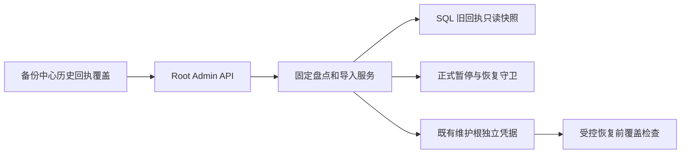
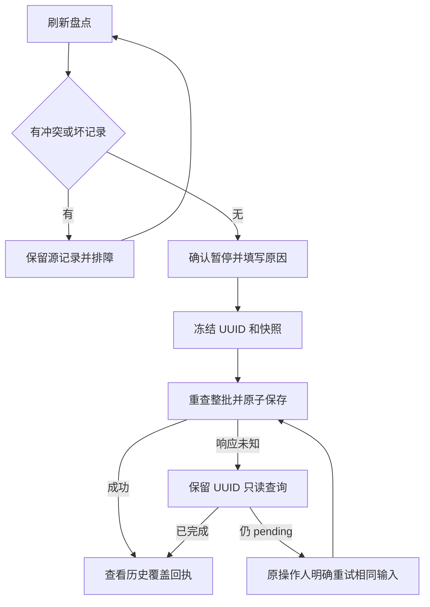
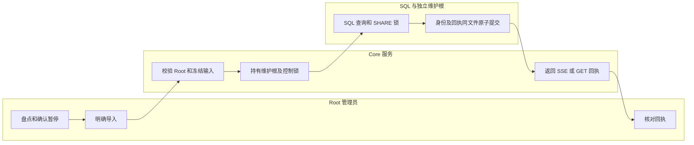

# 旧备份保留回执：盘点、导入与恢复前核对

## 1. 功能背景与目标

升级独立恢复凭据前，旧的人工保留请求只存在 SQL 中；数据库恢复可能丢失这些请求。此功能先展示缺口，由 Root 显式复制历史身份到既有维护根。它不释放磁盘、不改变 protected、不删除备份，也不替代异机备份。当前仅源码及自有隔离验收，现场需另行维护交接。

## 2. 角色与适用范围

Root 人类登录会话操作当前安装；QA 仅使用专用临时数据库／维护目录。运维负责确认旧写入者停用和升级窗口。普通租户、插件 API Key／STS 无权操作。其他安装 Scope 会提示数量但不会被当前 Root 的导入自动搬入。

## 3. 整体架构与模块关系



## 4. 核心流程



## 5. 跨角色协作流程



## 6. 前置条件与依赖

- 维护根已按安装流程登记，旧写入进程已停用，程序识别 v5／凭据 v2。不要为测试复制或删除日常维护根。
- SQL 回执表沿既有中央迁移就绪；本切片无新 SQL 迁移。正式 TaskBus 控制配置已发布，自动治理已确认暂停，恢复核对已完成。
- 固定上限 4096 条请求、1024 次导入审计、16 MiB 文件。只有当前 Scope 可导入；不接受浏览器来源路径和业务表。
- 本轮无需用户立即重启。发布时由用户依现有维护方式重新编译／重启 Core 和前端，再验证，不能用本轮隔离结果替代现场验收。

## 7. 操作步骤

### 页面主链路

| 动作 | 入口 | 预期结果 | 失败处理 |
| --- | --- | --- | --- |
| 读取盘点 | `/ops/backup` → 数据库备份 → 历史回执覆盖 → 盘点 | 当前覆盖数、缺口、未知结果及按页明细；默认不写入 | 来源不可用时旧内容可见但提交禁用；修复连接／结构后手动刷新 |
| 筛选缺口 | 覆盖状态选择“未覆盖” | 仅改变显示；导入仍检查整个当前 Scope | 冲突或无效项在列表保留，先排障，不改业务数据 |
| 确认暂停 | `/monitor/storage` 的受控执行保护 | 已发布且确认暂停；此处不会替你停用进程 | 维护未核对或 worker 不可用时不得继续导入 |
| 显式导入 | 导入 → 填写原因 → 勾选确认 → 提交 | UUID 固定，单次 SSE 返回 completed 及覆盖数量 | 丢响应保持原 UUID；点击只读查询，404 仍表示未知；只有显式原输入重试可继续 |
| 核对历史证据 | 回执 → 选择原 UUID | 当时快照覆盖数；checking 仍是未知结果 | 历史证明不代替当前盘点，恢复前必须重查 |

切换盘点／导入／回执保留草稿与任务；窄屏使用分区选择框。离开页面会断开流，已接纳 UUID 可在回执列表重新打开。页面不会周期刷新或自动重发导入。

### 管理接口

以下命令由操作者在目标环境使用，默认前缀 `/api/v1`。令牌通过环境变量提供，不写文档或 URL。查询只读；POST 必须先在 UI 明确暂停并使用新鲜快照。

```sh
curl --fail-with-body -H "Authorization: Bearer $ROOT_TOKEN" "$CORE_URL/api/v1/admin/ops/backup/cleanup-retention-history?page=1&page_size=20&coverage=missing"
```

预期 `data` 包含 `snapshot`、`total`、`covered`、`missing`、`foreign`、`can_import`。`complete=true` 仅指当前 Scope 当前观察；foreign 非零时 restore_ready 为 false。HTTP503 应先修复配置／来源，不修改容量阈值。

```json
{"request_id":"填入本次固定 UUID","expected_snapshot":"填入预览的 64 位摘要","reason":"保存旧回执以便恢复核对","confirm":true}
```

将严格正文保存到受控本地文件，然后执行一次（未知时不要生成另一个 UUID）：

```sh
curl --fail-with-body --no-buffer -H "Authorization: Bearer $ROOT_TOKEN" -H 'Content-Type: application/json' -H 'Accept: text/event-stream' --data-binary @history-import.json "$CORE_URL/api/v1/admin/ops/backup/cleanup-retention-imports"
curl --fail-with-body -H "Authorization: Bearer $ROOT_TOKEN" "$CORE_URL/api/v1/admin/ops/backup/cleanup-retention-imports/$REQUEST_ID"
```

预期 SSE accepted → complete；completed 带 complete=true。uncertain、流结束、断网或 GET404 均不证明未执行。查询只核对原 UUID，终态读取不会重新导入或写保护。

### 本地联调

日常服务由用户通过 VSCode 的既有启动配置运行，本功能不另要求常驻端口。独立验证优先使用显式临时 PG：先自行建立 `/tmp/powerx-control-owned-*` Unix socket 集群和 `storage_control_test` 角色，将 DSN 写入 `POWERX_STORAGE_CONTROL_TEST_DSN`（禁止指向日常库）。

```sh
go -C backend test -race -p 1 ./internal/infra/storage_recovery ./internal/service/storage_governance ./internal/service/system_recovery ./internal/transport/http/admin/backup -run 'TestRetentionImport|TestRetentionHistory|TestCurrentStorageNativeHistoryGap|TestCleanupReviewNativeHTTPAndSSE' -count=1 -v
npm --prefix web-admin exec -- vitest run --root web-admin tests/unit/backup
```

预期 PASS；无测试 DSN 时原生 PG 场景明确 skip，不能计作通过。SQL 回放另须 `POWERX_STORAGE_RETENTION_RESTORE_TEST=1` 和绝对 `POWERX_STORAGE_TEST_PG_BIN`。测试 HTTP 监听仅临时随机回环端口，PID／端口见日志；结束关闭自有进程并确认端口释放。本轮执行和收尾见证据。

## 8. 预期结果与验收标准

覆盖成功、漂移拒绝、整批无部分提交、同 UUID 幂等、不同操作人／正文拒绝、原 Actor／保护／token 不变；文件故障和响应丢失后原 UUID 可核对。实际 SQL 回放后历史仍可查，缺口阻止受控覆盖且不推进代次。浏览器检查 1440／390、明／暗主题、导航草稿保留、推送同步、无周期请求与离开／换身份释放流。隔离成功不证明生产部署、真实取回、完整业务恢复或长期运行。

## 9. 代码实现映射

| 范围 | 代码 |
| --- | --- |
| 固定路由与严格 DTO | `backend/internal/transport/http/admin/backup/{routes,retention_history_handler}.go` |
| 盘点、快照与导入 | `backend/internal/service/backup_ops/retention_history.go` |
| SQL 读取 | `backend/pkg/corex/db/persistence/repository/ops/backup_cleanup_retention_repository.go` |
| 独立原子凭据／升级 | `backend/internal/infra/storage_recovery/{retention_import,retention,anchor}.go` |
| 暂停守卫 | `backend/internal/service/storage_governance/backup_policy_control.go` |
| SQL 覆盖前检查 | `backend/internal/service/backup_ops/retention_coverage.go`、`system_recovery/current_storage.go` |
| 页面／客户端 | `web-admin/app/components/ops/backup/BackupRetentionHistory.vue`、`app/composables/api/services/backupHistoryService.ts` |

## 10. 常见问题与排障

| 情况 | 处理 |
| --- | --- |
| `BACKUP_HISTORY_PAUSE_REQUIRED` | 核对正式暂停发布及恢复 acknowledged；不要只停浏览器 |
| `BACKUP_HISTORY_SNAPSHOT_CHANGED` | 原批次已拒绝，手动刷新并查看差异，必要时明确新请求 |
| `BACKUP_HISTORY_CONFLICT`／`RECORD_INVALID` | 保留 SQL／独立证据核对原记录；不能删除回执绕过 |
| `BACKUP_HISTORY_SOURCE_LIMIT`／`LEDGER_FULL`／`IMPORT_LIMIT` | 保留历史并按受控容量方案处理，不直接清空凭据 |
| 404、`RESULT_UNKNOWN`、断网 | 保留 UUID，只读查回；不可把 404 当作未执行 |
| `BACKUP_HISTORY_COVERAGE_REQUIRED` | 当前 SQL 仍有遗漏，先回到盘点；其他 Scope 须走原安装归属处理 |
| 插件 Lookup 被拒绝 | 此检查仅在受控恢复前执行；检查原准入 reason_code，不以本导入开关替代配置修复 |

## 11. 回滚与风险控制

协议升级保留维护根身份／历史，旧程序不认识新协议时拒绝写入。保留当前受控执行器、暂停状态和现有维护回退边界；不得降协议、重建空凭据、清表、解除原清理锁或用旧SQL覆盖维护根。独立文件与 SQL 非跨存储事务；导入自身全部身份与回执通过单文件原子 checkpoint 保证整批，失败保留 pending，恢复前再次核对覆盖。主机全部副本丢失仍需独立备份／受控密钥方案。

## 12. 变更记录

2026-11-09：新增 T171 旧回执显式导入、v5／v2、恢复覆盖检查及页面；[合同](../../../contracts/backup-retention-history-import.md)、[隔离证据](../../../contracts/evidence/backup-retention-history-import-validation-20261109.json)。T171／T172／SG-11 现场总门槛未完成；下一工程项为跨代次未知意图人工终结合同与实现。

整包发布另有共享工作区 core 升级载荷登记差异（`UPGRADE_PAYLOAD_CHANGED`）；本功能不新增 SQL 迁移或替其他变更刷新迁移 ID。对应变更评审／整合后须再次通过该检查，再安排现场升级。
