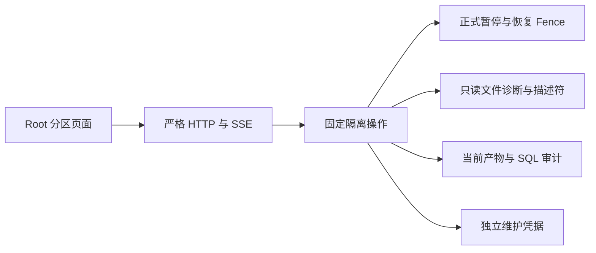
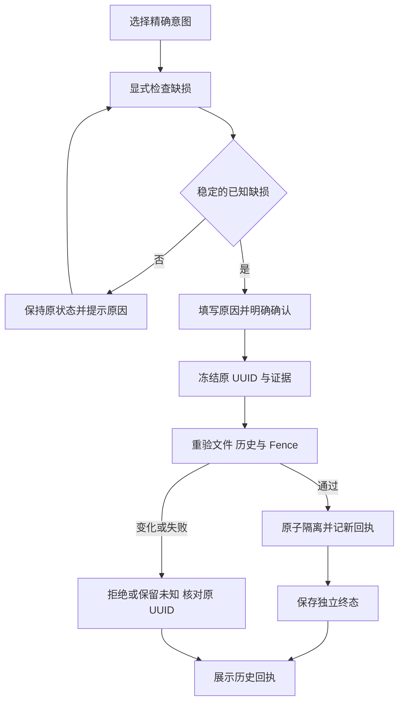
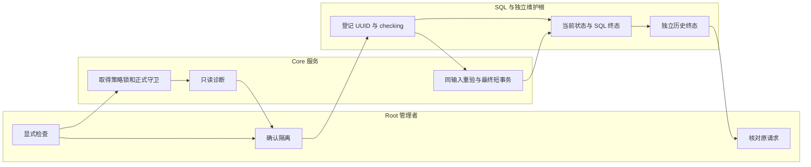

# US9：隔离缺损备份

## 1. 功能背景与目标

清理结果未知时，完整备份可以人工保留；缺失或不完整的产物需要另一种处置。隔离将它移出可用备份并阻止恢复，保留文件和历史供排查。它不修复数据、不释放空间、不证明备份有效。

## 2. 角色与适用范围

Root 人类管理会话；当前安装已登记策略的成功作业、精确 pending/unconfirmed 意图。普通用户、插件服务身份和 API Key 均不能执行。本文隔离验证不代表日常或生产部署完成。

## 3. 整体架构与模块关系



## 4. 核心流程



## 5. 跨角色协作流程



## 6. 前置条件与依赖

当前源码及中央审计迁移、维护 v7／凭据 v4就绪；旧写入程序已停止或完成正式交接。日常安装的升级需维护授权，不可拿开发 scope 代替安装升级。全局暂停已发布，计划及 drill 关闭，恢复 acknowledged；原历史独立覆盖完整。文件来源必须在登记根下，可安全固定父目录。没有活动备份或验证任务。

## 7. 操作步骤

### 页面

1. 进入 `/ops/backup` → 数据库备份 → 备份清理待核对，选择文件详情 → **隔离缺损产物**。应显示说明与检查入口，不自动读取大文件；权限或读取失败时保留列表并提示。
2. 点击 **检查当前缺损情况**。等待一次 SSE 诊断；应看到缺失／大小变化／校验或旁文件问题。完整文件、路径不安全、正在变化、父目录不可固定时不能提交。中断后显式重查。
3. 填写 3–256 字原因并勾选确认，点击 **确认隔离此产物**。服务端重新检查，成功回执为“已隔离 · 不能用于恢复”。没有文件删除或保护开启；原未知仍未知。
4. 响应丢失时保留原 UUID，点击核对原请求；查询失败继续保留。仅当服务端允许原请求接续时显式恢复同输入；不刷新生成新请求。跨代次阻断显示历史，不能自动执行。
5. 成功后关闭详情；当前注意清单不再包含该意图。历史备份仍显示隔离标记，下载与恢复不可用。需要后续定位的统一隔离台账仍属下一工程项。

### 接口

使用正式配置前缀，令牌仅从受控终端环境读取，不写 URL。示例读取诊断：

```sh
curl --no-buffer --fail-with-body -H "Authorization: Bearer $ROOT_TOKEN" "$CORE_URL/api/v1/admin/ops/backup/cleanup-reviews/$ARTIFACT_ID/quarantine-preview?expected_token=$CLEANUP_TOKEN"
```

预期 `event: complete`，data 中 `can_quarantine=true`、`diagnosis`、64 位 `diagnostic_digest`、`review_version` 和 `history_digest`。没有 complete 不能提交。POST 按[合同](../../../contracts/backup-cleanup-quarantine.openapi.yaml)携带新请求 UUID、上述冻结值、原因与 confirm=true；不可添加路径、verified 或自由操作。核对结果：

```sh
curl --fail-with-body -H "Authorization: Bearer $ROOT_TOKEN" "$CORE_URL/api/v1/admin/ops/backup/cleanup-quarantines/$REQUEST_ID"
```

预期 data.state=quarantined、operation=quarantine_cleanup、valid_backup_proof=false；404／错误仍未知，不能作为新请求资格。

### 本地联调

由用户启动日常 backend/web-admin；不要关闭用户进程。可先在自有隔离资源执行：

```sh
go -C backend test -race ./internal/infra/storage_recovery ./internal/service/backup_ops -count=1
```

```sh
cd web-admin && npx vitest run tests/unit/backup
```

真实 SQL 故障和回放测试必须使用 `POWERX_STORAGE_CONTROL_TEST_DSN` 指向自有 `/tmp/powerx-control-owned-*` Unix socket、storage_control_test 角色。不得指向业务库。回放测试还需显式开启 `POWERX_STORAGE_RETENTION_RESTORE_TEST=1` 并提供 `POWERX_STORAGE_TEST_PG_BIN`。查看测试 PASS 和原 UUID 回执，不能以普通 fixture 代替实际 provider／生产验收。

## 8. 预期结果与验收标准

- 六种已知缺损可隔离，健康／链接／FIFO／越界／漂移拒绝；提交期间重新出现文件必须失败。
- 不变项：文件内容、Job.status、protected、原 token 和未知记录。变更只有当前 cleanup_state 与新审计／独立回执。
- 并发单赢家；SQL 回滚、丢响应、checkpoint 故障、恢复代次和 SQL 回放不能重复执行。
- 桌面纵向导航、390 窄屏选择器、明暗主题、草稿和回执状态保留；无自动扫描、轮询或 POST。
- 安装升级保留旧 retain 请求；新列缺失只阻止本处置，不影响普通插件调用准入。

## 9. 代码实现映射

| 内容 | 路径 |
|---|---|
| 路由与 SSE | `backend/internal/transport/http/admin/backup/cleanup_quarantine_handler.go`、`routes.go` |
| 操作与证据 | `backend/internal/service/backup_ops/cleanup_quarantine.go`、`cleanup_quarantine_probe.go`、`cleanup_resolution.go` |
| SQL 审计 | `backend/pkg/corex/db/persistence/model/ops/backup_cleanup_resolution_gorm.go` 与对应 repository |
| 独立凭据 | `backend/internal/infra/storage_recovery/retention.go`、`anchor.go` |
| 页面与客户端 | `BackupCleanupQuarantine.vue`、`BackupCleanupReviews.vue`、`backupQuarantineService.ts` |
| 故障与回放 | `cleanup_quarantine_postgres_test.go`、`cleanup_quarantine_replay_test.go`、`cleanup_quarantine_probe_test.go` |

## 10. 常见问题与排障

| 情况 | 处理 |
|---|---|
| 父目录消失／无法固定 | unavailable，先恢复来源可观测性，不能当成缺文件直接隔离 |
| 诊断已过期／收到变更 | 保留草稿，显式重查；不自动全量读文件 |
| BACKUP_RESOLUTION_SCHEMA_NOT_READY | 检查正式迁移及唯一索引，不关闭能力门禁或清业务数据 |
| ORIGINAL_REQUEST_REQUIRED／未知 UUID | 核对原请求，不新建绕过 |
| CHECKPOINT_REQUIRED | 只显式接续原请求补独立回执，不重做 SQL |
| 备份历史 status 仍是 success | 原状态是作业执行事实；隔离标记决定当前可用性，不改写历史 |

## 11. 回滚与风险控制

暂停本功能入口并保留审计、独立维护根和现存隔离标记。不得降协议、删除墓碑、手工清 token 或将隔离恢复成可用。误隔离后的解除／重建及统一台账后续另行实现；本切片没有解除按钮。SQL 和文件系统不是原子事务，未知结果按原 UUID 核对；外部不协作写入不属于策略锁排空证明。

## 12. 变更记录

2026-11-09，T172 人工隔离，维护 v7／凭据 v4。源码与自有隔离证据见[验证回执](../../../contracts/evidence/backup-cleanup-quarantine-validation-20261109.json)。现场部署、资源接管、T155 长期目标与整站／长期运行仍未完成。下一项为隔离产物台账与只读复查，完成标准见[合同](../../../contracts/backup-cleanup-quarantine.md#边界与下一项)。
