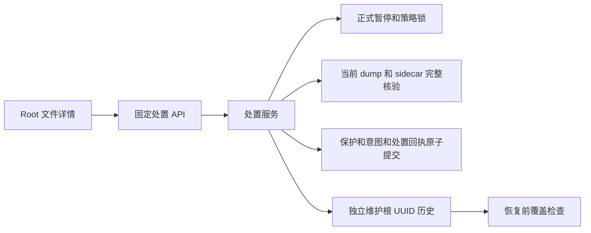
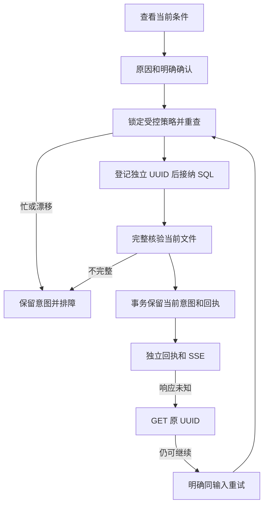
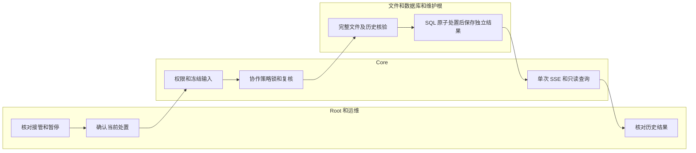

# 未知备份清理意图：人工保留

## 1. 功能背景与目标

恢复或执行中断后，旧请求可能一直显示未知。当前文件完整时，Root 可以另做一次有审计的人工保留，让当前意图退出待核对清单。原未知记录仍未知；新处置不删文件、不清 token、不启用计划。源码和自有隔离验收不代表正式站已升级。

## 2. 角色与适用范围

Root 人类会话操作当前安装已接管策略的成功数据库备份。运维确认旧执行器交接，QA 使用自有数据库／目录。插件 API Key、STS、普通租户不可操作。一次性备份、缺失／损坏文件与外部未接管执行器不在本次成功保留范围。

## 3. 整体架构与模块关系



## 4. 核心流程



## 5. 跨角色协作流程



## 6. 前置条件与依赖

- 后端／前端为当前源码，维护目录按原流程升级至当前 v7／凭据 v4（接续 v6/v3）；旧写入程序已停用。升级和业务恢复不能覆盖维护根。
- 已通过集中迁移准备 `ops_backup_cleanup_resolutions`；该表不就绪只阻断这项处置，不用于普通插件调用准入。
- 全局暂停已发布／确认，恢复 acknowledged；相关计划／drill 已关闭，受控任务无活动记录，协作执行器遵守 policy 会话锁。外部旧脚本排空另按交接流程证明。
- 当前 dump 和两个 sidecar 都完整，精确 token／历史覆盖一致；4096 个共享独立身份和 16 MiB 上限内。

## 7. 操作步骤

| 动作 | 入口 | 预期结果 | 失败处理 |
| --- | --- | --- | --- |
| 查看意图 | `/ops/backup` → 数据库备份 → 备份清理待核对 → 检查文件现状 | 显示精确 artifact/token 和历史 | 孤立／软删／来源异常停止，不删记录绕过 |
| 进入当前处置 | 详情左侧“终结意图并保留” | 条件就绪或明确原因；列出仍未知的历史数 | 先处理暂停、恢复、历史覆盖；预览不证明最终排空 |
| 明确执行 | 填 3～256 字原因，勾选确认，点击“核验并终结为人工保留” | 单次 SSE 显示完整读取进度，最后显示新历史回执；原 token／历史不变 | 内容失败保留原意图；响应未知保留原 UUID |
| 查询未知请求 | “只读核对原请求” | 原 UUID 的确定结果，或仍未知／待补独立回执 | 404 不证明未执行；不要生成新 UUID。仅明确点击“继续原请求” |
| 结束查看 | 完成回执后关闭 | 当前意图退出待核对清单，回执仍可按 UUID 查询 | 历史成功不能代替恢复后的当前文件核验 |

切换分区保留草稿／进行中的请求；窄屏为选择导航。未确认请求锁住关闭和重选意图；确定跨代次阻断时保留身份并允许关闭。无状态轮询、自动重试或后台私有队列。

接口默认前缀 `/api/v1`。以下是操作者自己的目标与 Root 会话，不在 URL 放票据或令牌：

```sh
curl --fail-with-body -H "Authorization: Bearer $ROOT_TOKEN" "$CORE_URL/api/v1/admin/ops/backup/cleanup-reviews/$ARTIFACT_ID/resolution-preview?expected_token=$CLEANUP_TOKEN"
```

预期 `can_resolve=true` 和本次 `review_version`／`history_digest`。固定正文写入受控本地 `resolution.json`：

```json
{"request_id":"本次固定的非零 UUID","expected_token":"原清理 token","review_version":"预览的 64 位摘要","history_digest":"预览的历史摘要","reason":"核验当前备份并人工保留","confirm":true}
```

```sh
curl --fail-with-body --no-buffer -H "Authorization: Bearer $ROOT_TOKEN" -H 'Content-Type: application/json' -H 'Accept: text/event-stream' --data-binary @resolution.json "$CORE_URL/api/v1/admin/ops/backup/cleanup-reviews/$ARTIFACT_ID/resolutions"
curl --fail-with-body -H "Authorization: Bearer $ROOT_TOKEN" "$CORE_URL/api/v1/admin/ops/backup/cleanup-resolutions/$REQUEST_ID"
```

收到 accepted 说明已接纳 SQL；未收到也可能已登记独立身份，仍须保留原 UUID 核对。complete retained 且 independent_complete=true 表示该次操作结果已持久保存。checking、uncertain、断流和 404 均不能当作未执行。`CHECKPOINT_REQUIRED` 的同 UUID POST 只补独立历史，不重写当前保护。

本地服务仍由用户通过既有 VSCode 配置启动；本轮无需用户立即重启。独立开发验证使用显式 `/tmp/powerx-control-owned-*` Unix socket、`storage_control_test` 角色的临时 PG DSN，禁止指向日常库：

```sh
go -C backend test -race -p 1 ./internal/infra/storage_recovery ./internal/service/storage_governance ./internal/transport/http/admin/backup ./cmd/database -run 'TestCleanupResolution|TestCleanupReviewNativeHTTPAndSSE' -count=1 -v
npm --prefix web-admin exec -- vitest run --root web-admin tests/unit/backup
```

需显式 `POWERX_STORAGE_CONTROL_TEST_DSN`；未配置原生场景会 skip，不能计作通过。dump/restore 另需 `POWERX_STORAGE_RETENTION_RESTORE_TEST=1` 和 `POWERX_STORAGE_TEST_PG_BIN` 绝对路径。测试自有 PID、命令、端口有记录，结束关闭并移除临时凭据和集群。

## 8. 预期结果与验收标准

完整文件保留成功，原历史／token 不变；并发只有一个当前处置成功。活动任务、协作锁、文件变化、恢复或 Fence 漂移拒绝；SQL 失败不部分保护／改状态；独立 checkpoint 失败可只补回执；SQL 回放后的旧回执不重放保护，新操作必须重新明确核验。Root 权限、严格正文、SSE、明暗 1440／390、草稿／未知 UUID 保留与无周期请求分别验证。现场接管、完整业务恢复及长期运行另验收。

## 9. 代码实现映射

| 范围 | 代码 |
| --- | --- |
| 固定操作与两阶段回执 | `backend/internal/service/backup_ops/cleanup_resolution.go` |
| 固定 SQL 恢复覆盖 | `backup_ops/cleanup_resolution_coverage.go` |
| SQL 原子 CAS | `backend/pkg/corex/db/persistence/repository/ops/backup_cleanup_resolution_repository.go` |
| 模型／中央迁移 | `model/ops/backup_cleanup_resolution_gorm.go`、`backend/pkg/corex/db/database/migration.go` |
| 独立凭据与兼容升级 | `backend/internal/infra/storage_recovery/{retention,anchor}.go` |
| HTTP | `backend/internal/transport/http/admin/backup/{routes,cleanup_resolution_handler}.go` |
| 页面／客户端 | `BackupCleanupResolution.vue`、`backupResolutionService.ts` |

## 10. 常见问题与排障

| 原因 | 处理 |
| --- | --- |
| `SCHEMA_NOT_READY` | 先按正式迁移流程准备新表／唯一索引；不关闭门禁或扩大插件权限 |
| `PAUSE_REQUIRED`／`POLICY_BUSY` | 核对正式发布、关闭计划／drill、等待受控任务结束及交接；不强杀用户服务 |
| `HISTORY_COVERAGE_REQUIRED` | 在历史回执覆盖分区检查和显式导入旧记录；冲突先保留证据处理 |
| `ORIGINAL_REQUEST_REQUIRED` | 同代次已有未完成处置，必须先核对原 UUID；不得复制新任务 |
| `CHECKPOINT_REQUIRED` | 原 Actor 明确继续原请求，只补存独立回执 |
| `RECOVERY_REVIEW_REQUIRED`／SQL 历史缺失 | 原请求历史只读；维护代次、恢复确认及当前意图需要重新核对 |
| `CONTENT_*` | 文件缺失／损坏不属于本次可成功保留范围；保留意图，等待人工隔离流程，不删除 |

## 11. 回滚与风险控制

新表为 protected 运维历史，普通日志清理排除。SQL 当前保护、清理状态和新终态同事务，但 SQL 与独立文件分两阶段，故障可保留未知。升级后的旧程序应拒绝写入；不要降协议、清回执、清 token 或替换维护根回退。内容摘要不能抵御具有维护目录写权限者的替换，整盘回滚／主机损坏需独立备份。官方载荷摘要登记不等于整包发布审查。

## 12. 变更记录

2026-11-09：T172 人工保留当前清理意图，维护 v6／凭据 v3及独立审计表。[合同](../../../contracts/backup-cleanup-resolution.md)、[隔离证据](../../../contracts/evidence/backup-cleanup-resolution-validation-20261109.json)。下一工程项为缺损产物的人工隔离；T172、现场交接及 SG-11 不关闭。
