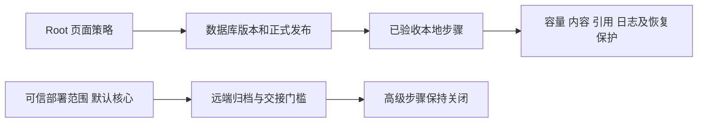
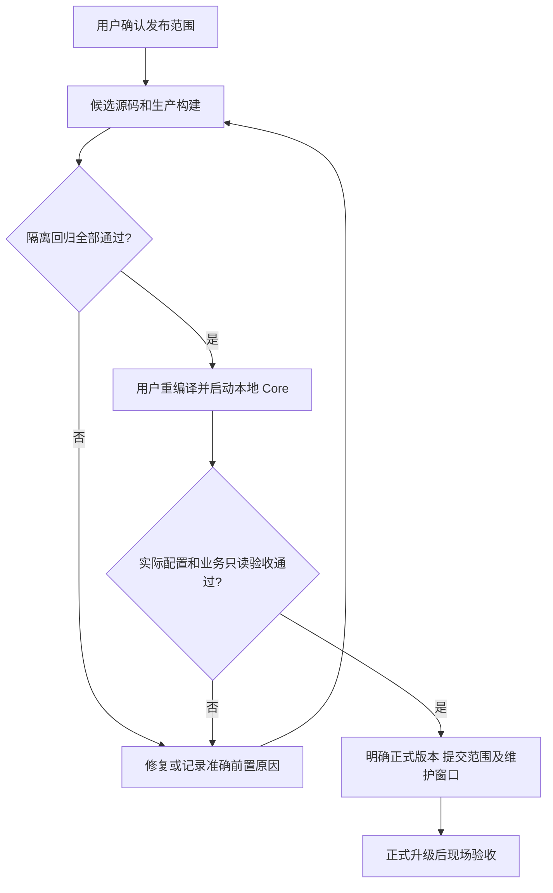
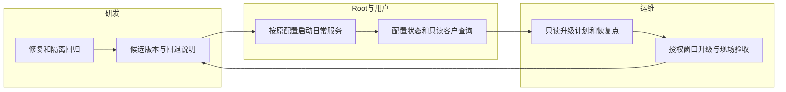

# 存储核心范围发布与验收

## 1. 功能背景与目标

本次先交付已验收核心功能，远端归档与现场接管保持未就绪。发布范围由用户明确确认，不能为赶发布降低容量、权限、日志留存或删除保护，也不能把历史测试写成已部署。

## 2. 角色与适用范围

Root 管理员核对本地功能与策略；研发处理候选源码、测试和版本；运维负责正式升级窗口和现场只读验收。本轮为当前分支未提交 worktree 的本地候选，未发布镜像／标签／PR，未操作正式站。完整商用规格另行验收。

## 3. 整体架构与模块关系

## 4. 核心流程

## 5. 跨角色协作流程

## 6. 前置条件与依赖

保持 `storage_governance.advanced_operations_enabled: false`。这是部署可用性门槛；普通策略仍通过 UI 和正式数据库配置。不得为解除 503 关闭准入、扩大插件权限或删除业务数据。正式迁移沿用当前版本的数据库 upgrade／migrate 入口，先 status／plan，不能临时建几张表冒充完整迁移。

源码启动涉及日常进程时，遵守仓库 AGENTS.md：由用户按原 VS Code 配置重编译并启动；Agent 不关闭或重启用户 Core／Nuxt。本轮隔离测试所用数据库与监听端口交付前关闭。

## 7. 操作步骤（按场景拆分）

### 当前候选检查

查看 `tmp/storage-release-20261110/PLAN.md`、build-results 与正式证据。预期候选构建和核心检查通过；标记 uncommitted 的候选不能直接当正式 release。任何失败先查看对应日志，早期环境错误必须与纠正后的结果分开。

### 本地实际运行验收（本轮已由用户重启后完成只读复验）

1. 用户按原 VS Code 配置重新编译并重启 Core；Nuxt 保持原启动方式。预期实际进程加载新源码，不能只看到热更新页面就认定后端更新。失败时保留日志，使用原启动配置定位，不换安装身份或新建日常库。
2. Root 打开 `/monitor/storage`，依次看容量概览、系统表、自动治理／告警、数据库期限。预期物理盘和 PowerX 已统计资源分开，未知量保留未知，表容量／时间范围可读，策略和生效版本一致。失败查看控制链／迁移原因；不把 migration_ready=true 单独当成全部就绪。
3. 在“日志归档与追溯”看到“远端归档未就绪”；执行器交接分区看到未就绪且按钮禁用，紧急暂停与只读诊断仍可用。接口应为 remote_execution.enabled=false／legacy_handoff_available=false。发现不同结果先停在只读状态，核对当前 Core 的发布范围，不能用页面禁用替代后端保护。
4. 原文件日志、审计文件和 PostgreSQL SQL 日志按既有配置继续写入。文件与数据库期限只有各自 UI 已明确启用且当前控制版本／来源／引用校验通过时执行。未接管资源继续保护，不自动迁入新清理器；如需写策略或接管现场另行执行对应批准流程。
5. 使用 WorkspaceX 原专用身份检查两项客户授权仍为 granted，再执行官方 SDK 的只读 Lookup。预期找到或未找到，不能是配置未就绪型 503，更不能把配置故障包装成容量耗尽。保持客户、订单和支付写入为 0；失败保留 trace 与安全 reason_code，查控制链而非扩大权限。

### 正式发布与运行

本轮本地只读运行已通过；按用户安排共同总结提交后再上传、打版本。工作区有大量既有改动，必须审阅入版清单；不自动 stage／commit／push。运维在批准窗口先取得恢复点和正式 upgrade 只读计划，再升级。部署后重复上面的实际运行步骤，记录 SHA／进程／主机与真实结果；旧脚本／timer 继续按既有安全维护边界运行，不能与新执行器同时接管同一来源。

## 8. 预期结果与验收标准

Linux 后端和独立 Nuxt 生产构建通过；原生升级、Root 权限与配置错误分类、数据库期限／文件保护、手动及定时快照在线采集和独立恢复、前端与真实桌面窄屏均有当前证据。高级门槛后端拒绝真实执行，UI 可见；门槛不篡改历史策略和回执。源码、隔离结果、本地重启、正式部署分别记账。

## 9. 代码实现映射

| 责任 | 路径 |
|---|---|
| 部署范围 | `backend/config/storage_governance.go`、bootstrap `app.go`／`storage_governance.go` |
| 远端门槛与运行配置 | `backend/internal/service/archive_ops/release_gate.go`、types／remote／s3_target／policy_control／service |
| 接管门槛 | `backend/internal/service/storage_governance/execution_control.go` |
| 系统快照命令登记 | `backend/internal/service/archive_ops/system_component.go` |
| UI | `StorageExecutionControl.vue`、`ArchiveGovernanceBody.vue` 及对应服务类型／i18n |
| 验证 | `release_gate_test.go`、`execution_control_postgres_test.go`、`snapshot_ops/postgres_test.go`、`scripts/ops/test-storage-core-release-ui.mjs` |

## 10. 常见问题与排障

- 423 ARCHIVE_RELEASE_NOT_ACCEPTED／STORAGE_HANDOFF_RELEASE_NOT_ACCEPTED：本次范围按预期关闭，不是权限不足，不应通过增权解除。
- 本地对象缺失：核心范围不自动访问远端补回，保留记录；待真实远端验收后再按恢复流程处理。
- 配置不可用型 503：先检查正式数据库迁移、控制表／列／唯一索引、TaskBus、发布版本和来源；不能因为磁盘空闲就关闭门禁。
- 表总占用不等于数据库总量，DELETE 后库内可复用也不等于立即释放文件系统空间；不自动 VACUUM FULL 或清 WAL。
- 上方通知浮层长期开页跨后端重启的复查仍为既有待办，不能用通知落库推断前台接收。容量风险同时从存储页面的告警查看，不把该浮层当唯一安全入口。

## 11. 回滚与风险控制

未接管旧执行器、未改用户策略、未修改日志开关或插件授权。本轮新默认门槛不删除已有配置；回退时保留原命令证明、任务／请求和恢复代次。数据库升级若报告 restore_required，按正式恢复程序处理，不反复重跑。Linux 原生、整套 Core／DB 故障、长期目标、现场所有权、双环境及 7／14 天结果仍未完成；有限范围发布不关闭 SG-09／SG-11。

## 12. 变更记录

2026-11-10：用户确认核心范围发布；修复系统快照执行漏接，加入默认关闭高级操作的后端／运行配置与 UI 门槛，完成隔离联合验收。用户已重启本地 Core，Root 运行状态及原身份 v0.0.28／最新 v0.0.29 SDK 只读复验通过；数据库期限仍待 UI 接管并启用，正式发布待共同总结后执行。
