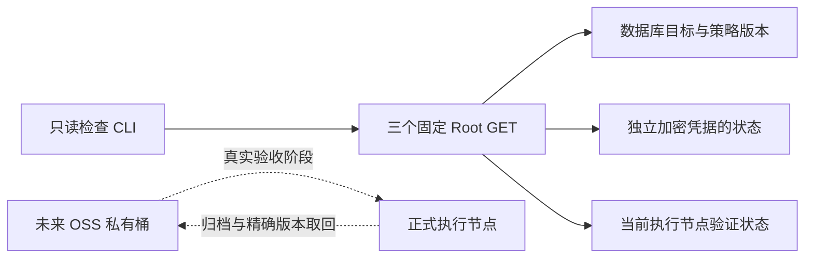
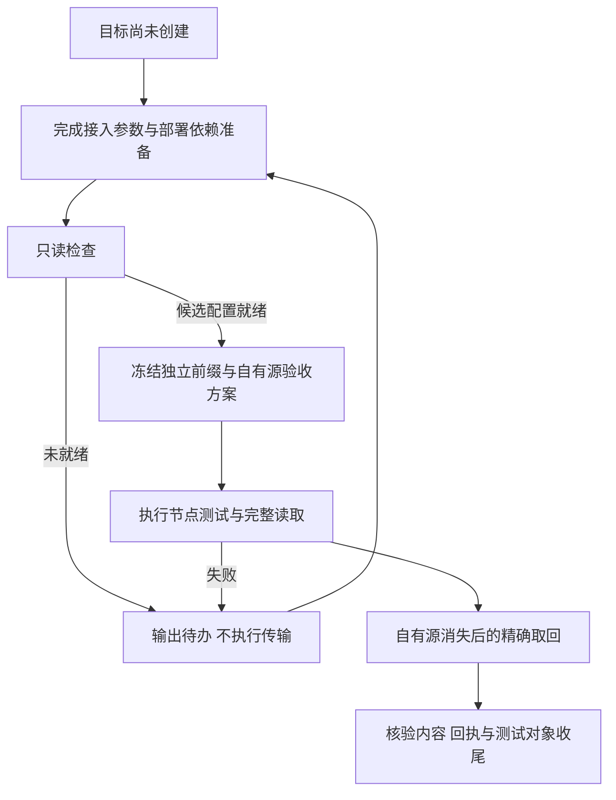
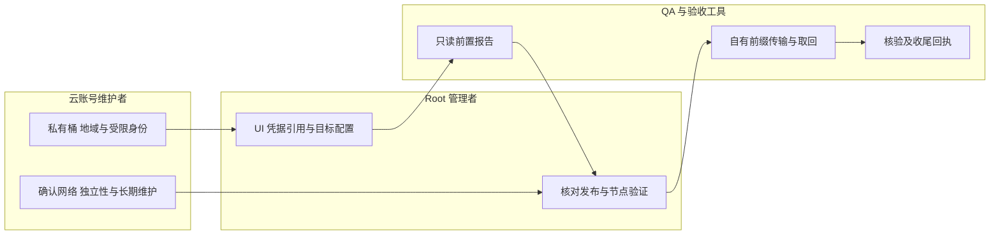

# US9：阿里云 OSS 接入准备与 T155 验收清单

## 1. 功能背景与目标

未来归档使用长期在线私有 OSS，避免依赖个人电脑。用户目前尚未配置 OSS，本轮准备检查工具和操作顺序；不提前启用归档或声称真实取回成功。

## 2. 角色与适用范围

Root 负责 PowerX UI，云账号维护者负责 OSS／RAM／网络，QA 负责独立前缀与自有源验收。CLI 是元数据只读观察，不能代替 Root 的保存／接管／启用操作，也不能证明云端长期可靠。

## 3. 整体架构与模块关系



## 4. 核心流程



## 5. 跨角色协作流程



## 6. 前置条件与依赖

目前无目标；无需现在创建云资源。日后准备 bucket、地域、S3 兼容 endpoint、独立测试前缀和服务器凭据引用名称。生产和开发使用不同前缀／归属，凭据值不发聊天、不写目标普通配置；独立密钥存储和外部挂载主密钥属于部署依赖，按[凭据手册](../../../contracts/archive-credential-vault.md)准备后再从 UI 写入。

云端必须长期在线并独立于来源主机和 Mac。端点可达、版本能力、私有访问、生命周期、历史版本取回与清理权限必须逐项验证。当前部署和升级仍按维护授权执行，本工具不补迁移、不启动或重启服务。

## 7. 操作步骤

### 场景 A：现在执行只读检查

1. 使用当前短期 Root 管理会话，从受控登录流程取得私有会话文件；不是 OSS AccessKey 文件。执行：

```sh
python3 scripts/ops/check-storage-archive-readiness.py --core-url http://127.0.0.1:8077/api/v1 --token-file "$ROOT_SESSION_FILE" --output /tmp/powerx-archive-readiness-new.json
```

预期新建 0600 报告。路径必须尚不存在。HTTP Core 只允许本机；远端使用 HTTPS，API 前缀按实际配置填写。CLI 不登录、不调用任何写接口；已有报告不覆盖，错误时换一个新报告路径并核对原因。

2. 检查 issues。当前观察为目标与策略尚未接管、目标为空、独立凭据存储未就绪；退出码 3 是待配置，不是“磁盘已满”或“OSS 故障”。
3. 有目标后在命令追加 `--target-id "$TARGET_ID"`；不会自动选择首个目标。退出 0 也仅表示 Core 元数据满足候选条件，t155_passed 仍 false。

### 场景 B：未来在 UI 接入 OSS

1. 云端按实际地域创建私有桶，配置版本保留，准备受限 RAM 身份和独立前缀。保留网络／账号／长期维护证据；不把一个可达 URL 当成独立长期目标的证明。
2. PowerX `/monitor/storage` → 日志归档与追溯 → 存储目标 → 管理归档凭据。准备独立凭据提供器后显式接管或新建加密引用；失败时核对部署依赖、恢复代次或密钥状态，不回退明文配置。
3. 按[目标合同](../../../contracts/archive-target-control.md)显式接管并保存目标。S3 兼容 endpoint 使用官方当前格式 `https://s3.oss-{region}.aliyuncs.com`，region 按所选地域填写，例如 `cn-hangzhou`；路径样式关闭，使用虚拟托管。自定义域名、证书和账号是否受默认公网域名限制，按官方规则另行核对。不要将普通 OSS endpoint、桶 URL 和 S3 兼容 endpoint 混用。[官方接入说明](https://www.alibabacloud.com/help/en/oss/developer-reference/use-aws-sdks-to-access-oss)、[兼容差异](https://help.aliyun.com/zh/oss/developer-reference/compatibility-with-amazon-s3)。
4. 核对已保存／应用／执行端快照版本相同，凭据为 sealed/active、无恢复或轮换待办。保存不等于已生效，也不会自动启用策略。
5. 从实际执行节点点击测试目标。失败保留错误和当前版本；不关闭保护来“让测试通过”。现有代码的版本、ACL、policy 和生命周期查询若与 OSS 有差异，先取得具体响应，再补专用适配并重验。

### 场景 C：目标就绪后完成 T155

1. 冻结验收记录：目标 UUID／版本、执行节点、凭据引用版本、自有隔离源、专用前缀、原因、开始时间及收尾清单。不得混用业务目录和生产归档前缀。
2. 在自有隔离环境按正式部署登记合成测试源，策略保持关闭，手动执行一批；记录原任务 UUID、远端 key／version、字节数和 SHA256。实际 UI 按共享 SSE 展示状态；不以常驻详情轮询替代推送。
3. 完整读取并核对内容。仅在确认原始数据是 Agent／QA 自有副本后使该源和本地缓存不可用，使用原任务和确切远端版本取回。只读一个元数据 HEAD、只算队列成功或只下载当前 latest 都不算通过。
4. 再核对内容、版本、旧历史不变和恢复／保护状态。按冻结清单清理本次测试对象的确切版本，保留脱敏回执；不执行桶级删除或顺带删除历史对象。
5. 只有这些证据完整后才能更新 T155 状态。旧执行器交接、正式策略接管和长期运行验收分别进行。

### 本地开发验证

```sh
python3 -m unittest discover -s scripts/ops -p 'test_storage_archive_readiness.py' -v
```

预期只使用自有临时 HTTP fixture，退出后监听关闭。测试验证 GET 限定、重定向拒绝、私有会话文件、报告不覆盖、令牌不泄露及未配置不假报成功；不连接 OSS。

## 8. 预期结果与验收标准

只读检查可发现缺目标、未接管、版本未确认、独立凭据不可用／吊销／待恢复及路径样式差异；保留原策略状态。CLI 不持有 OSS 值、不写平台配置或云端对象。真实验收还需节点传输、完整版本读取、自有源消失后的取回及收尾，不以本地测试或报告 exit=0 替代。

## 9. 代码实现映射

| 内容 | 路径 |
|---|---|
| 固定只读检查与私有报告 | `scripts/ops/check-storage-archive-readiness.py` |
| 临时 HTTP／CLI 边界测试 | `scripts/ops/test_storage_archive_readiness.py` |
| 目标版本／验证 | `archive_ops/target_control.go`、`storage_governance/archive_target_control.go` |
| 独立凭据 | `archive_ops/credential_vault.go`、`internal/infra/archive_credentials/` |
| 强制私有、版本与完整读回 | `archive_ops/s3_target.go`、`s3_transfer.go` |
| 实际 S3 协议客户端 | `internal/infra/media/driver/s3/minio/{client,versions}.go`；go.mod 使用本仓库替换，不是直接上游 SDK |

## 10. 常见问题与排障

| 问题 | 处理 |
|---|---|
| legacy/ready=true | 旧来源可读，尚未接管；不是已发布可执行配置，也不证明 schema 坏了 |
| CREDENTIAL_STORE_NOT_READY | 凭据提供器尚未配置或不可用，先检查部署与密钥依赖 |
| TARGET_NODE_VERIFICATION_REQUIRED | 当前节点／目标／凭据版本的验证尚未有效，显式测试目标 |
| OSS_VIRTUAL_HOST_REQUIRED | 关闭路径样式，核对服务端实际 Host 与官方要求 |
| CORE_METADATA_UNAVAILABLE | 检查会话、API 前缀和来源；401/403/重定向不会被当成配置为空 |
| 版本或公开访问查询不兼容 | 保留具体失败响应，先适配／复核，不跳过版本和私有访问保护 |
| 报告路径已存在 | 保留历史报告，使用新路径；工具不会覆盖 |

## 11. 回滚与风险控制

本轮工具没有平台或云端写入，停止运行无需回退配置。未来修改目标或凭据会使旧节点证明失效；保持相关策略暂停并按原 UUID 核对未知结果。不要通过降协议、删除账本、关闭版本保留或扩大 RAM 权限替代修复。当前 S3 兼容基础能力不等于全部 OSS 归档协议已实测。

## 12. 变更记录

2026-11-09：根据用户“未来使用阿里云 OSS，目前尚未配置”，完成只读准备切片；T155 真实远端验收待目标就绪。见[合同](../../../contracts/storage-archive-readiness.md)与[证据](../../../contracts/evidence/storage-archive-readiness-validation-20261109.json)。下一可独立推进项为 T158：远端断连／凭据失效／控制数据库不可用的已接纳归档联合故障回归，必须保留原请求／本地内容，不生成虚假的远端成功或删除资格；原生及 UI 证据仍不代替云端验收。
