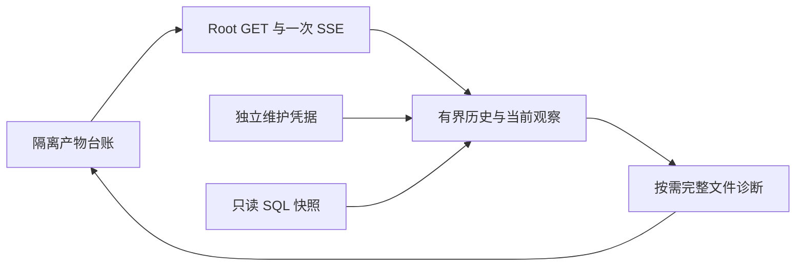
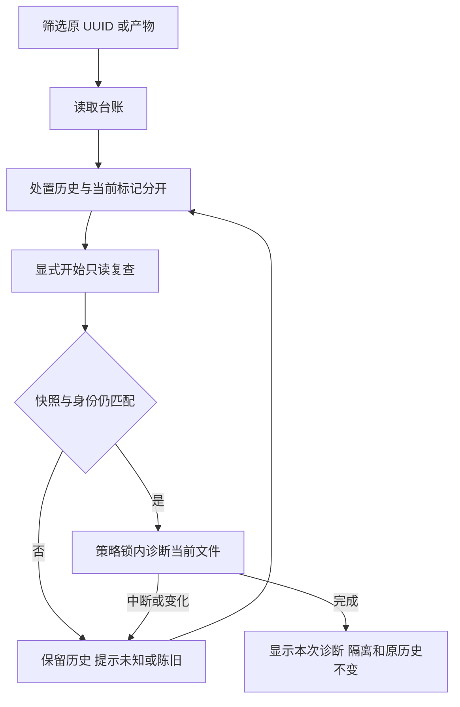
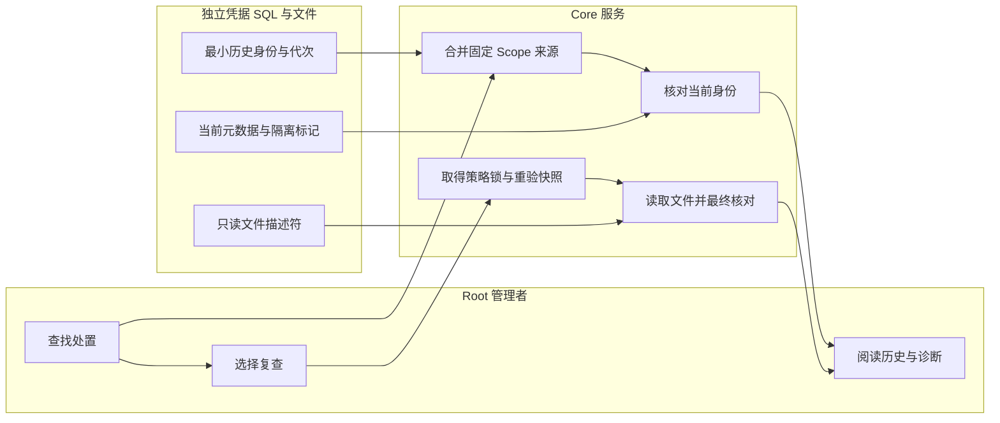

# US9：查看隔离台账并只读复查

## 1. 功能背景与目标

隔离完成后，产物退出“备份清理待核对”，仍需长期找到原编号、原因和当时的结论。数据库恢复还可能让当前标记回到隔离前；台账把历史与当前并列展示，避免用旧回执覆盖当前状态。

## 2. 角色与适用范围

当前安装的 Root 人类会话。普通用户、插件服务身份、API Key 和 STS 不可访问。台账不开放解除隔离、清文件、补回执或恢复执行；本次自有隔离验收不代表正式站部署完成。

## 3. 整体架构与模块关系



## 4. 核心流程



## 5. 跨角色协作流程



## 6. 前置条件与依赖

后台和前端使用匹配源码，现有 protected 处置审计表和维护 v7／凭据 v4 可读取。该切片没有新迁移或维护协议；首次部署仍需按前一切片的正式升级流程准备旧依赖，不可拿开发 scope 代替生产安装升级。没有处置记录时台账为空，不凭空生成历史。正式备份 SSE 能连接才能收到失效通知；断线时页面明确提示，手动刷新仍可读当前快照。

## 7. 操作步骤

### 场景 A：查找历史与当前状态

1. 打开 `/ops/backup` → 数据库备份 → **隔离产物台账**。预期看到历史结果、当前数据库标记、登记容量和处置时间；读取失败保留上次结果并提示状态未知。
2. 输入精确产物／作业编号、原 token 或请求 UUID，选择当前状态、历史结果、当时分类和排序，点击 **应用筛选**。预期服务端分页后的结果更新；输入中尚未应用的草稿不被推送覆盖。容量是当前登记大小，不是一次新的磁盘测量。
3. 点击 **详情**，默认 **处置历史**。核对请求 UUID、原 token、原因、操作人、分类和时间；上方另列当前状态。历史成功、当前未标记隔离是可解释的恢复后状态，不是系统自动重新隔离。
4. 若出现缺回执、冲突或无归属标记告警，保留原身份并按维护流程核对来源。台账不补建、不修改 checking，也不将缺记录说成此前未执行。覆盖告警在备份中心顶部仍可发现。

### 场景 B：只读复查当前文件

1. 在详情切到 **当前文件复查**，点击 **开始只读复查**。预期一次 SSE 字节进度及最终诊断；进入页面／切换分区不会自动扫描文件。
2. 文件完整时可看到本次完整性通过，仍保留隔离标记并说明“不授予恢复资格”。文件缺失、旁文件不全或不安全路径分别显示诊断；没有删除或修复动作。
3. 中断、来源变化或断库后点击 **重新读取当前状态**，确认当前身份再显式复查。旧快照不能直接重试为成功；关闭详情会取消只读请求，不留下后台任务。
4. 明暗主题和窄屏使用同一分区流程；筛选、历史 UUID 和进行中的复查在任务切换时保留。收到共享 SSE 后只同步元数据，当前来源变化才使诊断失效，无周期查询。

### 接口示例

API 前缀可配置，默认 `/api/v1`。令牌从受控终端环境读取，不放 URL：

```sh
curl --fail-with-body -H "Authorization: Bearer $ROOT_TOKEN" "$CORE_URL/api/v1/admin/ops/backup/cleanup-quarantine-inventory?current=quarantined&sort=size&direction=desc&page=1&page_size=20"
```

预期 JSON 的 data.items 将历史 result 与 current 分开，valid_backup_proof=false；来源不可用时为错误，不是空成功。复制原 UUID 与该条 snapshot，显式复查：

```sh
curl --no-buffer --fail-with-body -H "Authorization: Bearer $ROOT_TOKEN" "$CORE_URL/api/v1/admin/ops/backup/cleanup-quarantine-inventory/$REQUEST_ID/inspection?expected_snapshot=$SNAPSHOT"
```

预期 SSE progress 后 complete，read_only 和 quarantine_unchanged 均 true、valid_backup_proof=false。没有 complete 或身份不匹配不能当成功。快照变化先 GET 原 UUID 读取当前观察，禁止添加自由路径或请求解除隔离。完整字段见[OpenAPI](../../../contracts/backup-quarantine-inventory.openapi.yaml)。

### 本地联调

日常服务由用户启动；不要为验证重启或迁移用户数据库。先使用自有隔离测试：

```sh
go -C backend test -race ./internal/service/backup_ops -run '^TestQuarantineInventory' -count=1
```

```sh
cd web-admin && npx vitest run tests/unit/backup/quarantine-inventory.spec.ts
```

原生服务测试需 `POWERX_STORAGE_CONTROL_TEST_DSN` 指向自有 `/tmp/powerx-control-owned-*` Unix socket 和 storage_control_test 角色；不得指向业务库。真实回放还需显式 `POWERX_STORAGE_RETENTION_RESTORE_TEST=1` 和 `POWERX_STORAGE_TEST_PG_BIN`。查看 PASS、请求 UUID 和只读结果；测试结束关闭自有进程并确认端口释放。浏览器受控 SQL 标记变化与真正 pg_dump/pg_restore 分别留证，不能互相替代。

## 8. 预期结果与验收标准

- 原处置退出待核对清单后仍可通过 UUID／原 token／ID 定位；过滤、排序、分页在服务端完成。
- 历史与当前不同、SQL 回放、来源缺失、超限和冲突明确呈现；无归属标记不谎称完整覆盖。
- 复查没有 SQL DML、独立记录重写、自动 POST、文件删除或解除隔离；完整文件不重新开放恢复。
- 旧 snapshot、代次变化、当前身份变化、策略锁忙和 SSE 丢终帧不能假装成功。
- 桌面／390 窄屏、明暗主题、草稿／详情状态保留、空闲无查询和断线提示通过实际页面检查。

## 9. 代码实现映射

| 功能 | 路径 |
|---|---|
| Root 路由与参数 | `backend/internal/transport/http/admin/backup/quarantine_inventory_handler.go`、`routes.go` |
| 有界合并／分类／只读复查 | `backend/internal/service/backup_ops/quarantine_inventory.go` |
| 批量 SQL | `backup_cleanup_resolution_repository.go`、`backup_artifact_repository.go` |
| 文件安全证据 | `backend/internal/service/backup_ops/cleanup_quarantine_probe.go` |
| 页面与客户端 | `BackupQuarantineInventory.vue`、`quarantineInventoryService.ts`、`pages/ops/backup.vue` |
| 原生和 UI 测试 | `quarantine_inventory_postgres_test.go`、`cleanup_quarantine_replay_test.go`、`quarantine-inventory.spec.ts` |

## 10. 常见问题与排障

| 现象 | 解释与动作 |
|---|---|
| 历史成功，当前未隔离 | 回执是历史事实；核对 sql_replayed／当前 token 和恢复记录，不自动写回隔离 |
| 文件完整，仍不能恢复 | 完整性只是当次诊断；本入口不解除隔离或批准恢复 |
| 当前记录缺失／身份改变 | 原 UUID 保留；不能使用新 token 代替原请求 |
| 台账读取失败 | 检查现有审计列、独立凭据和本安装 Scope；不关闭普通能力门禁或清业务数据 |
| 来源超限 | 423，停止全量合并，不截断成完整清单；需独立维护／归档履历方案 |
| 无归属隔离标记 | 不代表可删除；核对备份执行历史、来源和安装绑定，不手改 token 或历史 |
| 推送断开 | 保留当前上下文、显示断线，可手动读一次；不改用常驻状态轮询 |

## 11. 回滚与风险控制

可以暂停台账入口，保留已有隔离与原历史。该切片没有新 schema／协议，不需要回退历史格式；不能通过删除独立凭据、清 token 或改当前标记回退。三秒只读 SQL 快照与独立来源摘要校验不能承诺跨存储原子性或未来文件状态；检查结果只用于排查。

## 12. 变更记录

2026-11-09：T172 隔离台账和只读复查；[合同](../../../contracts/backup-quarantine-inventory.md)、[验收证据](../../../contracts/evidence/backup-quarantine-inventory-validation-20261109.json)。未迁移／重启日常及生产，未接管现场资源。下一现场优先项为 T155：正式 UI 配置长期私有目标及服务器凭据引用后，用独立前缀完成归档、完整校验、源消失后精确取回和收尾；旧执行器交接、整站恢复、外部密钥和长期／发布验收仍待完成。
