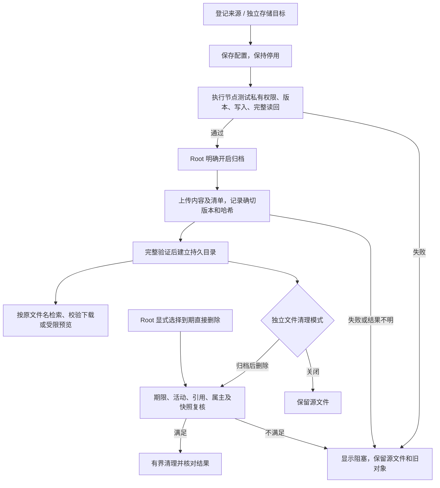
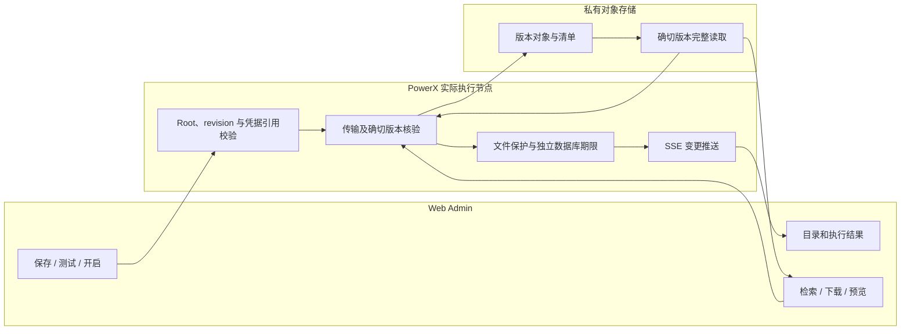

# US9：归档开关、期限、安全删除与历史取回（v0.6）


逐表监控、日志写入限额及两类新增安全清理规则见 [v0.7 使用指导](usecase-us9-table-safety.md)。归档、监控和数据库清理分别明确配置，不会互相默认开启。
## 1. 功能背景与目标
归档由平台 Root 管理员明确选择，并通过 UI 配置执行节点能够访问的独立目标。不归档时可以显式选择安全到期删除；关闭归档本身不会开启删除，也不会关闭 PostgreSQL／PowerX 新日志。本文面向管理员、运维和 QA，覆盖文件日志、调用审计期限、已存在的临时归档和取回。

## 2. 角色与适用范围
平台 Root 管理员配置目标、策略与启停；开发人员准备程序和增量迁移；运维部署并核对容量；QA 按自有数据验证双模式。服务身份和普通租户不能执行这些部署操作。

当前已完成本地源码交付与运行准备。2026-11-01 日常实例的文件日志自动删除、保护和同一进程连续十五分钟窗口已通过，测试策略与样例均已收尾，见[稳定窗口证据](../../../contracts/evidence/storage-stable-window-validation-20261101.json)。2026-11-02 数据库期限和容量拒绝在独立 PostgreSQL 中完成组合验收；日常数据库删除与调用拒绝仍未开启。生产服务器、服务器旧守护、Mac LaunchAgent 和已有对象尚未切换，旧 Mac 副本最后处理。隔离归档能力以 [开发证据](../../../contracts/evidence/storage-archive-controls-validation-20261031.json) 为准，不据此宣称真实生产历史已经可取回。

2026-11-02 后续已完成实际 Nuxt 页面＋正式归档 API／鉴权／SSE＋独立私有版本 MinIO 的组合验收：UI 保存／测试／显式启用、生命周期回收自有原件、本地缓存消失后的检索／预览／下载校验，以及关闭后继续取回均通过，见[组合验收证据](../../../contracts/evidence/storage-archive-native-ui-validation-20261102.json)。页面身份上下文与隔离 Root JWT 是受控 fixture；日常实例另由既有 Root 会话确认接口 200、调度器启动和 4 个来源就绪，保持 0 个归档策略。受控链路与真实日常／生产历史分别计证据。

随后已在日常 `3030 → 8077` 实例使用正常 Root 会话完成页面配置、真实上传、唯一自建样例清理、原件及 CAS 消失后的 UI 预览与下载接口解压校验；关闭归档后仍能取回。归档会复制该来源所有符合规则的封存候选，本次 6 项约 401 MiB；只回收了自建 59 字节样例，原有 6 份封存日志未删除且哈希一致。临时策略／目标／任务／凭据和新建缓存均已退役，操作审计与清理记录保留，见[日常实例 Root 验收证据](../../../contracts/evidence/storage-installed-root-validation-20261102.json)。这一项为手动闭环，不代表生产、长期策略或业务数据库清理已经启用。

## 3. 整体架构与模块关系


归档面板同时用于 `/monitor/storage` 的“日志归档与追溯”和 `/ops/backup` 的资源归档分区。两处读取相同服务、配置和任务；没有第二套 UI 权威。数据库期限单独位于存储治理左侧导航。任务及配置变化沿现有 SSE 推送，页面不建立状态轮询。

## 4. 核心流程



## 5. 跨角色协作流程



## 6. 前置条件与依赖

- 使用 Root 用户 JWT。API Key、STS／服务身份不能使用这些部署操作。
- `storage_governance.lifecycle_enabled`、`allow_enforce`、`manage_native_retention` 是部署门禁；UI 不能越过部署授权。旧无 `cleanup_mode` 策略停用，需重新核对保存。
- 归档目标与业务 `storage.s3` 独立。通过“存储目标”配置 HTTPS endpoint、bucket、prefix、region、独立凭据引用和路径访问方式。HTTP 仅允许显式配置的回环测试地址。
- UI 的“实际执行节点”属于 PowerX 实例。生产 Core 的 `127.0.0.1` 指生产服务器，不能代表 Mac。桶必须私有、开启版本保留；不能有绕过引用保护的桶级自动过期规则。需具备查询这些设置及版本读写／删除测试对象的权限。
- region 必须匹配实际服务。本次隔离 MinIO 的配置为 `AsiaShanghai`；不能假定所有 MinIO 都是 `us-east-1`。
- 凭据只写服务器私有 `secrets/<ref>.json`（0600），UI 不回显密钥。配置型凭据不能在 UI 原地覆盖，另建引用；凭据、目标或实际执行主机身份变化使旧测试证明失效；即使复制了相同逻辑 node_id 的私有配置，也不能沿用另一台机器的回环地址证明。测试有效期 24 小时；已启用且指纹未变的目标可由执行器续验。
- 数据库新列、索引通过现有集中 Go/GORM migration 入口管理。**生产磁盘紧张时不要直接迁移大表或重建索引。** 先重新采集容量，再备份、评估 WAL／索引空间与维护窗口，随后迁移、核对并重启。先前约 5 GiB 的余量是历史观测，不代表当前容量。未迁移时新增写入兼容旧表，数据库治理拒绝启用。没有在此次实施中执行生产迁移。

## 7. 操作步骤（按场景拆分）

### 7.1 配置、测试、开启和关闭

1. 进入 `/monitor/storage → 日志归档与追溯 → 存储目标`，先保存独立凭据，再保存目标。预期只有草稿，无正式传输；失败时检查错误与“实际执行节点”。
2. 点击“测试写入与取回”。测试仅创建随机 `_tests` 对象，读取具体版本、校验大小／SHA-256，再删除该测试版本。成功只表示当前目标验证有效，不会开启归档。
3. 进入“归档策略”，选择已登记来源与目标，配置期限、容量预算及间隔。点击“保存配置（不启用）”；修改策略也会停用归档和独立远端清理，避免新配置直接生效。
4. 点击“开启归档”，核对来源与目标后确认。未验证或配置已变更时，后端拒绝启用；保留表单和错误。可以手动“归档一批”，或等待已开启的调度。已登记轮转格式的日志使用目录／inode／ctime 等快照识别变化；封存内容未变或没有新封存文件时不重复生成目录和清单。归档峰值按选中的有界封存候选估算，避免把活动日志和整个目录重复预留。
5. 点击“关闭归档”并确认。停止新传输；已发生但未完整确认的提交按实际状态核对，不伪装取消成功。关闭不删除历史、不切换直接删除、不停止 SQL 日志。

### 7.2 文件日志清理模式

在“自动治理 → 来源 → 配置策略”选择以下模式，核对天数、预算、预览和启用确认：

| 模式 | 结果 |
|---|---|
| 清理关闭 | 不删除；可另行开启仅归档 |
| 到期直接删除 | 不要求归档，仍检查全部文件保护条件 |
| 归档校验后删除 | 必须有当前已启用策略及具体文件的远端验证证明 |

活动文件、最新轮转、未知业务文件、链接、打开句柄、显式保护、预览后替换或来源身份变化不删除。执行前复核目录／inode／属主／内容快照和策略；共享主机锁、有界批次和意图记录限制重复执行。归档不可达时归档模式保留原件，不能降级成直接删除。日志写入配置不随这些操作关闭。

### 7.3 数据库期限

进入“数据库期限”，先查看迁移门禁、两表物理占用和当前启停。观察模式也可读取就绪状态：部署状态目录未配置、执行未授权、字段／索引未迁移分别显示；不会把尚未启用误报成服务故障。状态目录未配置时禁用保存；未授权时不能开启清理或调用容量保护，默认天数仅为未启用草稿。打开配置后分别设置成功终态、异常终态、未确认通知核验时限、隔离保留期、每表批次和合计容量预算。默认值是 **未启用的草稿**：30／90 天、24 小时、隔离后 30 天、200 行和 8 GiB；不是已经生效的生产期限。

- 启用后每 15 分钟推进一个有界窗口（最多 100 批／60 秒，每批不超过配置行数），避免固定低吞吐永远追不上存量；无法安全回收时仍需门禁和扩容。仅管理登记且未删除租户的 `invocation_traces`／`event_publications` 固定模型，未知租户和业务队列不处理。
- 新发布记录区分 `published`／`dispatched`／`unrouted`／`failed`／`unconfirmed`。发布确认不代表业务消费完成；不再因为调用过无返回值 `Publish` 就标记成功。
- 旧 `pending` 需单独勾选核验采用：已知调用通知主题、旧生产者特征、同租户事件链接、终态 trace 和通知负载必须一致。超时后进入 `quarantined`，保留隔离期限；不把旧通知伪造为成功，不自动重放业务副作用。新未确认通知也需链路核实；不满足的保留待人工处理。
- 成功／异常终态达到各自期限且关联通知也已到期，才能先删 trace；通知仍有任何 trace 引用时不删。外部 FK 需人工审查。预览有界且不改数据；执行重新检查，事件预览计数不假设 trace 已删除。
- 可单独勾选“达到预算或磁盘 critical 时拒绝新的能力调用”，即使到期清理暂停也继续保护；UI 独立显示这一开关。检查两表物理占用、critical 余量、整盘占用上限及其他任务尚未释放的空间预留；缺失任意目标表或占用未知时也拒绝。检查在业务副作用前发生，已有任务继续；拒绝不靠丢弃其事后审计实现。HTTP 为 503，包含 `STORAGE_CAPACITY_EXHAUSTED`；gRPC 为 `Unavailable`，消息包含同一原因标记。此门禁不限制全部外部服务或系统日志，也不是为每次调用预留精确写入量，仍需主机预算、告警和扩容措施。
- 批次先记意图，并保存实际使用的策略快照、revision、确认操作者及时间；策略以后改变也能核对本批依据。响应丢失不自动重放，读取运行记录。删除行数不等于释放磁盘：普通 VACUUM 后可供库内复用，物理表可能仍占空间并触发容量门禁。不自动 `VACUUM FULL`、删除 WAL 或清表。审计较长期限与预算矛盾时必须扩容或调整明确的业务策略。

#### 本地数据库增量准备（dev/test）

先通过备份中心完成并验证本地数据库备份，再核对 `POWERX_CONFIG` 指向的数据库和 `deployment.env`。以下命令由操作者执行，不会在打开页面或启动服务时自动运行：

```bash
cd backend && POWERX_CONFIG=/ABS/etc/config.yaml go run ./cmd/database migrate -scope capability-retention
```

预期仅为**既有两张调用审计表**增加 5 个字段和 3 个索引；重复执行无额外变更。旧记录保留原状态和正文，新分类为 `legacy_unclassified`，终态时间为空，不推断可删。缺表时拒绝执行；DDL 使用统一迁移锁、事务、3 秒锁等待和 1 分钟总时限，任何一步失败整批回滚。不会运行 seed、其他业务模型升级或数据清理。

若监控元数据表本身也尚未安装，另用已有范围：

```bash
cd backend && POWERX_CONFIG=/ABS/etc/config.yaml go run ./cmd/database migrate -scope storage-governance
```

两个范围含义不同，不能互相替代。两者限定 `dev/test`，正式安装通过备份／容量评估后的完整升级计划执行；此处不提供绕过正式发布的生产开关。迁移完成后，使用新程序重新加载，再刷新“数据库期限”，检查 `state_configured`、`enforcement_allowed`、`migration_ready` 和后台状态。私有状态读取损坏仍返回错误，不会悄悄恢复默认策略。

#### 独立数据库期限与容量验收（不需重启日常服务）

1. 在仓库根目录确认 Go、Python 3 和本机 PostgreSQL 的 `initdb`、`pg_ctl`、`psql` 可用。运行以下命令，替换 PostgreSQL bin 路径及新的证据目录；目录已存在时脚本拒绝覆盖：

   ```bash
   python3 scripts/ops/validate-storage-database.py --pg-bin /opt/homebrew/opt/postgresql@14/bin --artifacts tmp/storage-database-validation-new
   ```

2. 预期生成独立私有集群，只监听随机私有目录内的 Unix socket，不开放 TCP、不读取日常配置。测试在写入前核对集群 system identifier，拒绝默认 5432；Root／租户身份上下文、路由登记和业务适配器是明确的受控 fixture。Admin HTTP、Selector、调用服务、审计、真实 PG 和 gRPC 错误路径组合执行；这不是实际日常登录或已部署 Core 的验收。
3. 预期成功／失败期限、终态时间、未知／pending／租户及引用保护、旧通知隔离宽限均通过。实际写入大于 64 MiB 的不可压缩自有数据，超限请求在路由／业务执行和新增审计行之前拒绝；暂停清理时保护保持开启，批次请求 ID 重试不重复执行。自动启动周期按 2 行批次推进 5 行，并发出运行变化事件；不以这个启动周期替代日常实例连续十五分钟数据库验收。
4. 查看 `result.json` 的 `passed`、测试退出码、`sql_logging` 及 `cleanup`。SQL 写日志和 collector 必须开启，SQL 日志中记录真实 DELETE；公开证据仅存哈希与是否记录，临时 SQL 正文随自有集群清理。临时 PID、命令、工作目录见 `ownership.json`／`processes.json`。失败查看同目录私有日志；清理未完成时先按记录核实自有 PID 和数据目录，不操作日常 PostgreSQL。

2026-11-02 隔离样例中，删除 28 行前后关系均占 81649664 字节，普通 `VACUUM (ANALYZE)` 后为 1318912 字节；具体回收量取决于页布局、索引、TOAST 与活跃事务。生产可能仅复用空页而不返还文件系统，不能承诺同样缩小。处理容量阻塞时先检查真实占用和受保护数据，再选择扩容／迁移、经评估的普通 VACUUM 或明确调整预算，不自动撤销调用保护。详见[数据库验收证据](../../../contracts/evidence/storage-database-admission-validation-20261102.json)。

#### 15 分钟运行验收安排

开发交付不依赖日常服务何时启动。所有代码和增量准备完成后，再约定本地运行验收：先确认当前程序版本、部署就绪状态及 UI 中明确启用的策略，然后记录基线并观察完整 900 秒。文件清理、数据库清理和归档各自验收，未选择的能力保持停用；不能以采样成功或手动执行代替自动周期。核对周期时间、策略版本、候选保护、实际执行记录、数据库／系统物理余量和持续日志写入。首次使用自有测试日志和独立数据，不因验收而删除业务记录或 Mac 旧对象。

2026-11-01 本地准备已实际完成：现有 `powerx` 开发库已备份并在独立实例完整恢复校验，限定增量迁移完成；日常配置已设置私有运行目录、部署门禁及 20／10 GiB 余量保护，身份及其他配置保持原样。只读组装检查通过，但没有启动用户服务或启用文件／数据库／归档策略。现在无需重复迁移：操作者按原命令重新加载 Core，刷新 Web Admin，然后在 UI 选择本轮测试策略。PostgreSQL 日志采集与 SQL 写操作记录均已开启，不需要因此重启数据库。详见[本地准备证据](../../../contracts/evidence/storage-local-ready-validation-20261101.json)；该结果不表示日常进程已重新加载或十五分钟自动周期已通过。

随后已使用正常 Root 登录和真实页面完成文件模式实测：临时设置 3650 天／10 GiB，仅命中自建过期日志，后台 20:25:59 自动批次删除 1 份、319488 字节，另一份保护测试文件保持完整，六份原有封存日志哈希不变。验收后策略已暂停，测试文件已收尾；这组参数不是实际保留建议。Mac 在 20:38 休眠、21:25 唤醒，所以只将实际自动删除与文件保护记为通过，**不将该窗口算作连续十五分钟在线验收**。详细结果见[真实自动批次证据](../../../contracts/evidence/storage-canary-live-validation-20261101.json)。

之后使用临时防休眠断言补测，采样间隔保持约五分钟；期间后端又发生一次进程切换，新进程保留原策略并自动回收第二份自有过期日志，重启接管已验证。最终策略暂停、测试文件清理，临时防休眠进程退出。该结果不代表同一进程十五分钟未中断、生产发布或长周期守护已通过。

最终在用户确认稳定窗口后，**23:38:06～23:53:11 连续文件治理验收已通过**：同一 Core 进程、策略开启 905 秒，三次约五分钟采样，真实后台 scheduled 批次只清理自有过期样例，保护样例和原有日志不变。结束已暂停策略、移除样例并退出临时防休眠进程，数据库删除和归档保持关闭。详见[稳定窗口证据](../../../contracts/evidence/storage-stable-window-validation-20261101.json)。这不替代生产及其他能力专项验收。

#### 系统表清单（只读，2026-11-04）

Root 用户进入 `/monitor/storage`，选择左侧“系统表清单”。桌面使用纵向分区导航，窄屏通过分区选择框进入。首次进入才请求表清单，切换分区保留搜索、用途筛选和页码；状态变化沿已有 SSE 触发同步，不建立周期性状态查询。

本版固定登记 63 张表，分为日志与观测、执行与投递、安全审计、用量与费用、运维恢复及受保护数据。目录包含权限基线原始数据等明确排除普通日志删除的表，以免“可以观测”被误解成“可以清理”。没有接入任意表名、连接串或 SQL 输入。

1. 默认按实际已分配容量从大到小排列，每页最多 20 项。概览显示已观测表合计、已观测／已登记数量和排除普通日志清理的表数；合计不是完整数据库总量，也不与文件系统已用空间重复相加。
2. 列表展示用途、schema／表名、合计占用、最早／最新时间、时间字段及保留机制。数据范围按登记列计算，通常是 `created_at`，采样／探测／审计采用各自登记时间列。时间范围不等于清理资格或保留期限。
3. 点击“详情”，查看表数据、索引、TOAST、合计以及估算行数。分项互不重叠；估算行数来自 PostgreSQL 统计，不冒充精确 COUNT。物理占用和时间范围均包含未物理清除的软删除记录。
4. 列表容量观测先于时间边界查询；每张表的时间查询最多 100ms，整体采集最多 10 秒，列表缓存最多 2 分钟。大表缺少合适索引时显示时间范围未知，已有容量不丢失；“重新采集此表”跳过列表缓存，将该表时间查询上限设为 2 秒。系统不会自动创建索引、迁移、VACUUM 或修改记录。
5. 当前数据库未建表、无权读取、关系类型暂未支持、时间列缺失／无值、采集超时分别保留状态，不用 0 替代未知量。分区表暂不汇总子分区，明确显示未支持，不能把父表的空壳大小当成总占用。
6. 调用审计两表的详情可进入现有“数据库期限”分区。其余表显示待专项保留规则、已有元数据窗口或明确受保护，没有新增通用删除按钮。配置为启用不等于执行门禁和后台已就绪。

只读 API：`GET /api/v1/admin/ops/storage/database-tables` 和 `GET /api/v1/admin/ops/storage/database-tables/:table_id`。沿用平台 Root 用户 JWT，拒绝普通用户、API Key、STS／service_actor 和范围覆盖 query；未登记 ID 返回 404。API 只返回用途分类、容量和时间边界，不返回行内容、请求响应载荷或凭据。

实现映射：`model/storage_governance/system_table_catalog.go`、`repository/storage_governance/system_tables_repo.go`、`internal/infra/storage_observer/system_tables.go`、`internal/service/storage_governance/database_tables.go`、`SystemDatabaseTablesPanel.vue`。目录是观测注册，不是清理白名单；原生 PostgreSQL 验收使用 Agent 自有临时集群和强制只读连接，浏览器验收使用独立生产产物与受控接口数据，不据此宣称正式站已部署。

### 7.4 查询、下载、预览和迁移

进入“检索与取回”，按原文件名、来源或编号及日期检索。目录保留源端已回收记录；“下载并校验”完整核验确切清单／对象版本，输出原文件名与清单。预览最多 64 KiB，支持有界 gzip 解压，输出不会覆盖活动日志或自动回灌数据库。

“纳管已有归档”扫描所选目标 prefix 下的临时／原生清单，逐项校验完整内容。临时源端回收凭据可由部署的 `legacy_receipt_directory` 匹配；缺凭据显示待核对且保持保护。重建原生目录也保持保护，不推断已经清理服务器原件。

选择历史记录的“迁移副本”，指定同类来源、已验证、明确开启的新目标策略。异步复制内容和清单，完整读回后建立受保护的新记录，保留旧清单版本／哈希证据。失败、部分迁移和结果不明均不删除旧对象。确认新目标可以检索、下载和查看后，再另行计划旧 Mac 副本处置；本次没有执行该处置。

### 7.5 归档自身期限与预算

远端清理有独立开关，可在停止新归档后继续按已确认策略治理历史。先预览再确认；自动检查每小时独立运行，不依赖产生新归档。保留最新归档、显式保护、导入／重建历史、活跃下载／恢复锁和仍被其他清单引用的确切数据版本。只删除本策略 namespace 内可证明到期的版本，不清扫未知孤儿，不操作其他桶或前缀。

S3 容量和份数是**本策略 namespace 的预算**，不代表整桶总预算。到期天数与预算矛盾时停止新归档并报不足，不提前到期。独立策略的配额应合计规划；latest、共享和保护占用可能令回收无法满足预算。迁移副本默认保护，完成验证并明确解除后才适用正常期限；原导入／重建记录持续保护，等待存量处置计划。

删除后重新 GET 确切版本确认不存在。响应丢失显示 `unconfirmed`；“只读核对具体版本”只核对结果，不补删。部分版本尚存在时保持待核对，阻止同策略继续清理，不将部分字节称为完整回收。

### 7.6 API 与本地联调示例

接口前缀默认 `/api/v1`，部署配置可能自定义；仅使用现有 Root 会话，令牌不写 URL 或文档。

```bash
curl --fail-with-body "$POWERX_ADMIN_URL/api/v1/admin/ops/storage/database-retention" -H "Authorization: Bearer $POWERX_ROOT_TOKEN"
curl --fail-with-body "$POWERX_ADMIN_URL/api/v1/admin/ops/backup/archives/catalog?page=1&page_size=20&q=postgresql" -H "Authorization: Bearer $POWERX_ROOT_TOKEN"
```

状态响应应含 `policy.enabled:false`（未开启时）、`ready/problem`，或归档 `items/pagination`。503 时检查部署门禁／迁移／私有目录；409 时重新读回 revision，不能原样重发删除批次。

本地验证命令（仓库根目录；不要求重启日常服务）：

```bash
(cd backend && go test ./internal/service/archive_ops ./internal/infra/storage_lifecycle ./internal/service/storage_governance ./pkg/corex/db/persistence/repository/capability_registry ./internal/service/capability_registry ./internal/transport/http/admin/storage ./internal/transport/http/admin/backup)
python3 -m unittest discover -s scripts/ops/powerx-space-guard -p 'test_*.py'
(cd web-admin && npm exec vitest -- run tests/unit/storage tests/unit/backup/resource-archives.spec.ts)
```

在已准备且指向自有数据库、空闲端口的私有配置下，可用 `cd backend && POWERX_CONFIG=/ABS/private/storage-validation.yaml go run ./cmd/app` 启动 Core；前端用 `cd web-admin && POWERX_NUXT_BUILD_DIR=.nuxt-storage-dev POWERX_BACKEND=http://127.0.0.1:19486 npm exec nuxt -- dev --port 3487`（与私有配置端口保持一致）。这些示例不是对日常服务的重启指令。实际调试程序由操作者指定空闲端口和私有配置，并记录 PID、命令、工作目录和端口。Agent 自行启动的进程交付前必须关闭。真实隔离 S3／PG 验收通过 `POWERX_STORAGE_VALIDATION_CONFIG` 显式指定自有测试配置；缺失时跳过，不能偷偷读日常凭据。浏览器配置 `playwright.archive-governance.config.ts` 使用隔离 Nuxt 构建产物，API fixtures 只证明页面行为。

### 7.7 可重复的 UI＋真实归档目标验收

1. 准备 Go、Node、Python 3（含 `boto3`）、MinIO 和 Playwright Chromium。先在 `web-admin` 构建隔离产物，不覆盖日常 Nuxt 构建目录：

   ```bash
   POWERX_NUXT_BUILD_DIR=.nuxt-storage-archive-validation POWERX_NITRO_OUTPUT_DIR=.output-storage-archive-validation npm run build
   ```

2. 回到仓库根目录运行以下命令。证据目录必须是新目录；可通过 `--minio-bin` 指定可执行文件。预期只使用自有的 19400／19401／3487／3488 端口和动态 HTTP 端口，启动前发现占用即拒绝，不连接日常 9000 或数据库：

   ```bash
   python3 scripts/ops/validate-storage-archive-ui.py --artifacts tmp/storage-archive-ui-new --web-entry .output-storage-archive-validation/server/index.mjs
   ```

3. 脚本生成私有随机凭据及独立版本桶，启动正式归档 handler、JWT 中间件、SSE 和生命周期执行器。浏览器从页面填写凭据／目标／策略，保存草稿不传输，未验证目标无法启用；验证后明确开启并手动归档。完成状态由真实 SSE 更新，不用任务轮询替代推送。
4. 预期仅回收自有 `app.log.2`，活动和最新轮转保留；清除自有本地缓存后仍能检索、预览、下载、解压并核对 SHA-256。关闭归档后再下载一次，历史保持可用。1440／390／320 宽度检查分区、筛选保留及无横向溢出，空闲观测区间没有周期性详情请求。
5. 检查 `result.json` 的 `passed` 和全部 `cleanup` 字段，`browser/` 保存安全截图、请求路径和下载样例；私有配置及 Root 测试 JWT 只保存在 0600 文件，不启用浏览器 trace／密钥表单截图。临时 MinIO、HTTP、前端及 fixture 进程必须退出，端口释放、临时来源和对象数据清理。失败先看私有 `browser.log`／`go-native.log`，不重启或清空日常服务来修复 fixture。

这项测试连接真实归档 API 与目标，但页面导航／登录上下文仍是受控 fixture；日常 Root 登录、生产存储目标、Mac 历史迁移和长期自动运行不由它替代。正常 PowerX 后端启动时已经挂载采样、治理及归档调度；只有相应部署门禁与 UI 策略明确开启后才实际删除／传输。单纯重启或等待十五分钟不会把停用策略变为启用。

### 7.8 旧脚本接管与上线次序

1. 先重新采集生产 `df -B1 /`、PG／WAL 和增长率，核对备份与容量窗口。当前源码测试不表示线上已经腾空间。
2. 核对当前 Mac 接收是否在途，暂停旧接收调度并等待实际结果稳定。此操作与部署属于上线步骤，未在本次擅自执行。
3. 部署新版 Core 及 `guard.py`、`audit_custody.py`、`custody_policy.py`、`bind_core.py`。三份执行脚本都必须协议 2；旧文件须保留可回退副本。只修改源码仓库不改变已安装脚本。
4. 使用 `bind_core.py --help` 核对 CLI；先仅预览，再由部署操作者 `--apply`。例：

```bash
python3 /opt/powerx-ops/space-guard/bind_core.py --control-file /ABS/archives/custody-control.json --node-id INSTANCE_ID --core-uid CORE_UID --source-root /ABS/registered/logs
```

预期匹配真实控制文件、实例、固定来源、脚本哈希／权限；默认不写入。`--apply` 需 root，持旧 guard 锁，写 `/etc/powerx-space-guard/core-binding.json` 只读元数据；不包含 S3 密钥，也不启用归档或删除。来源必须已由 Core 登记且无遗留隔离文件。

5. 逐来源核对 UI 实际接管状态。有效绑定之后，临时守护不再压缩／清理该来源，继续观察和必要轮转；旧接收不再读取／提交这些来源。Core 负责原生归档。控制租约丢失保持已移交来源停删，不回退成旧执行器重新删除。
6. 在 UI 配置并验证目标，再明确启用所需模式；检查一个真实周期、SQL 新日志、SSE、历史取回和预算告警。生产自动周期及 Mac 现有历史取回应另外保存证据。

### 7.9 接入 PostgreSQL 原生文件日志及站内告警

数据库表占用和 PostgreSQL 文件日志是两个来源。启用 `postgres_enabled` 只接入数据库／关系／WAL 的观测，不会自动接管数据库服务器的文件日志。本机多个环境共用的集群日志使用 `scope: shared`，不能算作当前环境独占。

1. 运维先在目标数据库只读确认 `data_directory`、`log_directory`、`log_filename`、`logging_collector`、`log_statement` 和 `log_truncate_on_rotation`。当前原生适配器识别 `<前缀>%Y-%m-%d_%H%M%S.log`，以及对应 `.csv`／`.json` 和已封存的 `.gz`；其他命名保留为未知。`current_logfiles` 是 PostgreSQL 维护的活动清单，不能手写一份固定文件冒充它。参考 [PostgreSQL 日志配置](https://www.postgresql.org/docs/14/runtime-config-logging.html)。远程数据库的 data directory 不能直接当作 Core 的本机目录登记。
2. 在实际启动配置的 `storage_governance.sources` 登记目录、前缀、清单路径。`active_files` 在 `rotation_format: postgresql` 下表示文件名前缀，活动文件名每次从清单读取。配置示例：

   ```yaml
   sources:
     - id: shared-postgres-native
       name: PostgreSQL 原生 SQL 日志（共享集群）
       kind: postgresql_logs
       scope: shared
       path: /var/lib/postgresql/14/main/log
       rotation_format: postgresql
       active_files: [postgresql-]
       current_logfiles: /var/lib/postgresql/14/main/current_logfiles
       require_verified_archive: true
   ```

   路径必须替换为实际本机集群路径。清单须为日志属主控制的普通文件，不能为软链、硬链、可被组／其他用户改写的文件，条目必须准确指向登记目录的现存普通活动文件。目录位于未登记文件系统时，只观测，不允许删除。
3. 告警接收人由 `notification_tenant_uuid` 和 `notification_member_uuid` 显式固定；从 IAM 的有效租户和成员读取 UUID，并确认该成员仍有效。不能填用户 ID、用户名或直接把当前浏览器会话当作隐式接收人。当前机制创建该成员的站内通知并推送通知事件，不发送邮件／短信。页面的“通知接收”状态及 `last_notification_at`／`notification_problem` 用于确认配置和交付，配置成功不等于已交付。
4. 由日常操作者重新启动 Core 使新配置和程序生效。在 `/monitor/storage` 的容量概览确认共享 PG 日志来源，在自动治理分区确认该来源仍未启用；在归档分区确认来源可选、没有自动生成开启的策略；检查通知接收状态。程序重载后的容量检查在启动周期开始，之后约每 5 分钟执行，无需为来源登记再等待一个完整十五分钟窗口。失败时查运行状态和下表原因，不能通过刷新或关闭 SQL 日志解决。
5. 需要清理时再由 Root 选择期限、预算与显式清理模式。默认建议审计日志先验证异地归档；Root 明确选择安全到期删除时仍执行全部文件保护。预览成功后才考虑开启。PG 删除另要求 `lsof` 可执行，Core 为日志属主或 root；工具缺失、警告、超时或文件仍打开均保留原件。原子捕获后仍有打开句柄会恢复原位置；原位置已被占用则保留隔离文件并阻止后续执行。不会关闭 collector／SQL 写日志、清表或处理 WAL。

本地只读配置验收（不启动 worker、不给日常数据库写样本、不交付通知，使用独立临时账本）：

```bash
cd backend
POWERX_STORAGE_NATIVE_LOCAL_ACCEPTANCE_CONFIG="$PWD/etc/config.yaml" \
  go test ./internal/bootstrap -run '^TestStorageNativeLocalObservationAcceptance$' -count=1 -v
```

预期输出 `scope=shared`、`supported=true`、`scan_complete=true`，活动文件受保护且策略未开启。该命令只支持显式本地 `dev` 配置，不能代替重新加载后的真实页面与通知交付验收。失败先核对配置／目录权限与活动清单，保留所有原件。

## 8. 预期结果与验收标准

| 场景 | 成功判定 |
|---|---|
| 新安装、升级或保存草稿 | 未自动开启传输和删除；旧无模式策略停用 |
| 无归档直接到期删除 | 过期自有 canary 删除；活动、最新、业务、链接、替换文件保留 |
| 目标断开／损坏／版本变化 | 不启用，或保留原件并显示阻塞 |
| 原件及本地 CAS 消失 | 仍能按原名检索、从远端确切版本校验下载和预览 |
| 本地目录丢失 | 从版本清单重建受保护索引，不依赖 `objects.json` |
| 迁移 | 新副本完整可用，原目标具体版本仍存在 |
| 数据库期限 | 只删已分类且终态过期、引用满足的自有数据；旧通知核验后隔离 |
| 响应丢失 | 未确认保持可见，不自动重删；远端可只读核对 |
| 桌面与 390／320 窄屏 | 分区可操作、主要操作可见、筛选／表单保留、错误保留 |
| 空闲与身份切换 | 无常驻详情／列表轮询，旧连接／读请求释放，凭据字段清空 |

本次真实 MinIO 验证了版本读回、源消失后取回、远端索引重建和迁移；真实隔离 PG 验证了终态及隔离保护。浏览器使用实际 Nuxt 产物和受控 API，不等于真实日常实例／生产页面验收。七天／十四天和双环境验收保持未完成。

## 9. 代码实现映射

| 能力 | 实现 |
|---|---|
| 清理模式与执行保护 | `backend/internal/infra/storage_lifecycle/{engine.go,ownership.go}` |
| PG 活动清单、原生封存与句柄保护 | `storage_lifecycle/postgresql.go`、`archive_ops/sealed_logs.go`；`postgresql_test.go`、`native_logs_test.go` |
| PG 来源登记与通知接收 | `config/storage_governance.go`、`internal/bootstrap/{storage_runtime.go,archive_governance.go}`；`storage_native_local_test.go` |
| 私有目标／凭据／版本校验 | `backend/internal/service/archive_ops/{s3_target.go,s3_transfer.go}` |
| 持久目录／重建／迁移 | `archive_ops/{catalog.go,catalog_rebuild.go,legacy_import.go,migration.go,catalog_retention.go}` |
| 引用安全到期与核对 | `archive_ops/{remote_gc.go,gc_reconcile.go}` |
| 协议接管 | `archive_ops/custody_control.go`、`scripts/ops/powerx-space-guard/{custody_policy.py,bind_core.py,guard.py,audit_custody.py,archive_s3.py}` |
| 独立增量迁移 | `cmd/database/{main.go,migrate.go,migrate_scope_test.go}`、`pkg/corex/db/database/migration.go`；`capability-retention` 与 `storage-governance` 范围独立 |
| 数据库组合验收 | `scripts/ops/validate-storage-database.py`、`admin/storage/database_acceptance_postgres_test.go`、`repository/capability_registry/retention_repository_test.go`、`grpc/capability_registry/storage_capacity_test.go` |
| UI 与真实归档目标组合验收 | `scripts/ops/validate-storage-archive-ui.py`、`backup/archive_native_browser_test.go`、`web-admin/tests/e2e/storage/archive-native.spec.ts`、`playwright.archive-native.config.ts` |
| 数据库分类、确认及期限 | `capability_registry/audit.go`、`pkg/event_bus/publication_ack.go`、`repository/capability_registry/retention_repository.go`、`storage_governance/database_retention.go` |
| 共享 UI／身份释放 | `ArchiveGovernancePanel.vue`、`ArchiveGovernanceBody.vue`、`DatabaseRetentionPanel.vue`、`useBackupEvents.ts` |
| 正式合同 | `docs/contracts/{resource-archives,log-archive-governance}.openapi.yaml`、`specs/027-monitor-center/contracts/storage-governance.openapi.yaml` |

计划与正式进度分别见 `tmp/storage-governance-archive-ui-optimization-plan-20261031.md` 和 `specs/027-monitor-center/tasks.md`。本地实现和隔离验证不会自动勾选生产、Mac 旧对象清理或长期验收任务。

## 10. 常见问题与排障

| 状态 | 处理 |
|---|---|
| `legacy_handoff_required` | 旧安装尚未移交；核对绑定和三份脚本哈希，页面开关暂不能约束旧接收 |
| 目标验证失败／region 不符 | 在实际节点核对网络、私有 ACL、版本、region 和权限，重新测试 |
| `database_retention_runtime_not_configured`／`enforcement_not_allowed` | 部署尚未准备／授权；按部署窗口配置私有运行目录及门禁，不通过等待、刷新或修改 UI 默认值开启 |
| `database_retention_migration_required`／`index_required` | 不启用删除；评估容量后走集中迁移，再重新加载进程 |
| `database_external_references_require_review` | 存在外部 FK，人工确认引用，不绕过门禁 |
| `publication_unconfirmed_timeout_no_business_completion_claim` | 通知进入核验隔离；不代表业务失败或成功，不自动重放业务 |
| 归档预算不足 | 预览已到期且可回收的历史；保护占用不足以回收时扩容／改预算，不缩短已承诺期限 |
| `unconfirmed` | 保留运行意图和对象；读回核对。数据库不自动重放，远端核对也不补删 |
| 认证成功却回到登录页，菜单接口反复 301 | 检查浏览器缓存的旧菜单斜杠重定向。新版 `menuService` 的网络读取使用 `cache: no-store`，保留应用内权限菜单短缓存；不是重新设置密码或绕过登录 |
| 物理余量没有增加 | 对照关系物理占用、dead tuples、普通 VACUUM 和系统 `df`；行删除与文件系统释放分开报告 |
| `STORAGE_CAPACITY_EXHAUSTED` | 检查两表物理占用、主机 critical 余量、整盘上限和在途预留；缺表／查询失败也会阻塞。先处理原因，不用关闭清理或重复删除来绕过保护 |
| 整个归档接口 503，而日志目录使用 `logs/audit` 等相对配置 | 新版 bootstrap 先按日志写入器工作目录转绝对路径，再绑定真实目录；旧程序需要重新加载。不能仅改页面或放宽归档路径校验 |
| 点击“归档一批”却没有发出 HTTP 请求 | 使用包含脚本动作修复的新前端；UUID 在脚本方法中生成，避免模板把 `crypto` 当作组件属性。迁移入口同样修复 |
| `postgresql_manifest_required` | 登记原生格式、绝对 `current_logfiles` 路径与文件名前缀；不能由 UI 上传任意目录／清单 |
| `postgresql_activity_unavailable`／`postgresql_activity_changed` | 清单不可读、越界、格式未知或轮转中；保留原文件，待原生清单稳定后重新预览 |
| `postgresql_file_open_or_unknown` | 文件仍被占用，或缺少有权限的 `lsof` 证明；保留原件，核对日志属主、工具与进程，不强制删除 |

## 11. 回滚与风险控制

私有归档目录最多保留 10000 条任务元数据，达到上限停止新建，不删有效历史；仅已确认远端到期且无保护的目录墓碑在满 365 天后清理。操作审计保留最新 1000 条；远端清理最多保留 100 条已终结记录，未确认记录不因上限消失，达到门禁后停止新清理。数据库记录保留最新 100 次批次及仍未确认意图，未确认达到 100 次停止新批次。不能把这些本地运行索引代替长期 SQL／安全审计归档。

关闭归档、文件策略及数据库到期清理可停止各自后续任务。单独开启的数据库调用容量保护保持生效，需要另行明确取消；不能因为暂停删除而无意撤掉保护。已删除且没有归档的文件／行不能靠关闭策略恢复；恢复依赖事先验证的备份或确切版本。回退旧程序时先停止新版执行、核对在途和隔离记录，再显式转回执行归属；不能仅删除绑定文件让两个清理器接管。本地 PG 原生日志采集器和 SQL mod 日志已实际开启；生产采集器状态须部署前重新确认，不用本地结果代替生产重启／采集验收。

当前还不能承诺磁盘永不满：目标离线、受保护数据、系统服务、插件库和物理回收滞后都可能造成容量缺口。UI 预算、拒绝新调用与告警用于明确暴露和限制增长，仍需匹配实际留存量的服务器／对象存储空间。

撤销本次原生来源／通知登记时，先暂停该来源的清理和归档并核对在途，再从部署配置移除对应来源与接收人字段，由操作者重载 Core；不会撤销已交付站内通知或恢复已删除文件。不应回滚其他模块配置或删除整个生命周期／通知账本；同日其他配置有变化时只撤销本次字段，不覆盖整份旧备份。

## 12. 变更记录

- 2026-10-31：v0.6 本地实现与隔离 S3／PG、UI 验证，未替代部署与存量验收。
- 2026-11-01：补齐独立调用审计增量迁移、观察模式可读的就绪状态和错误恢复；补上 100 批未确认意图时停止新批次的边界。部署迁移、日常实例运行、真实旧对象处置仍单独验收。
- 2026-11-01 后续：按用户 `fix` 完成本地备份、恢复校验、限定迁移和日常运行配置；待操作者重新加载后做 UI 策略启用及自动周期验收。生产和真实旧对象未改动。
- 2026-11-01 真实页面验收：修复浏览器旧 301 菜单缓存导致的登录回跳，实际 UI 预览／启用及后台自有日志到期删除通过；暂停策略并清理测试数据。Mac 休眠导致的观测间断单列，不计为连续运行通过。
- 2026-11-02：修复调用准入漏检整盘上限／预留，以及 gRPC 容量错误降为通用失败；显式识别缺失目标表并返回占用未知。补齐独立 PG 的 API、自动批次、保护边界、普通 VACUUM 和日志持续记录证据。日常数据库策略未启用，生产发布另行验收。
- 2026-11-02 后续：修复相对日志目录使归档初始化失败、模板 UUID 使手动归档／迁移无请求的问题；UI＋正式 API／SSE＋真实私有版本 MinIO 闭环通过。日常 Root 页面和接口就绪，SQL 日志正常，已有 6 份封存文件哈希不变；真实归档策略仍未启用。升级载荷注册表已同步并通过内容校验，不代表生产迁移或其他工作树改动已全部验收。
- 2026-11-02 日常实例验收：正常 Root 页面实际临时启用、归档、回收 59 字节自建样例并从远端取回，正式下载接口 gzip／tar 流式校验通过；临时配置、缓存及目标已移除，既有封存日志、SQL 日志和运行审计保留，长期策略仍暂停。
- 2026-11-02 原生来源补齐：新增 PostgreSQL 动态活动清单、各日志流最新封存保护、原子捕获后句柄复核及归档一致性校验。本地共享来源和当前 Root 站内接收配置已准备；代码／只读配置验收与重载后实际生效分别记录，未自动启用长期清理、归档或数据库到期策略。
- 2026-11-02 重载后实际验收：操作者重启后的日常进程已加载共享 PG 来源与 Root 接收配置；04:28／04:33 两轮正常采样落库，04:23 站内告警成功交付，通知中心实页可读，实际 PG 只读预览保护全部 19 份文件。原有长期开页的右上角通知浮层曾未同步，刷新后通知中心可见；该 WebSocket 自动恢复现象单列待复查，不声称已修复。所有长期清理／归档策略仍关闭。
