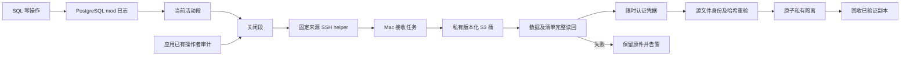
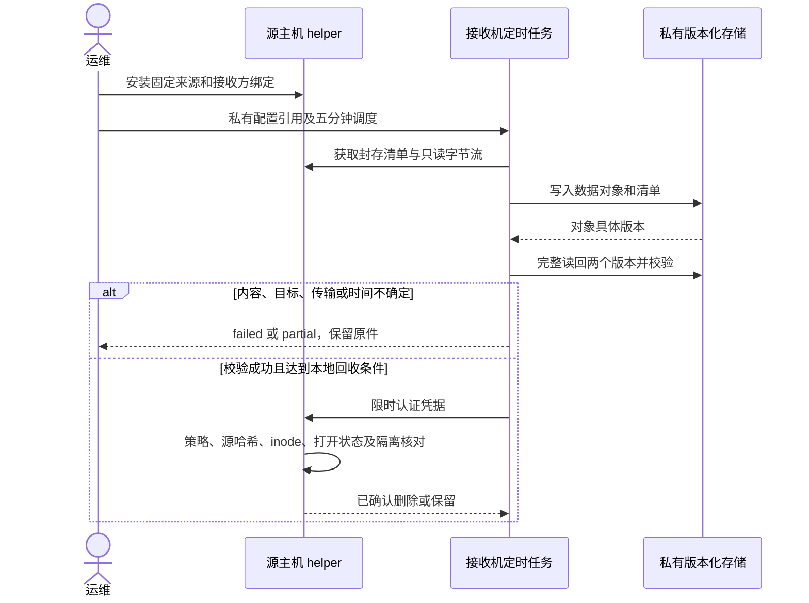

# SQL 审计与文件归档保护（v0.5.2）

> 2026-10-31 源码更新：归档现在支持显式 UI 启停、独立 S3 目标、直接安全到期删除和独立数据库期限，见 [v0.6 操作手册](usecase-us9-storage-archive-controls.md)。本文 v0.5／临时安装记录中的强制归档和数据库只监控描述保留为历史版本；此次未部署服务器或改动旧 Mac 副本。


更新日期：2026-10-30。本轮临时保护及 SSH→私有 MinIO 桥接已安装；PostgreSQL 原生采集器仍待获准重启激活，PowerX 源码修复未部署线上。完整 US9／常在线云端归档未由本轮替代。

## 1. 功能背景与目标

磁盘治理不能把审计线索一起清掉。目标是继续记录 SQL 写操作，把已关闭的 PostgreSQL／PowerX 审计文件存入独立私有存储，完整验证具体对象版本和清单后才回收本地副本。数据库业务表、事件表、WAL 和恢复点不进入这套文件清理。

SQL 日志提供语句及数据库身份线索；一条记录不等于事务已经提交，不包含被删行的完整前镜像，也不能推导应用未记录的业务操作者。应用现有审计字段继续保存在其文件中。数据恢复仍需要独立备份／恢复点，版本保留也不等于不可篡改的 WORM。

## 2. 角色与适用范围

运维管理固定 SSH 主机、私有凭据引用及日志配置；管理员查看容量与阻塞；开发／QA 用自有 canary 验证成功和失败路径。当前源主机为 `47.116.10.200`，接收机为用户 Mac，MinIO 为接收机的 `127.0.0.1:9000`，专用桶为 `powerx-audit-archive`。

这与服务器自己的 `127.0.0.1:9000` 不同，后者目前没有服务。当前副本跨越服务器和 Mac；Mac 休眠、断网或 MinIO 不可用时保留服务器原件。它不是常在线云存储，也不是 Mac 本地数据的异地灾备。切换长期在线私有 S3／OSS 时，必须更新接收端配置和服务器的目标绑定，重新验证，不能直接复用旧凭据。

## 3. 整体架构与模块关系



## 4. 核心流程

`guard.py` 继续处理普通 syslog／Nginx 保留及容量监测；它对 PostgreSQL 旧段、原生段和正式／开发审计文件一律不直接删除。原 PostgreSQL logrotate 使用 `rotate -1`，不设置 `maxage`，避免绕过归档门禁。

`audit_custody.py manifest/read/confirm` 仅允许 root SSH 操作者调用，来源和名称由服务器白名单解析，不接收任意目录。清单与传输有上限；传输最多写出快照声明的字节数，发生变化或增长就失败。活动文件、链接、已替换目录与不一致 inode 不允许回收。

接收方使用独立私有桶，检查公开策略／ACL、版本保留及无自动过期规则。每份数据及其元数据清单都按具体 `VersionId` 完整 GET，比较字节数和 SHA-256，不以 ETag 或用户元数据当作内容校验。验证完成后才生成两分钟有效、绑定来源和对象版本的认证凭据；服务器再次验证源内容，先写意图，再同盘原子隔离和核对 inode，最后 unlink 并记录结果。

七天为本地年龄上限；预算压力下仅能回收超过 24 小时、且刚验证过归档的副本。无有效凭据时，年龄或预算都不能导致审计删除。接收任务没有删除 S3 对象或旧版本的分支，也没有设置桶自动过期。当前活动段尚未封存，不是实时逐事务复制。

## 5. 跨角色协作流程



## 6. 前置条件与依赖

- 源主机 helper 仅使用 Python 标准库。接收机需要 `requirements-receiver.txt` 中的 boto3／PyYAML、既有固定主机 SSH 身份和已核对的 known_hosts；禁止关闭主机指纹校验。
- 接收配置、验证密钥和状态目录为 0600／0700，S3 凭据只从接收机的私有配置读取，不复制到源主机，不写入命令行、聊天或公开证据。
- 非 loopback S3 endpoint 必须使用 HTTPS。私有桶不能有公开策略／ACL，必须启用版本保留，并且不能配置对象或旧版本过期。
- 接收任务预留至少 20 GiB 本机余量；单文件默认至多 2 GiB，单轮默认至多 128 份／1 GiB。超限、来源不完整或目标不明均保留源文件。单轮有时间上限，部分完成继续由后续周期处理。

## 7. 操作步骤

### 7.1 查看页面与接口

Root 可在 `/monitor/storage` 查看当前数据库、磁盘和来源状态。临时接收器尚未登记为 Core 归档适配器，不能把页面的规划草稿或“自动治理”开关当成这个接收任务已启用。Core 运行状态仍可按既有端点核对：

```sh
curl --fail-with-body --silent --show-error \
  -H "Authorization: Bearer $TOKEN" \
  http://127.0.0.1:8077/api/v1/admin/ops/storage/runtime
```

当前日常实例仍保留观察配置；本轮没有借此打开全局自动清理或删除数据库事件。

### 7.2 查看源主机

```sh
systemctl status powerx-space-guard.timer
cat /var/lib/powerx-space-guard/latest.json
python3 /opt/powerx-ops/space-guard/guard.py
python3 /opt/powerx-ops/space-guard/audit_custody.py manifest
```

前两个命令查看周期与阻塞；默认 guard 是只读预览。manifest 只输出文件元数据，不输出 SQL。未归档候选应为 `verified_offhost_archive_required`，不能显示已删除。存在 `.powerx-audit-custody` 隔离项时应报待核对，不能清空隔离目录来消除错误。

### 7.3 查看接收机

私有根目录为 `/Users/michaelhu/PowerX-ops-backups/47.116.10.200/audit-archive/`；定时任务为 `com.powerx.audit-archive`，每五分钟触发一次。

```sh
launchctl print gui/$(id -u)/com.powerx.audit-archive
cat /Users/michaelhu/PowerX-ops-backups/47.116.10.200/audit-archive/state/last-run.json
python3 scripts/ops/powerx-space-guard/run_receiver.py --config /path/to/private/receiver.json
```

`ok` 表示本轮完成，`partial` 表示达到有界批次／时间条件，`failed` 保留原因类别和失败计数。`source_deleted` 只统计收到确认的删除；提交响应丢失单列为 `source_commit_unconfirmed`，必须核对源主机 `archive-receipts/`，不能按零删除或重新发一个凭据直接猜测。

定时入口使用独立监督器 `run_receiver.py`，285 秒后终止本轮工作进程及其 SSH 子进程，不依赖 SDK 是否吞掉超时异常。硬超时记录 `unconfirmed/source_results_unknown=true`，不填一个猜测的删除数；`state/supervisor.json` 保存 PID、时限和退出状态。没有到硬上限的批次到时记为 partial，下一轮继续处理未归档文件。

### 7.4 激活 PostgreSQL 原生采集器

本地开发库已通过 reload 开启 `log_statement=mod`。服务器原有 `mod` 保持启用。两边均已准备独立日志目录、0600 文件、每小时／100 MiB 轮转及不覆盖旧段；`logging_collector` 只能在启动时改变，目前为 `off/pending_restart=true`，现有 stderr 日志继续工作。

需取得明确重启许可后，分别按实际服务执行一次：

```sh
# Mac，本地 PostgreSQL 14；在已确认窗口执行
brew services restart postgresql@14
# 源主机，PostgreSQL 16；在已确认窗口执行
systemctl restart postgresql@16-main.service
```

这会短暂影响数据库连接，不能由 Agent 擅自执行。激活后核对 `SHOW logging_collector` 为 on、`pending_restart=false`、`pg_current_logfile()` 指向新目录；再检查新写入和一次原生轮转。服务器新目录为 `/var/log/postgresql/powerx-audit`，不在旧 logrotate 的非递归 `*.log` 范围；在激活前 copytruncate 的窗口仍存在。

## 8. 预期结果与验收标准

1. 本地与服务器分别用事务内临时表验证 `CREATE／INSERT／DELETE／TRUNCATE／DROP` 均留下日志，测试数据不进入业务表；不以业务清表验证审计。
2. 使用 Agent 自有过期 canary，归档对象故意损坏或认证凭据错误时原件必须保留；完整读回数据及清单后才可回收，回收后具体归档版本仍能读回并匹配哈希。
3. 匿名读取审计对象必须被拒绝。接收端离线时源删除数为零，目标状态不能显示正常。接收确认丢失必须保持未知。
4. Go race 验证审计 writer 的保留权真正到达实际 writer，以及开发环境也不能弱化强制归档。仅把 `MaxAge` 设为零而由构造器恢复三十天默认值不算移交。
5. 运行进程、源配置和归档副本分别验收；原生采集器在重启前不能计为已激活。长周期、常在线云端及完整业务操作审计覆盖仍单独验收。

```sh
python3 -m unittest discover -s scripts/ops/powerx-space-guard -p 'test_*.py'
# backend 工作目录
go test -race ./pkg/corex/audit ./internal/infra/storage_lifecycle ./internal/service/storage_governance ./internal/transport/http/admin/storage ./internal/bootstrap
```

## 9. 代码实现映射

| 代码 | 职责 |
|---|---|
| `scripts/ops/powerx-space-guard/guard.py` | 未归档审计禁止删除、容量及隔离异常 |
| `audit_custody.py`（同目录） | 固定来源、限时凭据、字节及 inode 校验、原子隔离回收 |
| `archive_s3.py`（同目录） | SSH 拉取、私有版本桶、数据／清单完整读回及结果未知 |
| `run_receiver.py`（同目录） | 独立进程时限、仅终止本轮进程组及未知结果 |
| `postgresql-common.logrotate`／`postgresql-audit.conf` | 关闭原生过期删除、原生采集器待激活配置 |
| `backend/pkg/corex/audit/file_sink.go` | 受信任保留权移交，避免构造器恢复原生删除值 |
| `backend/internal/bootstrap/app.go` | 保留权标识接线到实际审计 writer |
| `backend/internal/infra/storage_lifecycle/engine.go` | 所有环境的审计／PG／journal 强制归档 |

## 10. 常见问题与排障

- `127.0.0.1:9000` 无服务：确认是在接收机访问，不是服务器；目标未知时先保留原件。
- `audit_bucket_public_policy/public_acl`、版本缺失、自动过期：修复专用桶的私有与保留设置，不能跳过检查。
- `partial`：等待后续周期并核对 backlog、接收机余量和网络；不能因部分上传完成而宣布所有来源已覆盖。
- `source_commit_unconfirmed`：检查私有意图／完成记录和隔离项。S3 版本仍受保留；不要把未知改成成功。
- `logging_collector` 的 `setting could not be applied`：只有当配置值为 on、当前 off 且 `pending_restart=true` 时才属于预期重启提示；其他配置错误仍须修复。
- Mac 休眠：源主机保留文件并可能继续增长。当前告警是状态／日志，不是已经接通的外部通知；应恢复接收器或切换长期在线目标，不能删未归档审计来消警。

## 11. 回滚与风险控制

先暂停接收任务，原件由服务器保护继续保留；不要恢复旧的按年龄／份数直接删除配置。接收任务可通过 `launchctl bootout gui/$(id -u) ~/Library/LaunchAgents/com.powerx.audit-archive.plist` 停止。旧版本 Core 自身仍可能按原生策略处理审计轮转，新版源码修复需随版本加载，不能把临时桥接当作所有独立删除器的统一接管。

服务器变更前文件保存在 `/opt/powerx-ops/space-guard/revisions/`；本地 PostgreSQL 的原 `postgresql.auto.conf` 和设置快照保存在 `/Users/michaelhu/PowerX-ops-backups/local/postgresql-audit-*/`，均为私有备份。回滚须核对之后发生的用户改动，不能整文件覆盖新的配置。不要为了撤销采集器准备而顺便关闭 `mod` 写操作日志，不删除桶版本或业务表来回滚。

## 12. 变更记录

2026-10-30：Codex 按用户 `fix` 实施临时审计门禁、私有 MinIO 桥接和本地 SQL 写操作记录；首批 74 份／484,725,998 字节完成验证。真实 canary 验证损坏／无效凭据保留、成功后回收和匿名 403。数据库采集器重启与新版 PowerX 部署尚未执行。脱敏结果见[修复证据](../../../contracts/evidence/storage-governance-audit-custody-fix-20261030.json)。

依据：[PostgreSQL 日志配置](https://www.postgresql.org/docs/16/runtime-config-logging.html)、[S3 指定版本读取](https://docs.aws.amazon.com/boto3/latest/reference/services/s3/client/get_object.html)。
