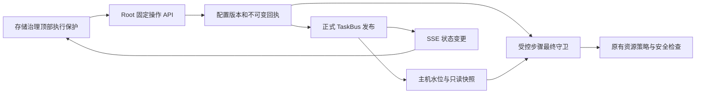
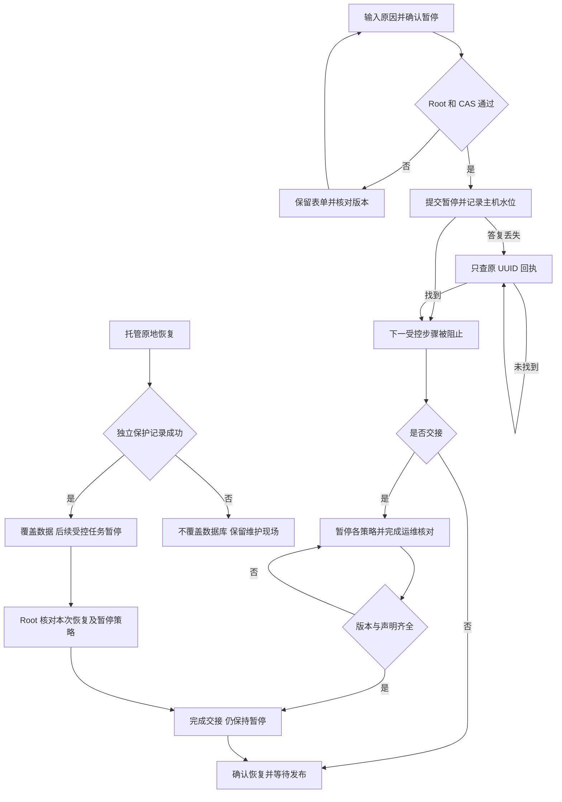
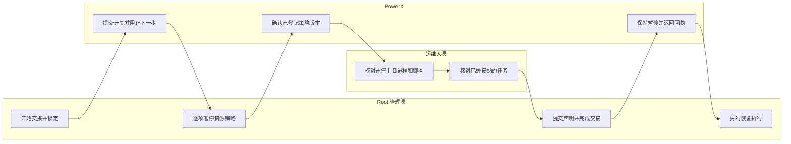
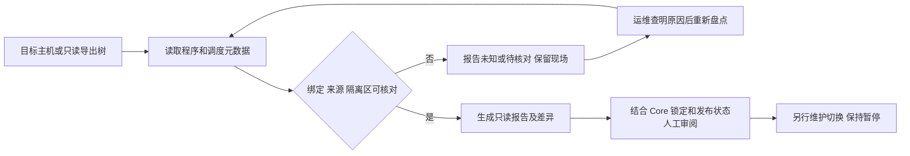

# 受控任务暂停与执行器交接使用指导

## 1. 功能背景与目标

清理和归档涉及多个资源策略。配置发布器故障时，管理员仍需要暂停后续受控步骤；升级交接还需要防止历史启用值突然恢复。本功能提供安装范围的暂停、交接锁定和单独恢复，**只覆盖已经接入新版守卫的普通任务**。

## 2. 角色与适用范围

平台 Root 使用 Web Admin 操作；运维核对旧进程和已启动任务；QA 使用独立测试资源验证。普通成员、插件、STS 和 API Key 不能操作。已启动长任务可能完成，旧脚本／Loki、业务写入和独立恢复不由此按钮停止。范围以[固定合同](../../../contracts/storage-execution-control.md)为准。

## 3. 整体架构与模块关系



## 4. 核心流程



图中“只查回执”是用户点击查询，无自动轮询。

## 5. 跨角色协作流程



## 6. 前置条件与依赖

当前版本后端与前端、现有配置／版本／TaskHistory 集中迁移、可访问的 PostgreSQL 和主机私有元数据目录。配置发布使用既有正式 TaskBus；恢复和完成交接还要求 `ControlWorkerEnabled` 对应发布器可用。没有新增常驻进程或配置文件开关；构造和启动不会迁移、接管或启用策略。

初次显示“尚未接入全局保护”是旧规则仍在使用，不能当作已有全局保护。首次通过“紧急暂停”或“开始交接并锁定”显式接入。旧后端缺少接口时显示待确认并禁用操作。

## 7. 操作步骤

### 场景 A：暂停与恢复

| 动作／入口 | 预期结果 | 失败处理 |
| --- | --- | --- |
| Root 打开 `/monitor/storage`，查看顶部“受控任务执行保护” | 显示当前安装和执行状态 | 待确认时进“执行保护与交接”，刷新检查；不把旧状态当作许可 |
| 点击“紧急暂停”，填写 3～500 字原因并勾选确认 | 提交后显示“已暂停受控执行” | 409 保留原原因和 CAS，明确载入最新版本后复核；结果未知只查原请求 |
| 查看“执行状态”的请求／已发布版本 | 暂停可在发布器停用或退出时提交；恢复按钮保持禁用 | DB、锁或主机元数据失败不能视为暂停成功；交由运维核对 |
| 原因解决后点击“恢复受控执行”，再次确认 | 等本次恢复版本发布确认后允许受控步骤 | 未确认时继续阻止执行；原先启用策略可恢复运行，应先检查 |

### 场景 B：执行器交接

1. 进入“执行器交接”，点击“开始交接并锁定”，填写原因并确认。预期显示交接锁定；若请求未知，保留窗口查询原 UUID。
2. 按资源清单到原配置分区逐项暂停自动策略，等待发布确认。清单只反映已登记配置；未暂停或未确认时不能完成交接，未知域需研发查明，不能删配置绕过。
3. 运维核对旧二进制、systemd／cron／临时脚本等外部入口，以及已接纳、排队和运行的任务。此功能不会替运维停止外部进程或取消长任务；不能如实确认时保持锁定。
4. 点击“完成交接，保持暂停”，勾选两项运维声明和本次确认。预期仍为暂停。声明是人员核对结果，不是系统自动检测证据。
5. 再单独恢复开关，随后逐项明确开启需要的资源策略。若交接后某项策略提前启用，恢复会被拒绝，需先暂停并等发布。

### 场景 C：托管原地恢复后重新核对（2026-11-08）

1. 托管维护恢复会先写独立保护记录，再替换数据库。正常业务恢复启动后，打开 `/monitor/storage`，顶部应显示“恢复后待核对，受控执行暂停”，进入“核对恢复保护”。若维护保护缺失或损坏，保持待确认，不能删除文件或换目录绕过。
2. 在“恢复后核对”查看本次记录时间；任务／快照／恢复标识按需展开。核对旧执行器、已接纳任务及环境后点击“重建暂停配置”，按固定本次恢复标识与版本确认；等待各资源通过正式发布并查看逐资源核对项。保留历史记录，不通过清空运行目录解除较高版本水位。
3. 按逐资源原因重新提交本次 S3 凭据、完整验证归档目标，并核对当前安装与数据库来源、空间预算及任务。界面三项声明仍是人员核对，不等于自动排空或真实业务恢复；不能确认时继续保持暂停。SSH 恢复证明尚未支持，保持阻止。
4. 点击“确认本次恢复，保持暂停”，填写原因并勾选三项声明和本次确认。提交绑定当前恢复标识；若出现另一恢复任务，原表单保留但提交会冲突。明确“载入最新版本，保留原因”后重新核对，旧声明会清空。
5. 等本次确认发布后，仍是“已暂停受控执行”。如需继续任务，再单独恢复执行开关，随后逐项启用经过复核的资源策略。历史启用值不会由本次确认自动恢复。
6. 超时或响应丢失时，只查原 UUID 回执。原回执可能来自上一恢复；它只能证明原操作，不能解除新的待核对状态。

此流程仅覆盖本版本托管的原地维护恢复。外部工具直接回退数据库／运维目录、维护根一起回退、跨安装迁移或资源水位不一致时，不提供自动解锁；保留现场继续核对。[恢复保护证据](../../../contracts/evidence/storage-recovery-control-validation-20261108.json)不是整站物理恢复或长期运行验收。

### 场景 D：旧执行器只读盘点与预演（2026-11-09）

面向目标 Linux 主机运维。需要仓库中的 `handoff_inventory.py` 和 Python 3.9+；不要求启动新服务或提供数据库／S3 凭据。建议具有文件、systemd 和 `/proc` 读取权限。权限不足保持 unknown，不通过追加权限或停止进程绕过报告。



| 动作／入口 | 预期结果 | 失败处理 |
| --- | --- | --- |
| 在实际服务器运行下方命令 | 输出 `mode=live_linux` 的当前报告；无部署或服务修改 | 非 Linux 或导出树只能得到 snapshot；不能证明进程已停止 |
| 查看 summary、units、problems、binding_state 和 control_state | failed 与 inactive 区分；enabled timer 即使空闲也显示 scheduled；绑定和有效发布分开 | unknown／未确认隔离内容先核对，不将零计数当无任务 |
| 维护动作后使用 `--compare` 新建第二份报告 | 展示程序、调度、PID 启动时间、来源和发布依据变化 | 报告不同须重新审阅；相同也不授权完成交接 |
| Root 按场景 B 完成实际交接 | 原有声明、CAS、发布保护继续有效，完成后仍暂停 | 报告不能导入成许可，不跳过真实长期目标及任务核对 |

在目标 Linux 的仓库根目录运行，示例使用 Root 私有目录中的新文件；其他运维身份使用自己的 0700 目录：

```sh
python3 scripts/ops/powerx-space-guard/handoff_inventory.py --output /root/powerx-handoff-before.json
python3 scripts/ops/powerx-space-guard/handoff_inventory.py --compare /root/powerx-handoff-before.json --output /root/powerx-handoff-after.json
```

离线开发使用 `--root /path/to/read-only-export`，始终不查询当前主机 systemd／进程；保留原属主等元数据，失真时不能当作可信绑定。工具没有 apply 参数，返回 0 只表示生成报告；`authorizes_switch` 恒为 false。`--output` 不覆盖文件，输出写入失败时使用新路径，不删除原证据。

未知封装脚本、at、容器、user systemd、其他主机接收器及 Core 排队／长任务仍需单独核对。共享 guard 可能继续负责轮转、journal 和未转移的日志；部分接管不应停止整套 timer。Mac 接收器仍按审计归档手册单独核对。完整字段／有界读取和可信范围见[盘点合同](../../../contracts/storage-executor-handoff-inventory.md)。本轮源码及只读现场观察不等于实际接管。

### 场景 E：备份清理结果未知时只读核对（2026-11-09）

1. 使用真实平台 Root 进入**备份中心 → 数据库备份 → 备份清理待核对**。顶部有待核对提醒时可直接点击进入；读取失败表示状态未知，不能当成待办为零。
2. 按产物和任务 ID 定位记录，点击“检查文件现状”。弹窗冻结本次清理 token，只展示三个文件的元数据，不执行内容哈希或删除。
3. “文件齐全”仍标记内容未验证；全部／部分缺失也不能认定删除成功。陈旧提示或 409 后显式点击“重新读取并检查”，不复用旧 token 继续操作。
4. 需要取回或保护时点击“打开原备份任务”。已有清理锁继续生效，保护可能被拒绝；保留原错误与记录，不能手工清空 cleanup_state/cleanup_token 盲重试。
5. 列表通过共享 SSE 在变化／重连后刷新，切换分区保留上下文；离开页面或退出身份后关闭旧请求和订阅。无需等 15 分钟即可检查当前清理意图。

验收：Root 可查看、租户／服务身份拒绝；旧 token 冲突；缺表返回专用 503；软／硬链接拒绝；检查后原文件与未知标记不变；桌面与窄屏可完成列表 → 弹窗 → 原任务操作。此流程只读，不提供自动解锁或清理结果确认，不能替代长期目标或现场接管验收。源码映射为 `backup_ops/cleanup_review.go`、`BackupArtifactRepository` 的 CleanupReview 方法、`backup/cleanup_review_handler.go` 与 `BackupCleanupReviews.vue`；回滚时撤回界面版本，保留数据库标记及原安全锁。

### 场景 F：按需完整校验备份内容（2026-11-09）

1. 在场景 E 的核对弹窗完成文件现状检查，切换**完整性校验**。两个阶段独立显示；切换保留状态，不会自行发起完整读取。
2. 明确点击“开始完整校验”。页面通过一次 SSE 显示读取字节，最长五分钟；同策略已有备份／恢复／校验时会拒绝，连接池上限需至少两条连接。字节到 100% 仍要等待最终结果。
3. 成功须为备份 SHA256、登记值、清单和校验文件一致。缺少 sidecar、文件内容损坏或读取中变化分别显示；不能根据原文件缺失确认删除完成。
4. 停止、关闭弹窗、断线、退出或切换身份都会停止检查，不能自动重连重做。需要继续时先核对当前记录，再手动发起；不是提交后在后台继续运行的任务。
5. **校验成功仍保留清理标记**，不表示实际恢复测试通过。此结果不持久保存、不能用来解锁／重删；后续人工处置必须由服务端重新核对并生成正式回执。

验收：完整真实读取和进度／最终事件均存在；同大小损坏／清单错配无成功；中断不重连；旧 token 与忙碌作业拒绝；单连接池快速失败；取消后锁释放；分区不堆叠，桌面／窄屏状态与操作完整。源码映射：`backup_ops/cleanup_verification.go`、既有 `policy_lock.go`、`cleanup_review_handler.go`、`backupCleanupReviewService.ts` 与 `BackupCleanupReviews.vue`；撤回本诊断入口不会清除已有未知标记，无数据回滚动作。

### 场景 G：人工确认保留并保护（2026-11-09）

1. 先在自有副本验证增量迁移；开发／测试明确核对目标配置后运行 `go run ./cmd/database migrate -config /path/to/dev-config.yaml -scope backup-cleanup-retention`（backend 目录）。正式安装使用受控升级计划，不使用该 dev scope。新表缺失不阻止客户能力调用，只会阻止这项新操作。
2. 迁移并重新编译重启 Core、刷新前端。在自动治理中明确暂停自动执行，并暂停目标备份计划。新保护操作不能取代现场执行器交接。
3. 按场景 E 进入意图，切换**确认保留**，填写 3～256 字原因并明确勾选。点击“重新核验并确认保留”；此前诊断成功也不能跳过服务器复核。
4. UI 通过 SSE 显示已接纳 UUID／字节进度。成功回执表示此请求完成时保护已设置；原 cleanup_state/token 保留，不代表清理完成、空间已释放或恢复测试通过。当前文件与保护状态需重新读取。
5. 网络中断／结果未知时保留原 ID，点击“读取原请求回执”。没有回执不能推断未提交；需要恢复时只明确点击“重试同一请求”，不更换内容或 UUID，不用手工 SQL 清标记。重新打开当前意图可以找回已接纳未完成请求。
6. 其他 Actor 的活动请求不能代替恢复；版本／围栏／活动任务或完整性错误会拒绝。终态拒绝后先排查原因，再重新读取当前意图和明确确认。界面分区切换保留草稿与回执，离开或换身份释放旧请求，没有状态轮询。

验收标准：原 UUID 与冻结输入可追踪，丢失成功响应只 GET 不重复 POST；同 UUID 重放无新写入，改内容／旧快照／忙碌拒绝，保护和回执不半提交，原文件与清理锁保留。桌面／窄屏明暗主题及当前操作反馈完整。回退不删回执表、不自动取消保护或恢复旧启用值。详见[固定合同与证据](../../../contracts/backup-cleanup-retention.md)。

### 接口与本地联调

相对路径见 [OpenAPI](../../../../specs/027-monitor-center/contracts/execution-control.openapi.yaml)。使用现有本机安全凭据文件，不能在聊天、历史或日志中粘贴 JWT。只读状态示例（`POWERX_ROOT_CURL_CONFIG` 指向权限 0600、含 Authorization 的本机 curl 配置）：

```sh
curl --fail-with-body --config "$POWERX_ROOT_CURL_CONFIG" "$POWERX_API_ORIGIN/api/v1/admin/ops/storage/execution-control"
```

响应 `data` 片段：`{"mode":"paused","desired_revision":1,"applied_revision":0,"confirmed":false,"can_resume":false}`。这表示暂停已经阻止下一步，但发布未确认；不能把 `applied_revision=0` 解释为暂停无效。

写操作使用 UI；自动化调用也必须提供 UUID、CAS、原因和确认，不接受 SQL／路径／任意域。超时后 GET `/execution-control/requests/<原UUID>`，不要重复 POST。

日常服务由用户启动；本功能无需另启常驻组件。仅在独立测试环境使用已有启动入口：后端目录 `make dev`，前端目录 `npm run dev`；使用 IDE 日常入口时沿用原流程，Agent 不替用户重启。检查顶部状态、请求的 `desired_revision`／`applied_revision`、`request_id`，以及 SSE 的 `configuration_changed`。测试命令：

```sh
cd backend && go test -race ./internal/service/storage_governance -run '^Test(ExecutionNativePostgres|RecoveryControlNativePostgres)' -count=1 -v
```

数据库用例只接受明确设置 `POWERX_STORAGE_CONTROL_TEST_DSN` 的 Agent 自有 Unix socket 测试库，未设置会跳过，不能用跳过结果声称原生验收通过。测试临时进程必须登记并在结束后停止；禁止改指日常／生产库。

## 8. 预期结果与验收标准

在独立资源上核对：消费者退出后暂停仍能提交；有界步骤先完成但暂停成功后下一步被拒绝；真实过期文件／行保持；恢复待发布不能执行；交接库存阻止未暂停项；完成交接不恢复策略。响应丢失后仅查原 UUID，404 仍保持未知。桌面及 390px 窄屏、明暗主题下可导航、保留原因并找到操作；请求记录无常驻轮询，离页释放 SSE。

[本轮证据](../../../contracts/evidence/storage-execution-control-validation-20261107.json)区分隔离库、S3／备份仿真和真实生产；2.5 秒空闲观察不是 15 分钟或长期验收。

## 9. 代码实现映射

| 环节 | 文件 |
| --- | --- |
| Root 路由与固定 DTO 绑定 | `backend/internal/transport/http/admin/storage/{api,execution_control_handler}.go` |
| 状态、交接库存、发布和最终守卫 | `backend/internal/service/storage_governance/execution_control.go` |
| 同连接共享／独占锁与 CAS | `backend/pkg/corex/db/persistence/repository/storage_governance/control_repo.go` |
| 私有文档白名单 | `backend/internal/infra/storage_budget/coordinator.go` |
| 页面与类型化客户端 | `web-admin/app/components/monitor/storage/StorageExecutionControl.vue`、`web-admin/app/composables/api/services/storageExecutionService.ts` |
| 原生／HTTP／前端验收 | `execution_control_postgres_test.go`（服务和 HTTP 两处）、`web-admin/tests/unit/storage/execution-control.spec.ts` |
| 外部执行器只读盘点与比较 | `scripts/ops/powerx-space-guard/handoff_inventory.py`、`test_handoff_inventory.py` |

## 10. 常见问题与排障

| 现象 | 处理 |
| --- | --- |
| 暂停后还有已启动任务完成 | 本功能阻止下一受控步骤，不杀长任务；运维核对已接纳任务，不能反复点击暂停替代取消 |
| 发布器不可用 | 暂停可提交，恢复禁用；修复原 TaskBus／发布器，等版本确认 |
| 配置未暂停或版本未确认 | 到对应资源暂停并等待发布；库存的技术标识可展开定位 |
| 结果未知、回执 404 | 保留窗口，按原 UUID 再次手动查询；不重复提交 |
| 版本倒退、缺失主机水位或状态待确认 | 核对数据库、当前安装和独立主机元数据，禁止删文件或降级绕过 |
| 已确认 open 仍不执行 | 其他资源版本、预算、目标或安全保护仍可能阻止；本开关不替代这些检查 |
| 报告中 unit 为 failed 或 unknown | 查看 Result／退出码并结合 guard_run；exit=2 也可能表示容量 critical，不能一律解释为崩溃。状态过期或缺失时先核对现场，不按无旧任务完成交接 |
| 盘点为零来源／零隔离文件 | 同时检查绑定与控制状态，未核实来源不等于不存在待确认数据 |

## 11. 回滚与风险控制

发生故障先暂停；升级交接先锁定，按职责范围核对并停止不识别新协议的旧执行器，不能仅因部分来源已接管就停止共享 guard。保留数据库配置版本、回执及主机开关文档；不可删除水位、手改 JSON、恢复旧启用值或回退到不识别协议的二进制来“解锁”。托管恢复的统一版本重建及 S3 代次核对已有[源码与隔离证据](../../../contracts/evidence/storage-recovery-reconciliation-validation-20261108.json)；维护根也被外部回退等路径仍没有自动安全证明。

本轮未改变日常／生产执行权。只读现场盘点不替代 T171 的真实旧进程交接；实际部署、长期目标、整站业务恢复、自动演练、外部密钥及 7／14 天运行验收继续按 SG-11／SG-09 推进。

## 12. 变更记录

| 日期 | 版本／责任 | 内容 |
| --- | --- | --- |
| 2026-11-09 | 交接准备，PowerX Core | 只读程序／调度／进程／来源盘点和差异报告；实际停止、绑定和接管另行进行 |
| 2026-11-08 | 开发切片，PowerX Core | 托管恢复独立标记、Root 代次核对与保持暂停；未发布生产 |
| 2026-11-07 | 开发切片，PowerX Core | 紧急暂停、单独恢复、交接锁定、Root UI 和隔离验收；未发布生产 |


### 场景 H：保留请求的恢复与升级核对（2026-11-09）

适用：备份清理待核对的人工保留请求；完成源码和隔离联验后，在维护窗口启用。新回执表沿中央迁移准备，本次无新增表列。编译启动本轮 Core 会按既有维护启动协议把完整 v1/v2 锚点升级为 v3，保留原 AnchorID／Epoch；不要手改 JSON、降级协议或删除证明。日常进程仍由用户自行重启。

1. 恢复前保留原请求 UUID 与回执；使用既有维护流程生成保护快照。在数据库覆盖前必须成功登记独立新代次。
2. 恢复后进入“恢复后核对”，完成当前代次的重建、正式发布及 Root 确认；保持暂停，再逐项核对策略。不要沿用历史启用值。
3. 进入备份清理待核对，先读原 UUID。retained 是历史操作事实，不证明当前文件或 protected；checking／404 不证明恢复前未执行。旧版本明确重试会被拒绝，不能自动替换 UUID。
4. 需要重新确认当前保留时，先保留历史线索并读取当前记录／核对版本，再明确发起新请求。缺少有效版本会显示原因并禁用提交；只读文件诊断仍可用。原 token 和清理意图不会解除。
5. 升级失败时核对正式升级回执与保护快照，保持资源暂停。受控事务失败／重新 plan/apply 应保留数据库中已有回执和 protected；SQL 回放会回退快照之后的历史，此部分的独立恢复凭据仍待下一项实现。

隔离验收命令与条件见[合同和证据](../../../contracts/backup-cleanup-retention.md#2026-11-09-t171恢复代次与正式升级联合验收)。本轮真实 SQL 回放仅针对自有测试 schema，不是日常／生产整站恢复；旧协议程序应拒绝执行，不能用手改协议完成程序回退。


### 场景 I：独立保留请求凭据（2026-11-09）

本轮为源码与隔离验收。日常启用由用户在既有维护流程重新编译／重启 Core；本次无新增数据库表列。维护协议会把完整 v1/v2/v3 接续升级至 v4，保留安装锚点和代次；不要降级协议、删除凭据或直接启动不支持 v4 的旧程序。

1. 按场景 G 明确提交人工保留。系统先在既有维护根保存 UUID／输入身份，SQL 确认后再保存历史结果；页面通过原 SSE 展示，不创建自动消费／重试任务。
2. 结果未知时读取原请求回执。“独立恢复凭据”表示历史来自维护根，并不证明当前备份文件或 protected。数据库表回放或不可用后，已保存的历史仍可读，不会借读取操作重写保护。
3. 若显示“结果待核对 · 禁止继续”，保留原 UUID 和原因，按原回执及恢复报告核对。此页面不重发，不表示已在途任务完成／停止；关闭弹窗不会删除凭据。旧 SQL 历史未登记独立凭据时也明确提示，不能当作已经完成覆盖。
4. 受控数据库恢复在覆盖前检查独立凭据完整性，维护报告包含 `backup_request_recovery_ledger`；丢失／损坏不能以重建空文件绕过。普通控制配置与插件准入不依赖该文件。
5. 凭据固定保留至后续明确迁移，最多 4096 个请求／16 MiB。满后拒绝新登记，读取历史仍保留；不能把它当普通文件日志清理。旧历史的批量盘点、显式导入及覆盖证明是下一项，不能在未导入时宣称全部旧 UUID 已保护。

验收材料与 SQL／文件两阶段故障处理见[独立凭据合同](../../../contracts/backup-retention-recovery-ledger.md)。长期异地归档、旧执行器现场交接及整站／长期运行仍单独验收，本文件不报告日常或生产已生效。
