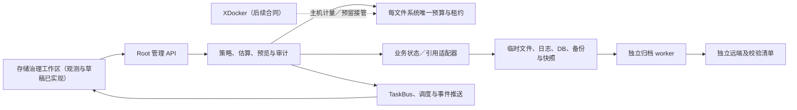
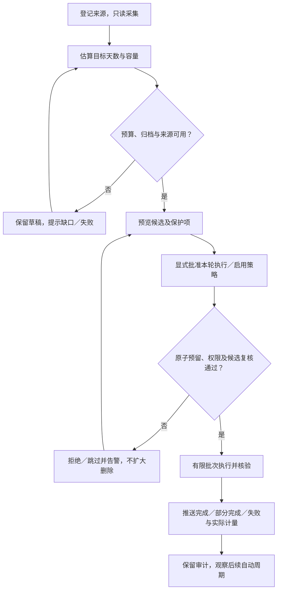
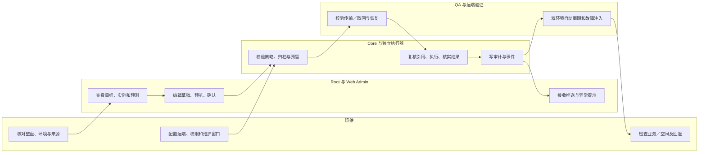
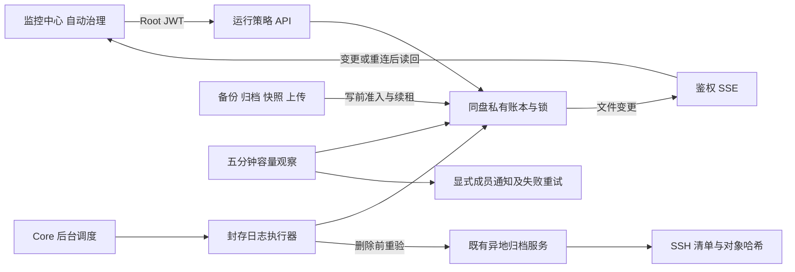
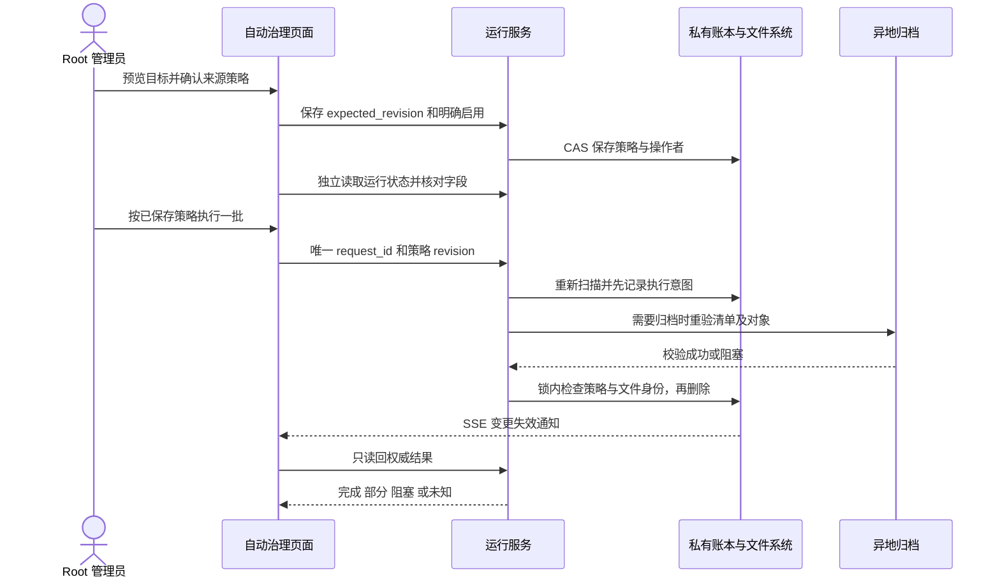

# US9：双环境存储治理实施与验收手册（v0.5 本地实现，未部署）

> 2026-10-31 源码更新：归档现在支持显式 UI 启停、独立 S3 目标、直接安全到期删除和独立数据库期限，见 [v0.6 操作手册](usecase-us9-storage-archive-controls.md)。本文 v0.5／临时安装记录中的强制归档和数据库只监控描述保留为历史版本；此次未部署服务器或改动旧 Mac 副本。


> 更新日期：2026-10-30。当前文件日志自动治理、共享写入准入、普通日志异步、通知与 SSE 的实际流程见[场景 F](#场景-f显式接管自动文件日志治理v05)；场景 D／E 为既有观察和手动批次。其余完整目标场景仍需按任务清单实施。数据库事件只监控，未升级线上或撤下临时守护脚本。

## 1. 功能背景与目标

同一台 120 GiB 主机同时运行正式、开发 PowerX。目标是在持续保留 PostgreSQL／journal 日志的同时，让临时文件、追踪、事件记录、备份和快照有明确生命周期，页面可看到容量与历史的实际情况。

配置基线是 **保留天数／份数 + 容量预算 + 保护条件**。主机日常预算 90 GiB，普通可用余量目标 20 GiB，10 GiB 紧急告警；共享资源只计一次。全部数值、例外和计算口径见[主方案](../../../plan/deploy/storage-governance.md)，页面设计见[UI 文档](../../../plan/deploy/storage-governance-ui.md)，开发顺序见[任务清单](../../../plan/deploy/storage-governance-tasks.md)。

本文不能承诺无限负载、任意断网时长下仍保留全部历史。严格审计需独立可靠远端；本地有界空间与长期历史分层管理。

## 2. 角色与适用范围

| 角色 | 任务与边界 |
|---|---|
| Root 管理员 | 首期主机资源查看、预算、策略、预览、执行与保护管理；用户 JWT |
| 运维 | 来源、主机身份、权限、日志参数、远端目标、部署与维护窗口 |
| Core／前端研发 | 类型化适配器、预算／租约、API／推送与真实 UI |
| 插件研发 | 自有临时文件、附件持久化、租约和引用移交；不能替 Core 管理主机目录 |
| QA | 独立测试目录／临时数据库、受控故障、运行和恢复证据 |
| XDocker 维护者 | 后续宿主机计量和预留接管；当前不假定合同已落地 |

租户 Admin 的用户管理或角色权限不自动授予主机存储权限。既有备份、归档的 Root 限制继续有效；插件 API Key／STS 不通过管理员路径管理整机删除。

## 3. 整体架构与模块关系



复用现有 `monitor_logs`、`archive_ops`、`backup_ops`、`snapshot_ops` 和 `/ops/backup`，新增资源治理域组织预算、保护和任务，不创建另一套彼此独立的清理计划。

## 4. 核心流程



## 5. 跨角色协作流程



## 6. 前置条件与依赖

### 当前核验前

- 确认操作对象、实例、端口和用户身份；正式与开发共享的主机、PG 集群、journal 不得重复登记。
- 读取现有策略和来源配置；现有策略启用状态以现场为准。此文档不改变旧值。
- 如需服务器扫描，先确认权限和开销；分目录低峰检查，不把全盘高 I/O 扫描作为页面每次刷新动作。

### 未来启用前

- SG-01～相应资源阶段已完成，迁移／正式合同已发布，版本可核对。
- 主机只存在一个权威预算协调者；相同来源没有新旧清理器双执行。
- 独立远端长期在线、凭据文件与主机指纹受控，已有真实传输、哈希和取回证据。
- 所需保护项、业务终态、临时工作区租约、最低恢复点与法律保留已定义。
- 运行模式初始 `observe`；新开关名称和配置 schema 以实施 PR 为准，目前不存在通用可启用的新开关。
- collector 改动、数据库结构迁移和需要重启的操作单独安排窗口；不得擅自重启用户服务。

## 7. 操作步骤（按场景拆分）

### 场景 A：当前已有能力的只读核验

| 步骤 | 动作与入口 | 预期结果 | 失败处理 |
|---|---|---|---|
| A1 | 运维核对 `df -B1 -T /`，必要时分目录 `du -x`，记录时间、权限覆盖及已删除仍占用情况 | 已用、普通可用、预留及容量口径可对账 | 区分权限不足、扫描增长与文件系统开销；不猜测不明占用 |
| A2 | Root 打开现有 `/ops/backup` 的运行配置、文件、归档与策略 | 看见实际来源、文件和已启用计划，不把示例当运行配置 | 对齐实际实例／构建，不直接改默认值 |
| A3 | 读取现有日志保留策略接口（下例） | 返回真实 `policy` 字段；不执行清理 | 401／403 核对用户会话及 Ops 读权限，404 核对实例版本与 API 前缀 |
| A4 | 按现有 [US7](usecase-us7-remote-log-archives.md) 核对归档状态与实际 worker 安装 | 区分 Core 调度、独立 worker、目标连通和文件校验 | 没有独立 timer 不代表 Core 内没有调度；读取现状后再处理 |

现有 API 示例；使用本地已启动实例，`TOKEN` 为用户在安全终端已有的 JWT，勿将其写入文档／证据：

```bash
curl --fail-with-body --silent --show-error \
  -H "Authorization: Bearer $TOKEN" \
  http://127.0.0.1:8077/api/v1/admin/monitor/logs/retention/policy
```

响应字段示意（值必须以实际返回为准，不表示默认策略或当前启用状态）：

```json
{
  "data": {
    "policy": {
      "enabled": false,
      "cron": "<实际 Cron>",
      "timezone": "Asia/Shanghai",
      "default_retention_days": 7,
      "file_paths": [],
      "db_tables": []
    }
  }
}
```

该接口没有统一容量上限。当前 `POST /api/v1/admin/monitor/logs/retention/dry-run` 也不能替代未来业务状态／引用预览；未核对来源前不触发旧 `run`，不把新方案的表名／目录直接加进去。

### 场景 B：开发完成后的页面流程（当前不可执行）

| 步骤 | 动作与拟定入口 | 预期结果 | 失败处理 |
|---|---|---|---|
| B1 | “监控中心 → 存储治理 → 容量概览”选择整机与环境 | 实占、预算、数据时间、共享与未纳管部分清楚，未知不填 0 | 先修复采集；数据过期时不继续启用清理 |
| B2 | “保留策略 → PostgreSQL 封存日志 → 调整”填 7 天／3 GiB | 有样本时显示所需与缺口；样本不足显示待采样 | 增加预算或明确调整目标；不静默缩短天数 |
| B3 | 保存未启用草稿，进入归档详情验证目标 | 版本回读一致，真实远端可校验／取回 | 修复目标／权限／采集来源，保留草稿 |
| B4 | 创建清理预览，检查保护项和候选原因 | 只含登记范围、过期且无引用、满足归档条件的资源 | 预览过期或引用变化则重新预览，不绕过保护 |
| B5 | 显式执行受控一轮 | 返回任务 ID，推送执行与核验进度，结果可复核 | 部分完成／失败真实显示，留存已完成部分与错误 |
| B6 | 核对数据与物理结果后启用该类自动治理 | 状态回读为已启用，后续自动任务有审计 | 只暂停该策略并保留日志／归档；不扩展删除范围 |
| B7 | 逐类、逐环境重复，持续试运行 | 正式／开发各有记录，共享资源只执行一次 | 未通过的资源保持 observe／preview |

### 场景 D：当前本地观测与策略草稿

1. **准备与迁移**：v0.4 的治理元数据共四张表：`ops_storage_policies`、`ops_storage_policy_revisions`、`ops_storage_samples`、新增的 `ops_storage_cleanup_runs`。在本地 dev/test PostgreSQL，只迁移此功能可执行 `cd backend && go run ./cmd/database migrate -config etc/config.yaml -scope storage-governance`。此入口使用集中模型注册、迁移锁和事务，不执行完整 Core／IAM／Agent 迁移或 seed；拒绝 prod/staging。最初三表迁移记录保留为历史证据，本次仅新增清理记录表，其他表结构／索引与 IAM 数量未变。正式升级仍使用既有计划／apply 流程。未迁移时草稿、历史、清理记录返回明确错误，不伪装空记录。
2. **配置与启动**：在部署文件登记下列字段，随后由用户按原命令重启 Core；Agent 不操作既有服务。主机／盘 ID 是部署登记值，不从路径猜测；两个环境共享的 PG 集群使用同一 `postgres_cluster_id`。只有需要 PG 计量或后台采样才开启相应开关。采样每五分钟写本模块元数据，默认关闭，不清理任何业务文件。来源与凭据仍归部署管理。

   ```yaml
   storage_governance:
     schema_version: 1
     mode: observe
     host_id: server-01
     filesystem_id: root-disk-01
     postgres_enabled: true
     postgres_cluster_id: shared-pg-01
     sampling_enabled: true
     sources: []
   ```

   开启 PG 计量需当前部署已有 PostgreSQL 连接；不从 HTTP 接受 DSN。默认查询当前库、`capability_registry_invocation_traces` 与 `capability_registry_event_publications` 两张重点表及共享 WAL。表不存在、无权限或超时显示未知／部分，不为采集自动提权。若 Core 配置禁用后台 worker，采样同样不运行。未知配置字段或 schema 版本明确拒绝；`enforce` 模式不支持。
3. **概览先区分范围**：Root 登录后进入 **监控中心 → 存储治理**（`/monitor/storage`），默认选择“PowerX 已统计部分”。这里分别展示当前环境数据库和已登记的 PowerX 目录；“PowerX 总占用”明确为“尚未完整统计”，不把数据库大小冒充总量。共享 journal 等只放“磁盘整体”。切换到“磁盘整体”才显示整盘已用／可用，包含其他软件和个人文件；容器内可能只是 Core 可见卷。尚未分类的空间不能算作 PowerX 占用。目录按去重后的实际分配列一项，统计方式按需展开。点击 **数据库占用详情** 查看表／索引／TOAST；WAL 属共享集群，不再加到文件系统总账。可复用字节未做页扫描，显示 —。读取失败保留已标记的旧数据，不能解读成实时正常。
4. **高级规划草稿（可选）**：应用日志的日常操作使用下文场景 E，不需要填写主机总预算。顶部选择管理范围，桌面左侧逐资源切换、右侧只显示当前资源，窄屏使用资源选择框。当前资源右侧展示真实已保存配置，点击“编辑配置”在当前分区打开表单：日志设置期限、容量和清理模式；归档设置空间目标、期限和容量；备份与快照设置执行频率、保留份数与天数。保存结果必须读回核对，启用／暂停和切换当前计划单独确认。未确认结果只读核对，不重复提交；新计划默认停用。只观测来源和未连接实例明确说明原因。容量测算建议仍单独放在“容量规划草稿”弹层。主页面的“主机空间保护”编辑运行预算，弹层内的“规划预算草稿”只作测算。以下仅描述高级规划；这些值不会启用新自动规则。

   | 动作 | 预期结果 | 失败处理 |
   |---|---|---|
   | 首次点击“主机总预算”，填写或按实际盘容量生成建议，再保存主机预算草稿 | 只保存主机预算及此前已保存的资源值；未保存的资源编辑不会被带入。建议值不是硬限额或跨实例预留 | 没有实际容量时手动核对；未保存主机预算前不能保存资源 |
   | 选择环境与资源，核对保留方式及建议 | 开发备份 24 份／1 GiB，正式备份 2 份／6 GiB；应用日志开发 3 天／0.25 GiB、正式 7 天／1 GiB；共享 journal 2 天／3 GiB。均可编辑，均未启用 | 来源未登记时检查部署文件；旧 Core 缺 catalog 时提示升级，不回退成通用 7 天／3 GiB |
   | 编辑天数、成功份数或仅引用保护，并核对预算及保护要求 | 日志按天；备份按成功份数；快照另列最低已验证恢复点；媒体／归档对象不套普通 TTL。已有旧草稿保持原组合值，显式选新方式或“采用此环境建议”后才转换 | 不以“文件 ready”代替已验证恢复点；无产物清单时不推算可恢复份数 |
   | 点击“测算容量” | 弹层明确当前环境、资源、保留方式。按天资源填人工每日增量，留空待采样；按份数返回“待接入实际产物清单”；引用保护返回不适用按天测算。结果不代表实测或可启用 | 未知资源或不支持的方式由服务端拒绝；切换资源取消旧请求，不混用结果 |
   | 点击“保存当前资源草稿” | 只合并这一项和已保存的其他资源，revision 增加、审计同事务提交，GET 回读一致后提示成功。切换环境／资源／分区保留未保存内容 | 409 或读回失败保留编辑值；重新载入会保留未保存草稿及原编辑版本，不能通过刷新绕过并发冲突。核对刷新后的版本，再明确点击“放弃本资源编辑”采用已读取值；其他资源草稿保留 |

   主机建议根据实际可统计容量、文件系统预留和已登记环境计算：含正式／预发／共享来源时余量取至少 20 GiB 或总量 10%，纯开发／测试取至少 10 GiB 或 5%；受控预算按剩余容量向下取整至 5 GiB，紧急余量取前者一半。以 117.74 GiB 可统计容量、5 GiB 预留和正式来源为例，建议 90／20／10 GiB；不是给所有机器写死 90 GiB。当前告警快照仍使用既有 20／10 GiB，保存草稿不会接管告警或旧备份／日志调度。跨实例唯一权威预算尚未实现。
5. **逐来源用量历史**：进入“用量历史”，选择当前数据库、应用日志、备份、快照、媒体等已登记来源；整盘和共享来源在另一查看范围。新采样按来源保存占用、文件数、状态、失败原因及统计指纹，记录数据库未取得值的原因。旧时间点没有逐来源摘要时显示未知，不回填为 0。相同统计指纹、前后均完整且间隔不超过 10 分钟时，返回相邻观测净变化，可正可负；它不是实际新增写入／删除量，不用于宣称真实 R95。每份摘要上限 32 KiB、最多 64 个来源，每五分钟去重，元数据保留 15 天，页面展示最近 14 天中的最新 12 点。配置和 worker 准入不是心跳；失败及缺段保持可见，无页面定时轮询。
6. **风险与当前边界**：“告警设置”仍只有普通可用空间 20／10 GiB 和整盘使用率 80%／90% 等快照提示，没有通知投递。清理记录现在保存本模块的应用日志预览和手动批次，不汇总旧备份／日志模块任务。统一自动治理尚未启用，旧原生轮转参数保持原值；PG 日志、journal、Loki、临时附件和插件独立库等未接入部分可在“查看资源覆盖”中核对。

接口核验（使用本地 Root JWT，不把口令或令牌保存到文档）：

```bash
curl --fail-with-body --silent --show-error -H "Authorization: Bearer $TOKEN" http://127.0.0.1:8077/api/v1/admin/ops/storage/policy
curl --fail-with-body --silent --show-error -H "Authorization: Bearer $TOKEN" http://127.0.0.1:8077/api/v1/admin/ops/storage/history
curl --fail-with-body --silent --show-error -H "Authorization: Bearer $TOKEN" -H 'Content-Type: application/json' -d '{"resource_id":"shared-postgresql-logs","retention_mode":"days","target_days":14,"max_bytes":3221225472,"daily_increment_bytes":322122548,"protected_bytes":0}' http://127.0.0.1:8077/api/v1/admin/ops/storage/estimates
```

测算示例中的 `shared-postgresql-logs` 必须替换为 GET `/policy` 返回 `catalog` 内实际登记且支持 `days` 的资源 ID；它不是本机必然存在的来源。环境、实例、路径由服务端解析，不能在测算请求中手填覆盖。备份使用 `retention_mode=count/target_days=0/retention_count=24` 等实际目标，不传每日增量；当前返回 `artifact_inventory_required`，不伪造大小／支撑天数。

预期：草稿未保存时 `revision=0/state=draft/cleanup_enabled=false`；响应 `catalog_version=1`，建议目录不是已保存策略；没有占用记录时 `sample_count=0/missing_samples=4032`，不能解释为磁盘零占用；按天人工计算为 `basis=manual_assumption/can_enable=false`。保存请求、字段与错误码见 [v0.4 正式合同](../../../../specs/027-monitor-center/contracts/storage-governance.openapi.yaml)。`Policy`、`PolicyRevision`、`Sample` 均固定平台域 tenant_id=0 并按实际实例过滤，不是对租户的通配授权。每份采样最多 32 KiB、每五分钟去重、保留 15 天；修改审计最多最近 100 版。v0.4 新增清理记录表，需要上述限定迁移；本地已完成，随后由用户加载新 Core 代码。普通观测不删除文件，Root 手动批次使用独立确认接口。

PG 分项口径依据 [PostgreSQL 14 管理函数](https://www.postgresql.org/docs/14/functions-admin.html)；`pg_total_relation_size` 包含 TOAST 与索引，当前采集将其拆开后只计一次。未使用扩展扫描或 `n_dead_tup` 推算可复用字节。

### 场景 E：应用日志的真实预览和手动批次（v0.4）

本轮支持的是**普通应用日志**。Agent 调试、审计日志只计量；正式／预发要求已验证归档，目前仅预览，不执行。没有新增自动清理调度器，也没有修改日志原来的 `max_age/max_backups/max_size`。

| 步骤 | 操作 | 预期结果与失败处理 |
|---|---|---|
| E1 | 完成限定迁移后，由用户按原命令重启 Core，刷新 Web Admin | 概览出现真实配置的应用日志；本地媒体、已启用的 Agent 调试／审计目录也登记计量。“查看资源覆盖”列出已接入、未接入、未启用和平台不适用的类型。未登记不能解释为无占用 |
| E2 | 进入“资源保留策略”，默认选当前实例的应用日志 | 直接显示现有轮转天数／份数，不强制先填主机预算。其他来源保持原管理入口，高级规划不用于启用清理 |
| E3 | 确认本次检查天数，点“预览日志清理” | 保存预览及操作者，不删除文件；最多扫描 1000 个直属条目、列 32 个候选，10 分钟有效。候选只有已识别的旧轮转文件，保护活动文件、最新一代、链接、错误所有权和近期修改；目录不完整时拒绝执行 |
| E4 | 查看候选及保护／跳过原因 | 无候选、旧通用日志保留器已启用、需归档验证、目录所有权不可靠等情况明确阻止，不提供可执行按钮。不能绕过保护或把预算当硬配额 |
| E5 | 点“确认清理本批” | 一次同步有限批次，最长 10 秒、末尾补记审计最多 3 秒。重新检查部署身份、来源指纹、revision、inode／大小／时间和活动文件；共用原生日志轮转的目录 inode 锁。每项先落删除意图，再移除，再落结果，不产生另一个自动定时器 |
| E6 | 等待请求结束及独立 GET 回读 | 只有回读确认才显示已删除数量。丢失响应后有限次读回，同一个批次重放只返回状态，不再次删除；持久化失败造成的 `unconfirmed` 不当作成功或 0 项已执行，不自动重发 |
| E7 | 打开“清理记录”，按需回读详情 | 看见预览、完成、部分完成或结果未确认，以及每项状态。仅确认已移除文件的大小合计，不宣称同等 `df` 空间已经释放。记录最近 100 条；最多保留 2000 条，30 天后仅回收预览／终态元数据，不自动删除未确认意图 |
| E8 | 到“用量历史”选择应用日志等来源 | 新五分钟槽开始出现逐来源记录及净变化；升级前的时间点没有这些字段，保持未知。无状态变化不周期请求；切换分区和来源保留查看上下文 |

这是一条受控手动流程，因此没有后台作业进度可推送，也未使用页面轮询。后续引入异步／自动任务时仍必须按 TaskBus 与 WS／SSE 合同实现，不能将此同步接口改成伪后台轮询。

当前服务器是否仍运行旧保留计划，以旧服务的有效设置为准；新流程检测到旧通用清理器已启用会阻止重复执行，不自动关闭旧计划。日志 writer 原有轮转继续使用原配置和同一目录锁；锁争用时本次不删除，写日志路径不等待手动批次。

### 场景 C：本地联调与检查

当前已有相关包可在独立开发环境做定向回归参考：

```bash
cd backend
go test ./internal/service/monitor_logs ./internal/service/archive_ops ./internal/service/backup_ops ./internal/service/snapshot_ops
```

动作：按实施 PR 追加的新测试验证边界，而非仅运行上述历史测试。预期：规则、文件／DB 集成、授权与兼容性检查通过。失败：保留日志，定位依赖和测试前提，不能连接正式库补跑；该命令的旧测试通过不代表新增治理完成。

需要页面联调时，由用户按项目原入口在项目根运行 `make dev`，web-admin 按其现有开发命令启动；已运行的用户服务不重复启动或擅自重启。Agent 临时服务必须记录 PID／命令／目录／端口，并在验收后关闭。

`/api/v1/admin/ops/storage/overview`、`/estimates`、`GET/PUT /policy`、`/history`、`POST /cleanup-previews`、`GET/POST /cleanup-runs` 和单批次 GET 已实现；自动启用、完整资源异步执行与推送仍待完成。后续任务日志和指标至少能按主机／实例、资源、策略版本、任务、Trace、阶段与结果关联，不能把当前无副作用计算当作异步任务已完成。

## 8. 预期结果与验收标准

| 检查 | 成功标准 |
|---|---|
| 总账与预算 | 一级池合计 90 GiB，子额度不重复；整机实占与未覆盖项可解释 |
| 参数 | 示例 7／3 与 14／3 计算正确；冲突不能启用；实际历史与预测分开 |
| 日志 | PG 和 journal 仍记录；活动数据不误删，远端校验／取回及缺口可核对 |
| 文件 | 请求结束可收尾、异步任务持久移交、崩溃接管不误删引用 |
| DB | 终态和租户条件有效，重试／在途保留；删除行数不冒充物理释放 |
| 恢复点 | 最新成功、显式保留、运行引用、最低已验证恢复点受保护 |
| 准入 | 双环境并发和重启不超卖；20 GiB 余量规则与临时峰值生效 |
| 页面 | 桌面与窄屏、纵向分区、草稿保留、失败反馈与真实权限通过 |
| 推送 | 静置无周期状态请求，事件和重连可同步，身份变更释放连接 |
| 运行 | 至少 7 天自动周期证据；14 天样本后复核估算；业务、插件与独立恢复检查通过 |

本地只读切片的 Go 测试覆盖真实 JWT／路由／临时目录采集，浏览器以真实 Nuxt 构建＋受控 API 检查桌面／窄屏、草稿保留、未知与失败状态。它们不替代完整 US9、Linux 实机、远端归档或双环境自动周期验收。实际部署仍需完整版本、任务和运行证据。

## 9. 代码实现映射

路径相对仓库根。标记“拟新增”的路径尚不存在；其余为本轮核对的当前代码。

| 位置 | 当前职责／后续工作 |
|---|---|
| `backend/pkg/utils/logger/config/config.go` | 现有 `log.retention` 参数；统一 bytes 预算需新合同 |
| `backend/internal/service/monitor_logs/retention_service.go` | 现有调度、策略与运行记录；协调新旧执行器 |
| `backend/internal/service/monitor_logs/db_retention_provider.go` | 现有按时间分批删除；不具备通用业务终态保护 |
| `backend/internal/service/monitor_logs/file_retention_provider.go` | 现有按路径／时间清理；临时文件需专用适配器 |
| `backend/internal/transport/http/admin/monitor/routes.go` | 现有日志查询／保留／dry-run 路由 |
| `backend/internal/service/archive_ops/{types,capture,restore,remote}.go` | 现有保留、CAS、GC、SSH；补压缩、容量与覆盖 |
| `backend/cmd/archive_worker/main.go` | 独立归档入口；需接入统一预算和资源保护 |
| `backend/internal/service/backup_ops/{retention,artifact_cleanup_service}.go` | 数据库备份保留；增加 bytes 与全局准入 |
| `backend/internal/service/snapshot_ops/preflight.go` | 当前局部空间检查；接入主机预留 |
| `backend/internal/service/snapshot_ops/{delete,policies}.go` | 快照引用与策略；增加已验证恢复点约束 |
| `web-admin/app/pages/ops/backup.vue` | 复用备份／归档详情 |
| `web-admin/app/components/ops/backup/BackupSectionTabs.vue` | 复用桌面纵向分区和窄屏模式 |
| `web-admin/app/composables/useBackupEvents.ts` | 已有任务事件接入参考，不等于新事件已发布 |
| `web-admin/app/components/monitor/MonitorCenterWorkspace.vue` | 现有监控工作区；导航与权限协调 |
| `backend/internal/service/storage_governance/` | 观测、草稿／revision、五分钟占用采样、缺段与当前风险；全局预算、真实新增量、非普通应用日志的预览／执行仍待实施 |
| `backend/internal/service/storage_governance/{presets,estimate,policy}.go` | 登记环境／资源的建议目录、保留方式校验、可信来源测算、旧草稿兼容；目录不写入审计 |
| `backend/pkg/corex/db/persistence/{model,repository}/storage_governance/` | 四张平台元数据表、CAS／审计事务、实例隔离、样本去重和 PG 指标查询；集中 migration 挂载 |
| `backend/internal/infra/storage_observer/postgres.go` | 当前 DB 及固定关系 allowlist、三秒查询预算、WAL 共享量与不可读状态 |
| `backend/internal/infra/storage_observer/collector.go` | 登记来源的有界元数据计量、描述符软链边界、实际分配和唯一 inode 归因 |
| `backend/internal/transport/http/admin/storage/` | 概览、测算、草稿 GET/PUT 与占用历史；Root 用户鉴权、严格 JSON／字段／范围校验 |
| `web-admin/app/pages/monitor/storage.vue` | 任务分区、数据库详情弹层、草稿保存及权威读回、占用历史；清理／启用未接入 |
| `web-admin/app/components/monitor/storage/StoragePolicyDraftPanel.vue` | 环境／实例及资源选择、独立主机预算弹层、资源测算弹层、单资源保存与跨分区草稿保留 |

| `backend/internal/service/storage_governance/cleanup.go` | 预览、逐项意图／结果、幂等回读、操作者／实例／版本与归档准入 |
| `backend/internal/infra/storage_observer/application_logs.go` | 原生轮转名称识别、来源所有权／活动／链接／变化复核、有界删除 |
| `backend/pkg/utils/logger/lib/directory_lock.go` | 原生轮转和手动批次共用目录 inode 锁；不增加锁文件 |
| `web-admin/app/components/monitor/storage/{StorageLogCleanupPanel,StorageCleanupRecords}.vue` | 预览确认、权威回读、未知状态、记录详情；无周期请求 |

## 10. 常见问题与排障

| 现象 | 检查与处理 |
|---|---|
| 明明清理过，磁盘还在涨 | 核对实占／预留／并发写入、源文件与 CAS 双份、已删除仍打开、DB 内部复用和 WAL；不要重复扩大删除 |
| 目标 7 天，实际不足 7 天 | 核对采样、预算、原生 journal 回收、归档缺口和首日启用；显示实际窗口，不能填目标值 |
| 日志归档未就绪 | 核实 collector／实际输出和活动文件检测；缺 `current_logfiles` 不得当作全部封存 |
| 备份／快照超过额度 | 检查保护项、最低恢复点、共享对象和下一轮峰值；增加预算或处理明确保护，不能自动删最后恢复点 |
| 预览后执行被拒 | 策略 revision、预览期限、租约／引用或可用空间已变化；重新预览 |
| 远端 SSH 可连但不可删除本地 | 连接不是校验；核对具体对象、清单和可取回结果 |
| 页面卡在旧进度 | 检查 WS／SSE、任务权威状态、事件版本和身份；手动同步，不能以定时轮询掩盖接入失败 |
| 草稿／历史 503 | 核对当前部署身份、迁移是否应用和 DB 可读性；不自动迁移或回填零值 |
| 草稿保存 409／读回失败 | 当前编辑仍保留；重新载入确认 revision 与内容，不把提交响应当权威成功 |
| 只有开发，没有正式环境 | 页面只列部署登记来源，不代表已连接远程主机；运维核对来源及实例归属，不能用浏览器补路径 |
| 整盘已用很大，PowerX 数据库很小 | 两者范围不同。整盘包含所有软件和文件；当前数据库只是 PowerX 已统计的一部分。不要将两者相加，也不要把差值算作 PowerX 文件占用 |
| 为什么不显示 PowerX 总量 | 其他目录、插件独立数据库和共享来源归属尚未完整接入；显示“尚未完整统计”，不能把已登记部分当作完整总量 |
| 本地目录存在，日志／媒体却显示未知 | v0.4.0 未解析 macOS 的 `/var → /private/var` 系统别名；shell `PWD` 会让相对日志路径也包含别名。加载 v0.4.1 后端后重试。现在仅启动登记时固定配置目标，之后仍拒绝软链接替换；不存在与无权限分别说明，不合并成含糊错误 |
| 快照显示“已扫描”，没有完整大小 | 仍有本轮 20000 条／2 秒总上限；v0.4.1 允许后续来源使用小目录剩余额度。若仍未完成，仅显示已扫描的未去重字节，不当作完整总量或持续扫描进度 |
| 备份不显示预计天数／字节 | 按份数需要实际产物大小、引用和验证清单；T114 未接通，不使用日志每日增量公式替代 |
| 提示策略目录不可用 | 前后端版本不一致，用户重启 Core 加载 v0.3 后重试；不要反复 migrate 或清空草稿 |
| PG 总量有值，WAL 未知 | 核对现有连接角色权限；不因观测自动授权，也不把共享 WAL 分到某一环境 |
| 开启采样后没有旧历史 | 仅从开启时记录，不回填过去 14 天；核对 worker 开关与固定五分钟周期 |
| 无法获得主机数据 | 核对宿主机／容器视角、来源权限和采集端；显示未知，不继续按 0 计算 |

## 11. 回滚与风险控制

1. 开发前保留旧策略／配置版本与启用状态；新能力默认 observe，旧任务移交要有所有权记录。
2. 出现异常时先暂停该资源的新执行，保留日志采集、独立归档和审计；确认没有进行中的删除后再交还旧执行器，禁止双执行。
3. 回滚程序必须能读取压缩对象、清单和持久租约；不兼容时先停新写入并按迁移方案处理，不直接回退二进制赌兼容。
4. 已删除数据不能靠暂停策略自动恢复；只能从已验证归档／恢复点受控取回。没有回退证据的历史数据不得自动迁入删除流程。
5. journal 原生上限不等待归档确认；断网超出本地缓冲可能有缺口，告警、远端可靠交付及明确历史覆盖不可省略。
6. 关闭当前观测功能时，先关闭 `sampling_enabled`／`postgres_enabled` 并由用户按原命令重启；保留四张元数据表，不自动删除表。v0.3 的显式 `retention_mode` 包含 `target_days=0` 的份数／引用语义，不能用旧页面重写此类草稿；回退前保留 revision／内容并评审读写兼容。既有无 mode 草稿仍保持原值；新草稿不接管旧清理器。
7. 不默认执行 VACUUM FULL、删除 WAL、truncate 活动日志、清空整个 `/tmp` 或重启用户服务；维护变更另有窗口与授权。

## 12. 变更记录

| 日期 | 版本 | 责任与范围 | 验证状态 |
|---|---|---|---|
| 2026-10-28 | 设计 v0.1 | 记录人：Codex；实施负责人待分配。新增容量治理目标、角色、步骤、验收、映射和回滚 | 仅文档与原型检查；实现／部署／运行验收待执行 |

本地只读切片的验证范围和待办见[2026-10-28 验证记录](../../../contracts/evidence/storage-governance-observe-validation-20261028.json)。浏览器数据为受控 fixtures；Go 路由测试读取真实临时目录。未进行远程部署或自动清理。

2026-10-29：本地 v0.2 增加策略草稿、PG 计量、占用历史与当前风险。临时 PostgreSQL、Root 路由、Nuxt 浏览器与任务状态见[验证记录](../../../contracts/evidence/storage-governance-state-validation-20261029.json)；未替代完整 US9 或正式／开发运行验收。

2026-10-29 本地迁移补充：新增 `migrate -scope storage-governance`（仅 dev/test PostgreSQL），复用集中注册；本地实际迁移完成，非治理表结构与 IAM 数量保持一致。迁移步骤当时没有改配置；后续经用户授权已完成下述本地观察配置准备。用户 Core 仍未重启，运行页面验收尚未完成。

2026-10-29 本地配置准备：本地私有配置已登记真实主机／APFS 文件系统／PG 集群标识，开启 PG 指标和五分钟占用采样，保留 observe 与禁用自动清理。其他 YAML 配置语义保持一致，旧配置保存在私有 `test-results/storage-local-configuration/config-before.yaml`（0600）供回退。真实本地验收覆盖草稿保存／读回／冲突，测试事务已回滚；实际占用摘要按正常槽去重保留，不回填过去历史。结果与边界见[验收准备证据](../../../contracts/evidence/storage-governance-local-ready-20261029.json)。

2026-10-29 v0.3：资源策略按登记环境／实例分组，按天、份数、引用保护分别编辑；主机总预算独立保存。环境建议不覆盖旧草稿，估算绑定服务端资源身份，未保存的其他资源不混入本次提交。验证范围见[环境策略验证记录](../../../contracts/evidence/storage-governance-context-validation-20261029.json)。本次没有新增迁移、变更私有配置、重启用户服务或操作远程。

加载 v0.3 后端代码需用户在原终端按原命令重启 Core，已重启则无需重复操作；Agent 不代为重启。预期：Root 的资源策略出现登记环境／资源及具体保留方式，已保存预算保留原值，数据库明细有真实值，用量历史显示已有观测。首个完整五分钟槽后可看记录，不表示已有 14 天完整历史、归档覆盖或真实新增量。

2026-10-29 范围澄清：概览及历史都把 PowerX 已统计部分与整盘空间分开，取消混合表格的含糊“总占用”；当前导航改名“用量历史”。只涉及前端展示及四种语言，不改变接口、采集、配置、数据库或清理行为。刷新 Web Admin 即可，无需为此次展示修改重启 Core 或 migrate。验证与待办见[范围澄清记录](../../../contracts/evidence/storage-governance-scope-validation-20261029.json)。

2026-10-29 v0.4：自动发现普通日志、已启用的 Agent 调试／审计目录和本地媒体；逐来源历史和统计指纹避免跨口径相减。应用日志完成 Root 预览、有限手动批次及审计回读，规划草稿不再是默认必填。已完成本地第四张治理表迁移及只读真实日志识别，没有执行用户日志清理或操作远程。完整边界及测试见[应用日志验证记录](../../../contracts/evidence/storage-governance-logs-validation-20261029.json)。旧 v0.3 的“无需迁移、只有摘要”结论仅适用于当时版本，不适用于本次新增表。

2026-10-29 v0.4.1：修正真实 shell 别名启动时的来源登记；只读验收复现同一 `PWD=/var/...`，已打开应用／调试／审计日志、媒体及快照目录。采集额度不再丢弃小来源剩余量；未完成值明确为“已扫描、未去重”。无新迁移、部署配置修改或实际文件清理；用户需按原命令加载新 Core，刷新页面。证据见[来源路径验证](../../../contracts/evidence/storage-governance-paths-validation-20261029.json)。

## 场景 F：显式接管自动文件日志治理（v0.5）

本节为当前本地代码流程。目的是防止封存日志持续堆积，并使新备份、归档、快照和上传在写入前取得共享空间预算。数据库事件、追踪数据和业务媒体不作为日志删除；存在受保护增长时必须告警、限流新增受控写入或扩容，不能靠缩短历史保证腾出空间。

### 模块关系与执行边界





执行器本身不需要业务数据库；运行状态存于同盘受保护目录。Root 登录、旧清理器数据库设置和成员通知仍由 Core 提供。本版自动调度在 Core 进程内，**不承诺 Core 停止后仍执行这套清理**。服务器原生轮转和临时守护脚本的移交必须单独验收，不能先移除已有保护。

### 1. 部署前只读核对

1. 保留临时脚本 `/opt/powerx-ops/space-guard/` 及 `powerx-space-guard.timer`。本轮没有修改服务器；它与新治理不能同时拥有同一来源的删除权。
2. 核对挂载、当前可用空间、实例 ID、账户与日志来源。可用空间低于 20 GiB 时，按默认预算启用准入会阻止新增任务和媒体写入；先释放足够空间或扩容，并为最大任务峰值留下余量。
3. PG 当前是 collector 还是 stderr，必须以现场进程／配置为准。stderr 可使用明确的数字轮转规则，不要求为本功能重启 PostgreSQL 开启 collector。journal 只接受归档后的封存 `.journal` 文件，不删除活动文件、不调用无差别 vacuum。
4. 同盘正式和开发实例使用同一个 `host_id`、`filesystem_id`、`runtime_directory`；目录必须同设备、运行账户拥有且为 0700。不同 OS 用户／不同挂载须另外设计协调者，不能填不同 ID 绕过共享预算。

以下只读命令用于现场核对，路径须换成实际日志和状态路径：

```bash
df -hT /
findmnt -T /var/lib/powerx/storage-runtime
stat -c '%U:%G %a %d %n' /var/lib/powerx/storage-runtime /var/log/postgresql
systemctl is-active powerx-space-guard.timer
```

### 2. 配置、归档及原生轮转

以 `backend/etc/config_example.yaml`／`config_example.prod.yaml` 的 `storage_governance` 为起点。先设置真实身份和路径，`lifecycle_enabled: true`，保留 `allow_enforce: false`、`admission_enabled: false`。确认无意外来源、占用和归档，再逐步允许执行与准入。已有账本的运行预算以账本为准，改 YAML 默认值不会覆盖已保存策略。

普通应用日志自动登记。PG stderr 的额外来源示意如下；下面的实例身份／路径为占位，不能原样套用：

```yaml
storage_governance:
  sources:
    - id: postgres-stderr
      name: PostgreSQL 文件日志
      kind: postgresql_logs
      scope: shared
      path: /var/log/postgresql
      rotation_format: numeric
      active_files: [postgresql-main.log]
      require_verified_archive: true
      # file_owner_uid 必须按真实文件属主填写；省略时取登记目录属主。
```

支持 `numeric`（`active.log.N[.gz]`）、`lumberjack`（原生日志时间戳轮转）、`dated`（明确前缀加日期）和 `journal`（原生封存文件名）。每个日志流保留最新轮转，最近五分钟改写、保留期内、软硬链接、特殊文件、属主不符或未知格式不会删除。扫描超 1000 项则整批阻止，最多删除 32 项，后续由下一批推进；不要把业务文件混入日志目录。

归档来源应登记在既有私有归档配置中，并与治理使用**同一个实际目录**。PG 可沿用原 collector `current_logfiles`，或明确声明 stderr 的 `rotation_format` 和 `active_files`；新格式也支持 `system_logs`、`application_logs`、`audit_logs`、`journal`。在备份中心设置真实异地目标和独立的长期保留，运行并确认对象可以取回。生产／预发日志以及 PG／journal 会强制要求远端校验，页面不能取消该保护。

```yaml
sources:
  - id: pg-stderr-archive
    name: PostgreSQL 封存文件
    kind: postgresql_logs
    directory: /var/log/postgresql
    rotation_format: numeric
    active_files: [postgresql-main.log]
```

归档对象仍为既有原始 CAS 编码，下载为 gzip 包；本轮没有原地改写旧对象。Core 发布的 worker 私有运行配置可携带同盘 `storage_budget`，独立 `archive-worker` 启动会加载并验证它。如果使用 `POWERX_OPS_ARCHIVE_CONFIG` 指向手工配置，运维必须同步该预算块；未配置的外部 worker 不在准入保障范围。来源、凭据和预算文件不向插件／租户发布。

原生日志仍负责轮转、压缩和活动文件尺寸；本轮不自动修改现场 logrotate／journald。Loki 两套仓库部署模板改为普通检索 24h，非 1 GiB 硬上限，也非审计归档。安装现场必须核对 WAL、索引、chunk、采集副本和清理延迟；未归档的审计记录不能依靠 Loki 丢弃策略保存。

### 3. 页面操作与明确移交

1. 用户在原终端重新编译／启动新 Core；web-admin 开发进程通过热更新或生产构建加载新页面。Agent 不重启用户进程。代码合同为 v0.5，旧后端不会提供新运行端点。
2. 用平台 Root 用户打开 `/monitor/storage` → **自动治理**。核对后台调度、准入、通知接收人、共享可用空间和任务预留。未配置状态会给出提示，不显示已保护。
3. 为来源配置保留期和预算，先保存暂停策略、预览保护和候选。保存后由独立 GET 核对全部字段；响应丢失只读回。规划草稿与运行预算分别保存，不能把“资源保留策略”草稿当成已启用规则。
4. 运维确认旧日志清理器已关闭、原生轮转配置妥当、所需归档可验证，再在维护窗口停止旧 timer 的同来源删除权。新启用会核对旧通用日志清理器和 `powerx-space-guard.timer`；旧 timer 或其 service 活跃／状态不明时拒绝启用。**本轮未执行该停止命令。**
5. 将宿主 `manage_native_retention: true` 明确移交 Core 普通／审计文件保留权，再以 `allow_enforce` 允许执行。前者关闭 Core 原生按天／份数删除但保留轮转和压缩，暂停新策略时仍保留封存文件；PG／journal 原生策略须在现场另行对齐，不能绕过归档保护。Root 明确勾选来源启用并保存。先执行一个批次，核对过期日志确实释放、活动／最新／归档失败文件仍在，业务请求和新备份正常。完成现场验收后才撤下临时脚本的定时职责，源码和回滚文件保留。
6. 配置显式有效租户／成员接收人后验证风险与恢复通知。通知库故障时账本会保留同一待发送标识，至少五分钟后重试；同盘配置多个通知实例时通过十分钟所有权租约避免重复争用。没有接收人时页面明确显示未配置。

启动时先观察容量并检查一次启用的来源，之后容量观察每五分钟、文件治理每十五分钟，使用两个独立定时器。不能用五分钟观察结束后的时间差判断替代文件治理定时器，否则毫秒级执行耗时差也可能错过十五分钟边界、推迟到第二十分钟。每轮文件治理总时限 90 秒、单来源最多 20 秒。手动执行请求最多十秒，未完成结果从账本读回。SSE 监听文件变化，心跳不查询状态，每分钟重新鉴权；页面断线保留表单，重连后读回一次。

### 4. 中断、低空间与回滚

- 磁盘／账本未知或共享预留不足：新增受控写入失败关闭；先排查日志增长、归档阻塞和容量，不把未知当零。已有业务数据不会被通用清理器删除。
- 只有保留期内／未归档文件导致超预算：显示阻塞或部分完成，保持保留要求。扩容、减少非必要产生日志或修复归档；不要按使用率强制删数据库事件。
- 执行中断：超过两分钟显示未确认。最终删除采用同盘私有隔离后再核对 inode，防止数字轮转在检查后换入新文件；替换文件会恢复，原位置已有新文件时两份均保留并阻止后续执行。若记录带 `pending_quarantine`，运维必须先核对 `runtime_directory/quarantine/<标识>`、恢复其内容，隔离项仍存在时不能解除锁。先暂停来源、核查文件与异地归档，再点击“核对后解除中断锁”。旧结果仍未知，不重发旧 UUID；下一次重新预览新批次。最近记录有界，不能用它代替长期审计归档。
- 暂停单来源会阻止后续逐项删除。完整回滚先暂停所有运行来源，关闭 `allow_enforce`／`lifecycle_enabled`；决定是否关闭准入后再由用户重启。保留私有账本和四张治理元数据表，不能删账本来绕过未知锁／revision。
- 只有新版本现场验证失败且已暂停新执行器，才恢复旧 timer 的删除职责。禁止旧／新清理器同时启用。回退旧二进制前备份配置和账本，旧版本不理解新运行端点。

### 5. 验收证据与仍需完成的目标

本地控制面测试：Root JWT 和服务身份拒绝、严格 DTO、CAS、保存回读、重复执行、损坏账本、来源替换、链接／属主保护、双实例抢占、续租和写前扩张。临时独立 PostgreSQL 验证治理表事务与真实指标，临时 SSH 验证远端对象损坏时阻止源删除；测试进程均收尾。实际 Nuxt 产物在 1440／390／320 上验证状态推送、表单保留、预览／执行和无状态轮询。

现场仍需核对真实挂载与账户、PG stderr／journal 来源、旧 timer 移交、归档取回、显式接收人、Core 调度和容量余量。七天稳定运行、十四天连续样本不能由单次单测或截图替代。完整设计中的 journal 游标覆盖、CAS 压缩协议、真实流入／R95、备份／快照字节淘汰、全部临时附件、XDocker 以及数据库删除仍未实现；数据库事件本轮继续保留。

详细记录：[v0.5 本地验证](../../../contracts/evidence/storage-governance-runtime-validation-20261030.json)。`make unit-test` 当前入口依赖缺失的 `backend/test-silent.sh`，因此不记录为通过；定向 Go race、原生 PG、SSH、Vitest、构建和浏览器结果分别记录。

| 当前源码 | 作用 |
|---|---|
| `backend/internal/infra/storage_budget/` | 独立共享预算、租约与受控 Writer |
| `backend/internal/infra/storage_lifecycle/` | 固定日志边界、保留策略、意图／结果与中断核对 |
| `backend/internal/service/storage_governance/runtime*.go` | Root 控制、观察、通知与运行状态 |
| `backend/internal/bootstrap/storage_runtime.go` | 受信任部署接线、旧清理器和归档握手 |
| `backend/internal/service/archive_ops/{sealed_logs,lifecycle_proof}.go` | 封存归档与删除前远端复验 |
| `backend/pkg/utils/logger/writer/loki_async.go` | 有界普通日志异步交付 |
| `web-admin/app/components/monitor/storage/StorageRuntimePanel.vue` | 自动治理、共享预算、执行记录与交付详情 |
| `web-admin/app/composables/useStorageGovernanceEvents.ts` | SSE 生命周期和重连后的状态同步 |

### 6. 本机实际验证与复验方法

本轮另以 Agent 自建的独立 Core、原生 PostgreSQL／Redis、真实 Nuxt 产物和浏览器验证实际接线。HTTP 使用 19481／19482，数据、身份与所有测试文件位于独立临时目录；没有模拟存储 API，也没有重启用户日常的 8077／3030 服务。它证明本地程序在显式配置下可以运行，不能解释为用户日常实例或线上服务器已经启用。详细结果、时间、截图和清理记录见[真实实例验收](../../../contracts/evidence/storage-governance-live-validation-20261030.json)。

实际自动批次于 UTC 13:30:58.634 和 13:45:58.914 开始，间隔约 900.28 秒；后一个批次删除了启动后另行放入的 1 MiB 过期封存文件。并行暂停来源、活动／最新轮转、业务文件、软／硬链接及两条 30 天前的 pending 数据均保留。手动批次另确认删除两份过期封存文件；缺少归档时删除数为零。

真实低空间备份任务失败且不生成 dump，恢复预算后生成 1,621,680 字节备份。媒体上传低空间返回 507、已有哈希不变，恢复后普通／multipart 上传均为 204，暂存与预留清零。Loki 故障期间 12 次菜单请求均成功，本机测得最大 2.78 ms；接收器恢复后队列排空且当前错误清除。这是该隔离环境的一次测量，不是生产性能保证。通知接收人未配置，未把成员通知计为真实验收通过。

复验应在独立测试实例执行，按以下顺序核对；不要用真实盘填满的方式制造风险：

1. 在该实例专用目录准备活动文件、最近一份轮转、8／9 天前的数字轮转和业务文件，再登记 `numeric` 来源与 `active_files`。Root 打开“自动治理”→“配置策略”→“预览日志清理”，应只出现两份过期封存文件。保存七天保留并独立读回后手动执行，应删除两份；业务文件和活动／最新轮转内容不变。失败时核对执行记录和来源状态，不能重发同一个 UUID 猜测结果。
2. 手动批次完成后另放入一份八天前的封存文件；保持 Core 持续运行，等待完整十五分钟，不点击“执行一批”。核对账本中新增 `scheduled:` 请求及实际文件删除；单纯刷新页面、启动时清理或缩短测试定时器均不算该周期通过。并行保留一个暂停来源，跨越同一周期后其过期文件必须仍在。
3. 对要求归档的来源尝试保存 `require_archive=false`，读回仍应为 true；缺少可验证归档时执行结果为 `blocked/archive_verification_required`、删除数为零。额外放入软／硬链接，确认链接及外部目标均保留；测试实例中旧的 pending 数据库事件也应保持原状。
4. 只在测试实例中临时把 `min_free_bytes` 提高到超过实际可用空间，保存前记录预算 revision 和原值。执行一次数据库备份，任务应为 failed、错误为 `storage budget insufficient`、不生成 dump。恢复预算后新建备份应成功并生成可读的真实文件；失败时先还原预算，勿降低日志保留要求。
5. 使用真实媒体创建／预签名 API取得上传票据，正常上传后记下文件哈希，再提高上述测试余量阈值。通过原上传入口重新上传应返回 HTTP 507，已有内容哈希不变，无残留 `.media-upload-*`。恢复预算后上传应重新成功。该入口现在复用媒体驱动的共享预留、逐次写入检查和原子暂存；multipart 流式读取，超限返回 413，不通过系统临时目录绕过计量。
6. 用隔离的故障 Loki 接收器返回 503 或超过请求超时，确认 `failed/retries` 增长、队列有界且菜单请求仍响应；恢复接收器后应有成功交付，队列排空、当前 `last_error` 清除。累计失败计数保留。该结果不等于可靠审计交付，也不证明本次流量触发过队列溢出。
7. 浏览器在 1440／390／320 下切换六个分区，桌面用纵向 Tab、窄屏用“存储治理分区”选择框。未保存的策略草稿应保留，SSE 变更刷新不覆盖草稿，空闲时无周期状态请求。完成后关闭测试实例和依赖，确认端口释放，再删除测试配置、凭据与数据。

定向回归命令（在 `backend` 运行前两行，在 `web-admin` 运行最后一行）：

```bash
go test -race ./internal/service/storage_governance ./internal/infra/storage_lifecycle ./internal/infra/storage_budget ./internal/transport/http/admin/storage
go test -race ./internal/http/middleware ./internal/infra/media/driver/local ./internal/transport/http/openapi ./internal/transport/http/admin/media
npx vitest run tests/unit/storage
```

这些回归命令证明受控分支；真实周期、API、文件和进程收尾仍按上述步骤独立核验。通知接收人和生产归档／PG／journal 移交不在本轮真实实例验收内，继续按场景 F 的部署步骤验收。

## 场景 G：SQL 审计与归档后回收（v0.5.2）

用户要求保留删除／清表追踪后，本轮补上：临时守护及原生 logrotate 不能直接过期删除 PostgreSQL／PowerX 审计；接收机对私有版本化 S3 数据和清单完整读回后才签发限时回收凭据。本地开发库已开启 `log_statement=mod`，两边原生采集器需获准重启激活。源码同时修正审计 writer 构造器恢复三十天默认保留值的问题，并强制所有环境的 audit／PG／journal 归档条件。新源码未部署线上。

当前目标是用户 Mac 的 MinIO，不是服务器同机 S3，也不是常在线云端。Mac 离线时保留原件。操作、状态、回滚及剩余边界见[审计归档手册](usecase-us9-storage-audit-custody.md)。
