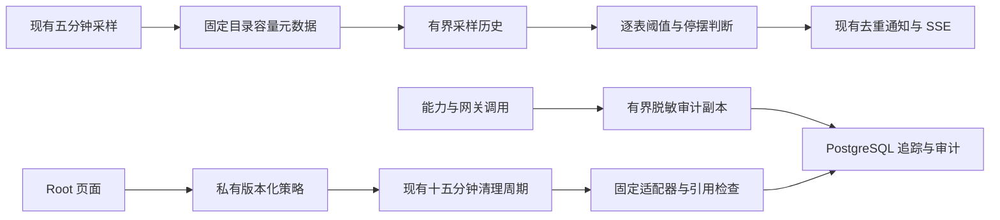
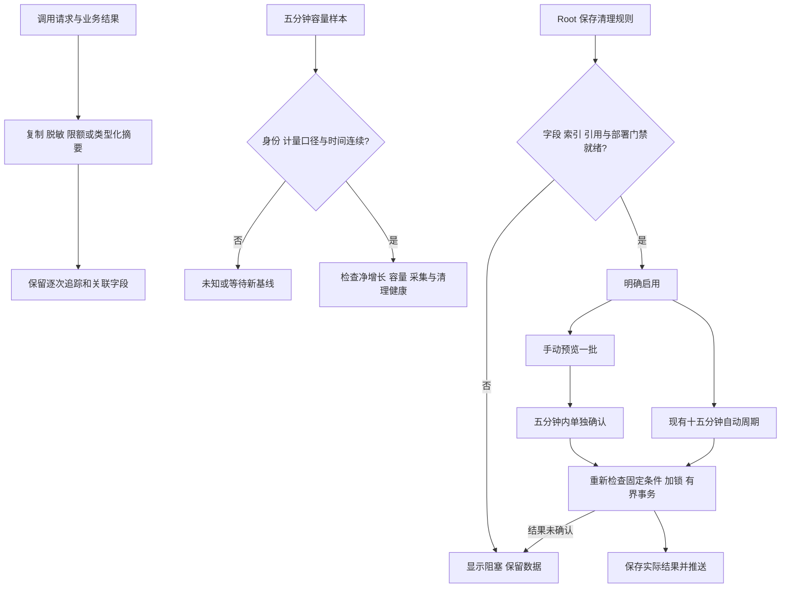
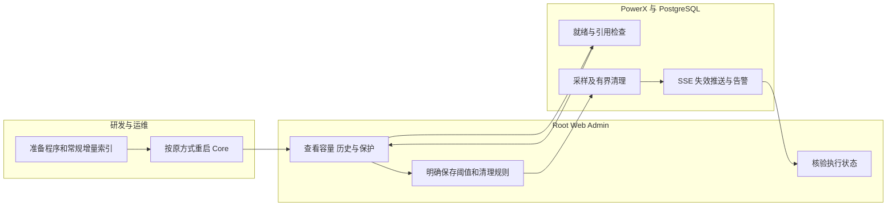

# US9：数据库日志写入保护、逐表监控与安全清理（v0.8）

## 1. 功能背景与目标

能力调用追踪和通知载荷曾持续占用大量数据库空间。此轮从写入、发现异常、固定规则清理三处控制增长：压缩可扩张的审计副本，显示逐表容量与历史，发现采集或清理停摆，并只对审查通过的记录开放删除。

源码完成不代表正式站已经升级或策略已经开启。新增监控与两类清理均默认关闭；不会因访问页面、升级程序或配置归档而自动删除数据库记录。

## 2. 角色与适用范围

平台 Root 用户在 `/monitor/storage` 配置。普通成员、插件、API Key、STS 和 service actor 均不能使用这些实例级接口。运维负责数据库常规增量迁移及重启；QA 使用隔离数据验证；业务用户的请求与完整权限判断结果不因审计摘要而改变。

63 张系统表是观测目录。是否属于系统表，不代表可以按年龄删除：权限状态、业务记录、结算、恢复点、运行队列、未知状态与引用关系仍受保护。

## 3. 整体架构与模块关系



采样只读取容量元数据，不在后台反复扫描 63 张表的时间字段。时间范围仍由既有列表／单表观测按预算查询。页面初次加载、手动刷新、SSE 变更和重连同步可读取接口，没有周期性详情轮询，也没有新增任务队列。

## 4. 核心流程



## 5. 跨角色协作流程



## 6. 前置条件与依赖

- 写入保护随新程序生效，不依赖这两个新增索引；不回写历史大载荷。
- 逐表采样需 `storage_governance.postgres_enabled`、有效 `postgres_cluster_id`、`sampling_enabled`、明确安装身份和当前数据库。启用告警还需要已配置的主机私有状态与运行中的后台 Worker。
- 主机状态由已有 `lifecycle_enabled` 或 `admission_enabled` 接入。数据库清理执行门禁为 `lifecycle_enabled && allow_enforce`；`allow_enforce` 沿用 `manage_native_retention` 的显式移交要求。开启这些部署门禁仍不等于开启表清理。
- 通知沿用明确配置的 `notification_tenant_uuid`／`notification_member_uuid`。未配置接收人时页面照常显示状态，不能宣称通知已投递。
- 两类新固定适配器需要 `idx_registry_probe_retention`、`idx_registry_discovery_expiry`。索引挂载在 `pkg/corex/db/database/migration.go → migrateCapabilityRegistryModels → AutoMigrate`；运行时不建索引。磁盘紧张的正式库先评估索引、WAL 和维护窗口，再通过常规迁移执行。
- 私有状态增加 `table-monitoring`、`cleanup-health`、`database-backlog`、`system-table-retention` 有界文档。不要删除状态文件来解除未确认操作。

## 7. 操作步骤

### 7.1 查看容量并开启监控

1. 用 Root 进入“监控中心 → 存储治理 → 系统表清单”。预期看到容量、时间范围、保护分类；未建表或未知占用显示状态和 `—`，不显示为零。失败时保留上次数据，查看错误。
   - 列表分别显示“自动清理”“保留多久”“操作”。“未开启”表示已有规则但尚未启用；“暂不可配置”表示本页没有适用规则；“受保护”表示不能作为普通日志处理；“模块自动维护”表示随所属模块写入维护元数据。读取策略失败显示“状态未知”，不当成关闭。
   - 可组合关键词、用途与清理状态过滤；排序支持合计占用、净占用变化、最早／最新记录、保留时间和表名，并切换升降序。未知数值始终排最后。保留时间按已配置的较长天数比较，未生效规则仍参与，按版本数量保留的记录不换算为天数。
   - 修改条件回到第一页；手动刷新、推送和分区切换保留条件。重置恢复全部用途／状态及容量降序。“配置清理”只打开原有配置入口，仍须另行明确保存；“查看保护原因”打开详情。
2. 点击“监控与告警 → 告警阈值”。默认草稿为单表 4 GiB、窗口净增长 256 MiB／15 分钟、停摆与积压宽限 45 分钟、连续失败 3 次；这些数值在明确启用之前不生效。
3. 勾选“启用逐表监控与告警”，核对阈值后“确认并保存”。缺少采样或主机状态时按钮阻止启用；策略版本冲突时保留输入，重新核对当前配置。
4. 保持 Core 运行。首次有效样本后显示“样本有效”；增长比较还需同一数据库／schema／关系目录指纹及时间窗口基线。跨库、重建表、缺失或不可用样本不拼接成虚假的增长。
5. 单表“详情 → 24 小时历史”查看最多 289 个点。后台样本仍按既有 15 天窗口保留；此接口只返回最近 24 小时。

**净占用变化不等于写入流量。** PostgreSQL 复用已有空页时，记录增加而已分配空间可能不变；删除后也可能只得到可复用空间。告警不能承诺把多少空间立即归还文件系统。

### 7.2 使用固定清理规则

| 表／入口 | 已实现的规则 | 始终保留 |
|---|---|---|
| 能力调用追踪与发布通知／数据库期限 | 沿用已有类型、终态、登记租户、关联核验与隔离规则 | 业务队列、未知类型及不满足核验的 pending |
| `capability_registry_health_probe_results`／详情 → 安全清理 | 过期且长期未更新的已知健康状态，必须存在更新的未软删除探测 | 每个适配器最新有效记录、未来重试、未知状态 |
| `capability_registry_discovery_cache`／详情 → 安全清理 | 已明确软删除且删除、过期、签发及更新时间均超过宽限期，归属已登记租户 | 活动缓存，包括用于刷新失败回退的过期缓存；未知／已删除租户 |
| 存储采样、清理记录与策略修订 | 沿用各模块的有界元数据窗口 | 操作意图与保护记录遵循原有规则 |
| 其余目录项 | 只观测，继续显示保护或待审查 | 权限、业务、结算、恢复、队列及引用状态 |

1. 对新适配器，打开该表“详情 → 安全清理”。预期先看到规则和就绪状态，没有自动启用或删除。
2. 设置保留／宽限天数（7–3650）和每批上限（1–500）。勾选“启用此规则及每 15 分钟自动清理”，点击“确认并保存规则”。这会授权后续自动批次；只想查看候选时保持关闭并预览。
3. 点击“预览可清理记录”。预期显示一批候选数量和截止时间，数据库内容不变。缺索引、外部外键或检查失败时阻止执行；修复后重新读取。
4. 已启用规则时，在五分钟内勾选独立删除确认，再点击“确认删除本批”。预期显示实际删除数及运行记录。执行会重新检查保护条件；锁竞争可跳过候选，因此实际数量可能少于预览。
5. 结果未确认时，弹层固定底部保留警告。不要重复删除；刷新查原请求 ID。后端保留未确认意图并阻止后续新批次，不能用修改策略或清空状态绕过。

旧日志中心中“填写表名／时间列后按时间删除”已禁用，不再把 SQL 标识符合法视为业务安全证明。旧配置仍能被读取，但会报告 `legacy_database_retention_disabled_use_typed_storage_policies`；新增此类旧配置会被拒绝。

### 7.3 写入保护的预期变化

能力追踪和网关请求／响应审计副本每项硬上限 16 KiB；统一审计的 Meta、Before、After、Diff 可扩张 JSON 字段同样受硬上限约束。错误摘要最多 2 KiB。部署原有更小限额仍可收紧上限。

密码、令牌、认证头、Cookie、私钥及连接凭据脱敏；长正文、大集合、附件正文、过深结构和无法安全解码的数据保留明确省略标记。不会为保留哈希而先完整序列化巨大原文。业务对象不被原地修改。

成功的类型化权限基线服务读取保留操作、schema、租户／插件、查询数量、决定数量及摘要校验值，不逐项复制上千条权限决定。失败、未知格式或不匹配的调用走通用有界快照。每次调用仍各有追踪及原有通知状态，保留 trace、主体、资源、状态与时间；没有通过采样抹掉调用历史，没有改 PostgreSQL 的 SQL 日志开关。

### 7.4 接口与本地联调

只读示例（使用现有 Root 会话提供的令牌，不在文档或聊天中粘贴真实令牌）：

```sh
curl -fsS -H "Authorization: Bearer ${POWERX_ROOT_JWT}" http://127.0.0.1:8077/api/v1/admin/ops/storage/database-tables/monitoring
```

预期信封含 `data.state`、`data.policy.enabled`、`data.sampled_at`、`tables`、`alerts`、`cleanup` 和 `backlog`。未启用时 `state=disabled`；采样缺失、停摆及不可用分别表达，不伪装健康。403 检查是否为人类 Root 用户；503 检查采样表、部署门禁与私有目录。

新增路径和 DTO 见 [OpenAPI](../../../../specs/027-monitor-center/contracts/storage-governance.openapi.yaml)。接口拒绝 query；写操作需要 `expected_revision`，启用／执行需要 `confirm=true`；新适配器手动执行额外需要 `preview_id` 与 UUID `request_id`。

局部回归（仓库 `backend/`）：

```sh
GOWORK=off go test ./pkg/corex/audit/... ./internal/service/capability_registry ./internal/service/integration_gateway/tenant ./internal/service/storage_governance ./internal/service/monitor_logs ./internal/transport/http/admin/storage
```

前端回归（仓库 `web-admin/`）：

```sh
npx vitest run tests/unit/storage
```

常规数据库增量使用仓库根目录 `make db-migrate`，再由服务所有者按原命令重启。开发启动沿现有 `backend` 的 `make dev` 和 `web-admin` 的 `npm run dev`；不得对运行中的用户服务擅自再开同端口进程。本轮原生 PG 测试只有显式隔离 DSN 才执行，缺少时跳过，绝不回退日常配置。

### 7.5 本地开发库仅准备两个清理索引

若当前开发程序已包含新适配器、两张来源表已存在，而 UI 仅报告缺少两个索引，可在 `backend/` 使用集中迁移的窄范围入口。先核对配置是 `dev/test`、实际本地 PostgreSQL 数据库／schema，以及已登记的 `postgres_cluster_id`。以下名称仅对应本次本地 `powerx.public`，其他环境必须填写各自真实名称：

```sh
GOWORK=off go run ./cmd/database migrate -scope system-table-retention -config etc/config.yaml -confirm-database powerx -confirm-schema public
```

入口要求配置连接端点及所有备用端点均为回环地址或 Unix socket，并从实际连接核验数据库名及 PostgreSQL 集群标识；不能仅凭配置标签判断目标。`prod/staging` 拒绝此范围，正式安装仍走完整升级流程。迁移在现有迁移锁和事务中执行，锁等待上限三秒；只补两个固定普通索引，不建表、改列、回填、seed 或开启删除。缺少来源、同名索引不符合定义或锁冲突时失败并回滚；不要通过删除旧索引或修改集群标识绕过失败。

成功后刷新“详情 → 安全清理”，预期就绪但规则仍关闭。索引和 UI 策略会被当前已升级的程序重新读取，无须仅为这两项准备再次重启。若程序仍是旧二进制，仍须由服务所有者按原方式升级并重启。

本地有实际删除验收时，只使用有明确归属的独立样例，先记录原状态，再经 UI 保存、预览和独立确认执行。核验最新探测、未知状态、未来重试、活动回退缓存及未知租户均受到保护；随后暂停测试规则，再移除剩余自建样例。不要用真实历史数据冒充测试夹具。

## 8. 预期结果与验收标准

- 写入：大载荷、循环结构、嵌套凭据和无效 JSON 仍产生合法有界快照；原对象不变；千条权限决定按摘要记录，逐次追踪数量不变。
- 监控：持续样本支持正负净变化；缺基线、换库、重建关系和不可用样本不伪造速率。容量、采集失败、过期样本、失败／未确认清理和持续积压可显示并进入既有通知去重流程。
- 积压：仅对已有两张调用审计表做限时、只读、有界存在性探测，不做全表 COUNT；跨多个周期持续存在并超过宽限才报积压。其余新适配器检查执行健康与固定规则，不声称已统计全库积压。
- 删除：默认关闭；错误身份拒绝；预览不改记录；版本、过期预览、索引、外键、最新状态、重试、未知租户、行锁及重复请求均有验证。
- 页面：1440／390／320px，桌面纵向任务导航、窄屏选择器、推送后保留表单与筛选，无周期详情请求，未确认结果在弹层底部可见。
- 证据：本轮结果见仓库 `tmp/storage-safety-20261104/REPORT.md`。受控 HTTP 浏览器、原生 PG、日常实例和正式站验收分别记录，不能互相替代。

## 9. 代码实现映射

2026-11-04 的[真实本地重启验收](../../../contracts/evidence/storage-vscode-restart-validation-20261104.json)验证了正常 Root 登录、实际 `3030 → 8077` 接口、63 表采样和唤醒后连续十五分钟检查；当时告警与删除规则关闭、两项索引待迁移。

随后完成[本地监控启用与安全删除验收](../../../contracts/evidence/storage-table-safety-enable-validation-20261104.json)：通过限定迁移补齐两项索引，UI 保存默认逐表告警；9 条自建样例中仅 2 条过期候选被删除，7 条保护样例保留，之后关闭测试规则并清除自建样例。两张来源表恢复为原来的零行。1440／390／320px 页面均检查通过，SQL 日志设置未变。监控保持启用，调用审计及其他删除策略仍关闭；没有部署或操作正式站，也没有将未触发的阈值通知描述为真实投递成功。

| 环节 | 路径 |
|---|---|
| 共享有界脱敏 | `backend/pkg/corex/audit/payload/` |
| 基线成功摘要 | `backend/internal/service/capability_registry/audit_baseline_summary.go` |
| 能力／网关／统一审计接入 | `capability_registry/audit.go`、`integration_gateway/tenant/service.go`、`pkg/corex/audit/service.go` |
| 逐表轻量采样与告警 | `storage_governance/samples.go`、`table_monitoring.go`、`database_backlog.go`、`cleanup_health.go` |
| 调度及通知去重 | `storage_governance/runtime.go` |
| 固定清理服务／仓储 | `storage_governance/system_table_retention.go`、`repository/storage_governance/system_retention_repo.go` |
| 迁移 | `pkg/corex/db/database/migration.go → migrateCapabilityRegistryModels`；开发限定入口 `cmd/database migrate -scope system-table-retention → MigrateSystemTableRetentionIndexes` |
| Root HTTP | `transport/http/admin/storage/database_tables_handler.go`、`system_table_retention_handler.go` |
| 页面 | `SystemDatabaseTablesPanel.vue`、`TableMonitoringControl.vue`、`SystemTableRetentionControl.vue` |
| 列表状态、期限展示及排序 | `web-admin/app/utils/storage-table-list.ts`；两个固定规则复用现有只读接口，顺序读取以避免争用同一主机文档锁 |
| 验收 | `table_monitoring_test.go`、`storage_safety_postgres_test.go`、`table-safety-controls.spec.ts`、`storage-table-safety.spec.ts` |

## 10. 常见问题与排障

| 现象 | 检查与处理 |
|---|---|
| 新路径 404 | 当前 Core 可能仍运行旧二进制；按原方式重新编译／重启，再刷新页面 |
| macOS 重启／重挂载后整组存储接口 503 | 检查预算账本设备号与当前 `st_dev`。新程序仅在 APFS 卷 UUID 与配置 `fs-<UUID>` 一致、零预留、各清理策略关闭、无未知结果／待隔离操作且没有旧 ownership 时，于启动主机锁内更新设备号并记录 `device_rebindings`（最近8次）。不会清空账本或自动启用旧策略；其余情况仍拒绝启动，Linux 不自动换绑。升级后需重新编译并重启 Core |
| 等待首次采样／采样过期 | 核对采样配置、当前库、安装身份、Worker 开关与最近样本时间；不是刷新页面等待自动修复 |
| 有分配空间但增长为 `—` | 基线不足、采样间断、换库或关系目录变化；保留未知，等待新窗口 |
| 空间未减少但删除成功 | 先看实际删除数；普通删除通常产生数据库内部可复用空间。不会自动执行 VACUUM FULL、清空表或删除 WAL |
| 索引缺失／存在外键 | 完成受控迁移或审查真实依赖；运行时不强建、不级联删除 |
| 清理显示未确认 | 核对原请求和事务结果，保留意图；禁止通过清空私有目录或新请求盲目重放 |
| UI 改过值又收到推送 | 草稿保留原 revision；保存冲突后核对当前策略，不能静默覆盖另一操作人的修改 |
| 告警无通知 | 查看既有通知配置和投递错误；未配置接收人不等于已投递 |

## 11. 回滚与风险控制

先在 UI 关闭对应新清理规则，再关闭逐表告警。关闭监控不会替代关闭清理；关闭归档也不会替代任何数据库策略。既有两表策略、文件策略和外部临时守护分别核对，不能靠降级程序推断其停用。

回滚程序前保留私有状态、运行记录和数据库备份；两个新增普通索引可保留，不需为程序回滚删除索引。已执行的数据库物理删除只能依靠适用的备份或数据库恢复能力找回，审计摘要也不能重建被省略的业务正文。原有历史膨胀不会因写入保护立即缩小；未审查表继续只观测，不能使用旧任意表清理兜底。

## 12. 变更记录

2026-11-04：按 P0 写入保护 → P0 逐表监控 → P1 首批固定适配器顺序交付，随后完成实际本地开发库的两个索引迁移、UI 监控启用及自建样例删除验收。修正空清理健康和未启用积压探测的显示。未替换正式站临时守护或修改生产策略；正式站上线及启用独立验收。
