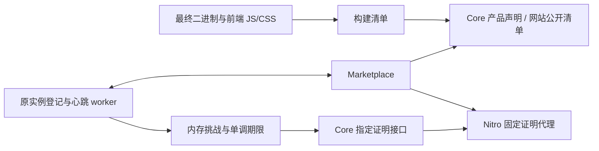
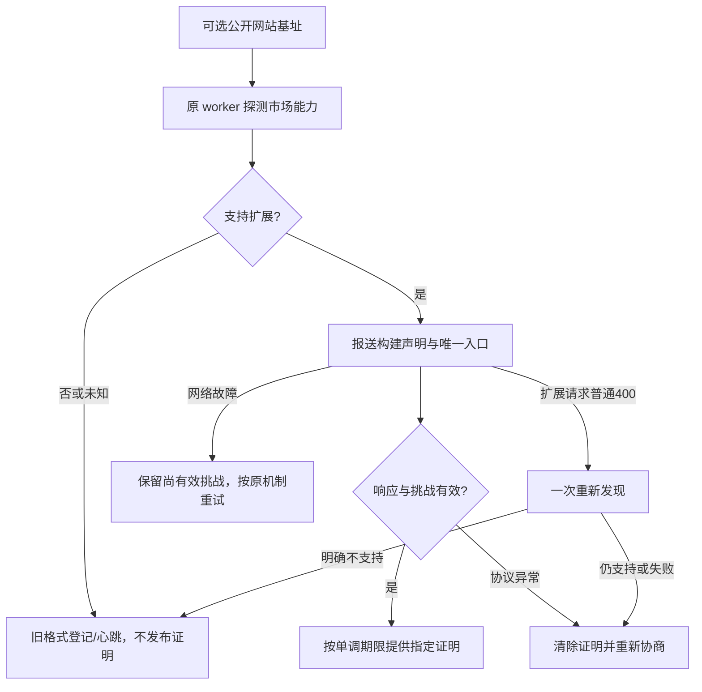
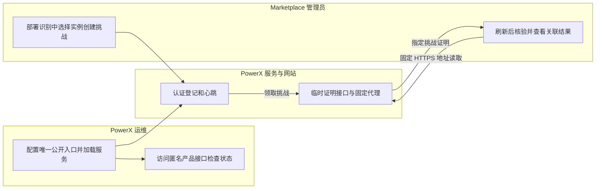

# PowerX 构建识别与实例网址关联

## 1. 功能背景与目标

PowerX 现在能公开声明自身构建，并通过已有市场心跳领取短期挑战，让 Marketplace 验证某个网站入口是否提供指定实例收到的证明。构建声明、静态资源匹配、实例关联是三个不同的证据；都不代表硬件远程证明或真实公司身份认证。

PowerX 侧运行时代码已接入。本地源码模式没有发行清单时，启动会计算当前实际可执行程序的构建指纹，保持 development 状态，并自动随登记/心跳上报。市场管理员在「分发跟踪 → 实例与指纹」即可查看，无需使用方提供文件或公网入口。市场故障不阻塞 Core 启动或本地上传安装。Docker 镜像实际构建、真实 HTTPS 入口及双部署验收仍需分别记录，不能由单元测试替代。

## 2. 角色与适用范围

| 用例 | 文档 | 角色与验收口径 |
| --- | --- | --- |
| 构建及公开识别 | [发行清单与公开标识](usecase-build-and-identify.md) | 研发、运维；清单对应最终制品，匿名接口与网站资源可读 |
| 实例网址关联 | [心跳与挑战核验](usecase-instance-link.md) | 运维、Marketplace 管理员；原实例身份不变，指定证明核验成功 |

支持源码、systemd 和 Docker。PowerX 不新增管理员页面；市场页面入口为 `/admin/distribution`，使用 Marketplace 的管理员身份。本功能不修改插件业务源码、Redis 隔离或安装器流程。

## 3. 整体架构与模块关系

私有实例凭证沿用环境私有目录，公开清单不包含 EnvironmentID、私有环境摘要、租户或令牌。公开的 build_id 标识构建，持久化 instance_id 标识独立运行环境，两者不能混用。证明只保存在当前进程内存，不写入构建清单或发行包。

## 4. 核心流程

重复挑战取旧期限与新期限中较早者。剩余期限扣除完整请求耗时和 1 秒安全余量；市场的最终核验仍以市场服务端时间为准。退出、修改/清空入口、换身份、凭证被拒或能力失效时停止提供旧证明。

## 5. 跨角色协作流程

## 6. 前置条件与依赖

- PowerX 服务端使用原有持久化身份目录，不复制其他部署的身份文件。
- Marketplace 支持 `powerx.deployment-fingerprint/v1`；旧市场可继续普通登记/心跳。
- 关联要求网站 HTTPS、有效证书及市场可公开访问。生产市场不会访问本机 `127.0.0.1`、内网或跳过 TLS；本地传输检查见用例中的受控命令。
- 构建清单由管理员导入受信任规则库；目标网站自身的声明不会自动获得信任。

## 7. 操作步骤

先按[构建用例](usecase-build-and-identify.md)检查公开信息，再按[实例关联用例](usecase-instance-link.md)配置入口和发起挑战。源码服务仍由使用者在原终端执行根目录 `make dev`、在 `web-admin` 执行 `npm run dev`；文档和代码变更不会自动重启既有进程。

## 8. 预期结果与验收标准

1. 开发方式没有侧车时，产品接口返回 `development` 且无伪造 build_id；正式包自检成功返回 `available`。
2. 根路径与 `/console/` 网站能读取公开清单、最终 JS/CSS 及指定证明；动态证明始终 `no-store`。
3. 公开证明只有 schema、challenge_id、nonce、expires_at，访客凭证和任意目标地址不进入上游。
4. 网络失败保留尚有效挑战；空集合清除；重复投递不续期；过期、改入口、退出、401/403 后不可读。
5. 旧市场兼容、原身份重启复用、本地上传和安装补报回归通过。
6. 两套真实部署仍须确认实例不同、重启不新建实例、各自证明不能串用；不得据受控记录关闭联合 A01–A24。

本轮构建、竞态、回归及真实 Nitro 输出检查的具体结果见[PowerX 受控验证记录](../../../contracts/evidence/deployment-fingerprint-powerx-runtime-20261023.json)。临时输出和监听服务已清理；该记录不能代替真实 HTTPS 双实例验收。

## 9. 代码实现映射

| 职责 | 源码（仓库根目录起） |
| --- | --- |
| 清单生成、严格 schema、二进制自检 | `backend/internal/productinfo/`、`backend/cmd/build_fingerprint/` |
| 主程序构建信息与侧车 | `make_files/dist.mk`、`deploy/powerx/docker/dockerfiles/backend.Dockerfile` |
| 前端清单及元数据 | `web-admin/scripts/build-fingerprint.mjs`、`web-admin/nuxt.config.ts` 的 `nitro:build:public-assets` hook |
| 单入口及环境覆盖 | `backend/config/plugin.go`、`backend/config/config.go` |
| 能力协商与普通 400 回退 | `backend/internal/infra/plugin/marketplace/deployment.go` |
| 原 worker 接线与内存证明 | `backend/internal/service/plugin_marketplace/deployment.go`、`automatic_registration.go`、`distribution.go` |
| 匿名产品与证明路由 | `backend/internal/transport/http/public/product/`、`backend/internal/http/router.go` |
| 固定代理 | `web-admin/server/middleware/00-marketplace-proof.ts`、`server/utils/marketplace-proof.ts` |
| 构建输出实际 HTTP 检查 | `web-admin/scripts/check-deployment-fingerprint-output.mjs` |

## 10. 常见问题与排障

| 现象 | 检查与处理 |
| --- | --- |
| 产品 `missing` / `invalid` | 核对当前可执行文件旁 `<binary>.build.json`，发行版本、提交、目标平台和严格 schema；重新发布配套产物 |
| 产品 `digest_mismatch` | 二进制与侧车不是同一产物或文件被修改；整体替换发行产物，不能只手改 build_id |
| 入口配置无效 | 后端日志检索 `plugin.marketplace.public_site_url 无效`；填写完整、规范化的 HTTP/HTTPS 基址后重启加载。无效配置只暂停扩展，不阻塞普通登记 |
| 普通识别成功但无法关联 | 关联要求 HTTPS；确认市场创建挑战的网址与 PowerX 声明完全相同，并等待下一次既有心跳 |
| 证明 404 | 未领取、已过期、入口改变、空集合或能力失效；在市场手动刷新记录并重新挑战，不能枚举其他挑战 |
| 证明 503 | Core 未就绪、维护中或固定上游不可达；核对网站服务的 `POWERX_BACKEND`、API prefix、后端状态 |
| 清单请求返回 HTML | 前端需重新构建；清单必须在 Nitro 静态资源索引生成之前写入，不能只在已构建 `.output/public` 中补一个文件 |

## 11. 回滚与风险控制

关闭市场扩展能力或加载旧市场后，Core 在线重新协商并受控使用旧格式；不删除私有凭证或重装插件。清空 `public_site_url` 并加载后，通过下一次成功扩展心跳同步清除市场入口；改回旧网址需要重新核验。

PowerX 本轮没有新增数据库迁移。回滚程序时保留实例身份、安装日志和市场历史。反向代理/CDN 不得缓存动态证明；不得增加跳过 TLS、访问内网或任意上游代理的生产开关。

## 12. 变更记录

- 2026-10-23：PowerX 侧构建、自检、公开信息、心跳扩展与固定证明代理接线；源码与受控产物验证，实际部署单独验收。
