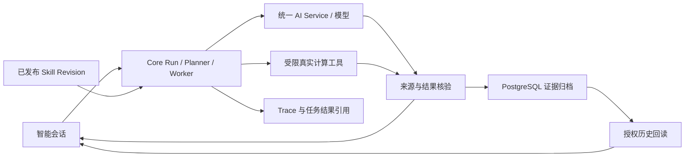
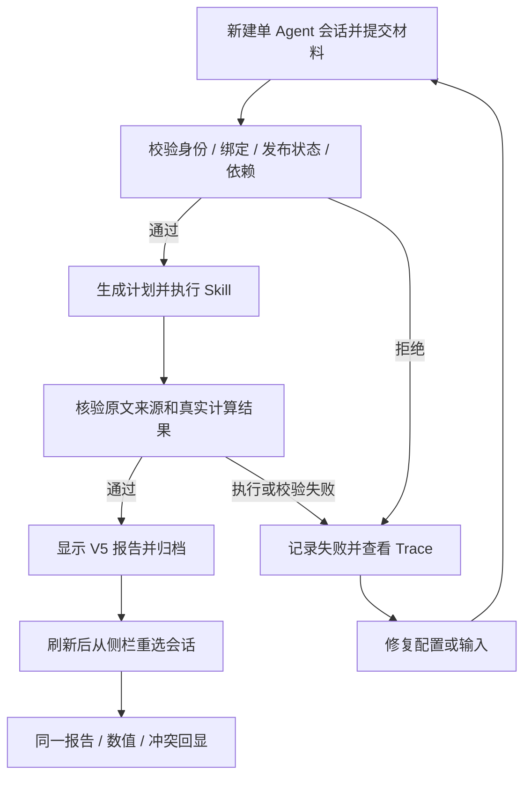
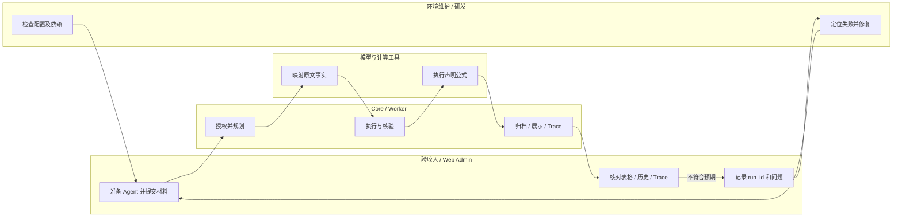

# 单 Agent 页面验收指南（024 / V5）

本指南验证“一个 Agent → 已绑定 Skill → 真实工具 → V5 报告 → 历史与 Trace”。先执行 [7.1～7.4 页面步骤](#page-test)，再填写验收记录。团队任务另按[团队指南](../../agent/native_agents/marketing-knowledge-demo/README.md)验证。

## 1. 功能背景与目标

确认升级后 Agent 能选择已绑定技能、使用真实用户原文和工具结果、识别数值冲突，并在刷新后保持相同报告。材料使用营销复盘示例；Core 仍通过通用声明式执行机制处理，不按业务名称分派。

本轮只新增验收 Agent 和会话，使用已有已发布 Skill；已迁移的本机不需要再次迁移或 seed。

## 2. 角色与适用范围

| 角色 | 工作 |
| --- | --- |
| 验收人 / QA | 用 root 登录，创建验收 Agent，运行材料、检查报告及 Trace |
| 环境维护者 | 准备同一构建的 Core/Worker、模型、Redis、PostgreSQL、对象存储 |
| 研发 | 根据 run_id / trace_id 定位失败，修复后新建运行复测 |

root 用于查看运行追踪；通过本指南不等于普通用户权限隔离、团队协作、插件渠道或 031 跨实例容灾已验收。

## 3. 整体架构与模块关系



模型提取和解释输入；声明的公式由工具实际计算。数学结果不能证明原始数据或业务归因正确。

## 4. 核心流程



修复后显式创建新运行；失败不能靠占位完成文案或重放旧报告计为通过。

## 5. 跨角色协作流程



## 6. 前置条件与依赖

- 页面示例地址为 `http://127.0.0.1:3030`，Core 为 `http://127.0.0.1:8077`。端口和 API base 以目标实例配置为准。
- 用 root 登录，固定同一租户和环境；本轮已验证环境为 `dev`。目标租户须能解析并调用已发布的 `marketing.review_summarize`。
- 本机 V5 汇总 Revision 为 `b92c4d1a-ae23-4bc3-a80a-00b5dcbc6d9a`；目标环境应核对自己的发布记录。仅看到旧 Registry 的 published 标签不足以证明已发布 V5 Definition。
- 当前构建已迁移 `agent_evidence_snapshots`，`payload` 为 BYTEA。远程未升级时，由维护者按[迁移和专用示例发布步骤](../../../../specs/024-ai-engineering-skills/evidence-acceptance.md#远程服务器部署本次变更)处理；不要为本轮测试运行完整 seed、refresh 或 reset。
- Core、持久化 Worker、Redis、PostgreSQL、S3/MinIO 报告存储及模型可用。本轮浏览器验收使用 `ai.runtime.durable_sessions.enabled=true` 和 `admin_chat_enabled=true`；模型调用按已有物理容量池配置执行。
- 使用已测试通过的模型。本轮为 Ollama / `qwen3:8b`；模型配置详情见 [AI 设置指南](../../agent/ai_setting.md)。
- 若新 Core 启动明确拒绝公开默认 JWT 密钥，应由维护者处理实例密钥配置。验收脚本的临时密钥不作为日常配置；API 留证使用真实用户 JWT。

## 7. 操作步骤

<a id="page-test"></a>

### 7.1 创建独立验收 Agent

单聊与团队使用独立 Session；同一负责人下也不会共用会话列表。升级后证据不足的旧会话保留在“待确认历史”，可查看但不能续写或重试。本轮从“当前会话”新建，详见[会话归属与升级契约](../../../contracts/agent-chat-sessions.md)。

1. **动作**：打开“智能体管理” → “新建智能体”。**入口**：`/settings/ai/agents`。填写下表，点击“新建智能体”。

   | 页面字段 | 填写内容 |
   | --- | --- |
   | 智能体名称 | Agent升级验收 |
   | 系统 Key | `qa.agent-evidence`；若已存在，复用本轮自己创建的对象或换唯一后缀 |
   | 状态 | 启用 |
   | 系统提示词（主指令） | 根据已绑定技能处理请求，仅依据实际执行结果生成报告。 |
   | 技能 IDs | `marketing.review_summarize` |
   | 角色设定、知识库 IDs、其他工具授权 | 本轮留空 / 使用默认值 |

   **预期**：提示创建成功，列表中出现该 Agent，状态为启用。**失败处理**：保留页面错误；缺 Skill、未发布、依赖或授权失败时先检查对应治理记录，不通过扩大权限绕过。

2. **动作**：打开“智能会话”，选择刚创建的 Agent。**入口**：`/agent/sessions`，不是 `/agent/team-tasks`。通过 Agent 的配置按钮检查“模型配置”；需要覆盖时关闭“使用系统默认”，选择已配置的 Provider/模型。本轮可复用 Ollama / `qwen3:8b`，温度 0、最大 tokens 4096，保存。

   **预期**：会话底部显示所选模型，聊天信令和控制通道正常。**失败处理**：模型未出现在列表、未配置或测试失败时，先到 AI 设置处理。保存模型时不要改动验收 Agent 的 Skill 绑定。

### 7.2 场景 A：原始材料，验证真实计算与冲突

**动作**：点击“新建会话”，完整粘贴以下内容，按 Ctrl+Enter 发送。输入与[后端材料夹具](../../../../backend/tests/fixtures/agent_runtime/marketing_review_saas.txt)对应。

```text
请仅执行已绑定的营销活动复盘汇总技能，依据以下原文生成带计算证据的复盘报告：
活动主体是一款面向中小企业的SaaS产品，客单价在6000元到2.4万元之间，产品形态是年订阅制加增值服务包。活动目标不是拉新，而是激活近6个月内未续费或未升级的存量客户。我们把它命名为“老客唤醒返场计划”，周期是28天，投入渠道包含直邮定向EDM、企业微信社群、短信、公众号图文以及信息流广告。
核心结论先行：活动投入34.2万元，活动标记GMV 46.2万元，财务口径ROI只有1.35。如果只看这个数字，这是一场“花钱买吆喝”的亏损活动。但当我用增量归因口径重新核算后，真实ROI是3.37，带来了29.0万元的可归因增量GMV，并且沉淀下来一批高复购人群，其中90天内二次购买率达到27.8%。
第一周数据就开始出现异常：结果显示短信渠道的ROI只有0.65，信息流渠道的ROI却有4.8。
信息流渠道点击率1.2%，下单转化只有0.08%，表面看是落地页问题。实际上大部分点击来自产品媒体曝光带来的围观流量，本来就是强意向之外的泛人群。拿“低转化”当绩效问题去优化素材，是在错误的人群池里做无用功。
```

**预期**：

- 显示“原文报告值”“工具计算值”“原文与计算口径冲突”“缺口或阻塞”等结构化区块。
- 活动产投比为 `46.2 ÷ 34.2 = 1.35`，增量产投比为 `29.0 ÷ 34.2 = 0.85`。
- 原文的增量 ROI `3.37` 仍保留，与 `0.85` 显示数值冲突。不要把它改成原文已正确报告 0.85。
- `27.8%` 保留为原文复购率；缺少复购人数和客户池人数时列缺口，不生成虚构人数。
- Run 可以是 completed，报告业务状态为 needs_action：执行成功，但业务信息有待核实。

**失败处理**：只有“任务已执行完成”的占位文字、没有 V5 结构化报告，或者只显示原文 3.37，都不算通过；记录 Trace 后停止判定成功。

### 7.3 场景 B：替换数字，验证没有复用旧报告

**动作**：再点击“新建会话”，复制场景 A 的完整输入，只替换三处：

| 原始文字 | 替换文字 |
| --- | --- |
| 活动投入34.2万元 | 活动投入20.0万元 |
| 活动标记GMV 46.2万元 | 活动标记GMV 60.0万元 |
| 29.0万元的可归因增量GMV | 10.0万元的可归因增量GMV |

**预期**：工具计算值变为 `3` 和 `0.5`，页面可按精度显示 `3.00` 和 `0.50`。原文 `1.35`、`3.37` 保持原样，分别与新计算值形成两条冲突；复购人数缺口仍在。本轮须有新的 run_id / trace_id。

**失败处理**：仍得到 1.35/0.85 时，对照本次已保存的用户输入和 Trace 检查；不能仅根据模型解释“已更新”判定通过。

### 7.4 检查 Trace 和刷新历史

1. **动作**：在场景 A、B 的助手消息下点击“追踪本轮”。**预期**：报告加载成功，存在规划、执行任务和结果引用，运行 completed 且无任务错误。**失败处理**：401/403 先检查当前登录身份；报告缺失或结果引用异常时记录 message_id、run_id、trace_id，不重复提交冒充原运行恢复。
2. **动作**：记录数值和冲突后刷新页面，从侧栏重新选择同一会话。**预期**：数值、原文引用、标签、冲突和缺口保持一致。当前工作台刷新后可能回到欢迎页，因此“重选历史会话”是本步骤的一部分。**失败处理**：没有报告、数值变化、只剩占位文案或显示“证据不可用”时记录原运行；不要要求模型重新生成来替代历史核验。

场景 A/B 及历史、Trace 已有真实浏览器验收证据。本文新建 Agent 的页面字段已与当前 UI/DTO 核对；先前安装验收的测试 Agent 通过正式 API 创建，本轮页面创建仍需验收人记录实际结果。

### 7.5 场景 C：缺少原始数据

**动作**：新建会话发送：

```text
请执行已绑定的营销活动复盘汇总技能。某存量客户活动原文只报告90天内二次购买率27.8%，没有提供复购人数、客户池人数、活动投入或GMV。请保留原文报告值并列出缺口。
```

**预期**：保留 27.8% 为原文报告值，列出原始人数或金额缺口；不凭空构造分子/分母，不给出缺少输入的活动产投比。

**失败处理**：出现虚构人数或计算值时记录报告及原文。此场景的百分比无计数语义已有后端回归；本段是操作者的页面验收用例，不记作此前已执行的浏览器证据。

### 7.6 API 留证与本地回归（研发 / QA 可选）

从浏览器 Network 中找到当前会话的 `GET /agents/sessions/<id>/messages`，取得 session ID。设置目标实例的完整 API base、同一登录用户的有效 JWT 和会话 ID；JWT 不放入验收报告。下面命令仅回读历史，不触发新模型调用。

```sh
export POWERX_API_BASE="http://127.0.0.1:8077/api/v1"
export POWERX_TEST_ENV="dev"
# 在当前 shell 设置 POWERX_USER_JWT 和 POWERX_TEST_SESSION_ID。
: "${POWERX_USER_JWT:?}" "${POWERX_TEST_SESSION_ID:?}"
EVIDENCE_DIR=$(mktemp -d "${TMPDIR:-/tmp}/powerx-single-agent.XXXXXX")
export EVIDENCE_DIR
curl --fail-with-body --silent --show-error \
  -H "Authorization: Bearer ${POWERX_USER_JWT}" \
  "${POWERX_API_BASE%/}/agents/sessions/${POWERX_TEST_SESSION_ID}/messages?env=${POWERX_TEST_ENV}" \
  -o "$EVIDENCE_DIR/history.json"
python3 - <<'CHECK'
import json, os
from pathlib import Path
history = json.loads((Path(os.environ['EVIDENCE_DIR']) / 'history.json').read_text())
rows = [row for row in history['data']['items'] if row['role'] == 'assistant']
assert rows, 'No persisted assistant message'
report = rows[-1]['meta']['response_envelope']
assert report['schema'] == 'powerx.agent.response/v5'
print(report['schema'], report['outcome'])
print({row['field_key']: row['value'] for row in report['presentation']['computed']})
CHECK
```

场景 B 的输出应包含 `powerx.agent.response/v5 needs_action` 和 `{'gmv_multiple': '3', 'incremental_multiple': '0.5'}`。API 前缀发生配置变化时，仅调整 `POWERX_API_BASE`；不要在多个命令里分别硬编码版本。JSON 摘录结构为 `data.items[].meta.response_envelope`，这只是本次报告的数据形状，不是新的调用入口。

从仓库根执行已有回归，验证除零失败、来源隔离、缺口/冲突和 Worker 回读：

```sh
go -C backend test ./pkg/corex/agent/evidence -run '^TestTypedToolDivisionByZeroHasFailedActualExecution$' -count=1
go -C backend test ./internal/service/skills -run '^TestV5BusinessGapsConflictsAndSystemFailuresAreDistinct$' -count=1
go -C backend test ./internal/server/agent ./internal/server/agent/runtime
```

单测通过不替代页面验收。以上除零等失败分支在隔离测试中执行，不需要停止模型服务或撤销日常 Agent 的权限来制造故障。日常服务由维护者启动；源码启动命令为仓库根 `make dev`，前端为 `cd web-admin && npm run dev`。已有服务正常时直接使用；需要重编译/重启时先由进程所有者处理。

## 8. 预期结果与验收标准

| 检查项 | 通过标准 |
| --- | --- |
| 入口 | 单 Agent 智能会话，所选 Agent 和绑定 Skill 正确 |
| 场景 A | 工具计算 1.35/0.85，保留原文 3.37 的冲突 |
| 场景 B | 工具计算 3/0.5，两条数值冲突，具有新的运行身份 |
| 缺口 | 27.8% 保留为原文；缺计数时不生成复购人数 |
| Trace | 成功运行含规划/执行及结果引用；协议或系统失败不伪装完成 |
| 历史 | 刷新重选后保持原数值、标签、引用与业务状态 |
| 留证 | 记录实际环境、模型、Agent、session_id、run_id、trace_id 和结论 |

需要 A、B、Trace、历史全部通过，才能说该实例的单 Agent V5 主链路通过。完整新建页面与场景 C 按本轮实际操作另填记录。

## 9. 代码实现映射

| 操作 / 行为 | 代码入口 |
| --- | --- |
| 新建 Agent / Skill 绑定字段 | [agents.vue](../../../../web-admin/app/pages/settings/ai/agents.vue)、[agent_handler.go](../../../../backend/internal/transport/http/admin/agent/agent_handler.go) |
| 单 Agent 会话 / 模型配置 | [AgentWorkspace.vue](../../../../web-admin/app/components/agent/AgentWorkspace.vue)、[ConfigPanel.vue](../../../../web-admin/app/components/agent/ConfigPanel.vue) |
| 已发布示例和计算声明 | [seed_native_marketing_agents.go](../../../../backend/cmd/database/seed/seed_native_marketing_agents.go)、[marketing_calculation_policy.json](../../../../backend/cmd/database/seed/locales/marketing_calculation_policy.json) |
| 可信原文传递 / Worker | [user_input.go](../../../../backend/internal/server/agent/user_input.go)、[manager_task_invoker.go](../../../../backend/internal/server/agent/runtime/manager_task_invoker.go) |
| V5 执行、来源与工具回执 | [executor_evidence_v5.go](../../../../backend/internal/service/skills/executor_evidence_v5.go)、[tool_runtime.go](../../../../backend/pkg/corex/agent/evidence/tool_runtime.go) |
| 原始任务结果与终态回读 | [durable_task_artifact.go](../../../../backend/internal/server/agent/runtime/durable_task_artifact.go)、[durable_final_output.go](../../../../backend/internal/server/agent/runtime/durable_final_output.go) |
| 历史投影 / 页面渲染 | [chat_history_service.go](../../../../backend/internal/service/agent/chat_history_service.go)、[MessageItem.vue](../../../../web-admin/app/components/agent/MessageItem.vue) |

## 10. 常见问题与排障

| 现象 | 检查与处理 |
| --- | --- |
| 看到了主 Agent + 子 Agent / 团队任务 | 切回 `/agent/sessions`，选择本轮单 Agent |
| 看不到之前的 T205 验收 Agent | 先前临时 Agent 已清理，按 7.1 自建，不复用已删除会话 |
| 创建失败 / Skill 不可运行 | 检查名称、唯一 Key、启用状态、主指令、同租户已发布 Definition 与依赖；不要全量 seed |
| 模型没配置 / 长时间等待 | 看 AI 设置和 Trace 的排队/执行状态；模型共享物理槽会排队，不连续重复发送 |
| 只有普通对话或完成占位文字 | 本例未证明执行汇总 Skill，核对实际 Agent 绑定、候选和规划结果 |
| 只显示 needs_action | 检查是否对应原文冲突和数据缺口；与 Run completed 可以同时成立 |
| 刷新后欢迎页 | 从侧栏重选原会话，再核对历史报告 |
| 证据不可用 / Trace 加载失败 | 保留当前消息、环境和运行 ID，检查主体权限、归档与引用完整性 |
| Planner 协议或工具执行失败 | 记录失败运行；查看“追踪本轮”，有“复制追踪信息”时复制 run_id/trace_id；修复后新建运行 |

## 11. 回滚与风险控制

- 仅创建、编辑和删除自己本轮的验收 Agent / 会话；不改固有 Agent 或团队，不为验证而批量授权。
- 清理前保存必要的输入、报告和运行身份；通过页面删除本轮会话，再删除验收 Agent。软删除/运行审计记录可按系统保留策略保留。
- 单 Agent 验证不需要数据库回滚。部署迁移和数据恢复由维护者按独立备份/升级方案处理，不使用 reset/refresh 清理测试对象。
- 本机通过不能替代远程部署、实际插件各自安装验收或 031 的多 Core/Worker 容灾压测。

## 12. 变更记录与验收记录

| 日期 | 变更 / 证据 |
| --- | --- |
| 2026-10-15 | 建立单 Agent V5 页面指南，区分团队任务、原始/替换材料、业务缺口、Trace 和刷新；依据 [T205 真实验收记录](../../../../specs/024-ai-engineering-skills/evidence-acceptance.md)及当前页面/DTO编写 |

每次实际验收填写，不预填通过：

| 日期 / 执行人 | 环境 / 租户 | 模型 | Agent UUID | session_id | run_id / trace_id | 场景 | 实际结果 / 结论 |
| --- | --- | --- | --- | --- | --- | --- | --- |
| 待填写 | 待填写 | 待填写 | 待填写 | 待填写 | 待填写 | 创建 / A / B / C / 历史 / Trace | 待填写 |
