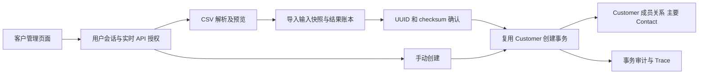
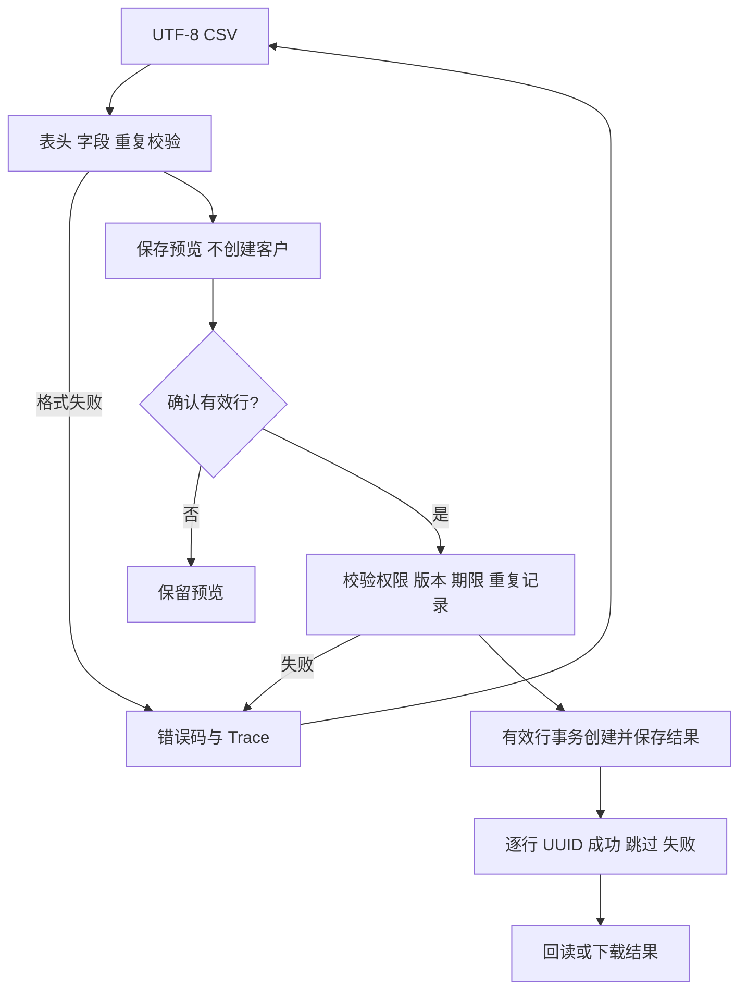
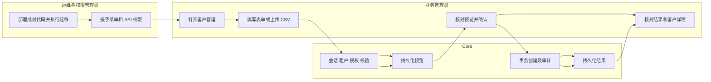

# Core 客户管理：菜单授权、手动创建与 CSV 导入

## 1. 功能背景与目标

客户主数据可以由管理员在 PowerX 直接建立。新建会原子创建 Customer、当前租户成员关系和主要 Contact；不产生登录身份、密码或渠道认证证明。CSV 导入先展示持久化预览，再由用户确认有效行，并提供可重复回读的逐行结果。

## 2. 角色与适用范围

适用 Core Root 或有相应 API 权限的租户成员。Root 也必须选择当前租户。菜单权限控制入口，创建和导入由独立操作权限控制。API Key/STS 不能访问这些 Admin 入口；Framework 原有客户创建仍原子建立主联系人；通用 Contact 的 primary 角色变更收敛为显式设主，见主联系人维护合同。

支持 UTF-8（可含 BOM）CSV，最多 1 MiB、200 条数据行。XLSX、其他编码、未知列及身份覆盖列会明确拒绝。本流程只创建新记录；重复邮箱/电话标记为跳过，不根据这些字段合并身份或更新已有客户。

## 3. 整体架构与模块关系



## 4. 核心流程



## 5. 跨角色协作流程



## 6. 前置条件与依赖

- 前后端均更新；数据库迁移增加 `customer_account_imports`，并增量登记 `menu.customer:view`。集中挂载在 `pkg/corex/db/database/migration.go`。迁移不授予新权限、不重置旧授权/密码/安装状态，也不复活已删除权限。
- `menu.customer:view` 在 **设置 → 用户管理 → 权限 → 菜单权限 → 业务运营 → 客户管理** 勾选并保存。需要用户有实际角色绑定，菜单授权不会自动提供写入权限。
- **能力/API 权限** 中：手动创建需要 `customer.admin_customers_accounts:create`；CSV 导入需要预览、回读、确认三个权限。后端校验 formal `platform_capability` 来源、有效 UUID 角色绑定、active/allow 权限；到期、deny、deprecated 或删除授权均拒绝。

| 操作 | 实际权限 triple | 所属能力 |
|---|---|---|
| 创建 | customer / admin_customers_accounts / create | com.corex.customer.accounts.admin_manage |
| 预览 | customer / admin_customers_imports_preview / create | com.corex.customer.accounts.admin_import |
| 回读 | customer / admin_customers_imports_import_uuid / read | 同上 |
| 确认 | customer / admin_customers_imports_import_uuid_commit / create | 同上 |

新安装通过原 Setup 流程完成初始化。旧实例按 [已安装升级合同](../../../contracts/powerx-installed-upgrade.md) 执行已评审的迁移计划；开发机器可在仓库根目录执行 `make migrate`，结束后重新运行 `make dev`。不要对旧实例重跑完整 Setup/seed。正式升级的 catalog 步骤会增量登记新能力与权限并保留既有授权；首次部署及非升级开发环境的目录同步可用 `make capability-seed`。命令失败先保留输出并修复，不启动未迁移的新后端。

## 7. 操作步骤

### 手动创建

1. 打开 **业务运营 → 客户管理**，点击 **新建客户**。按钮不可用时核对上表中的创建权限；当前租户为空时先选择租户。
2. 选择个人或企业，填写客户名称及可用邮箱/电话。企业还需填写自然人的主要联系人姓名；成功后弹窗关闭、列表刷新，可进入详情核对 Contact。
3. 错误显示在表单中并保留 request/Trace。网络结果不确定时先刷新列表核对，避免再次手动新建。

### CSV 导入与回读

1. 点击 **批量导入客户 → 下载 CSV 模板**，删除示例行并填写实际客户。表头为 `type,display_name,primary_email,primary_phone,primary_contact_name,primary_contact_email,primary_contact_phone`。type 空值默认 person；company 要有主要联系人姓名。
2. 选择 UTF-8 CSV 并点击 **生成导入预览**。预期显示“尚未创建客户”、有效/跳过数量、原始 CSV 行号、每行生效字段及错误码。格式错误先重新导出；业务校验失败的行可修正后重新预览。
3. 核对有效行，勾选确认并点击 **确认并创建有效客户**。预览 24 小时内有效，只处理 `ready` 行；确认时再次核对重复记录。邮箱按大小写不敏感比较，电话忽略空格、加号、横线和括号，比较范围为当前租户。
4. 成功后逐行显示 `created/invalid/duplicate/failed` 和客户 UUID。点击 UUID 查看详情；**下载逐行结果 CSV** 导出行号、状态、错误码和 UUID。个人、省略类型及企业均沿用原创建事务。
5. 请求中断时通过 **回读导入记录** 或保存的 `/customers?import_uuid=<UUID>` 回读同一记录。相同 UUID/checksum 重复确认或并发确认返回同一结果。服务中断导致未提交事务回滚时，原预览仍可重试。
6. 完成后失败行不会在同一批次偷偷重跑。修正失败原因，另建仅含失败行的 CSV 预览并确认；之前创建成功的客户保持原 UUID。当前仅创建者能回读和确认自己的导入记录，跨租户或其他创建者返回 404。

### 接口调用

根地址 `/api/v1/admin/customers`，租户由会话上下文确定。正式 DTO 和状态码见 [OpenAPI](../../../contracts/customer-admin-import.openapi.yaml)。例：

```sh
curl -sS -X POST "$POWERX_ORIGIN/api/v1/admin/customers/accounts" -H "Authorization: Bearer $POWERX_USER_TOKEN" -H 'Content-Type: application/json' -d '{"type":"person","display_name":"Ada","primary_email":"ada@example.com"}'
```

预期 HTTP 201，`data.payload` 包含 `uuid`、`membership_uuid` 与 `primary_contact_uuid`。此请求不创建密码登录身份。导入 `POST /imports/preview` 接收 `{file_name,csv}`；`POST /imports/<UUID>/commit` 只接收 `{checksum,confirm:true}`；`GET /imports/<UUID>` 回读。未知字段、自由 tenant/actor/customer UUID、query 覆盖及修改后的 rows 不接受。错误体保留稳定 `error_code` 和标准 request/Trace。

### 本地联调

后端在 `backend` 中运行 `go test ./internal/service/customer ./internal/transport/http/admin/customer ./pkg/corex/db/database`；设置 `POWERX_CUSTOMER_ADMIN_TEST_DSN` 为本机可创建测试 schema 的 PostgreSQL 后，运行 `go test -race ./internal/transport/http/admin/customer -run TestCustomerAdminImportHTTPPostgres -count=1 -v`。测试用自己的独立 schema 并清理，不需要启动服务。前端在 `web-admin` 运行 `npm run test:unit -- --run tests/unit/customers`。后台监听 8077 时由使用者在根目录运行 `make dev`，前端由使用者运行 `npm run dev`；联调失败保留页面错误码和 Trace。

## 8. 预期结果与验收标准

- 菜单权限配置能看到业务运营下的客户管理，保存后授权 ID 与实际菜单一致。
- 菜单授权不会授予创建/导入；用户会话、租户及操作授权缺失时明确失败。
- 客户、membership、主要 Contact 原子创建；企业联系人必须是明确提供的自然人。
- CSV 预览不创建客户，确认只处理批准快照；重复、过期、非法格式和跨租户均有明确结果。
- 两个并发确认只创建一次；失败的行不留下半份客户；回读与重试保留 UUID。
- 列表按 20 项分页，导入超过第一页仍可浏览。真实生产浏览器验收须在部署、迁移和授权后执行。

## 9. 代码实现映射

| 位置 | 职责 |
|---|---|
| `web-admin/app/pages/customers/index.vue` | 操作权限、分页、租户切换及回读链接 |
| `web-admin/app/components/customers/CustomerCreateModal.vue`、`CustomerImportModal.vue` | 表单、UTF-8 文件预览、准确确认、结果 |
| `PermissionManager.vue`、`seed_permission.go`、`system_menus_handler.go` | 客户菜单登记与业务运营分组 |
| `backend/internal/service/customer/admin_access.go` | 用户平面与实时操作授权 |
| `account_import_service.go`、`account_import_repository.go` | 预览、审批、重复检查、事务账本、审计 |
| `pkg/corex/db/database/migration.go`、`account_import_gorm.go` | 集中模型及增量菜单登记 |
| `backend/config/platform_capabilities/customer.yaml` | 正式用户态导入能力 |
| `account_import_service_test.go`、`admin_access_test.go`、`import_handler_test.go`、`customer_menu_migration_test.go` | 幂等、权限、回滚、原生 PostgreSQL 与迁移 |
| `web-admin/tests/unit/customers/customer-admin.spec.ts` | 创建/导入/分页/租户清理交互 |

## 10. 常见问题与排障

| 问题 | 处理 |
|---|---|
| 权限页仍没有客户菜单 | 核对版本、集中迁移与前端更新；菜单 source=core/resource=customer/type=menu |
| 导入按钮不可用或 403 | 核对三项操作权限、有效 UUID 角色绑定、当前租户及用户凭证平面 |
| 503 无法保存预览 | 检查 `customer_account_imports` 和审计表是否已迁移；保留 Trace |
| 409 PREVIEW_CHANGED/EXPIRED | 回读正确 UUID/checksum；过期或版本变化后重新上传预览 |
| repeated/existing duplicate | 核对当前租户的现有客户；流程不会自动合并或覆盖 |
| 结果不确定 | 回读原导入 UUID，再用同一校验和重试；不要直接换一份包含所有成功行的文件 |
| 已完成批次有失败行 | 查看逐行错误码和 Trace，修复后只给失败行新建预览 |

## 11. 回滚与风险控制

停止使用新增创建/导入按钮即可停止新写入；已创建客户继续保留。回滚前端不删除客户、联系人或导入历史。撤销操作授权可立即阻止新确认，保留菜单权限仅允许入口。已完成导入不提供自动删除或合并回滚，错误业务数据须经过明确的客户治理流程。

新增表保留以便恢复回读。正式镜像/数据库回滚遵循升级合同的备份恢复规则；不能假定仅换旧镜像即可回滚数据库。预览数据仅以当前用户/租户范围回读，确认期限不等于自动删除历史。

## 12. 变更记录

2026-10-11：补齐 Core 客户菜单权限、创建页面、CSV 持久化预览/确认/回读、列表分页与增量迁移。本机验收与生产浏览器验收分别记录。

客户详情的设主、停用保护及已有客户补录见 [主联系人维护与存量补录](./usecase-primary-maintenance.md)。CSV 仅创建新客户，补录使用独立持久化模式，不会静默修改重复客户。
