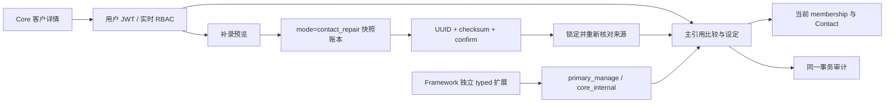
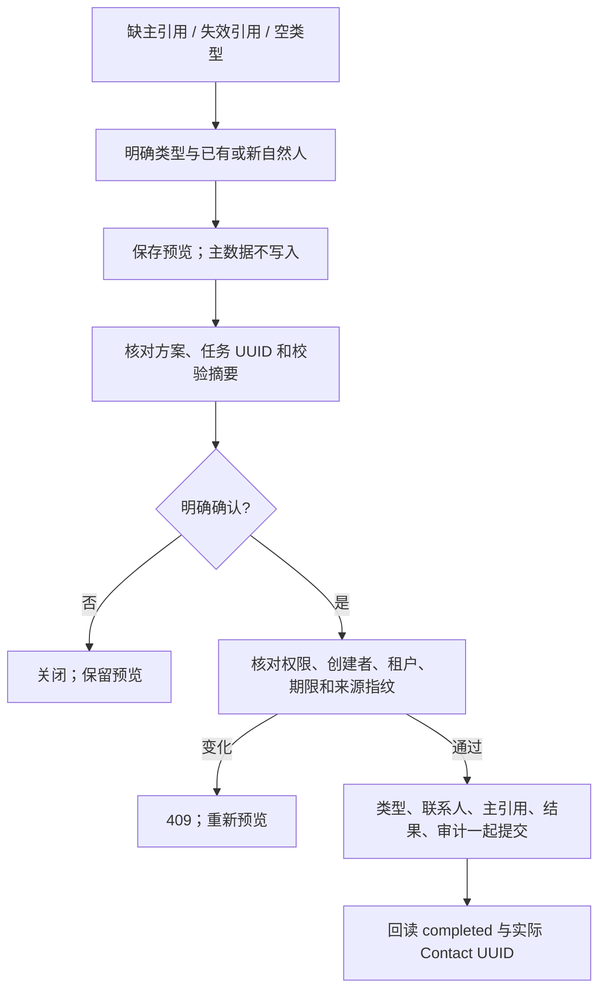
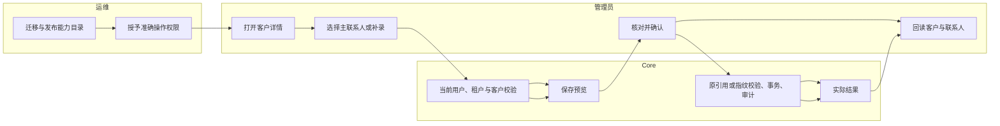

# Core 主联系人维护与存量补录

## 1. 背景与目标

Customer 是个人或企业主体；Contact 是自然人。主联系人以当前租户 membership 的 `primary_contact_uuid` 为权威。勾选普通角色不能替代引用更新，停用主联系人前必须更换引用。本流程还提供已有客户缺联系人、引用失效或类型为空时的显式补录。

## 2. 角色与范围

管理员使用用户 JWT 和独立 API 权限。Root 仍需有效用户及当前租户。补录只维护现有客户，不创建新 Customer 或登录身份。类型属于全局客户主体；主引用属于当前租户。公司必须选择或提供自然人，不用公司名生成联系人。

## 3. 模块关系



## 4. 核心流程



## 5. 跨角色流程



## 6. 前置条件

更新 Core 和 web-admin；执行集中迁移，使 `customer_account_imports.mode` 存在，旧行默认 `create`。能力发布不自动给用户或 API Key 新权限。

| 操作 | 精确权限 |
|---|---|
| 联系人列表 / 创建 | `customer.admin_customers_customer_uuid_contacts:read` / `:create` |
| 编辑 / 停用 | `customer.admin_customers_customer_uuid_contacts_contact_uuid:update` |
| 渠道读取 / 绑定 | `customer.admin_customers_customer_uuid_contacts_contact_uuid_identities:read` / `:create` |
| 渠道解析 | `customer.admin_customers_customer_uuid_contactsresolve_identity:create` |
| 设主 | `customer.admin_customers_customer_uuid_contacts_contact_uuid_primary:create` |
| 补录预览 | `customer.admin_customers_contact_repairs_preview:create` |
| 补录回读 | `customer.admin_customers_contact_repairs_repair_uuid:read` |
| 补录确认 | `customer.admin_customers_contact_repairs_repair_uuid_commit:create` |

菜单 `menu.customer:view` 只提供入口。API Key/STS 不可访问 Admin 路由；Framework 使用固定 `core://customer/contacts`，独立 `primary_manage` grant。

## 7. 操作步骤

### 页面设主

1. **客户管理 → 客户详情 → 联系人**，选择另一位 `active` 联系人，点击“设为主联系人”。目标必须属于本客户及当前租户。
2. 核对姓名并确认。页面提交回读的原引用；引用已变化时显示 `CONTACT_PRIMARY_CHANGED` 和请求 ID，刷新再确认。
3. 回读主要标记和 `primary_contact_uuid`，再停用原主联系人。当前主联系人的停用按钮不可用，接口也拒绝。

### 页面补录

1. 缺失资料的客户详情点击“补录客户主联系人”。确认 `person/company`；已有类型不能修改。选择本客户有效联系人，或明确填写自然人资料。
2. 点击预览，核对具体方案、任务 UUID、校验摘要、类型与联系人。姓名为 1–128 个 Unicode 字符，控制字符不允许。企业无联系人时必填自然人姓名。
3. 勾选明确确认后执行。成功显示 `completed` 和实际 Contact UUID；刷新客户详情验证引用。预览 UUID 留在 URL 的 `repair_uuid` 中，原创建者可重新打开回读。
4. `SOURCE_CHANGED/EXPIRED` 需要新建预览；事务失败则回读原 UUID/checksum 后重试。跨租户、跨创建者或 CSV 任务 UUID 返回 404。

### 正式 API

完整 DTO、HTTP 状态与权限见 [OpenAPI](../../../contracts/customer-contact-maintenance.openapi.yaml)。

```json
{"customer_uuid":"22222222-2222-4222-8222-222222222222","type":"company","primary_contact":{"display_name":"Jane","email":"jane@example.test"}}
```

提交到 `POST /api/v1/admin/customers/contact-repairs/preview` 后，使用响应 `uuid/checksum` 提交：

```json
{"checksum":"<preview checksum>","confirm":true}
```

确认路径为 `POST .../contact-repairs/{uuid}/commit`，回读 `GET .../contact-repairs/{uuid}`。设主路径 `POST .../{customer_uuid}/contacts/{contact_uuid}/primary` 必须明确传 `expected_primary_contact_uuid`；当前无引用时传空字符串。

### 本机部署命令

从 Core 仓库根，使用目标实例的既有配置。先备份；旧实例镜像升级遵循正式升级合同，禁止重新 Setup 或整套 seed。

```bash
cd backend && go run ./cmd/database migrate --config etc/config.yaml
```

从 Core 仓库根发布目录：

```bash
make capability-check && make capability-seed
```

然后由使用者重启自己的后台 `make dev`，刷新前端；生产部署按该实例运行方式重启。CLI 固定目标配置，远程实例不能使用本机默认配置。

## 8. 验收

主引用与标签一致；更换后原联系人可停用；停用与设主并发不会留下 inactive 主引用。预览不写主数据，确认保留客户 UUID、只创建或复用所选 Contact，重复确认不重复创建。切租户/客户清除旧数据、弹窗、表单、字典和恢复链接，迟到响应无效。普通用户须验证各个按钮及后端拒绝行为。

本机证据见 [2026-10-11 验证记录](../../../contracts/repairs/customer-contact-maintenance-20261011.md)。生产浏览器及 Core 客户 → AI Craft 选择 → 保存订单为独立部署验收，尚未因单元或数据库测试完成。

## 9. 代码定位

| 文件 | 职责 |
|---|---|
| `primary_contact_service.go` / `contact_repository.go` | membership 锁、原引用比较、角色归一、审计 |
| `contact_service.go` / `contact_admin_access.go` | 停用保护、角色限制、实时操作授权 |
| `field_validation.go` / `model/customer/validation.go` | 统一 Unicode 校验 |
| `contact_repair_service.go` / `account_import_gorm.go` | 预览、指纹、账本模式、幂等确认 |
| `contact_handler.go` / `contact_repair_handler.go` | 正式 HTTP 合同 |
| `contact_core_binding.go` / `capability_invoker.go` / `customer.yaml` | 固定 typed primary 操作及双授权平面 |
| `customers/[customer_uuid].vue` / `CustomerContactRepairModal.vue` | 隔离、权限、设主与补录 UI |
| `contact_maintenance_test.go` / `import_handler_test.go` / `customer-detail.spec.ts` | 回滚、冲突、Unicode、PostgreSQL 和页面隔离 |

## 10. 排障

| 信号 | 处理 |
|---|---|
| `CONTACT_PRIMARY_OPERATION_REQUIRED` | 删除普通创建中的 primary；使用正式设主操作。编辑当前主联系人时保留 primary。 |
| `CONTACT_PRIMARY_CHANGE_REQUIRED` | 先更换主引用，再停用。 |
| `CONTACT_REPAIR_AMBIGUOUS` | 从当前客户 active 联系人中明确选择，不能猜测。 |
| 403 | 核对当前租户、用户会话、准确操作权限、有效角色及实时状态。 |
| 503 | 确认集中迁移和审计表；保存错误码与 Trace，不再次 Setup。 |
| Host `CAPABILITY_UNKNOWN` | 发布目录；`not_granted` 则给准确服务能力授权，不给宽泛 Admin 权限。 |

## 11. 回滚

停用新增操作或撤销准确授权即可阻止后续写入。保留主数据、补录账本和审计；无自动删除联系人或逆转引用。正确引用可通过新一次带原引用的设主操作更换。正式数据库回滚遵守升级备份规则。

## 12. 变更记录

2026-10-11：Core 主引用完整性、详情页租户/客户隔离与操作授权、共享字段校验、显式历史补录和 Framework primary 管理合同。
