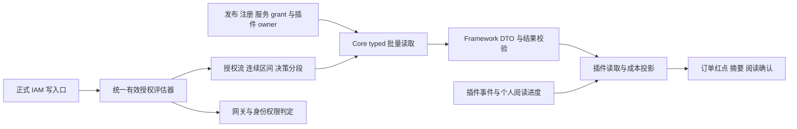
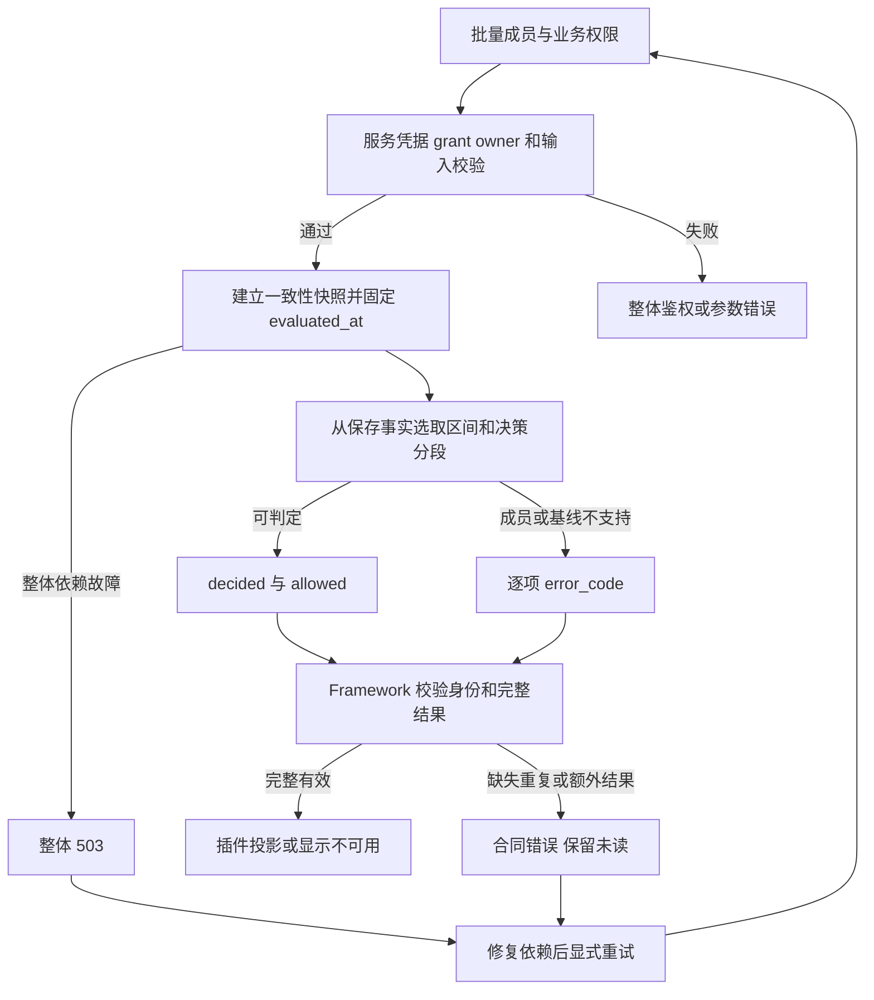
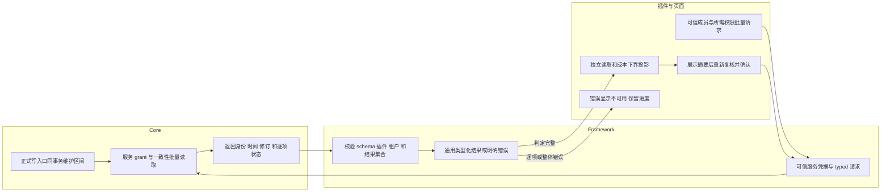
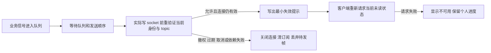

# IAM 连续授权基线跨仓实施指导

版本：1.3。日期：2026-10-19。状态：`core_source_implemented`；本版修正全租户自动追踪生命周期，远程安装态验收待完成。Framework／插件历史实施状态以各仓证据为准。

本文是 Core、Framework 与插件共同使用的权威实施合同。Core 提供区间账本、同事务维护、typed 批量能力、正式 schema，以及所有适用租户的自动追踪。Core 授权追踪与插件业务启用分开管理；普通部署不再要求逐租户显式 apply 或插件 guard。第 12 节保留带日期的历史交付证据；源码测试不代表安装态可用。

权威正文保存在 Core 的 `docs/guides/features/iam-authorization-baseline/guide.md`。Framework 和插件侧只维护指向本文的入口及各自实施证据。跨仓相对链接适用于当前工作区目录；独立检出时按仓库名和仓库内路径查阅，不复制正文形成第二套合同。

状态校准：`design_only` 对应初版 1.0；本次 Core 源码交付后已更新为上述状态。IAM 基线源码完成与实时接入完整交付分别验收，不能用任一方的完成状态替代另一方；原有 B01–B18 保留，本版新增 B19–B24。

## 1 功能背景与目标

AI Craft 的小样、大货订单变更提示按成员独立记录已读。新获读取权限的成员只提示授权后的变化；成本权限独立控制成本变化的可见性。该功能需要可靠的提示下界及授权修订，当前权限集合、JWT 签发时间和首次访问时间均不能代替。

Core 负责成员对插件业务权限的授权事实，Framework 负责通用 typed 访问与校验，插件负责订单事件、字段投影、未读和阅读确认。Core 请求与存储不包含订单、轮次、工序或内容版本。

当前代码依据：RoleBinding 有可选有效期但没有完整历史；`authorization:check` 限于 `iam.member/read`；身份 `PolicyVersion` 基于当前集合。插件现有 `order_content_authorization.v1` 以非空 `GrantedAt` 过滤事件，必须随本方案升级，不能仅新增 Core 接口。

## 2 角色与适用范围

| 角色或仓库 | 本次责任 | 交付边界 |
|---|---|---|
| Core IAM 与网关研发 | 统一评估器、授权事实与区间、并发协议、只读能力及精确授权 | 授权写入和事实维护同事务；所有读取路径采用正式映射 |
| PowerXPlugin Framework 研发 | 通用 DTO、批量读取、可信模式装配、信封与完整性校验 | Go 及适用的 .NET 客户端保持合同一致；不依赖 Core 数据库表 |
| AI Craft 研发 | v2 阅读合同、读取与成本投影、页面不可用状态、后台投递 | 不直查宿主 IAM；不解析自由 Gateway 对象；不因失败切换 local |
| QA 与运维 | 初始化、真实 API Key/STS 授权及安装态验收 | 源码、隔离数据库、真实宿主和生产证据分别记录 |

首期登记以下正式业务权限，归属插件 `com.powerx.plugins.ai-craft`：

| 场景 | 业务权限码 | 基线支持范围 |
|---|---|---|
| 小样订单读取 | `production.sample_track:read` | 无附加条件的 `TENANT` |
| 大货订单读取 | `production.bulk_order:read` | 无附加条件的 `TENANT` |
| 成本字段读取 | `operations.business_dashboard.cost:read` | 无附加条件的 `TENANT`，起点独立 |

权限通过正式插件权限元数据及基线登记注册；通用 Core 服务不得按插件 ID 或上述业务码编写专用分支。只维护登记权限及受影响成员，不预生成所有成员与全平台权限的笛卡尔积，不按订单建授权行。

新基线能力只支持 TENANT，不得据此裁掉或扩大网关原有组织、本人等范围。Root 无有效成员时拒绝个人阅读；有有效成员时，Core 从实时 Root 身份派生内置系统 `root` 角色来源，与普通成员授权共用目录、决策和连续区间；不需要额外业务角色，不扩大 `role_admin`。该角色由 Core 管理，不能人工配置。旧数据或不完整目录仅剩全局旁路时仍返回基线不支持，不返回普通 `allowed=false`。

## 3 整体架构与模块关系



### 3.1 数据与身份定义

授权流唯一键为 `tenant_uuid + plugin_id + member_uuid + permission_code + scope_fingerprint`。范围指纹由 Core 对规范化的范围、维度、对象及条件计算并版本化；调用方不能指定或制造它。相同范围才可以合并连续区间。

| 概念 | 语义及约束 |
|---|---|
| 跟踪登记 | 权限归属、获准查询范围、支持的数据范围、初始化状态及可靠覆盖起点 |
| 授权流 | 某唯一键的授权事实；撤权后保留，不删除并重建修订计数 |
| `epoch_id` | 连续可访问区间身份；重叠来源变化不改变它；全部撤权后重授产生新身份 |
| `fact_revision` | 正式事实发生真实变更时单调递增；幂等重放及无实际变化的覆盖写不递增 |
| `decision_segment_id` | 当前判定分段身份；由保存的来源、限制及定时边界确定，可存储或确定性推导 |
| `authorization_revision` | 由合同版本、授权流事实修订、epoch、决策分段和范围构成的不透明版本；客户端只比较相等性 |
| `valid_until` | 按当前已保存事实，当前连续授权区间的已知结束时间；无已知结束为 null，不保证未来不会被提前撤销 |
| `recheck_at` | 当前评估后，下一个可能改变判定或修订的已保存边界；无已知边界为 null |

Core 物理模型为 `iam_authorization_tracking`、`iam_authorization_streams`、`iam_authorization_segments`。epoch 身份保存在同一连续区间的各分段中，不另设 epoch 表；分段 UUID 对应 decision_segment_id，epoch_uuid 对应 epoch_id。流唯一索引包含租户、插件、成员、业务权限与范围指纹；源写入共同门闩串行化同事务重算，保证分段不重叠及修订不复用。查询额外检查重复分段、重复流和无效保存状态，发现缺口返回不可用，不以可变当前行覆盖历史。

连续区间统一采用 `[start, end)`。同范围的有效授权求并集，首尾相接视为连续；间接授权路径先对角色绑定、成员关系等有效期求交，再参与正式合并。拒绝和条件必须参与统一评估，不能对 allow 无条件求并集。

| 时间段 | 有效来源 | epoch | 决策分段 | 连续起点 |
|---|---|---|---|---|
| 10:00 至 10:30 | A | E1 | S1 | 10:00 |
| 10:30 至 11:00 | A、B | E1 | S2 | 10:00 |
| 11:00 至 12:00 | B | E1 | S3 | 10:00 |

上述示例在 10:30、11:00 改变修订，epoch 保持 E1；`valid_until=12:00`，`recheck_at` 随当前分段前进。不能将查询时间或定时任务执行时间加入修订，不能在任务重放时重新生成已有分段身份。

### 3.2 起点来源和提示下界

| 字段 | 目标合同含义 |
|---|---|
| `baseline_kind` | `native` 为新合同记录的真实授权；`reconstructed` 为可信历史重建；`initialized` 为明确初始化 |
| `granted_at` | 可信的真实连续授权起点；未知必须为 null |
| `known_since` | Core 可可靠覆盖该授权历史的起点 |
| `visible_since` | Core 授权基线可供消费者采用的事件提示下界，必须可靠；不包含订单或插件功能启用概念 |

初始化已有有效授权时：`baseline_kind=initialized`、`granted_at=null`、`known_since=T0`、`visible_since=T0`。这是可使用的初始化基线；未知真实起点不等于基线不可用。只有可靠提示下界也无法提供时，才返回基线不可用。

若过去分段因范围或条件无法判定，之后恢复可判定 allow，也不能证明该时刻是真实连续授权起点。Core 保留历史不确定性，逐项返回 `IAM_BASELINE_UNAVAILABLE`，直到有一次确定的成员权限撤销／禁用再重授，或另行完成可信历史迁移；不自动填新 GrantedAt。未知未来边界仅作为 recheck_at，不能冒称已知连续结束的 valid_until。

native/reconstructed 的 `visible_since` 不早于真实起点及可靠覆盖起点。保留 initialized epoch 的重叠来源变更不能把它包装为 native；真实撤权后重授才产生具有真实起点的新 epoch。

### 3.3 生命周期和授权范围

| 变化 | epoch 和起点处理 |
|---|---|
| 首次授权或全部撤销后重授 | 新 epoch；真实起点为本次生效时间 |
| 重叠来源增加或部分移除，访问连续 | 保留 epoch 和起点；真实事实变化更新修订 |
| 成员或账号禁用、删除后恢复 | 关闭旧区间；恢复时有权限则创建新区间 |
| 管理员停用租户、插件实例或权限后恢复 | 关闭旧区间；恢复时有权限则创建新区间 |
| JWT 登录或刷新、STS 刷新、服务 key 轮换或服务 grant 变化 | 不改变成员业务授权 epoch；服务面仍独立鉴权 |
| 服务停机或网络不可达 | 不改变 epoch；按保存的时间事实判定 |
| 仅显示名称等不影响授权的变更 | 不改变 epoch 或判定修订 |

新写入授权即使 `start_at` 位于过去，也不能追溯制造历史授权；真实生效不早于该正式写入的生效时刻。可信历史重建使用独立、显式流程。

存在完整无条件 TENANT 来源时，仍须按正式规则处理适用拒绝与限制。只有受限范围时返回 `IAM_BASELINE_UNSUPPORTED_SCOPE`；无法正确计算的条件或策略返回 `IAM_BASELINE_UNSUPPORTED_POLICY`。不能静默忽略限制。共享来源解析保留绑定的范围、条件、有效期及间接关系。新基线采用 TENANT deny 优先；存在条件策略、受限 deny 或仅受限 allow 时分别明确报不支持。网关保留既有范围处理入口，不把基线的 TENANT 限制套给所有网关功能。

## 4 核心流程



### 4.1 正式写入与并发协议

固定顺序为：锁定相关授权源或共同写入门闩 → 枚举完整受影响集合 → 按唯一键固定顺序锁定或创建授权流 → 同事务修改事实、重算区间与分段、更新修订 → 提交。所有相关入口共用这一协议。

共同锁必须在枚举前取得，并覆盖尚不存在的关系。修改角色权限与新增角色成员必须争用同一共同锁；组织角色绑定与新增组织成员同理。首期实际采用 PostgreSQL 平台级事务 advisory lock `704983720161015`，覆盖共享权限目录及尚不存在的成员关系；取得门闩后重算所有已登记权限的流。这个粒度偏保守，IAM 写入吞吐是扩展租户级分片锁前的性能验收项。源写入使用 READ COMMITTED；其他隔离级别明确拒绝。数据库冲突令整个事务失败，由原命令幂等重试，不在中间步骤局部重试。

至少接入：角色绑定/解绑、角色权限增删和角色删除、组织/团队/岗位/组成员关系、成员/账号状态、租户/插件启停、权限状态和插件权限映射，以及正式导入、同步、默认授予等能影响这三项权限的旁路写入口。成员部门展示关系不应被误当成实际参与授权的 Assignment，须沿真实判定链枚举。

事务内临时删除再重建按最终事实比较，不能制造短暂撤权。任一事实维护失败必须整体回滚，不能先返回授权写入成功再异步补起点。所有查询使用同一事务句柄，不能在事务内调用持有外部 DB 的仓储绕出事务。

### 4.2 保存未来区间与定时边界

写入时保存由当前正式事实推导的未来区间和内部判定边界。修改计划只调整尚未生效的未来事实，保留已发生历史；新的变更从本次正式生效边界开始计算。

GET 和 typed 读取仅按快照中的保存事实与 `evaluated_at` 选择区间，不写库、不初始化、不修复。定时任务只负责缓存失效、通知和巡检。停机期间先到期、后重授，即使期间无人访问，恢复查询也必须选到新 epoch。相同时间发生结束与开始时按合并后的整体结果判定，不按任务执行顺序制造间断。

### 4.3 批量快照和时间语义

整批成员、读取权限、成本权限、区间与修订来自同一个一致性数据库快照或等价机制；不能仅给多次独立读取贴相同时间标签。凭据 grant 与 owner 的校验顺序仍遵守现有服务授权规则。授权事实读取使用权威库，不使用无法证明满足该快照要求的延迟副本。

首期按服务端记录的事件时间与提示下界作严格 `event_at > visible_since` 比较；相等时不提示。**不保证跨数据库事务提交的全局先后顺序。** 授权时间记录后等待提交、插件事件先提交等情况，均按记录时间比较；这是首期业务验收边界。

目标时间合同为 UTC、微秒精度，传输格式为 `YYYY-MM-DDTHH:mm:ss.ffffffZ`。原毫秒事实精确转换，不制造额外精度；新的两端写入在存储前按同一规则定为微秒。Framework 保留合同精度，拒绝非合同时间格式，不能单方截断、四舍五入或改成 `>=`。时间源及同步状态纳入上线检查；时钟偏差用例验证声明行为，不证明提交全序。

阅读确认以本次 Core 一致性快照中可见的已提交授权事实为准；之后发生的撤权不追溯该次已受理确认。该结果仅用于当前确认请求，处理超时后必须重新复核，不能复用打开摘要时的旧判定。

## 5 跨角色协作流程



Core 的服务调用许可与被查询成员的业务权限分别判断。有查询能力不代表成员有订单权限；用户 JWT/RBAC 也不能代替服务 grant。Core 自动建立授权追踪；插件须读取可靠结果后，在自己的受控事务内启用通知，不能以自动追踪替代业务历史检查。

## 6 前置条件与依赖

### 6.1 目标服务能力

| 字段 | 目标值 |
|---|---|
| capability_id | `com.corex.iam.authorization_baseline.service_read` |
| permission_code | `corex.iam.authorization_baseline:read` |
| channel / endpoint / method | `core_internal` / `core://iam/authorization-baseline` / `INVOKE` |
| operation | `read_member_baselines` |
| actor_context / resource_scope | `service_actor` / `tenant` |
| auth_type / agent_usable / risk_level | `api_key_or_sts` / `false` / `high` |
| API key scope | `_scope.iam.authorization_baseline.service_read` |
| API key action / resource_type / resource_pattern | `read` / `capability` / `iam_authorization_baseline_read` |

正式声明、typed invoker、schema、注册、发布和服务授权检查必须一起交付。API-key permission 必须具有 `allow_api_key=true`、`api_key_explicit=true`。首期不新增管理员诊断接口；以后若增加，同一 capability 合同补充 `admin_user + user_jwt + RBAC` binding。

STS 插件身份取已验证 token；API key 必须由本能力的 owner 与精确有效 grant 唯一确定插件，多候选返回整体鉴权错误。不能取第一个 owner，也不能借另一项能力的 owner 推导。Framework 核对返回插件等于自身配置插件，并核对可信租户。无效凭据、未发布、无租户注册、无有效 grant 或身份不唯一均不得调用。

### 6.2 请求和批量边界

目标请求 schema 为 `powerx.iam.authorization-baseline-query/v1`。UUID 必须有效且非零；规范化后重复也视为重复。成员数量 1 至 100、权限数量 1 至 10，组合总数最多 1,000；未知字段、重复、空数组、超限及任何未登记或不属于当前插件获准查询范围的权限使整体请求失败。

下例是写入本地 `baseline-query.json` 的完整 Registry invocation 请求，目标能力实现后使用：

```json
{
  "capability_id": "com.corex.iam.authorization_baseline.service_read",
  "preferred_protocol": "core_internal",
  "payload": {
    "body": {
      "operation": "read_member_baselines",
      "request": {
        "schema": "powerx.iam.authorization-baseline-query/v1",
        "member_uuids": ["10000000-0000-4000-8000-000000000001"],
        "permission_codes": [
          "production.sample_track:read",
          "operations.business_dashboard.cost:read"
        ]
      }
    }
  }
}
```

业务 DTO 不接收 tenant、plugin、角色、权限快照、URL、HTTP method、headers、query 或 raw proxy payload。Registry 从正式 binding 选择固定入口，未知 operation 及旧自由代理格式明确失败。

### 6.3 响应和错误

目标结果 schema 为 `powerx.iam.authorization-baseline-result/v1`。以下是 typed invoker 的业务输出；HTTP 外层沿用现有 Registry invocation 信封，Framework 按既有 transport 解封后校验 `result`，不能把下例当成裸 HTTP 信封：

```json
{
  "result": {
    "schema": "powerx.iam.authorization-baseline-result/v1",
    "tenant_uuid": "20000000-0000-4000-8000-000000000001",
    "plugin_id": "com.powerx.plugins.ai-craft",
    "evaluated_at": "2026-10-15T02:15:00.000000Z",
    "items": [
      {
        "member_uuid": "10000000-0000-4000-8000-000000000001",
        "permission_code": "production.sample_track:read",
        "status": "decided",
        "allowed": true,
        "baseline_kind": "initialized",
        "granted_at": null,
        "known_since": "2026-10-15T02:00:00.000000Z",
        "visible_since": "2026-10-15T02:00:00.000000Z",
        "authorization_revision": "opaque-read-revision",
        "data_scope": "TENANT",
        "scope_fingerprint": "opaque-tenant-scope-fingerprint",
        "valid_until": "2026-10-15T06:00:00.000000Z",
        "recheck_at": "2026-10-15T03:00:00.000000Z"
      },
      {
        "member_uuid": "10000000-0000-4000-8000-000000000001",
        "permission_code": "operations.business_dashboard.cost:read",
        "status": "decided",
        "allowed": false,
        "authorization_revision": "opaque-cost-denied-revision",
        "data_scope": "TENANT",
        "scope_fingerprint": "opaque-tenant-scope-fingerprint",
        "granted_at": null,
        "visible_since": null,
        "valid_until": null,
        "recheck_at": null
      }
    ]
  }
}
```

`status=decided` 必须包含显式布尔 `allowed` 和非空修订。allowed 为 true 时必须具有可靠的 kind、known_since、visible_since 及 TENANT 范围；native/reconstructed 还必须有真实 granted_at。allowed 为 false 时不提供提示下界，修订仍能标识当前拒绝分段。

`status=error` 必须包含 `error_code`，禁止出现 `allowed`、可消费下界或伪造修订。例如：

```json
{
  "member_uuid": "10000000-0000-4000-8000-000000000001",
  "permission_code": "production.sample_track:read",
  "status": "error",
  "error_code": "IAM_BASELINE_UNAVAILABLE"
}
```

| 情况 | 目标行为及本能力错误码 |
|---|---|
| 格式、未知字段、重复、超限、未登记或越出插件查询范围 | 整体 400 `IAM_BASELINE_INVALID_ARGUMENT`，不返回部分结果 |
| 无效服务凭据 | 整体 401；保留现有认证层机器码 |
| 缺 grant、未发布/注册、owner 不匹配或身份不唯一 | 整体 403；保留授权层机器码；本能力身份歧义为 `IAM_BASELINE_PLUGIN_AMBIGUOUS` |
| 整体数据库或依赖故障 | 整体 503 `IAM_BASELINE_DEPENDENCY_UNAVAILABLE` |
| 成员不存在、已删除或跨租户 | 对应全部成员/权限组合为 `IAM_BASELINE_MEMBER_UNAVAILABLE`，三者同码同结构 |
| 成员或账号已禁用，身份关系仍有效 | 正常 decided / allowed=false |
| 基线不可靠或登记尚未完成初始化 | 逐项 `IAM_BASELINE_UNAVAILABLE` |
| 范围、条件或仅 Root 旁路不能表达 | 逐项 `IAM_BASELINE_UNSUPPORTED_SCOPE` / `IAM_BASELINE_UNSUPPORTED_POLICY` / `IAM_BASELINE_ROOT_BYPASS_UNSUPPORTED` |
| 确认没有业务权限 | 正常 decided / allowed=false |

整体可返回结果时，每个请求成员与权限组合必须恰好一项，错误也占该组合一项；顺序不作为关联依据。Framework 对遗漏、重复、额外组合、错误分支携带 allowed、缺必要时间/修订、身份或 schema 不匹配，统一视为合同失败，不消费部分响应。这些错误码已在 Core 服务及 Registry HTTP 错误桥接中实现；运行中的旧二进制需重新编译后才会返回新行为。

### 6.4 模式和配置边界

复用可信启动期 ProviderMode 及已有 Gateway/STS 凭据配置，不能由浏览器切换 provider。首期授权基线不做跨请求缓存，仅允许同一请求内共享同一次批量结果；用户会话与服务授权失败分别处理，不因服务 403 让用户反复登录。

Core 的跟踪登记缺行代表 uninitialized；正常迁移、启动及授权源提交在单一事务内补齐 ready 与初始快照，失败整体回滚。已有异常或 blocked 记录不被自动重置。插件自己的 blocked 与业务启用切点由插件持久化，Core 不修改插件数据。流程见第 7.2 节。本次能力不新增管理员页面或 Admin REST 面，因此合同仅声明 service_actor 面；以后增加管理员接口时须在同一正式能力合同中补充 admin_user + JWT + RBAC。

### 6.5 完整实时接入的依赖与启用门禁

以下是既有能力与新增基线能力的组合，不合并为一个宽泛 IAM 管理授权：

| 用途 | 正式能力或入口 | 启用检查 |
|---|---|---|
| 成员业务权限基线 | `com.corex.iam.authorization_baseline.service_read`，固定 typed operation 见第 6.1 节 | 当前可信租户／插件的批量 provider 已绑定；能力已发布、租户已注册、服务有精确 grant |
| delegated worker 分页成员目录 | 现有 `DirectoryService.ListMembersPage`；Core `GET /api/v1/tenant/iam/members?page=...&page_size=...`，当前归属 `com.corex.iam.directory.read` | 目录 service grant 独立有效；页大小不超过 200。`com.corex.iam.members.read` 目前只覆盖按 UUID 获取／batch-get，不能替代分页目录授权 |
| WS 当前身份与 topic | `WSIdentityRevalidationService`／`IdentityLifecycle`；`com.corex.iam.identity_context.service_read` 的 typed `revalidate_ws_identity` | Registry 可取得当前模式的身份服务；delegated 可从 Core 取得并复核服务端 handle；topic descriptor 和成员归属匹配 |
| 依赖授权诊断 | `POST /api/v1/tenant/capabilities:grant-status` | 该诊断自身的 `com.corex.capabilities.grant_status.read` 授权独立检查；诊断失败不视为已获授 |

Framework 的 Bundle、Registry 获取入口、delegated adapter／Host client、Skeleton Deps 与 bootstrap 必须贯通新批量基线接口，不能只新增 DTO 或独立 client。功能关闭时保留既有 IAM Bundle 的正常使用；启用功能时，缺少新 provider、可信插件身份、required capability 声明或有效服务 grant，应明确拒绝启用／显示不可用。启动检查不替代每次调用的 live grant 校验，运行中撤销仍须生效。

local v2 provider 由插件注入，Framework 不保存授权历史、不推测起点；local 也需满足相同时间、修订与错误合同。模板不得内置“所有成员默认有权限”的 local baseline。delegated 所需的基线、目录、身份服务分别检查；不得因为缺服务 grant 而切换到插件本地 IAM。分页目录当前正式 REST binding 的复用及是否需收敛 typed binding 纳入 C06 治理核查，涉及合同变化时先补正式声明、invoker、schema、精确 grant 和验收，不猜新 capability ID 或借 Admin 权限。

## 7 操作步骤

以下为跨仓实施及目标环境验收步骤。Core 源码已实现 C01–C05；C06 及 Framework／插件的消费验收须按各仓当前证据核实。目标库迁移、插件权限标记与同步、实际服务授权和运行版本须按环境核验；Core 授权追踪由生命周期自动完成，不再增加逐租户初始化步骤。

### 7.1 分仓实施任务

| 顺序与任务 | 动作及入口 | 预期结果 | 失败处理 |
|---|---|---|---|
| C01 统一评估器 | Core IAM、网关及插件身份真实判定路径 | 共享正式业务映射，保留完整范围与限制；新能力仅输出支持范围 | 差异形成回归用例，禁止复制另一套查询 |
| C02 数据模型 | Core 集中 migration 与 IAM repository | 唯一流、epoch、分段、未来边界和可靠来源；无自动业务初始化副作用 | 迁移回滚或停止发布，不删旧事实 |
| C03 写入协议 | 全部正式授权源及状态写入口 | 共同锁先于枚举，事实和投影原子更新，幂等有界重试 | 整体事务回滚；补齐旁路写入口 |
| C04 初始化流程 | 迁移、正常启动和正式源事务统一补齐所有适用租户 | 同一并发边界内建立 T0 与快照、切换 ready；已有记录不重置 | 事务失败回滚；GET 与恢复只读启动不写入；异常旧账本独立修复 |
| C05 服务能力 | typed invoker、formal capability、schema、grant 校验 | 按第 6 节批量返回；固定 binding，拒绝自由代理 | 暴露明确失败；不靠 YAML 冒充实现 |
| C06 组合依赖与授权核查 | Core 正式 IAM directory、identity-context 合同与第 6.5 节真实服务凭据 | 分页目录、基线、WS 身份各自 binding／注册／grant 可用；核定目录最小授权与 typed 治理边界 | 合同缺口单独补齐；不误用 members.read 或 Admin 管理权限，不标完整实时接入已完成 |
| F01 通用批量合同 | Framework Go IAM，适用的 .NET IAM 同步 | `ReadMemberBaselines` 或语言等价接口；nullable 真实起点、分支结果与精度一致 | 缺失能力明确不可用，不映射到旧 AuthorizationDecision |
| F02 transport、Registry／Bundle 与 bootstrap | 共享 Registry transport、IAM Registry／Bundle 获取入口、delegated Host client、Skeleton Deps／bootstrap 和启用门禁 | 精确服务凭据、完整结果校验、取消及错误透传；功能启用时验证 provider 绑定、required capabilities 和 live grant；local provider 由插件注入 | 缺任一依赖明确拒绝启用；无自动 local fallback，不新增权限推测 |
| F03 模板与生成产物 | Skeleton → scaffold → CLI 内嵌模板、模板同步脚本及新生成的 Go Gin 插件 | Bundle／Deps、bootstrap、服务依赖声明与 WS 发送修复完整同步；生成插件实际编译并验证绑定、拒绝和发送场景 | 同步检查失败或生成物仍沿用旧逻辑即不通过；不得只以 Framework 包测试替代 |
| F04 WS 最终发送 | `runtime/realtime/identity_lifecycle.go`、Skeleton `wsbus/handler.go` 的 `send` 及其模板 | 每个业务下行帧在队列／发送锁等待后、实际写 socket 前复核当前身份和具体 topic；撤权、过期、取消、迟到结果关闭连接、清订阅、丢待发帧 | 拒绝或依赖故障均不发送；上游订阅／投递校验不能代替最后发送门禁 |
| P01 插件 v2 | `order_content_authorization.v2` 及本地/delegated provider | 独立读取与成本基线；使用 VisibleSince/CostsVisibleSince；旧零时间校验移除 | 明确拒绝旧格式，升级生产者与消费者，不做别名兼容 |
| P02 全链路投影与重连 | 列表 SQL、摘要分页、阅读令牌、确认、推送接收与重连处理 | 时间下界、范围、修订和错误语义一致；WS 仅触发重新读取；连接／重连／重新订阅均不确认已读；保留插件已有最终发送校验 | 不显示已读、不推进游标；topic 归属不能代替具体订单业务权限与成本投影 |
| P03 delegated worker | 插件 `order_content_delivery_worker.go`、provider 注入及接收人投递状态 | 移除构造函数的 local-only 限制；delegated 从宿主分页目录读候选成员、按最多 100 成员批量基线筛选；local 仅走插件注入的同合同 provider | delegated 禁止查询本地 IAM；页／批次／成员错误保留待处理，不把错误接收人或未完成枚举的事件标完成 |
| A01 三方联调 | 第 7.3 节与第 8 节 | API Key/STS、初始化及安装态矩阵有真实证据 | 维持功能不可用状态，定位对应责任仓 |
| A02 实时与生成插件联调 | 第 7.6–7.8 节、B19–B24 | 排队撤权阻断、重连不已读、跨分页筛选、生成产物真实执行均有证据 | 保留失败与待办；不以投递前授权、同步通过或 HTTP 健康检查替代 |

### 7.2 初始化与启用场景

Core 授权追踪是平台生命周期职责，覆盖所有适用租户，不按某个租户或 AI Craft 特判。适用条件为：租户有效、插件 `auth.credentials` 已启用、正式 Permission 为 active 且显式标记 `authorization_baseline: true`，并能通过共享业务权限映射获得权限码。

1. 正式迁移完成建表后、正常 Core 启动时，统一补齐已有租户的缺失追踪。后续新租户、插件启用或权限登记的正式源事务在提交前自动发现缺失组合。权限与插件哪个先登记都适用，不需要再次 migrate 或 seed。
2. 初始化与角色、成员等授权变更使用同一 PostgreSQL 事务级共同锁；取得锁后用数据库时间建立 T0、ready 和初始快照，维护失败连同源变更回滚，无快照与增量之间的缺口。
3. 仅补缺行。已有 known_since、初始化收据、epoch 和无实际变化的修订保持原样；异常旧记录不猜测修复。正常启动不会将外部 SQL 等绕过正式入口的来源漂移补记成刚发生的授权，既有流仍由读取报不可用。首次看到既有 allow 为 `initialized / granted_at=null / known_since=T0 / visible_since=T0`，首次看到 deny 仍为 deny。之后的正式新授权为 native，不追溯历史。
4. Core 不连接、清理或迁移插件事件库，不新增业务角色或扩大租户管理员授权、不放宽数据范围、不替插件启用通知。系统 `root` 目录由 Core 维护；其旧基线只有精确匹配旧算法指纹才从升级实际时间追加来源，保留已有起点、历史和连续授权窗口。正常 migrate 或启动自动完成，无需逐租户执行 seed。Core 自动收据由 Core 生成，`initialized_by=core.authorization-baseline`，不需要插件 prepare guard。
5. 插件独立读取 ready 结果，在内容事件共同控制边界内检查历史事件、个人游标和投递任务，持久化不早于所需基线的功能切点 Tc 后开放通知。发现待保留历史或失败时保持自己的 blocked／待启用状态，不移动已有切点、不隐藏旧数据。Core ready 不等于业务通知已启用，两库不宣称原子提交。

GET、typed 读取和 CLI 默认预检均只读；恢复 verify／hold 和 coordinator maintenance 启动跳过自动初始化。缺表时仍需正常 schema 迁移；部分账本表缺失时明确失败，不能静默恢复。Core 普通 migrate 现在负责通用授权初始快照，仍不承担插件事件清理或历史业务修复。

先由插件在正式 manifest 中对三项业务权限设置 `authorization_baseline: true`，经正常权限同步写入 IAM Permission.meta；不能仅在文档列出权限码。示例片段（保留插件现有协议绑定与其他元数据）：

```yaml
permissions:
  - module: production
    resource: sample_track
    actions: [read]
    type: action
    data_scope: TENANT
    authorization_baseline: true
```

`production.bulk_order:read` 和 `operations.business_dashboard.cost:read` 在各自已有权限声明上作相同标记。仅明确标记该插件已登记业务权限可查询；未标记返回整体 400。此标记不授予任何成员业务权限；正式权限同步事务会为适用租户自动建立缺失追踪。尚不满足条件或状态异常时，查询仍逐项返回 `IAM_BASELINE_UNAVAILABLE`。

在 Core 仓库根目录执行 schema 迁移（目标配置、权限和维护窗口须已经确定）：

```bash
cd backend
go run ./cmd/database migrate -config /absolute/path/to/target-config.yaml
```

从 Core 的 `backend` 目录预检，替换真实租户与插件身份：

```bash
go run ./cmd/authorization_baseline -config /absolute/path/to/target-config.yaml \
  -tenant '<tenant_uuid>' -plugin com.powerx.plugins.ai-craft \
  -permissions 'production.sample_track:read,production.bulk_order:read,operations.business_dashboard.cost:read'
```

正常部署到这里应读到各权限 ready 及各自 known_since，无需 `-apply`。未 ready 时检查运行 Core 版本、schema、租户／插件状态、正式权限标记及启动错误，不能要求用户逐租户向插件索取 guard 作为标准补救。

旧 CLI 的 `-apply` 保留为受控维护兼容入口，仍要求收据、操作者及两个显式确认参数，不能代替新生命周期。Core 自动记录被旧维护调用碰到时只复用原记录，不替换收据或 T0；旧人工记录仍按原 guard 幂等规则拒绝其他收据覆盖。异常历史修复须单独审查和验收。

首期生产实现支持 PostgreSQL；SQLite 仅用于单元测试。MySQL 等未实现并发协议的数据库明确拒绝初始化和基线读取，不可套用本次通过的 PostgreSQL 结论。`reconstructed` 是合同保留值，本次 CLI 只建立 initialized 基线，不提供历史重建或存量事件迁移工具。


### 7.3 服务授权和接口场景

动作：能力实现后，在 Core 仓库根目录执行静态检查；有对应目标配置及授权后再 seed。命令真实存在，但不能把运行成功等同于新能力端到端验收：

```bash
make capability-check
make capability-seed CAPABILITY_SEED_CONFIG=/absolute/path/to/target-config.yaml
```

预期：正式能力被发布并注册到目标租户。失败：检查声明、schema、真实 invoker 与目标配置，不运行全量 seed 掩盖问题。

动作：用实际开发 Host 服务凭据检查 grant。`POST /api/v1/tenant/capabilities:grant-status` 自身需要 `com.corex.capabilities.grant_status.read`；先将 `{"capability_ids":["com.corex.iam.authorization_baseline.service_read"]}` 保存为 `baseline-grant-query.json`。从安全渠道设置已有环境变量 `POWERX_API_ORIGIN` 和短期 `POWERX_SERVICE_TOKEN`，不把 token 写入文档、证据或 shell 历史：

```bash
curl --fail-with-body -sS -X POST "$POWERX_API_ORIGIN/api/v1/tenant/capabilities:grant-status" -H "Authorization: Bearer $POWERX_SERVICE_TOKEN" -H 'Content-Type: application/json' --data-binary @baseline-grant-query.json
curl --fail-with-body -sS -X POST "$POWERX_API_ORIGIN/api/v1/tenant/invocations" -H "Authorization: Bearer $POWERX_SERVICE_TOKEN" -H 'Content-Type: application/json' --data-binary @baseline-query.json
```

预期：目标项明确 granted，typed 调用获得第 6 节完整结果；API Key 按 Framework 已配置的认证 scheme 单独重跑，不能用 STS 成功代替 API Key 证据。撤销精确 grant 后应 403。失败：检查真实凭据、owner、发布/注册和 grant，HTTP 200 的 grant-status 仍可能是 not_granted 或 unknown。

### 7.4 插件适配和页面场景

插件对每张订单组合读取与成本结果，并构造 `scope_revision`，覆盖身份、所需授权修订、范围、投影合同版本及插件启用切点。该版本不能只用 perms_hash，也不能仅包含 allowed 布尔值。

```text
普通变化下界 = max(读取权限.visible_since, 插件功能启用切点)
成本变化下界 = max(普通变化下界, 成本权限.visible_since)
```

成本下界只在成本判定 decided 且 allowed=true 时使用；确认无成本权限隐藏成本变化。成本判定 error 必须显示不可用，不能降级为无成本权限。相同成员、类型及权限的结果在当前页复用一次批量读取，不按订单逐条请求 Core。

动作：用普通有效成员打开插件“小样跟踪单”或“大货单”列表，另一成员修改公开备注，再打开变化摘要并确认已读。现有入口以插件当前菜单及页面为准，新增不可用反馈和确认文案由 P02 实现并走 locale。

预期：只有可见且晚于下界的变化出现红点；完整展示并确认后只推进当前成员进度；确认期间新版本保持未读。失败：列表显示不可用并保留进度，摘要/确认显示可重试错误，不把失败显示成已读。

动作：打开摘要后撤销再重授相同权限，用旧阅读令牌确认。预期：当前 Core 复核返回不同修订，旧令牌失败，重新读取摘要后才可确认。后台投递逐接收人处理；判定错误保留待处理及可观测失败，不标为完成。

### 7.5 本地联调场景

动作：先运行受影响包测试，再由开发者按仓库正常方式启动服务。以下测试路径当前存在，新增测试必须加入这些包或同步更新本节：

```bash
cd backend && go test ./internal/service/authorization_baseline ./pkg/corex/iam/authorizationbaseline ./internal/service/iam ./internal/service/plugin_identity ./internal/bootstrap ./internal/service/plugin ./internal/service/integration_gateway/apikeypermissions ./internal/transport/http/openapi/capability_registry ./pkg/corex/db/database
```

Framework 仓库：

```bash
cd framework/backend/go && go test ./iam/contracts ./iam/delegated ./iam/adapters
```

AI Craft 仓库：

```bash
cd backend && go test ./internal/services/admin/operations/ai_craft ./internal/domain/repository/operations ./internal/transport/http/admin/operations
```

Core 日常启动命令为仓库根目录 `make dev`，必须在迁移、目标配置和依赖已确认后由服务所有者执行；实现变更需重新编译/重启后再验收。插件 `make dev` 会带迁移副作用，不作为本指导默认联调命令。

以实际响应 Trace ID 关联 Core、Framework 与插件现有日志，记录快照时间、脱敏成员/权限组合、修订、分段、错误和处理结果；具体新增日志字段在实现时固定，不虚构已存在的指标。Agent 若临时启动服务，应记录命令、目录、PID、子进程及端口，交付前清理并确认释放，只能清理自己启动的进程。

### 7.6 WS 排队撤权与重连场景

当前核查事实：Skeleton 的订阅回调调用了 `lease.AuthorizeTopic`，但 `wsConn.send` 在取得 `sendMu` 后仅检查取消和过期，再调用 `WriteJSON`；等待发送锁期间发生的撤权可能越过前一次检查。AI Craft 的对应 `send` 已有事件发送前 `AuthorizeTopic` 和 local policy 检查，应保留并验证其关闭、取消及排队并发行为；不能把 Skeleton 缺口直接认定为插件也完全没有校验。

目标发送链路：



动作：订阅正确租户／成员 topic，将一帧业务信号阻塞在发送锁或测试发送门闩前；确认入队／投递前检查已经通过，再在 Core 提交该成员撤权，最后释放发送门闩。入口必须覆盖 Skeleton／模板生成插件的真实 `send → WriteJSON` 路径，而非仅调用 worker 或伪造订阅成功。

预期：最终发送位置复用 `WSIdentityRevalidationService`／`IdentityLifecycle`，按本次重验证可见的已提交身份事实检查当前身份、成员归属及具体 topic；撤权已经可见时，旧连接不再写出该帧，关闭并清理订阅及剩余待发帧。重验证后的取消、过期或本地生命周期撤销仍须在实际写前检查；迟到的成功结果不得恢复已关闭连接。topic 授权不代表某张订单业务权限；若 topic 策略不足以表达业务读取许可，插件发送适配器还须作对应业务校验。首期推送只携带重新读取所需的标识，不下发订单内容、成本明细、阅读令牌或身份 handle。

失败处理：重验证错误、超时或服务 503 均禁止发送，保留可定位错误和 Trace，并释放连接资源；不得沿用旧权限快照继续发送。测试应有可控发送门闩，明确记录撤权提交、末端重验证和实际写入的顺序。该保证针对最后判定点可见的事实，不宣称 Core 撤权提交与远端 socket 写入具备分布式原子性。

动作：让成员存在未读变化，断开网络后重连、重新认证和订阅，再恢复信号处理。预期：连接成功、订阅 ack、消息送达及页面刷新只重新读取当前未读状态，不调用阅读确认、不推进个人游标；离线期间的变化仍未读，打开摘要并按 v2 确认流程完成后才推进。失败时保留未读并提示重试，不能用重连成功显示“已读”。

### 7.7 Framework 装配与 delegated worker 场景

动作：在 Skeleton 及插件 bootstrap 从可信 ProviderMode 选择 Bundle，将新批量 provider 通过 Registry 获取入口和 Deps 注入消费者；功能启用前核对第 6.5 节依赖绑定、manifest required capabilities 和实际服务 grant。分别模拟缺 provider、缺 grant、错误插件身份及上游不可用。预期：明确拒绝启用或显示不可用；既有、未启用本功能的 IAM 使用不被无条件增加新接口要求。local provider 由插件注入；delegated 不回退 local，浏览器不能切换 provider。

动作：改造 `OrderContentDeliveryWorker` 的构造与运行依赖，在 delegated 模式启用一个超过 200 名候选成员的租户；通过 `DirectoryService.ListMembersPage` 持续分页读取宿主成员，按最多 100 成员拆成基线批次，合并同批事件所需的读取与成本权限，复用本轮有效批次结果，不按每个事件／订单／成员单独调用 Core。

预期：移除“非 local 就不构造 worker”的限制后，缺必要依赖应返回明确不可用状态。delegated 的租户来自可信安装／服务上下文，候选成员来自宿主目录，禁止读取插件本地 Tenant、Member、Role、Permission、RoleBinding 等 IAM 表来枚举或判定；本地业务事件、阅读游标和投递账本仍由插件保存。local 模式通过插件注入的目录与 local v2 provider 走同一 worker 接口，Framework 不承担其授权历史存储。

worker 按 v2 的读取／成本提示下界筛选接收人，并维持成员级幂等投递进度。确认 `allowed=false` 可作为本次不投递的正常结果；成员不可用、基线错误、目录页失败或发布失败保留失败／待处理，不能将错误接收人标完成。只有全部候选页已处理且所有接收人都有明确处理结果，才能按插件投递合同推进事件；枚举中断不得把尚未枚举的成员视为无权限。分页去重、续扫／重试和状态恢复必须有验收证据。各基线批次保持自身一致性快照，不声称多页目录与全部批次共享一个全局快照。

失败处理：保留成员／事件幂等记录并按有界策略重试；不得因部分成员成功而静默跳过失败成员。worker 授权筛选不替代第 7.6 节实际 WS 下行校验，WS 成功发布也不代表成员已读。

### 7.8 模板同步与生成插件场景

动作：Framework 完成 F02／F04 后，将 Skeleton 的 Bundle／Deps、bootstrap、required capabilities 及 WS handler 等受影响文件同步到 `scaffold/templates/backend/go-gin/` 和 `tools/cli/internal/templates/data/backend/go-gin/`；同步规则纳入 `scripts/template-sync-config.yaml`。在 PowerXPlugin 仓库执行：

```bash
npm run sync:templates -- --check
make build-px-plugin
```

再按 `tools/cli/README.md` 的 `px-plugin init <plugin-id>` 流程，用新构建的 CLI 在空临时输出目录生成 Go Gin 插件。为生成物注入测试 local v2 provider 和 delegated Host 客户端，分别验证“功能关闭”“启用且绑定完整”“启用但缺 grant／provider”三种状态，并在生成物上重跑 B19／B20。模板不提供插件业务权限的默认放行或虚构历史。

预期：同步检查无漂移，CLI 嵌入最新模板，生成物实际编译通过；Registry 可取得新基线接口、启用门禁及最终发送保护生效。失败处理：修复 Skeleton、scaffold、CLI 嵌入链及构建产物后重新生成验证，不能手改生成物掩盖模板缺口。本节是待交付任务，本轮文档补充未执行模板同步、CLI 构建或生成插件验收。

## 8 预期结果与验收标准

| 编号 | 场景 | 必须观察到的结果 |
|---|---|---|
| B01 | A 授权、B 重叠、移除 A | 起点和 epoch 不变；来源边界改变判定分段和修订 |
| B02 | 全部撤销后授予相同角色集合 | 新 epoch、新真实起点、新修订；旧令牌失效 |
| B03 | 定时任务停机，期间到期后重授 | 无查询写入，恢复直接返回正确新 epoch |
| B04 | 重叠内部边界、首尾相接与同一时刻批量边界 | 连续性正确；不按任务顺序制造中断；recheck_at 正确 |
| B05 | 幂等重放、同值保存、同事务删除重建 | 无新 epoch 或无效修订增长 |
| B06 | 修改角色权限与新增角色成员并发 | 两种提交顺序均无遗漏授权流 |
| B07 | 组织角色绑定与成员关系并发、禁用与恢复 | 共同锁覆盖新增关系；状态与区间原子一致 |
| B08 | 初始化与授权变更、内容事件写入并发及中途失败 | 无快照增量缺口，无检查后新增事件遗漏，状态可恢复 |
| B09 | 读取/成本并发改变 | 同一批次只见同一快照，不拼接不同事务状态 |
| B10 | 重复、遗漏、额外结果，error 携带 allowed，身份不匹配 | Framework 拒绝整份无效合同，不消费部分结果 |
| B11 | 成员缺失、已删除、跨租户 | 逐项同一种不可用错误，其他合法成员仍按合同返回 |
| B12 | 成本 deny 与成本 error | deny 隐藏成本；error 明确不可用，阅读和投递不推进 |
| B13 | 初始化真实起点未知 | granted_at=null 仍可使用可靠 visible_since；不伪装 native |
| B14 | 相同时间、微秒边界、.NET/Go 转换及跨服务时钟偏差 | 严格大于，精度保持；结果符合记录时间语义 |
| B15 | TENANT 与拒绝/限制混合、仅受限范围、Root 旁路 | 不越权；不支持与无权限正确区分；其他网关范围不回归 |
| B16 | API Key/STS 未授权、撤销、跨租户、owner 多候选或重绑定 | 精确拒绝；Framework 拒绝非自身插件结果 |
| B17 | 自由 URL/method/headers、旧 payload、未登记权限 | 明确参数或授权错误，不形成代理入口 |
| B18 | 旧摘要确认、新事件、跨成员/设备及列表批量 | 无越权、误清或逐订单 Core 调用；读取及确认均无初始化写入 |
| B19 | 业务信号通过投递／订阅检查并排队，释放发送锁前提交撤权 | 真实最终发送位置重验证看见撤权，旧连接不写出该帧；关闭、清订阅、丢待发帧；保留判定与发送顺序证据 |
| B20 | 未读状态下断线、重连、重新认证／订阅及消息补达 | 仅重新读取状态；无阅读确认请求、无游标推进，既有未读保持；成功阅读确认另走 v2 流程 |
| B21 | Registry／Bundle、Skeleton bootstrap 及功能启用 required grant 检查 | 新接口可经正式获取入口消费；缺 provider、grant 或身份不符明确拒绝；关闭功能兼容既有绑定，local 由插件注入，delegated 无回退 |
| B22 | Skeleton、scaffold、CLI 内嵌模板与全新生成插件 | 同步检查无漂移；新 CLI 生成物编译及启用／拒绝用例通过，并在生成物验证 B19／B20；不以模板文本相同替代运行证据 |
| B23 | delegated worker 跨至少两页目录、每页拆批、权限／成本混合及中途失败 | 宿主分页目录＋最多 100 成员批量基线；无本地 IAM 查询、无逐订单调用；页／成员错误不标完成，重试幂等并可恢复，读取／成本下界独立 |
| B24 | 最终发送重验证超时／503、等待中到期或取消、撤销后迟到成功 | 拒绝写帧且资源释放；迟到结果不恢复连接；保持未读，失败投递有可观测状态，不误称送达或已读 |
| B25 | 多租户旧环境升级、正常启动及重复执行 | 所有适用租户缺失追踪自动 ready；既有起点、收据、epoch 和无实际变更的修订不重置；不新增角色授权 |
| B26 | 新租户／插件启用／权限登记，两种登记顺序及与授权变更并发 | 同一源事务提交后可读；初始 allow 不伪造 GrantedAt；后续真实授予为 native；失败与源事务一起回滚 |
| B27 | 禁用租户／插件、未标记或废弃权限、只读恢复与普通查询 | 不生成不适用组合；只读路径无写入；异常旧记录不被自动洗成 ready；插件业务事件与游标保持原样 |

交付证据分层记录为源码/单元、隔离 PostgreSQL 并发与时间测试、Framework 合同、插件 UI、真实安装态 API Key、真实 STS、目标环境。每层保留命令、配置身份、时间、脱敏请求响应、Trace 和清理结果；未通过的层级不标完成。

## 9 代码实现映射

下表为本次 Core 已交付和 Framework/插件待适配的入口。源码、正式声明和运行证据分别记录，文件存在不替代真实宿主验收。

| 链路 | 当前仓库内位置 | 本次调整 |
|---|---|---|
| Core 绑定模型 | `backend/pkg/corex/db/persistence/model/iam/role_binding_gorm.go`、`member_assignment_gorm.go` | 有效期来源；新合同历史与分段单独维护 |
| Core 权限映射 | `backend/pkg/corex/iam/pluginpermission/code.go` | 保留共享映射，纳入完整评估器 |
| Core 网关 | `backend/internal/bootstrap/plugin_authz.go` | 对齐有效期、状态、范围及限制 |
| Core 身份 | `backend/pkg/corex/db/persistence/repository/iam/plugin_identity_repository.go`、`backend/internal/service/plugin_identity/service.go` | 复用评估器；现有 PolicyVersion 不替代新修订 |
| Core 正式写入 | `backend/internal/service/iam/rbac_service.go`、`member_service.go`、`permission_service.go`、`provisioning_service.go`，以及状态/插件同步入口 | 共同锁、完整影响集及同事务维护 |
| Core migration／正常启动 | `backend/pkg/corex/db/database/migration.go`、`backend/internal/bootstrap/authorization_baseline.go` | 建表后和正常启动自动补齐全部适用租户；只读恢复跳过；插件业务修复独立 |
| Core 自动追踪 | `backend/pkg/corex/iam/authorizationbaseline/bootstrap.go` | 通用发现缺失组合、Core 自有收据、原起点和授予不变；源事务提交也走相同路径 |
| Core 新账本 | `backend/pkg/corex/db/persistence/model/iam/authorization_baseline_gorm.go`、`repository/authorization/facts_repo.go` | 三张表和同快照来源读取 |
| Core 统一来源与区间 | `backend/pkg/corex/iam/authorizationbaseline/sources.go`、`timeline.go`、`ledger.go` | 共享业务映射、未来分段、连续 epoch 与事实修订 |
| Core 共同事务边界 | `backend/pkg/corex/iam/authorizationbaseline/transaction.go`、`backend/pkg/corex/db/database/connection.go` | 数据库工厂安装；GORM/Raw 源 DML 提交前维护；维护失败回滚；禁止绕过事务 |
| Core typed 服务 | `backend/internal/service/authorization_baseline/`、`backend/internal/app/shared/deps.go` | 读取、调用者识别、初始化及 invoker mux 装配 |
| Core 正式合同 | `backend/config/platform_capabilities/iam-authorization-baseline.yaml`、`specs/026-iam/contracts/authorization-baseline.openapi.yaml` | 固定 typed service_read 与显式 API key 元数据 |
| Core 初始化命令 | `backend/cmd/authorization_baseline/main.go` | 预检／状态、显式 apply、收据审计和幂等恢复 |
| Core API key 同步 | `backend/internal/service/integration_gateway/apikeypermissions/platform_capabilities.go`、`owner_service.go` | 精确新 scope、owner 唯一性 |
| Core Registry 入口 | `backend/internal/transport/http/openapi/capability_registry/routes.go` | 复用真实 invocations、grant-status 路由 |
| Core 实时组合依赖 | `backend/config/platform_capabilities/iam.yaml`、`plugin-request-identity.yaml` | C06：核查分页目录、WS 身份及基线的独立 binding／service grant；不借 Admin 权限 |
| Framework Go | `framework/backend/go/iam/contracts/`、`iam/delegated/`、`iam/adapters/` | 新通用批量接口、严格结果校验及模式装配 |
| Framework .NET | `framework/backend/dotnet/src/PowerXPlugin.Framework/IAM/` | 同等 nullable、精度、分支结果和身份校验 |
| Framework 获取与成员分页 | `framework/backend/go/iam/adapters/registry.go`、`iam/delegated/adapter.go`、`iam/delegated/core_client.go`（后两者同属 `framework/backend/go/`） | Bundle／Registry 暴露新接口；复用现有 `ListMembersPage`，不增加本地 IAM 旁路 |
| Skeleton 启动装配 | `skeleton/backend/go-gin/internal/bootstrap/app.go`、`iam_resolver.go` 及 `internal/shared/app/` | F02：可信模式、Deps、完整绑定与功能启用门禁 |
| Framework WS 生命周期 | `framework/backend/go/runtime/realtime/identity_lifecycle.go` | 复用当前身份重验证、撤销与关闭机制，不另存一套权限 |
| Skeleton WS 最终发送 | `skeleton/backend/go-gin/internal/transport/http/wsbus/handler.go`、`handler_test.go` | F04：核查并补齐取得发送顺序后的 `send → WriteJSON` 校验及可控排队撤权测试 |
| Framework 生成模板 | `scaffold/templates/backend/go-gin/`、`tools/cli/internal/templates/data/backend/go-gin/`、`scripts/template-sync-config.yaml`、`scripts/sync-templates.mjs` | F03：同步 bootstrap、Deps、manifest 与 WS handler；构建 CLI 并验证全新生成物 |
| 插件合同 | `backend/internal/contracts/order_content_authorization.go` | v2；区分真实起点与提示下界，成本独立 |
| 插件投影 | `backend/internal/services/admin/operations/ai_craft/order_content_change_service.go` | 列表/摘要/确认使用新基线与修订 |
| 插件 SQL | `backend/internal/domain/repository/operations/ai_craft_order_content_change_repository.go` | 所有 granted_at 过滤迁移到对应提示下界 |
| 插件 HTTP | `backend/internal/transport/http/admin/operations/order_content_change_handler.go` | 不可用、重试及可信成员语义 |
| 插件投递 worker | `backend/internal/services/integration/ai_craft/order_content_delivery_worker.go`、`order_content_delivery_worker_test.go` | P03：移除 local-only 构造限制；宿主成员分页、基线批量、成员级幂等状态及失败恢复 |
| 插件 WS 与重连消费 | `backend/internal/transport/http/wsbus/handler.go`、前端实际 WS 事件／重连监听及阅读确认调用点 | 保留已有末端授权；P02／A02 验证重连与送达不确认已读，UI 重新读取当前状态 |

相关依据：[Core Host 治理](../../../../AGENTS.md)、[现有身份合同](../../../contracts/plugin-request-identity.md)、[Framework 覆盖台账](../../../../../Plugins/PowerXPlugin/docs/contracts/powerx-core-framework-coverage.md)、[插件业务规格](../../../../../../../CraftWorkspace/com.powerx.plugin.ai-craft/specs/011-order-content-change-notifications/spec.md)。

## 10 常见问题与排障

| 现象 | 排查入口与预期 | 处理 |
|---|---|---|
| 能力在目录存在但调用 403 | 实际凭据 grant-status、tenant registration、owner 与精确 scope | 授予正确服务权限；不追加 IAM 管理权限 |
| granted_at 为 null | 查看 baseline_kind 和可靠 visible_since | initialized 是有效合同；不能恢复旧非空 GrantedAt 校验 |
| 定时边界后修订未变 | 对照保存的 decision_segment_id、recheck_at 和 evaluated_at | 修复边界推导；不靠首次 GET 补写 |
| 一个成员加入角色后没有基线 | 重放角色权限/成员关系并发时序、共同锁和影响集 | 修复正式写入口，账本缺口走显式恢复流程 |
| 页面无红点但请求失败 | 原始逐项状态、Framework 解码、UI 错误分支及 SQL 下界 | 显示不可用并保留进度；不以 false 默认值吞错 |
| 确认旧摘要失败 | 比较读取、成本修订及插件投影合同版本 | 重新读取当前摘要，不复用旧授权 |
| Core 跟踪缺失 | Core 版本、schema、租户与插件状态、active 权限标记、启动／源事务错误 | 修复通用生命周期；正常部署不要求逐租户 apply，也不跑全量 seed |
| 插件启用阻断 | 插件控制状态、待保留事件及业务切点 | 独立处理业务历史；Core ready 不代表可以清事件或重置切点 |
| 边界事件与提交先后直觉不一致 | 检查记录时间、微秒精度和时间源 | 按首期时间合同解释；严格提交顺序需求另设计因果协议 |
| 投递前有权限，排队后撤权仍收到信号 | 检查实际 `send → WriteJSON`、发送锁等待及末端重验证 Trace | 在最终发送处补齐校验、关闭与队列清理；仅调整 worker 不足以修复 |
| 重连后未读自动消失 | 检查连接／订阅 ack／消息回调是否调用阅读确认，比较前后游标 | 改为只重新读取未读状态；重连与已读确认分开验收 |
| delegated worker 未构造或只覆盖部分成员 | 检查 local-only 条件、Registry provider、宿主目录分页及批次进度 | 修复受控装配，保留失败；禁止用本地 IAM 或已成功页推断其余成员 |
| Skeleton 正常，新生成插件仍沿用旧行为 | 对照 scaffold、CLI 嵌入模板及实际 CLI 二进制版本 | 同步、重新构建和生成后验收；不手工补生成物冒充模板完成 |

源码定位命令可从 Core 仓库执行 `rg -n 'authorization_baseline|decision_segment_id|visible_since|IAM_BASELINE_' backend docs/guides/features/iam-authorization-baseline`。运行时排障使用实际 Trace 与已交付日志字段，不输出服务 token、API key 或身份票据。

## 11 回滚与风险控制

1. 初始化失败或存在待保留事件时保持 blocked，插件显示不可用，保留事件、个人游标与投递任务。
2. 新合同部署失败时停用该功能的消费及相关投递，保留 Core 正式授权写入和事实记录。不能只停基线维护却继续修改授权后再恢复旧账本。
3. 需要回退到未维护本合同的 Core 版本时，先标记受影响跟踪历史不再可靠；以后重新启用必须显式重建/迁移并通过验收，不能假装中间历史连续。
4. schema 采用保留数据的演进；服务回滚不自动 DROP 流、区间或分段。业务异常修复独立 opt-in，有 dry-run、影响行、恢复方案和授权。
5. v2 不静默兼容 v1，不把 T0 填入 GrantedAt，不 fallback 到插件 IAM。联动升级消费者和 provider，缺任一方就明确不可用。
6. 首期无跨请求基线缓存。以后增加缓存必须受服务 grant、authorization_revision、recheck_at 和 valid_until 约束；确认仍需当前请求重新复核。
7. 文档保存不授予数据库、生产部署或用户进程操作权限；实际操作按目标环境授权执行。Agent 临时服务在交付前清理。
8. WS 或 worker 接入失败时停用对应推送／投递消费，保留内容事件、成员阅读游标及可恢复投递状态；连接关闭、消息丢弃和重连均不自动确认已读。不得回退到绕过末端身份校验的旧发送路径。

## 12 Core 实现状态与交接证据

以下表格保存 2026-10-15 的历史交付状态，不代表当前运行环境。共同源锁放在数据库连接工厂的最外层源写事务中，覆盖 User、Member、Role、Permission、RolePermission、RoleBinding、MemberAssignment、Department、Team、Position、Group、Tenant 和 PluginInstanceConfig。绑定和成员关系来源采用业务语义身份，物理行删除重建不会凭空增加修订；外层提交按最终事实重算。同事务 savepoint 回滚不留下临时撤权。

GORM 的 Create/Update/Delete 与正式 Raw Exec DML 走同一提交边界；源表 SELECT FOR UPDATE 先取共同门闩。显式借用连接的迁移与 scheduler fence 保留协调包装；源 DML 的 SkipDefaultTransaction 或自由裸连接绕出事务会被拒绝。直接从底层 sql.DB、外部 SQL 客户端或其他服务修改 IAM 不属于已接入正式写入口，禁止用于日常授权维护；只读会检测来源摘要漂移并返回基线不可用，不修补历史。

| 层级 | 本次证据 | 结论和剩余条件 |
|---|---|---|
| Core 源码与隔离库 | `go test` 受影响 9 个包、最终两包含真实 PostgreSQL 专项复测和 `go vet` 均通过；区间、重叠／间断、来源状态、维护失败回滚、无 GET 写入、typed 拒绝、API key/STS、精确 grant 与 owner 歧义、未知区间后不伪造起点及 schema 测试 | 覆盖 Core 正式合同；Framework 与插件消费尚待接入 |
| PostgreSQL 真实事务 | PostgreSQL 14 独立测试实例（端口 59307；PID 32367、复测 PID 47420 均已退出，端口释放），临时 schema；角色权限与新角色成员两个提交次序、初始化竞争、repeatable-read、借用连接 | 验证 Core 并发边界；不等于插件事件库切点验收 |
| 全仓编译 | `go test -p 4 ./... -run '^$'`；Core 应用装配、初始化命令及本次包均编译通过 | 整体失败于既有 `tests/contract/event_fabric/seed_service_test.go` 测试桩缺少 `UpdateLifecycle`／`DeleteACLByTopic`；单包重试同样失败，相关文件未改动，未将全仓检查标为通过 |
| 正式能力检查 | `make capability-check`：declared=1104、referenced=66；`make capability-seed`：1104 项、4 个租户 | 本地发布／注册完成；不自动授予已有 key |
| 开发 Host 实际凭据 | `POST :8077/api/v1/tenant/capabilities:grant-status` HTTP 200，`not_granted` / `CAPABILITY_NOT_GRANTED`；request_id `5827391b-9945-4040-8217-5f56a2654c34` | 当前 key 缺精确 grant，尚不能完成真实调用；凭据未写入文档或日志 |
| 业务库与服务 | 本次未对业务库执行新表迁移／初始化，未重启用户服务 | 按第 7 节迁移，插件完成权限标记及 v2 适配后受控初始化，再重新编译启动及联调 |
| Framework／插件／生产 | 本次未改 Framework 或插件运行代码；1.2 已静态核对 Registry、Skeleton 最终 send、插件已有末端校验及 worker local-only 限制 | C06、F01–F04、P01–P03 与 A01–A02 待完成；三方验收矩阵 B01–B24 仍须逐项落证据 |

测试命令及隔离 PostgreSQL 参数：

```bash
cd backend
# 无该环境变量时，PostgreSQL 专项会显式 skip；不能宣称已经通过真实库专项。
POWERX_BASELINE_POSTGRES_DSN='<isolated_postgres_dsn>' go test -count=1 ./internal/service/authorization_baseline ./pkg/corex/iam/authorizationbaseline
```

Core 不提供跨请求基线缓存，不更改旧身份 PolicyVersion 含义。后续 Framework/plugin 对阅读令牌必须绑定新 authorization_revision，并在确认时重新读取。没有个人成员的 Root 不可被自动制造成员或共享阅读状态。首期记录时间语义保持第 4.3 节的边界。

### 12.1 全租户生命周期修正（2026-10-19）

本版通过基线、正式服务、集中 migration、bootstrap 和 IAM 五个包的 race 回归；tenant 包无测试。独立 PostgreSQL 14 实例验证了生产连接工厂上的全新库迁移、已有多租户缺失记录、重复迁移及后续新租户启用。初始化与成员授权两种并发提交顺序、失败整体回滚、原收据／起点／修订保留、只读恢复和外部来源漂移不被启动修复均有回归。

`go vet`、Core 与正式迁移工具构建、`make capability-check`、升级载荷检查及 diff 格式检查通过。测试发现的全新迁移 PostgreSQL 缓存计划错误已通过固定查询列解决，最小 IAM fixture 已补齐空权限目录。临时 PostgreSQL PID `65491` 已停止，`59317` 端口释放；未修改本机业务库、远程库、Framework／插件源码或用户服务，未执行 capability seed。完整命令、源码摘要和验证边界见 [生命周期回归证据](../../../contracts/evidence/iam-baseline-all-tenants-lifecycle-20261019.json)。远程安装验收仍须在部署新 Core 后完成，不以本轮隔离库结果替代。

### 12.2 Core 管理 Root 来源（2026-10-19）

复用系统内置 `root`，以实时账号与有效租户成员派生正式授权路径。系统角色目录随权限登记同步维护，角色及权限接口禁止人工修改 Root；租户 `role_admin` 和既有业务角色不扩权。正常迁移／启动按精确旧指纹追加 Root 来源，保留 `known_since` 与历史、延续既有允许区间；新增来源不追溯到账号创建、登录或插件事件时间。旧的插件专用成本角色只是历史补丁，不能作为服务器部署步骤。

回归及安装边界见 [Root 来源修复证据](../../../contracts/evidence/iam-managed-root-validation-20261019.json)。部署新 Core 后重新启用插件并使用真实成员与服务凭据验收；Framework 合同不变。

## 13 变更记录

| 版本 | 日期 | 维护责任 | 内容 |
|---|---|---|---|
| 1.4 | 2026-10-19 | Core | 系统 `root` 作为 Core 管理的正式来源，统一网关快照与基线；移除业务专用角色依赖，保留历史与租户隔离，补充 PostgreSQL 升级及页面保护回归 |
| 1.3 | 2026-10-19 | Core | 修正迁移、正常启动及源事务的全租户自动追踪；Core 起点与插件业务启用分离，不再要求逐租户 guard/apply；保持 typed 合同、既有授权及起点，补 B25–B27 |
| 1.0 | 2026-10-15 | Core 维护权威正文；Framework 与插件维护消费入口及实施证据 | 整合连续区间与决策分段、并发源锁、一致性批量、初始化字段拆分、时间语义、范围与 Root 六项反馈；冻结首期实施对齐基准，运行实现待交付 |
| 1.1 | 2026-10-15 | Core | 交付账本、共享来源、共同事务、typed 读取、正式服务合同和显式初始化 CLI；补齐未知历史不伪造起点的保护；记录发布、真实 Host 缺 grant 及既有全仓编译失败证据，Framework/插件和安装态验收保留待办 |
| 1.2 | 2026-10-15 | Core 维护对齐文档；Framework／插件各自交付运行实现 | 采纳 Framework 实时接入反馈：补齐 WS 最终发送、排队撤权与重连不已读、Registry／Bundle 与启用门禁、模板及生成物、delegated worker 宿主分页＋批量筛选；新增 B19–B24，校准旧 design_only 状态。本版仅修改文档，未执行初始化、部署、模板同步或生成物验收 |
