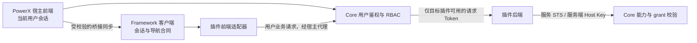
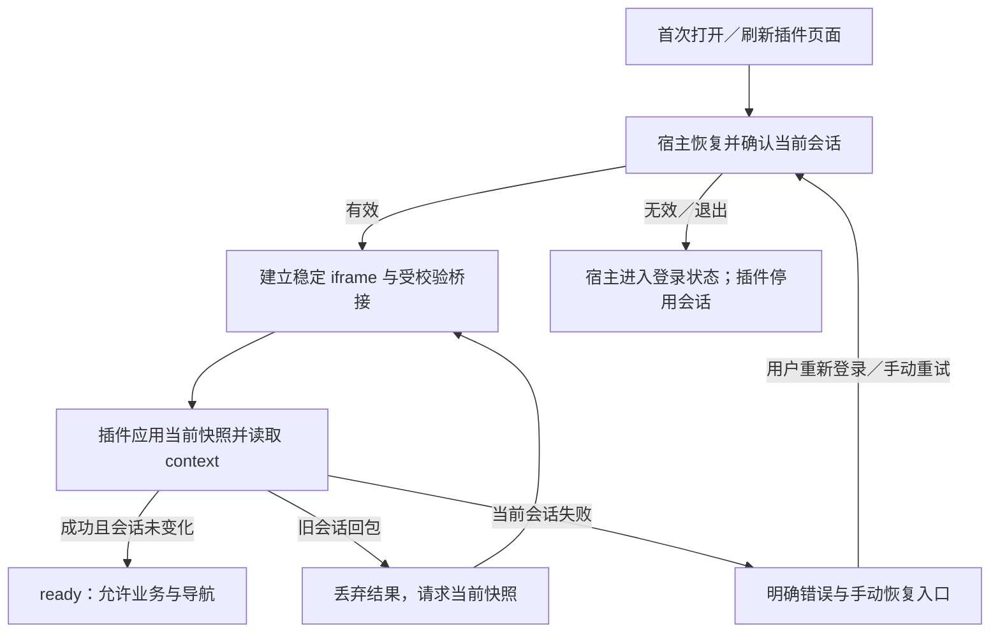
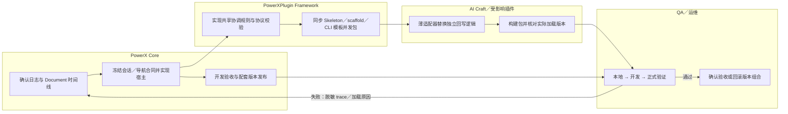

# PowerX 插件会话与首次页面刷新修复计划

> 版本：0.2；更新：2026-10-10；状态：Core 部分已实施并通过定向验证；Framework／插件接入及真实浏览器验收待完成。
>
> 用户现象：重新登录后出现 `tenant not found`，并在首次刷新插件页面时感到页面反复刷新。本文分别管理会话回滚、iframe 文档重载与启动重试，不把三者视为已确认的同一故障。

## 1. 功能背景与目标

### 1.1 已确认与待确认的事实

| 证据 | 当前结论 | 验证层级 |
| --- | --- | --- |
| 2026-10-09 19:49:24 登录 200；随后 me/context 先 200、再 403 | 重新登录确实成功，后续认证状态发生了变化 | 真实 Core 日志与审计 |
| 成功 context 的租户为 `1edd4132-1644-412d-abb4-d5f1e9487052`；随后失败请求为旧租户 `6b5d0240-9920-46da-b707-88200e0f51ea` | 新旧会话混用，不能归因于用户没有退出 | 真实 Core 日志与审计 |
| 已安装 AI Craft 0.1.75 的认证函数在 jsdom 中收到 storage 事件后，用旧内存 Token 覆盖新 Token | 已复现插件认证写回缺陷 | 实际安装包函数的模拟复现；不是浏览器登录验收 |
| 用户硬刷新后仍失败 | 前期 Core Cookie／桥接保护不足以完成修复 | 用户反馈 |
| Core 子页面随 route 改变 iframe src | 同插件导航具备文档重载触发条件 | 当前源码；不是首次刷新根因证明 |
| Core 遇到 `PLUGIN_ADMIN_UPSTREAM_NOT_READY` 时，每秒更改 iframe URL，最多自动重试 12 次 | 启动阶段存在明确的文档重载路径 | 当前源码；尚未确认用户本次命中 |
| 用户确认刷新现象主要发生在第一次刷新页面时 | 优先采集首次启动、会话恢复与桥接时序 | 用户反馈；尚无对应浏览器 Document 时间线 |

详细 traces 与安装包 SHA256 见[原始诊断记录](../../../contracts/repairs/auth-session-restore-20261009.md)。成功 context trace：`8b2fb7d9-9519-4980-9a71-8d7fd867dc8c`；随后旧租户 403 trace：`e1c01e7e-576f-4a34-afc6-bdd0d4e92c93`。

### 1.2 修复目标

1. 登录、退出、切租户及续期之后，各页面使用同一份当前会话；旧缓存和迟到请求不能恢复或覆盖旧会话。
2. 保留合法的初始化、会话恢复、自动续期、资源访问和 WebSocket 重连。
3. 首次打开／刷新插件页面时，初始化有结束状态；错误停留在可诊断状态，不进入自动跳转或文档重载循环。
4. 同插件内页面导航使用明确的导航合同；不能把 iframe src 更新与 SPA 导航同时作为日常路径。
5. Framework 提供共享规则，插件使用适配器；相似的复制代码不算统一实现。
6. 将第三方插件的凭证隔离作为后续独立阶段。本次可靠性修复不宣称已实现不可信插件隔离。

## 2. 角色与适用范围

| 负责方 | 本轮计划范围 | 交付物 |
| --- | --- | --- |
| PowerX Core | Web Admin 会话协调、刷新、Cookie 代理、插件桥接、iframe 生命周期 | 前端修复、测试、真实链路 traces |
| PowerXPlugin | framework-client 会话／导航合同；Skeleton、scaffold 与 CLI 内嵌模板 | 共享实现、版本声明、模板与包版本 |
| AI Craft | 独立 useAuth、桥接、API／WS 消费适配 | 接入共享规则、重新打包、部署包验收 |
| CRM 与其他插件 | 按实际认证实现调查和迁移 | 每个插件的影响清单与验收结果 |
| QA／运维 | 本地恢复库、开发环境、正式环境分阶段验收 | 脱敏网络证据、版本组合和回滚记录 |

本地扫描确认 AI Craft、CRM 和 PowerXPlugin Skeleton 存在缓存恢复代码，实现不同。其他插件尚未全面审计，不能直接标记为全部受影响。升级 Framework 不会自动替换插件仓库中复制的 `useAuth.ts`。

本阶段不需要业务数据库迁移。插件自身的数据源、数据库角色和 STS 凭证需独立核对；仅切 Core DSN 不等于插件已切到恢复库。

## 3. 整体架构与模块关系

### 3.1 保留现有后端身份分层

| 方向 | 身份／Token | 边界 |
| --- | --- | --- |
| 浏览器 → Core | 用户 JWT | 用户、租户成员、RBAC |
| Core → 插件后端 | 短期 plugin request token，aud=`plugin:<plugin_id>` | 当前用户访问指定插件 |
| 插件后端 → Core | 服务态 STS，aud=`powerx:api` | 插件服务主体、capability 与实时 grant |
| 开发 Host → Core | 服务端 API Key | 显式服务授权，不能放入浏览器 |

以[Token 合同](../../../guides/auth/plugin_auth_token_model.md)为准。旧 runbook 把 Core 下发的 plugin request token 也称作 STS，实施时需同步更正文档，避免混用两种主体。

### 3.2 会话修复合同（拟实施）

- 宿主是嵌入模式当前用户会话的发布者。插件可同步当前会话到其适配器；不得因旧内存值、缺少备用字段、旧 Cookie 而覆盖当前宿主会话。
- 每次登录、退出、切租户建立新的会话代际；续期在同一代际内更新 revision。Core 已冻结 `protocolVersion: 2`、`sessionId`、`revision` 的浏览器合同；完整字段见桥接 v2 文档，Framework／插件尚待接入。
- 会话代际只用于客户端竞态控制，不替代服务器验签、成员、租户或 grant 校验。JWT 的 iat 不能单独判断会话顺序。
- access、refresh、expiry 和会话元数据按完整快照提交；不能把新 access 与旧 refresh 合并。退出有明确终止标记。P0 需冻结跨标签／iframe 的写入协调策略；单个模块的 Promise 单飞不等于所有页面已协调。
- API、路由守卫、WS 刷新和桥接上下文请求均捕获启动时的会话；返回时已换代则丢弃成功和失败结果。
- 显式请求重新同步当前会话时，允许重新应用相同 Token；去重不能阻止丢失状态的插件恢复。
- 嵌入模式恢复缺失状态时向宿主重新请求。宿主明确退出后，不从 `__px_access_token`／运行时缓存复活会话。独立模式的本地登录按其自身会话规则保留。
- bridge 校验实际父窗口、配置的 origin、plugin／instance 和协议版本；敏感消息使用精确 targetOrigin，不能依赖 payload 自报 hostOrigin。
- 改变桥接协议属于合同变化：新 Core 与新客户端成对验收；旧版本明确提示升级，不增加隐藏的旧字段兼容或通配来源。

### 3.3 第三方插件隔离（后续设计阶段）

目标为插件独立 origin、宿主服务端管理续期凭证、HttpOnly／Secure Cookie 与 CSRF 防护，插件仅通过受控代理或限定用途的短期授权访问。该阶段需另行冻结服务端会话、WS、资源请求和部署合同，不能直接把当前 Cookie 改为 HttpOnly 即视为完成。

当前宿主把用户 access／refresh token 发给插件页面，trusted iframe 默认没有 sandbox。会话命名空间或 revision 只能减少误写，不能形成不可信插件安全隔离。[OWASP 指南](https://cheatsheetseries.owasp.org/cheatsheets/HTML5_Security_Cheat_Sheet.html#local-storage)明确说明 JavaScript 可读取 localStorage 中的会话数据。

## 4. 核心流程

跨项目目标行为如下。Core 已交付的准确范围与配套合同见[桥接 v2 合同](../../../contracts/plugin-session-bridge-v2.md)，不据此宣称 Framework 和插件已完成。

认证失败不直接触发 iframe URL 更新；403 不一概转换成登录失效。上游 503／502、权限拒绝、导航超时分别处理。首次加载／菜单切换／手动刷新分别记录事件原因。

## 5. 跨角色协作流程

## 6. 前置条件与依赖

1. 本地先使用备份恢复环境，记录 Core DSN 目标、插件数据源和包版本，禁止凭页面状态推断数据为空或已恢复。
2. 用户自行启动日常 Core／Nuxt 服务。临时服务记录 PID、命令、工作目录、监听端口；结束时仅清理 Agent 自己创建的服务。用户已要求保留的备份验证容器继续运行。
3. 新协议没有旁路 feature flag。Core 固定桥接 v2，版本／适配不支持进入明确错误状态；旧协议不参与会话修改。
4. 检查已有 worktree 改动，按项目独立提交。当前 Core 有前期 Cookie／桥接保护和回归测试，尚不能标记为最终修复。
5. 真实认证验收使用有效账号。默认 E2E 启动脚本含 `NUXT_PUBLIC_E2E_SKIP_AUTH=true`，不能作为本计划的登录验收；应另配启用真实鉴权的测试配置。
6. 首次刷新问题需采集 Document／iframe load／路由变化的时间线。当前缺少这份证据，不能先认定无限刷新来自认证回滚。

## 7. 操作步骤与实施任务

### Core 实施结果（2026-10-10）

| 任务 | Core 状态 | 剩余依赖 |
| --- | --- | --- |
| AUTH-01／02 | 完整 `powerx.session` 快照、代际、退出、Web Locks 刷新；API／守卫／WS／context 竞态保护与 loading 收尾已实现 | Framework 和插件消费器接入；真实多标签浏览器验证 |
| AUTH-03 | scoped login／refresh／logout 明确 409；不再转发这些写入或提交 Cookie | 插件续期改向宿主 requestAuth |
| AUTH-04 | Core 来源、版本、sequence、显式同步、认证确认合同已实现；停止广播 refreshToken | Framework 应用快照后验证 context，并返回异步结果 |
| PAGE-02／03 | 根页与子页共用 catch-all；初始 src 固定，后续导航带确认／取消与挂载点检查 | 插件实际 Router 的 setNavigator 适配 |
| PAGE-04 | load 不等于 ready；认证确认＋导航确认；12 次启动 retry 和卸载清理已验证 | 真实首次加载时间线 |
| ACCEPT-01 | 54 项定向测试、构建和自检通过；健康与匿名入口可访问 | 浏览器连接不可用；未执行真实登录验收 |

初始计划中的所有跨项目复选项仍保留未完成状态。此次是 Core 交付；新合同不能单边上线。当前 JS 可读宿主存储仍不构成第三方隔离。

### 7.1 分场景文档

| 文档 | 使用者 | 验收口径 |
| --- | --- | --- |
| [会话恢复与切换验收](usecase-us1-session-consistency.md) | Core／Framework／插件研发、QA | 新会话不被旧状态覆盖，合法恢复与续期正常 |
| [首次刷新与 iframe 导航排查](usecase-us2-first-refresh.md) | Core／插件研发、QA | 确认 Document 重载原因，首次加载和同插件导航有明确结束状态 |

### 7.2 实施顺序与完成门槛

| 阶段 | 任务 | 门槛 |
| --- | --- | --- |
| P0 证据与合同 | 采集首次刷新时间线；复现旧会话写回；确定同源与异源行为；冻结新桥接与会话合同 | 每个问题有证据级别和明确处理方 |
| P1 会话可靠性 | 实现宿主协调、插件适配、刷新与 context 的代际校验、明确退出、真实来源校验 | US1 全矩阵通过，正常续期和资源／WS 不回退 |
| P2 文档生命周期 | 稳定 iframe 入口／身份；Framework 导航适配器；ready／导航确认与超时；区分冷启动重试 | US2 全矩阵通过；首刷和导航各有独立结果 |
| P3 其他插件迁移 | 更新模板与版本；审计 CRM 等已有插件；受影响插件逐个重打包验收 | 每个插件记录已迁移／不受影响／待处理，不能只写“全部对齐” |
| P4 第三方隔离设计 | 独立 origin、服务端会话、受限浏览器授权、Cookie／CSRF／WS 合同 | 单独设计评审与实施验收，不与 P1/P2 混报完成 |

待执行清单：

- [ ] AUTH-01：共享快照、代际、退出标记与正常恢复规则。
- [ ] AUTH-02：API／路由守卫／WS 共用受控刷新；旧成功和旧失败均不得修改新会话。
- [ ] AUTH-03：Core 插件代理刷新响应的 Set-Cookie 纳入协调。候选方案为刷新响应不直接提交浏览器 Cookie，由当前会话协调器提交；需覆盖所有合法调用方，不能仅给 JSON 回包加检查。
- [ ] AUTH-04：Framework 与 Core 去重、来源校验、生命周期事件和 context 请求使用一致规则。
- [ ] AUTH-05：AI Craft／Skeleton 薄适配器，删除重复的旧会话恢复决策；同步所有生成模板。
- [ ] PAGE-01：首次刷新 Network／iframe／认证时间线，判定重载与重渲染。
- [ ] PAGE-02：同插件根页与子页共用稳定容器；src 不随普通子路由／query／hash 改变。
- [ ] PAGE-03：导航经插件实际 Router，正确处理 baseURL／query／hash／后退前进；有 request ID、确认和可见失败，不新增静默文档重载降级。
- [ ] PAGE-04：首次握手、上游未就绪重试和卸载清理有界；不把认证 401/403 当作启动重试；load 不单独作为插件 ready 依据。
- [ ] RELEASE-01：Framework、Core、插件包版本矩阵；旧客户端拒绝策略；源码、安装包、浏览器实际文件一致。
- [ ] ACCEPT-01：真实鉴权浏览器验收与脱敏 traces；保留业务数据与环境配置。

### 7.3 本地操作示例

| 动作 | 入口／命令 | 预期结果 | 失败处理 |
| --- | --- | --- | --- |
| 启动日常 Core | 用户在仓库根目录执行 `make dev` | Core 按现有配置启动 | 先核对监听 PID／日志／DSN，不额外启动重复实例 |
| 启动宿主前端 | 用户在 `web-admin` 执行 `npm run dev -- --host 127.0.0.1 --port 3030` | 浏览器可访问宿主 | 核对代理目标与端口；不能把前端 200 当作后端登录成功 |
| 检查 Core 健康 | `curl -fsS http://127.0.0.1:8077/api/v1/health` | envelope code=200、data.status=ok | 健康不等于插件 ready；继续检查实际插件 Document 响应 |
| 运行现有局部回归 | 在 `web-admin` 执行 `npx vitest run tests/unit/auth/bridge-auth-session.spec.ts tests/unit/auth/auth-cookie-sync.spec.ts` | 局部测试通过 | 仅为前期保护证据；不能代替未来代际／导航测试和浏览器验收 |
| 检查构建 | 在相应前端模块执行已声明的构建命令；Core 为 `npm run build` | 构建通过 | 与运行部署版本分开记录，不声称已上线 |

健康响应示例只展示必要字段：`{"code":200,"data":{"status":"ok"}}`。登录、刷新、context 沿用现有 `/api/v1/admin/user/auth/*`；新桥接字段不是已经上线的新 HTTP API。

## 8. 预期结果与验收标准

| 类别 | 必须通过 | 不能作为通过依据 |
| --- | --- | --- |
| 会话 | 首次恢复、重新登录、切租户、退出、多标签、迟到刷新、资源加载、WS 和 standalone | 仅构建通过或 JWT 看起来未过期 |
| 首次刷新 | 首次加载完成后稳定停留；无自动导航循环；上游失败有界且明确 | 只有截图正常或 context 请求次数减少 |
| 导航 | 同插件多次切换、query/hash、根页↔子页、后退前进，iframe 不重建、不重载文档 | 只保留 DOM 节点却反复更新 src |
| 发布 | 实际插件包与前端资源版本可追溯；每个受影响插件分别验收 | 只升级 Framework lockfile |
| 隔离 | 后续单独验证不可信插件不能读取宿主续期凭证或越过插件边界 | P1 的命名空间或 session revision |

会话测试需捕获同源多页面的真实 storage 事件；该事件在其他共享存储的文档触发，而非写入页面本身。[MDN 说明](https://developer.mozilla.org/en-US/docs/Web/API/Window/storage_event)。桥接校验依据[MDN postMessage 安全要求](https://developer.mozilla.org/en-US/docs/Web/API/Window/postMessage#security_concerns)。

实施时添加以下仅诊断元数据：session／revision、frame instance、导航 request ID、load cause、retry count、HTTP status 和 trace ID；这些是拟新增字段，不是当前已有日志能力。禁止记录 Token、密码、refresh 或 Cookie 原文。内部诊断不能塞进普通用户操作流程。

## 9. 代码实现映射

路径以各仓库根目录为基准；表内 Core／AI Craft 的 `app/...` 是各自 `web-admin/app/...`，Skeleton 的短文件名与前一文件同目录。引用的是当前实现，表中任务仍待实施。

| 项目 | 文件／目录 | 责任 |
| --- | --- | --- |
| Core | `web-admin/app/composables/useAuth.ts`、`app/utils/auth-cookie.ts`、`app/utils/auth-token.ts` | 当前会话与 Cookie 同步 |
| Core | `web-admin/app/composables/api/index.ts`、`app/middleware/01-auth.global.ts`、`app/composables/useWSBus.ts` | 多条刷新入口与迟到响应 |
| Core | `web-admin/app/plugins/api.ts`、`app/plugins/auth-init.client.ts`、`app/stores/user.ts` | 认证错误、上下文单飞及跨页面同步 |
| Core | `web-admin/app/composables/usePluginBridge.ts`、`public/powerx-bridge-client.js` | 来源、快照、去重及导航桥接 |
| Core | `web-admin/app/components/PluginWebView.vue`、`app/pages/_p/[pluginId]/admin/[...rest].vue` | 首次加载、src、容器身份及重试；独立 index 已删除，根页也匹配 catch-all |
| Core | `web-admin/server/middleware/00-proxy-plugins.ts` | Cookie 注入、scope auth 路由与代理响应提交 |
| Core | `backend/internal/infra/plugin/manager/router/router.go`、`router/authz_gate.go` | Document 代理、上游未就绪与 plugin request token 边界 |
| PowerXPlugin | `framework/frontend/nuxt/framework-client/{host-session,bridge,api-fetch}.ts` | 共享客户端与协议 |
| PowerXPlugin | `skeleton/web-admin/nuxt/app/composables/useAuth.ts`、`useHostBridgeAdapter.ts` | Skeleton 接入 |
| PowerXPlugin | `scaffold/templates/web-admin/nuxt/app/`、`tools/cli/internal/templates/data/web-admin/nuxt/app/` | 同步生成模板，避免复制旧缺陷 |
| AI Craft | `web-admin/app/composables/useAuth.ts`、`useHostBridgeAdapter.ts`、`api/_client.ts`、`api/_base.ts` | 当前写回与消费适配 |
| AI Craft | `web-admin/app/middleware/auth.global.ts`、`app/stores/user.ts`、`app/plugins/wsbus.client.ts` | 初始化、context 与 WS 联带验证 |
| CRM | `web-admin/nuxt/app/composables/useAuth.ts` | 类似缓存代码；需独立复现与验收 |

## 10. 常见问题与排障

- **首次刷新出现多条 context 请求，是否等于页面刷了多次？** 不等于。必须查看 Network 的 Document 与 iframe load／src 时间线。
- **403 tenant not found 是否直接导致整页 reload？** 当前 Core 登录错误处理主要针对 401；AI Craft insidePowerX 分支也不会直接跳其独立登录页。403 可以参与状态变化，但还需证明后续导航／Document 请求。
- **每秒重载，query 含 `__px_retry`？** 优先确认同一时间是否返回 `PLUGIN_ADMIN_UPSTREAM_NOT_READY`，这是独立于 Token 的启动重试。
- **菜单一切就闪？** 当前 catch-all src 跟随 route.fullPath；正常路径变化就可能重载 iframe 文档。
- **iframe load 已触发，是否代表 ready？** 不代表。浏览器在 iframe 加载失败时也会触发 load，error 也不能作为可靠 HTTP 失败通知；需实际文档／握手／协议确认。[MDN iframe 行为](https://developer.mozilla.org/en-US/docs/Web/HTML/Reference/Elements/iframe#error_and_load_event_behavior)。
- **修 Core 后还会回滚？** 独立插件 useAuth 与 Framework 的 setAuth 回调仍可能写共享存储；须核对运行包，不只看仓库源码。
- **两份旧文档说法不一致？** 本计划负责修复实施，Token 模型文档负责用户／插件服务主体。更新 `application_runbook.md` 和 `Token_Storage_and_Rotation.md` 的过时口径，不把旧说明当成已验证行为。

## 11. 回滚与风险控制

1. 本轮授权是编写计划与核查，未授权在其他仓库实施；本文不代表跨仓库代码已经修改。
2. 首先保留诊断证据与可工作的版本组合。Core、Framework、插件分别提交，成对部署；协议变更不能单边回滚。
3. 认证验收失败时停止受影响插件页面入口并显示明确原因；使用已知可工作的配套版本。没有可工作旧组合时保持入口停用，不能以无限刷新、绕过鉴权或业务数据修补恢复访问。
4. 不通过重新安装账号、改租户 UUID、refresh 数据库、重置 root 密码或删除插件业务数据处理浏览器会话问题。
5. 浏览器一次性清理仅针对该测试 origin 的已识别认证数据，并在所有旧相关标签页关闭后进行；不使用全量 localStorage.clear 代替代码修复。
6. 自动 retry 仅针对已识别的临时上游未就绪状态，须有总预算与取消路径。认证失败、权限拒绝、协议不支持不触发文档重载。
7. 当前同源 trusted 插件仍具有同等页面信任，P1/P2 不扩大到不可信第三方开放验收。P4 服务合同若改变 capability 授权面，按 AGENTS 运行 capability-check、seed、API Key／STS grant 测试与 grant-status。

## 12. 变更记录

| 日期 | 版本 | 内容 | 责任与状态 |
| --- | --- | --- | --- |
| 2026-10-09 | 0.1 | 会话／首次刷新计划、三项目分工、回归矩阵与回滚边界；记录用户“首次刷新时”反馈 | Codex 文档与只读核查；完整实施、实际首次刷新归因、浏览器验收待完成 |
| 2026-10-10 | 0.2 | Core 会话协调、协议 v2、认证确认、导航与 bounded retry；新增配套合同 | Core 定向测试通过；Framework／插件／真实浏览器验收待完成 |
