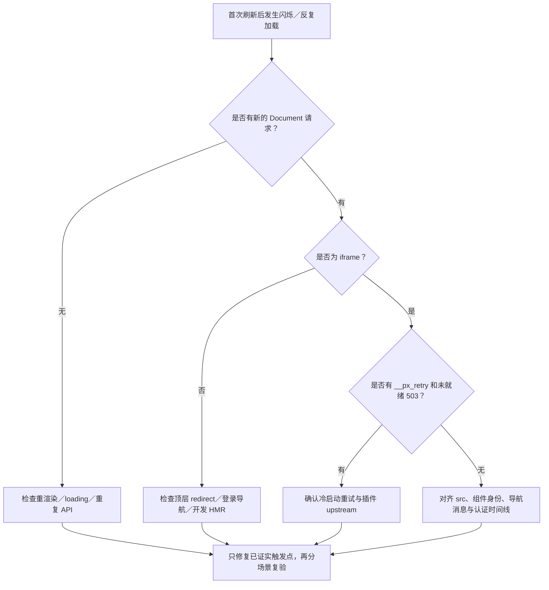

# US2：首次刷新、iframe 重载与导航排查

> 状态：用户明确反馈在第一次刷新插件页面时发生；本次尚未捕获对应浏览器 Document 时间线。以下为排查与修复验收计划，不是已确认根因。

## 1. 先分辨看到的“刷新”

| 现象 | 必须检查的证据 | 当前认识 |
| --- | --- | --- |
| 宿主整页重新加载 | 顶层 Document 请求、navigation／load | 尚未确认 |
| iframe 文档重新加载 | iframe Document、src、load、`__px_retry` | 存在明确源码触发路径 |
| 登录／业务路由反复切换 | 路由与 30x Location、context／refresh 状态 | 认证变化可能参与，但须证明顺序 |
| loading 闪烁、组件重渲染 | DOM／组件生命周期，没有新的 Document 请求 | 不应称作已确认的文档重载 |
| 多条 context 或业务 API | Fetch/XHR 请求，无 Document 请求 | 重复接口请求不等于刷新页面 |

## 2. 当前源码中的独立触发点

1. **首次上游未就绪**：`PluginWebView.iframeShowsAdminNotReady()` 读取文档里的 `PLUGIN_ADMIN_UPSTREAM_NOT_READY`；`scheduleAdminReadyRetry()` 每秒增加 retryNonce，改变 `__px_retry` query，最多 12 次自动重试。Core `router.go` 对未就绪返回 503 与 `Retry-After: 1`。这条路径不要求发生 Token 回滚。
2. **同插件导航更新 src**：catch-all 页面从 route.fullPath 生成 src，`PluginWebView.watch(cleanSrc)` 重设 loading、清理重试并重新注册 bridge。iframe DOM 节点仍存在也会因 src 变化重载文档。这主要解释导航时刷新，不能独立解释用户首次刷新的循环。
3. **初始化竞态与失败清理**：宿主 mounted 拉取 context、插件 bridge applyAuthToken 拉取 context、storage 事件同步可能交错；AI Craft 旧 Token 写回已复现，但没有证明当前首次 Document 重载由它直接触发。
4. **正常权限失败不是自动刷新依据**：Core auth-init／API 错误处理主要在 401 时清理并跳登录；AI Craft insidePowerX 的失败分支以保存错误／停用会话为主。`tenant not found` 的 403 不能直接推导出整页 reload。
5. **导航合同尚未完整共享**：Core 有 navigateFrame 和注入脚本的 history 导航；当前 PluginWebView 只声明 navigatePath，未使用该 prop 发导航；Framework typed bridge 未声明 navigate 消息。不能只把 src 固定后就认为路由一定可用。
6. **load 不等于 ready**：当前 onLoad 除未就绪文案分支外，会清除 loading／error；401、403 等错误文档也可能触发 load。浏览器 iframe 的 load／error 特性决定不能仅靠这两个事件判断成功，需受校验的 ready 握手与实际响应。[MDN 说明](https://developer.mozilla.org/en-US/docs/Web/HTML/Reference/Elements/iframe#error_and_load_event_behavior)。

## 3. 首次刷新采集步骤

| 步骤 | 动作与入口 | 预期结果 | 失败处理 |
| --- | --- | --- | --- |
| 1 | 在有效会话下打开已安装 AI Craft 子页面；记录完整 URL、时间与插件版本 | 明确本次刷新对象与版本 | 不把历史运行版本当成当前证据 |
| 2 | 浏览器 Network 开启 Preserve log，分别查看 Doc、Fetch/XHR、WS；刷新一次 | 得到首次刷新完整请求顺序 | 数据丢失时重新采集，不继续猜根因 |
| 3 | 记录顶层与 iframe Document 的 status、Location、时间、query、frame／initiator、trace | 可区分浏览器主动刷新、redirect、src 和 retry | 不复制带 Cookie／Token 的原始请求到聊天 |
| 4 | 查看 `__px_retry` 与 `PLUGIN_ADMIN_UPSTREAM_NOT_READY` 是否同步递增／返回 | 有则确认启动重试链；无则排除这次已识别链路 | 不能仅凭“每秒闪”就认定上游未就绪 |
| 5 | 同时记录 login／refresh／context 的 status、租户与 trace；观察是否有导航 | 判断会话变化是否先于文档重载 | 只有 context 403 时，结论仍为认证失败，非刷新归因 |
| 6 | 首次加载完成后静置 60 秒，再同插件切换两次页面 | 分开验收静置、首次刷新和菜单导航 | 若只切菜单重载，单独记录导航缺陷 |

可在宿主 Console 安装只读的当前 iframe src／load 观察；它不修改会话，不捕获 Token：

```javascript
(() => {
  const frame = Array.from(document.querySelectorAll('iframe'))
    .find(item => item.src.includes('/_p/com.powerx.plugins.ai-craft/admin'));
  if (!frame) { console.log({ error: 'target iframe not found' }); return; }
  let loadCount = 0;
  const report = event => console.log({
    event, at: new Date().toISOString(),
    src: frame.getAttribute('src'), loadCount
  });
  const onLoad = () => { loadCount += 1; report('iframe-load'); };
  const observer = new MutationObserver(() => report('iframe-src-change'));
  observer.observe(frame, { attributes: true, attributeFilter: ['src'] });
  frame.addEventListener('load', onLoad);
  window.__stopPowerXFrameDiagnostic = () => {
    observer.disconnect(); frame.removeEventListener('load', onLoad);
    delete window.__stopPowerXFrameDiagnostic;
  };
  report('observer-installed');
})()
```

此观察仅覆盖安装后仍存在的当前 iframe。顶层刷新会清除观察，组件替换也会脱离旧节点；首次刷新证据仍以 Preserve log 的 Document 时间线为准。结束时执行 `window.__stopPowerXFrameDiagnostic?.()`。

## 4. 判断与处理方向



## 5. 拟实施修复要求

- 同一插件容器使用稳定 instance 身份，不使用 route.fullPath 作为生命周期身份；根页与 catch-all 的切换也须确认不重建。
- 日常子路由导航保留 iframe document；由 Framework typed navigation adapter 调用插件实际 Router，保留 baseURL、query、hash 与浏览器后退前进。
- 首次 bridge 建立前保存最新目标路由；ready 后发送一次待处理导航，收到确认进入 ready。旧 instance／旧 request 的确认不能影响当前页面。
- 导航／认证分别去重，显式恢复不被同 Token fingerprint 过滤。超时停留可见错误，允许手动重试，不新增静默整页跳转。
- 上游未就绪重试有统一总预算；src、context 或 bridge 注册变化不能无意重置预算，卸载取消定时器与旧请求。当前 12 次预算是否保留由首次时间线与 UX 验收决定，不能静默扩大。
- 如果当前问题实际是组件重渲染，仅处理 loading／生命周期；不为它重构 Token。
- 当前注入脚本的路径归一化需保留并验收。不能只删 src 变化、恢复旧 pushState 逻辑而跳过 Router 与深链路验证。

## 6. 验收矩阵

| 编号 | 场景 | 成功标准 |
| --- | --- | --- |
| P01 | 已启动插件，首次打开子路由 | 一次目标 iframe 初始文档加载，握手完成后稳定 |
| P02 | 已启动插件，浏览器手动刷新一次 | 允许本次顶层／iframe 初始加载；之后静置 60 秒无自动重载循环 |
| P03 | 模拟上游临时未就绪 | 只在明确未就绪状态内有限重试；恢复后停止；超过预算显示错误 |
| P04 | 未就绪期间卸载／切换插件 | 旧 timer／请求取消，不影响新 iframe |
| P05 | context 401／403／网络超时 | 明确认证或权限错误；不启动文档 retry；同会话恢复次数有界 |
| P06 | 同插件连续切换菜单 10 次 | Document 数不增加、容器身份不变、业务页面正确 |
| P07 | 根页↔子页、query/hash、后退前进 | Router 状态与地址一致；无 iframe 重建、无隐藏全页降级 |
| P08 | 深链路刷新、locale、挂载 baseURL | 初始目标正确；不先跳首页再反复跳目标 |
| P09 | 切换到另一插件 | 按设计建立新容器；旧桥接、observer、timer、WS 已释放 |
| P10 | standalone 插件与不同源 iframe | 不受宿主固定入口策略破坏；来源校验正确 |

测试在真实鉴权环境运行。每项记录 Document 次数、src 次数、导航结果、认证结果、upstream 状态、实际资源版本与 trace；不能仅用截图或 API 请求数量宣称已修复。

## 7. 回滚与当前限制

- 首次刷新归因仍待真实浏览器证据；普通浏览器连接失败，未借助清空数据、伪造会话或猜测权限绕过采集。
- 根路径固定与 navigation adapter 必须配套发布；单边改变 src 可能导致菜单不跳、query 丢失或深链路失败。
- 导航修复失败时回滚已知可工作的配套版本；认证修复与导航修复分提交、分验收，不回滚业务数据库。
- 完整发布和其他插件迁移参照[总计划](guide.md)。
