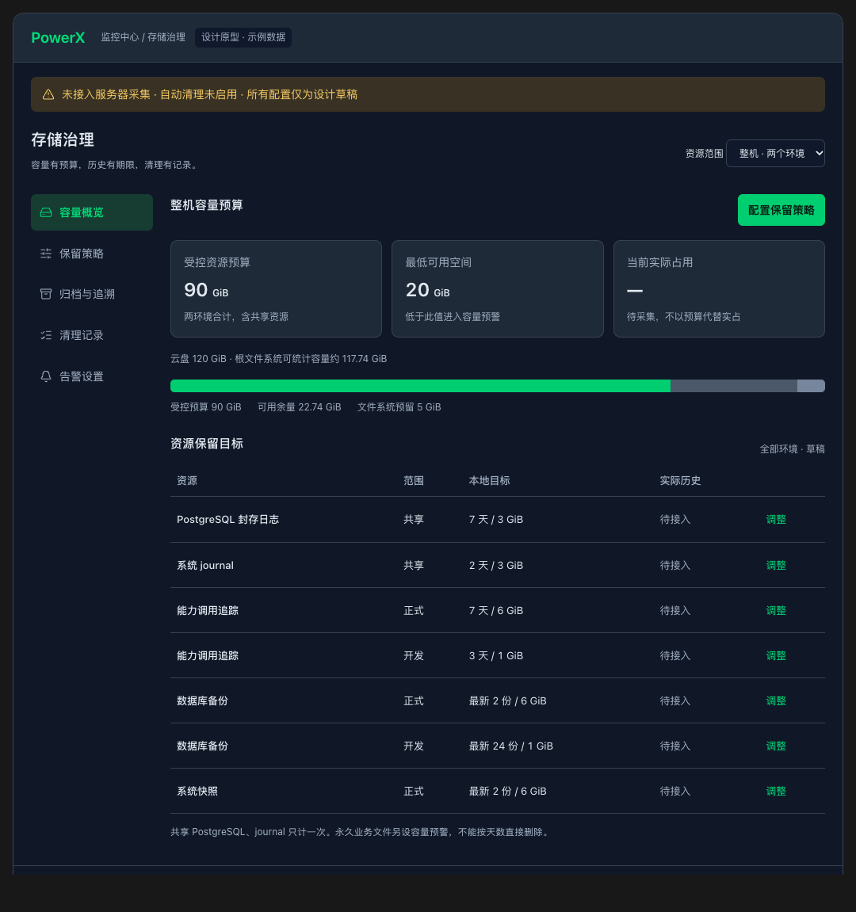
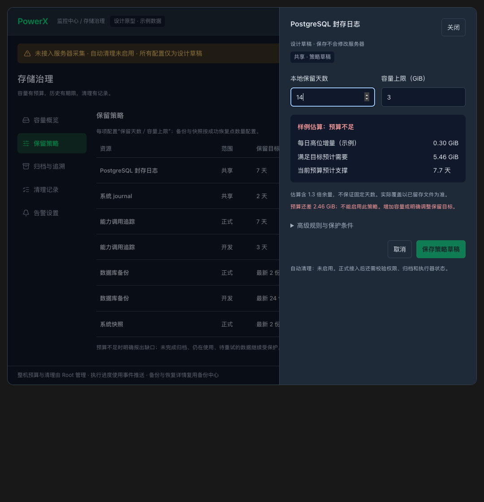

# PowerX 存储治理 UI 设计

> **2026-11-05 商用交付门槛**：[配置治理约束](storage-governance-commercial.md)及 [SG-11 正式任务](../../../specs/027-monitor-center/tasks.md#us9-commercial-gates)已登记，均待实现。现有本地 UI／配置接入证据不代表唯一权威、原子并发、Root 权限收口、密钥治理及升级恢复已经完成；SG-09 长期运行要求继续有效。

> 2026-11-01 实施入口：已补归档独立启停／S3 UI 配置、直接安全到期删除、持久历史与取回、版本引用清理、临时执行器接管及独立数据库期限。实际本地范围、部署门禁与尚未上线项见 [v0.6 手册](../../guides/deploy/027-monitor-center/usecase-us9-storage-archive-controls.md) 和 [验证证据](../../contracts/evidence/storage-archive-controls-validation-20261031.json)。本文完整长期目标仍按 US9 任务逐项验收，不将本地实现当作生产完成。


> 当前开发状态：v0.6 在原六个任务分区上增加“日志归档与追溯”和“数据库期限”，归档配置／检索复用备份中心权威服务。观察模式显示部署与迁移阻塞，启用仍需明确确认。核心容量风险始终可见；正式安装和长期运行另行验收。
>
> “资源保留策略”的规划草稿和“自动治理”的运行策略分开保存。运行策略明确确认后启用，读取独立账本核对结果；状态推送不进行常驻轮询。数据库期限已有独立 UI／版本策略；尚未启用的日常和生产实例继续只观测，不因页面升级删除记录。
## 1. 用户任务与入口

主要用户是管理正式、开发双环境的 Root／运维人员。打开页面后应依次回答：

1. 整机还有多少可用空间，哪类资源在增长？
2. 现有预算能否覆盖要求的历史，实际能查到哪一天？
3. 能安全释放什么，哪些资源必须保留？
4. 自动任务是否真实执行，归档是否真实可取回？

已注册入口：**监控中心 → 存储治理**，页面 `/monitor/storage`。

复用 `/ops/backup` 的数据库、快照、归档目标和恢复详情；存储治理统一展示预算和生命周期，不再复制一套互相覆盖的备份／归档策略。备份中心显示同一策略值并链接回预算编辑，任何入口修改后均按同一权威版本回读。

## 2. 信息结构

```text
PowerX / 监控中心 / 存储治理                 资源范围：整机／正式／开发／共享
┌ 全局容量、归档失败、采集断线等必须处理的状态 ─────────────────────┐
│ 容量概览       │ 当前分区：容量、增长来源、预算缺口、需要处理项    │
│ 保留策略       │                                                │
│ 归档与追溯     │ 点击资源 → 详情抽屉                             │
│ 清理记录       │ 点击调整 → 策略抽屉                             │
│ 告警设置       │                                                │
└────────────────────────────────────────────────────────────────┘
```

- 桌面：左侧纵向 Tab，右侧只显示当前任务；默认“容量概览”。
- 窄屏：纵向 Tab 收为任务选择器；列表转适合窄屏的行卡片或必要的横向表格，不挤压字号和主要按钮。
- 切换分区保留资源范围、筛选、选中任务、编辑草稿和正在执行的任务订阅；取消／离开时明确处理未保存草稿。
- 全局容量紧急、归档失败与实时连接异常在各分区可见，不藏在低频设置里。
- 不把五个分区重新连续堆成长页；列表本身允许滚动。

## 3. 范围选择与身份

| 选择项 | 展示内容 | 约束 |
|---|---|---|
| 整机 | 唯一文件系统总量，两个实例与共享资源占用 | 宿主机计量，不把容器可见目录当整盘 |
| 正式 | 正式实例拥有的资源、策略和任务 | 同时保留整机紧急状态；共享资源单列提示 |
| 开发 | 开发实例拥有的资源、策略和任务 | 不绕开主机共享预算 |
| 共享 | PG 集群／journal／Loki 等 | 主机计一次，来源归因另列 |

环境使用部署身份和实例 ID；详细 ID 放抽屉，页面默认展示可理解的名称。资源范围选择不能变成调用者提交任意实例或服务器路径的授权依据。切换环境时重新检查权限，释放不再授权的旧连接与数据。

## 4. 容量概览

### 4.1 首屏核心内容

| 内容 | 字段／表现 |
|---|---|
| 实际空间 | 文件系统总量、实际已用、普通可用、文件系统预留、采集时间与覆盖范围 |
| 治理目标 | 受控预算 90 GiB、最低可用 20 GiB、紧急阈值 10 GiB；标注“目标” |
| 主机容量条 | 实占视图和预算分配视图分别展示并清楚命名，不能用预算冒充当前实占 |
| 增长与缺口 | 近 14 天样本、每日高位增量、预算预计可支撑天数、缺口 |
| 需要处理 | 超预算、受保护数据阻塞、归档滞后、采集缺失等可定位事项 |

资源列表显示：来源／资源、范围、实占／预算、保留目标、实际历史、策略／执行状态、更新时间与“查看／调整”。共享对象归因采用与主机相同的唯一物理口径；子额度不可重复求和。

资源详情抽屉显示计量组成、活动／受保护占用、未纳管部分、采样证据、当前与上一版策略及最近任务。完整路径、对象 SHA256、错误堆栈和 Trace ID 放“技术详情”，不占主表宽度，不显示凭据。

### 4.2 空、加载与错误状态

- 未接入：显示“未接入／—”，主要操作为检查来源，不展示 0 GiB 或绿色正常。
- 采样中：可展示实占；预测字段显示样本数和“暂定／不可估算”。
- 采集失败：保留上次数据、明确标记过期时间和错误；不能作为当前准入依据。
- 部分来源不可读：展示覆盖不完整及缺失来源，不只显示可读取部分的合计。
- 已满／接近水位：显示允许处理项与受保护阻塞量，不给“一键清空”入口。

## 5. 保留策略与抽屉

主表按资源展示 **“保留多少天／最多多少 GiB”**。备份与快照改为“周期／成功份数／容量”；安全保护条件不隐藏在含糊的通用开关中。

### 5.1 编辑字段

当前入口先选顶部“管理范围”，再以桌面左侧纵向资源 TabView、右侧当前资源详情组织操作；窄屏改为资源选择框。每次只展示一个资源的状态、占用及管理入口。开发／正式表示部署身份，不是远程服务器切换；共享表示主机共用来源，容量去重统计，不代表继承同一份保留规则。

当前资源直接展示所属模块的已保存配置，并在本分区打开编辑弹层：文件日志复用自动治理编辑器，归档复用原目标／策略接口，备份和快照通过原计划接口编辑、保存及核对结果。启用和切换当前计划单独确认，不因载入页面或创建计划而启动调度。媒体和未接入适配器的来源明确说明只观测；其他安装实例的资源未连接管理接口时不能误用当前实例 API。只观测、未开启、执行暂停和状态未知分别呈现；不把规划建议当作正在生效的保留期限。“主机空间保护”打开实际运行预算，与容量规划预算草稿分开。

应用日志的“手动检查一批”在弹层输入本次截止天数，预览与确认沿用原批次保护；不会保存长期期限。未确认批次保留原记录，可只读核对，不重发删除。容量规划及估算收进“容量规划草稿”弹层，不执行清理。切换资源／范围和手动刷新保留未保存草稿；刷新不提高未保存草稿的编辑版本，外部修改仍需通过版本冲突保护。新草稿建议示例：

| 资源 | 正式建议 | 开发建议 | 共享／其他 |
|---|---|---|---|
| 数据库备份 | 2 份成功产物／6 GiB，建议每日生成 | 24 份成功产物／1 GiB，建议每小时生成 | 周期仅建议，不改现有调度 |
| 系统快照 | 2 份／最低 2 个已验证恢复点／6 GiB | 1 份／最低 1 个已验证恢复点／1 GiB | 按需；真实验证清单待接入 |
| 应用文件日志 | 7 天／1 GiB | 3 天／0.25 GiB | 测试 1 天；预发沿用正式 |
| PostgreSQL 日志／journal／Loki | 不分别重复设置主机共享来源 | 不分别重复设置主机共享来源 | 依次 7 天／3 GiB、2 天／3 GiB、1 天／1 GiB |
| 媒体／归档对象 | 引用保护，无通用 TTL 或默认预算 | 引用保护，无通用 TTL 或默认预算 | 必须按对象引用计量，人工确定额度 |

页面根据类型只显示相关字段；旧组合草稿保留原语义并提示显式转换。资源级测算在弹层中进行，结果保留环境／资源标签。份数缺实际产物清单时显示待接入，不套每日增量公式。以上都只是未启用草稿，不声明已经拥有建议的历史或恢复点。

| 字段 | 规则 |
|---|---|
| 资源与范围 | 从已登记来源选择；编辑时只读，不能手填目录或表名 |
| 保留目标 | 日志／追踪为天数；备份为份数，显示真实生成周期；快照另显示最低已验证恢复点 |
| 容量上限 | GiB 输入，提交为整数 bytes；限制与校验由正式 DTO 冻结 |
| 估算结果 | 每日高位增量／每份大小、样本时间、预计所需、预计支撑及差额 |
| 远端目标 | 显示对应归档目标和历史期限；修改目标跳转／复用归档配置 |
| 保护条件 | 活动、引用、显式保留、最低恢复点、远端确认；必需条件不可关闭 |
| 高级规则 | 调度、统计窗口、批量／时长限制、适用边界，按需展开 |

保存与启用分开。正式 UI 的“保存草稿”返回后需权威回读；“启用自动治理”需通过来源、估算、预览、归档、权限和执行器检查。修改策略本身不马上删除。并发编辑发生版本冲突时保留草稿并要求对比，不覆盖他人修改。

### 5.2 参数联动示例

以下是设计示例，每日高位增量 0.30 GiB、余量系数 1.3，并非服务器实测值：

| 用户选择 | 显示结果 | 允许行为 |
|---|---|---|
| 7 天／3 GiB | 预计需要 2.73 GiB，预算预计支撑 7.7 天 | 可以保存；是否可启用还需其他检查 |
| 14 天／3 GiB | 预计需要 5.46 GiB，缺 2.46 GiB | 可保留未启用草稿并标记冲突；不能启用 |
| 14 天／6 GiB | 估算预算可行 | 保存与其他检查；不表示已有 14 天历史 |
| 无有效样本 | 待采样，不能判断可覆盖天数 | 保留草稿、补采样，不显示可行 |

用户必须自己选择增加预算或调整天数；不自动换值。示意原型为简化演示会阻止保存不足预算；正式产品允许保留不可启用草稿，但应持续显示冲突。

### 5.3 两类状态分别展示

| 策略／估算 | 执行／资源 |
|---|---|
| 未配置、草稿、采样不足、估算可行、预算不足、已启用、已暂停 | 未运行、等待、执行中、核验中、完成、部分完成、失败、保护阻塞 |

“估算可行”不能当成“自动清理已启用”，“任务已接受”不能当成“清理完成”。

## 6. 归档与追溯

明确分开三组时间：

1. **目标**：本地 7 天，远端 90 天等策略目标。
2. **实际可查／可取回**：已验证的开始／结束区间、缺口、最近确认位置和取回结果。
3. **预计支撑**：按近期新增量和当前预算估算，标注估算时间和样本。

最早／最近文件时间不能证明中间连续。PG 日志缺段、journal 游标跳跃、断网未补齐和原生日志提前回收都要显示覆盖缺口。刚开启 90 天保留的页面不能立刻显示“已保留 90 天”。

归档进度：**已封存 → 已压缩 → 已上传 → 远端已校验 → 可按本地规则回收**。SSH 连通或上传发起不算校验成功。日志归档、数据库备份与整站恢复点分别标明范围；只生成 `.dump` 不表示日志历史已保存。

从资源进入备份中心时保留实例、资源、时间和任务上下文；本地已清理但远端仍保留的记录显示“远端可取回／待验证”，不显示整条历史消失或默认下载成功。

## 7. 清理预览与运行记录

### 7.1 预览

展示候选项、截止时间、规则／策略版本、预计回收量、受保护占用及跳过原因。候选原因至少区分：

- 已过期且满足全部保护条件；
- 仍在使用／有任务租约；
- 未归档或远端未校验；
- 待重试／业务未终态；
- 最低成功备份或已验证恢复点；
- 显式保留／法律留置；
- 来源不可判定、路径变化或预览已过期。

点击执行前显示范围、预计数量、预计释放及不可恢复的本地删除影响。服务端再次验证；预览后新产生引用时应保护该项并更新结果，不按过时清单直接删。

### 7.2 实时任务与审计

每轮记录操作者／自动策略、实例、资源、版本、计划／任务 ID、起止时间、候选与成功数量、跳过项、错误和 Trace。

**预计回收、逻辑已删、库内可复用、物理已回收、整盘净变化**分别呈现。单项失败用“部分完成”，未完成的核验用“待核验”；取消后说明已执行部分，不伪装成全部回滚。

进度由 WS／SSE 推送。断线时显示“实时更新中断”，保留任务与表单；重连后读取权威快照，再继续消费事件。浏览器无事件时不周期请求列表／详情。离开页面、退出或切换身份时清理连接；后台任务本身继续由服务端托管。

## 8. 告警设置

首批提供：整机可用低于 20／10 GiB、分类达到 80%／90%、预算不足、实际历史缺口、归档延迟／失败、采集失联、保护项阻塞、预留泄漏及长期未执行。

告警含影响范围、最近数据时间、建议进入的资源／任务和通知状态。确认告警不等于问题解决；去重、恢复通知和通知失败要留记录。用户不需要在主页面编辑 shell、SSH 私钥、数据库连接或 journal 参数。

## 9. 权限与复用边界

- 首期主机级治理仅 Root 用户会话；租户 Admin 的用户管理权限不授予整机查看／删除能力。
- 后续委派只读或执行角色时，后端按资源／操作授权；保护解除另行审计。插件 API Key／STS 不能套用管理员接口获得主机清理权限。
- 现有备份与归档合同继续保留其 Root 限制；新页面不通过前端绕过。
- 技术详情、导出和审计也必须受同一权限控制，不能泄露其他租户内容或凭据。

## 10. UI 验收

| 场景 | 必须满足 |
|---|---|
| 桌面与 390／320 px 窄屏 | 默认概览、导航和主要操作可见，无遮挡和横向溢出；抽屉可取消、关闭及键盘操作 |
| 分区／环境切换 | 草稿与任务保留；资源筛选和后端范围一致；共享总量不重复 |
| 加载、空、失败、断线 | 未知不是 0，旧数据标记时间，错误和维护信息不被分区隐藏 |
| 预算联动 | 7／3 与 14／3 示例计算正确，冲突不可启用；自动规则不静默改参数 |
| 归档 | 目标、实际、预计分开；连接／上传／校验／取回分开；缺口可见 |
| 清理 | 预览变化、保护项、部分完成及实际回收量可核对 |
| 推送 | 无周期状态轮询；事件更新、乱序去重、重连同步和身份释放通过 |
| 授权 | 通过真实路由验证 Root、无权用户与服务身份；隐藏按钮不是验收证据 |

本轮已有会话内示意的受控交互检查：预算不足提示、估算 5.46 GiB、草稿分区保留以及 390／320 px 无横向溢出。该检查不覆盖正式 Nuxt 页面、真实 API、服务器执行和生产验收。下图仅为设计示意：





## 11. 变更记录

### 2026-11-05：配置表单就地接入

资源右侧从“状态和跳转入口”补齐为“已保存配置 → 编辑弹层 → 保存并回读核对”。日志使用同一运行账本；归档显示目标和关联策略并可就地配置；数据库备份和系统快照显示真实计划、期限、份数、频率及启用／当前计划状态。启用和切换计划单独确认，新建计划默认停用。未知保存结果禁止重复写入，可只读核对；版本变化保留编辑并提供明确放弃入口。配置写入期间禁止切换资源；跨资源和刷新保留各自草稿。后台变更继续复用既有推送，不新增状态轮询。

验收：存储及备份相关 174 项单测通过；真实本地 Root 会话检查日志／归档／备份／快照的配置表单、输入保留、明暗主题和 1440／1280／390／320 px。真实服务仅做读取，未保存配置、启动计划或执行清理。详见 `tmp/storage-resource-config-20261105/README.md`。

### 2026-11-05：逐资源任务分区

第三分区采用管理范围 + 内层纵向资源 TabView，窄屏改为资源选择框。运行配置、单次手动检查和容量规划分别进入各自入口；使用原有自动治理、备份、媒体和归档配置，不新增另一套执行策略。切换／刷新保留编辑和未知结果，未确认批次可只读核对，外部版本变化不自动覆盖本地草稿。主要配置操作置于当前资源标题后，错误在当前弹层及必要的分区提示中可见。

本地 Root 实页已检查 7 类来源、两种主题、1440／1280／390／320 px、来源配置与预算／归档入口、上下文保留；没有清理或策略写入。存储单元测试 66 项通过。详见 `tmp/storage-resource-tabs-20261105/README.md` 与同目录验收记录；这不代表生产策略已启用或完成删除批次验收。

2026-10-28：形成存储治理 UI v0.1；页面、API、推送与执行器接入待开发，图片为交互原型截图。

### 2026-10-29 本地实现补充

- “资源保留策略”按部署环境／实例、资源、保留方式组织；按天、份数与引用保护分别呈现。测算属于当前资源弹层，主机总预算独立弹层，不再有脱离来源的通用计算器。
- 按环境／资源保留编辑与测算上下文；保存当前资源只合并该项和其他已保存值，不提交其他未保存编辑。主机保存同样不混入资源草稿。GET 读回核对 revision 和内容，失败或冲突保留编辑值。
- 初次主机预算留空，按实际盘容量生成可编辑建议；不把 120 GiB 双环境基线写给所有部署。建议与已保存草稿分开显示；旧草稿不自动转换，新 Core 目录缺失时明确提示版本不一致。
- 数据库占用在概览点击“数据库占用详情”进入弹层；WAL 和可复用量未知时为 —，不累加至 df 总账。
- 当前入口为“用量历史”，默认只有当前环境数据库记录，整盘已用／可用另选；目录历史、文件归档覆盖与清理前新增量未接入。预期样本等技术细节按需展开，采集失败仍直接提示。首次进入及手动刷新读取，无前端周期请求。
- 告警分区展示当前阈值提示，重要容量风险在所有分区可见；通知、恢复投递及设置仍待 T116／T153。
- 身份切换销毁旧草稿／历史连接并中止请求；桌面纵向导航、窄屏选择器和弹层需实际验收。

2026-10-29 采样状态补充：概览和占用历史返回 `sampling.configured/worker_enabled/interval_seconds/metadata_retention_days`。配置开启、运行模式准入和实际样本分开显示；维护模式拒绝 worker 时全局提示。已有记录不代表当前仍在采样，配置开启也不表示已有完整 14 天历史。

2026-10-29 v0.3 环境策略验收：1440／390／320 宽度下检查了导航、环境／资源建议差异、独立主机预算、跨分区／环境保留编辑、当前资源保存边界与测算弹层。浏览器使用真实 Nuxt 构建及受控 API，不是生产磁盘实测。运行边界和原有类型检查阻塞见[验证记录](../../contracts/evidence/storage-governance-context-validation-20261029.json)。

2026-10-29 范围澄清：整盘数字表示磁盘卷所有软件和文件，当前数据库只是 PowerX 的已统计部分；两者不相加，差值不归给 PowerX。概览默认展示 PowerX 数据库／登记目录及“总量尚未完整统计”，共享来源只放整盘视图。历史分成“PowerX 数据库／磁盘整体”，不再混合表格；四种语言使用明确范围名称。没有接入的总量与目录历史继续显示能力边界，详见[范围澄清验收](../../contracts/evidence/storage-governance-scope-validation-20261029.json)。

### 2026-10-29 v0.4：实际日志流程与逐来源历史

资源页默认选择当前实例已接入的普通应用日志，展示原有保留天数／份数和当前占用；主要动作是“预览日志清理”，不要求主机预算。候选和保护原因在弹层内查看，“确认清理本批”只处理该预览的一批文件；执行时禁用关闭／切换来源，回读完成后显示已确认结果。请求或审计失败时保留批次上下文，未知结果不能重试成另一轮删除。其他资源显示原管理入口，规划草稿放在明确“不执行清理”的高级折叠内。

概览自动列日志、本地媒体及已启用的调试／审计目录。“查看资源覆盖”显示每一类接入状态，不把未登记等同于零。用量历史可选择数据库或具体目录，展示占用、净变化和采集状态；缺少摘要的旧记录为未知。清理记录是最近 100 条普通应用日志预览／手动批次，不冒充旧模块和所有自动任务的统一审计。

桌面和 390／320 宽度的真实 Nuxt 构建＋受控 API 流程覆盖资源选择、预览不删除、一次确认、独立回读、记录详情、历史切换和无轮询。执行为最长 10 秒的同步批次，未建立后台进度；后续异步治理仍须推送。正式／预发的归档验证和其他资源清理尚未完成，不显示假启用。详见[本轮证据](../../contracts/evidence/storage-governance-logs-validation-20261029.json)。


## v0.5 已实现的自动治理分区

默认容量概览不变；“自动治理”按需读取运行状态。页面只显示当前分区，编辑采用弹层；窄屏使用分区选择器。来源表优先说明受保护／不支持／暂停／已启用，再进入单来源保留天数、预算、归档要求和预览。启用条件由宿主配置和旧清理器移交共同控制。

预览不写策略或文件；保存会先独立读回 revision 和全部提交字段，响应丢失时只读回，不重发写入。执行使用一次 UUID，并在响应不明时按执行记录读回。未知／执行中显示“—”，不显示零成功。未确认中断保持全局提示，先暂停来源、核对文件，再人工确认解除陈旧锁；历史结果继续未知。

同盘运行预算由独立弹层编辑，不混入其他来源未保存字段；显示进行中的未写出预留。通知接收人、后台调度、准入是否已配置必须可见；普通日志交付详情显示失败、丢弃和队列，不能称为可靠审计。源策略未保存的表单在事件刷新、断线和分区切换后保留；身份变化或离开页面释放旧请求和 SSE 连接。

验收以受控 API + 实际 Nuxt 产物的桌面 1440、窄屏 390／320 流程为准，另需安装现场验证真实来源、归档、接收人和后台调度；截图不能替代主机验收。
